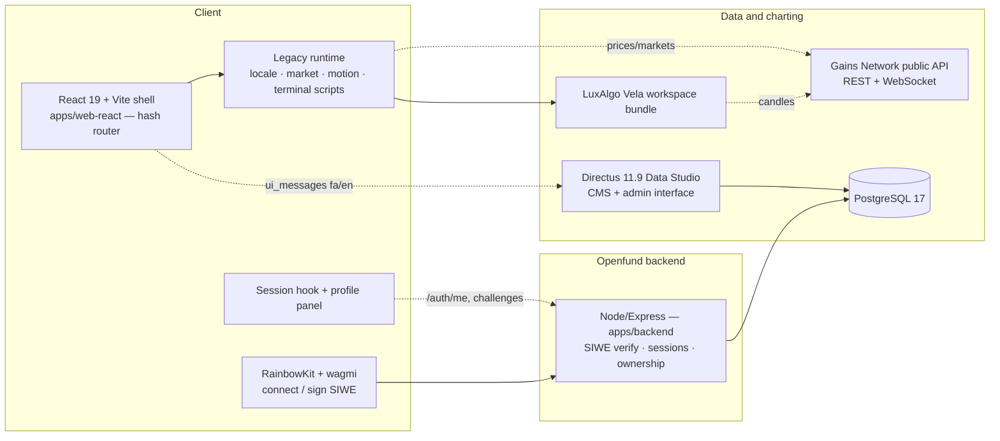
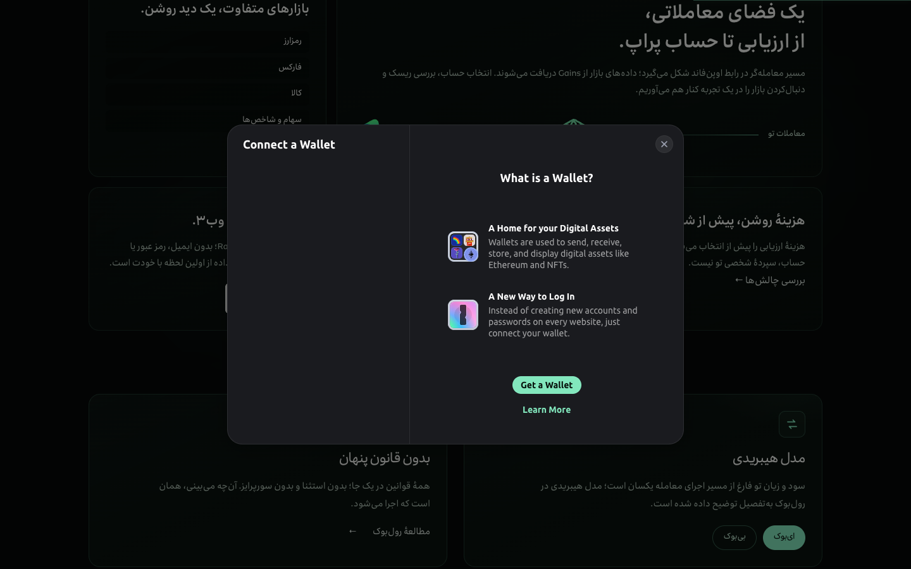
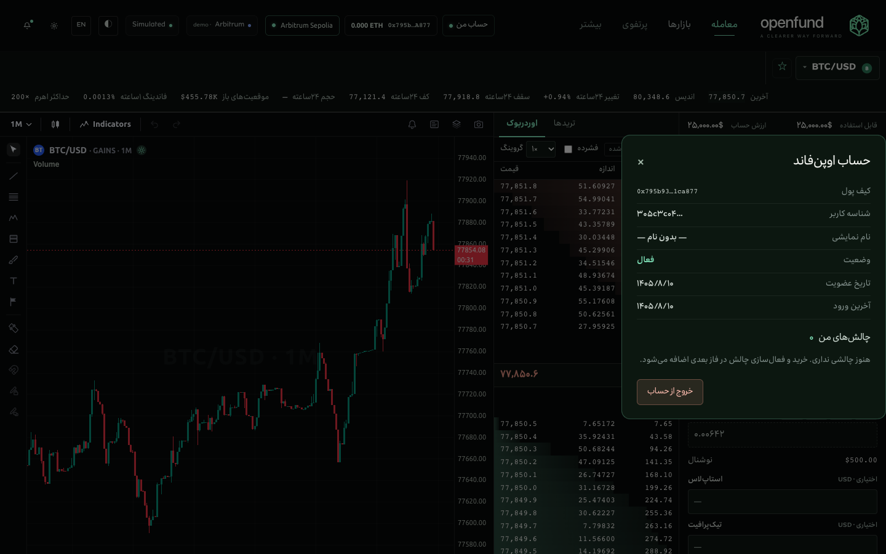

<div align="center">

<a href="https://github.com/algomanlife/openfund"></a>

# OPENFUND

### A transparent, decentralized prop-trading ecosystem — powered by wallet-based identity

**Bilingual (فارسی / English) prop-trading platform: landing + live trading terminal, LuxAlgo Vela charting, Gains Network market data, a Directus content backstage, and SIWE wallet authentication with multi-challenge accounts.**

[](https://github.com/algomanlife/openfund)


[Product](#product-overview) · [Wallet identity](#wallet-connectivity) · [Backstage](#directus-backstage-cms) · [Setup](#development-setup) · [Architecture](#platform-architecture) · [Security](#security-considerations) · [Roadmap](#roadmap)

</div>

---

## 1. Introduction

Openfund is an open, independently developed **prop-trading platform experience for Iranian traders**: skill evaluation → funded account with a profit split, presented with a Persian-first voice and a professional trading terminal. It is built in the open, on GitHub, with AI-assisted development workflows.

## 2. Vision & mission

Capital should follow skill, not connections. Openfund presents a transparent funding model — one-time evaluation fee, clear rules, up to 80/20 profit split, no hidden counterparty — where data ownership stays with the trader from the first wallet connection.

## 3. Product overview

- **Landing** — full bilingual marketing site (RTL fa / LTR en, dark + light themes, Irancell/Ubuntu fonts, motion) presenting the funding model, account builder, philosophy, rules and legal content.
- **Trading terminal** — professional workspace: real **LuxAlgo Vela** chart, live **Gains Network** market data (488 markets, REST + WebSocket), Gains-style market selector with real open-interest and funding stats, a clearly-labelled **simulated** demo trading engine on real marks, and Iranian trader Finglish labels (اوردربوک، لانگ، شورت، مارکت، لیمیت، فاندینگ، کولترال).
- **Wallet identity** — Sign-In with Ethereum (EIP-4361): one wallet = one Openfund user, owning multiple independent challenge accounts.
- **Demo trading** — every authenticated user gets a persistent 100,000 virtual-DAI account: open/close long & short positions on any of the 488 Gains markets with leverage, SL/TP, live PnL, liquidation monitoring, full trade history — simulated server-side, browser-open or not. See [`docs/architecture/DEMO_TRADING.md`](docs/architecture/DEMO_TRADING.md).
- **Portfolio** — native analytics page (`#/portfolio`) powered by the vendored **LuxAlgo journal-core** (MIT, `third_party/`): overview, performance metrics, equity/drawdown, PnL calendar, filterable history, trade details with ledger, private trade notes — over the user's own demo-account trades only.
- **Backstage** — Directus Data Studio manages all fa/en content and gives administrators user & challenge oversight.

## 4. Current development status

**Prototype with live data and real authentication.** Market data, charting, CMS, wallet connection and SIWE login are operational and verified (automated + live-edit tests). Trading itself is a clearly-labelled local simulation — no orders, no chain transactions, no fabricated results. On-chain evaluation and challenge purchasing are planned, not built. See [`docs/product/FEATURE_STATUS.md`](docs/product/FEATURE_STATUS.md) for the per-capability truth table.

## 5. Key features

| Feature | Status |
| :--- | :--- |
| Bilingual landing (fa/en, themes, fonts, motion) | Operational |
| Full Vela trading workspace (topbar, drawings, indicators, search) | Operational |
| Live Gains market data (488 markets, REST + WS ~90 upd/s) | Operational |
| Gains-style market selector (OI L/S, funding, CLOSED markets view-only) | Operational |
| Simulated demo trading engine on real marks | Operational (labelled) |
| RainbowKit wallet connection — Arbitrum Sepolia | Operational |
| **SIWE authentication + sessions + user records** | **Operational (verified)** |
| **100,000 DAI demo trading accounts (persistent)** | **Operational (verified)** |
| **Server trading engine — market/limit/stop, SL/TP, liquidation** | **Operational (verified)** |
| **Multiple challenge accounts per user** | **Operational (data layer + UI)** |
| Directus CMS — every landing/terminal string editable (fa/en, live) | Operational |
| **Portfolio (journal-core analytics, calendar, notes)** | **Operational (verified)** |
| Real order-book / volume / trade tape | Blocked — Gains API does not provide these (shown as `—` or labelled simulated) |
| Real trading (on-chain orders) | Planned — no contracts assumed |

## 6. Platform architecture



The React shell embeds the proven legacy runtime (phase-2a migration strategy — see [`docs/migration/MIGRATION_STATUS.md`](docs/migration/MIGRATION_STATUS.md)) and progressively extracts real React components. `apps/backend` is the only authentication and ownership boundary; Directus is the administrative data interface.

## 7. Technology stack

| Technology | Version | Role |
| :--- | :--- | :--- |
| React / React DOM | 19.3 | App shell, session UI |
| TypeScript | 5.7 | Type-safe app sources |
| Vite | 6.4 | Dev server + bundler |
| Node.js (backend) | 22 | `apps/backend` runtime |
| Express | 4.21 | Backend HTTP API |
| PostgreSQL | 17 | Users, challenges, sessions, nonces, audit, CMS |
| Directus | 11.9.1 | Headless CMS + admin interface |
| RainbowKit | 2.2.11 | Wallet connection UI (custom bilingual trigger) |
| wagmi / viem | 2.19 / 2.57 | Wallet hooks, SIWE verification (`viem/siwe`, EIP-1271) |
| LuxAlgo Vela | 0.9.3 | Trading workspace bundle (NOTICE attribution kept) |
| Gains Network | public API | Market data (no volume/order-book — by API design) |

Full registry with licenses and verified API constraints: [`docs/architecture/TECH_STACK.md`](docs/architecture/TECH_STACK.md).

## 8. Landing & Terminal previews

All screenshots are from the React app, captured by real-browser E2E — live Gains data in every shot. Full gallery in [`docs/images/`](docs/images/).

| Landing — فارسی (dark) | Terminal — فارسی (dark) |
| :---: | :---: |
| <a href="docs/images/react-landing-dark-fa.png"></a> | <a href="docs/images/react-terminal-dark-fa.png"></a> |

| Wallet sign-in (fa modal) | Profile & challenges |
| :---: | :---: |
| <a href="docs/images/wallet-modal-fa.png"></a> | <a href="docs/images/user-profile.png"></a> |

## 9. Wallet connectivity

RainbowKit (with wagmi + viem) provides the connection layer on **Arbitrum Sepolia (421614)**: injected wallets (MetaMask, Rabby, Taho…) work out of the box; the full remote wallet list requires a WalletConnect projectId (`VITE_WALLETCONNECT_PROJECT_ID`). The modal is translated to Persian and follows the app language. Connection alone is **never** treated as login — see the next section.

## 10. User identity architecture

**One Openfund user ↔ one primary wallet. One user → many independent challenges.**

1. User connects a wallet (RainbowKit).
2. Frontend requests a fresh, single-use nonce (10 min TTL) from the backend.
3. A EIP-4361 (SIWE) message is built and signed by the wallet.
4. The backend verifies signature (EOA + EIP-1271 contract wallets), domain, chain and nonce — then finds-or-creates the user by normalized (lowercase) wallet address (unique constraint = exactly one identity per wallet).
5. An HttpOnly, SameSite=Lax session cookie (opaque id, hashed at rest, 7-day server-side expiry) is issued.
6. Account switching or disconnecting invalidates the session; suspension blocks login and live sessions.

Details: [`docs/architecture/USER_IDENTITY.md`](docs/architecture/USER_IDENTITY.md) · [`docs/architecture/WALLET_AUTHENTICATION.md`](docs/architecture/WALLET_AUTHENTICATION.md).

## 11. Multi-challenge account architecture

```text
User (one wallet identity)
   ├── Challenge #1 — plan: standard, status: started
   ├── Challenge #2 — plan: starter,  status: created
   └── Challenge #N — independent lifecycle per record
```

`openfund_challenges` rows reference the user and a `challenge_plans` catalog entry (editorial metadata in Directus; risk math stays server-side — CMS config is never an authority over financial calculations). Ownership is enforced per request by the backend; a user only ever sees their own challenges. Challenge **purchase/activation is not implemented** — the UI keeps it clearly separate (empty state).

## 12. Directus backstage (CMS)

Directus is the official centralized backstage. All editable content — every landing/terminal string in fa/en, navigation, page SEO, site settings — is managed in the Data Studio with section grouping and friendly labels; editing a value renders live after refresh (verified on dev + build). Static files remain as a silent fallback if the backstage is unavailable.

The admin surface also covers: platform users (wallet, status, last login, challenge count), challenge records, the plan catalog and the audit log — **private to administrators**; the public policy has no permission on these collections.

Docs: [`docs/backstage/README.md`](docs/backstage/README.md) · [`docs/backstage/USER_MANAGEMENT.md`](docs/backstage/USER_MANAGEMENT.md) · [`docs/backstage/PERMISSIONS.md`](docs/backstage/PERMISSIONS.md).

## 13. Multilingual content management

489 `ui_messages` (298 landing + 186 terminal + new additions) with fa/en translations; both the Persian source text and the English translation are editable and render live. Language switching stays instant (dictionary-based, no reload); RTL/LTR layout rules are preserved (terminal workspace pinned LTR, header flips).

## 14. Gains Network integration

Public market-data API (`api.gains.trade/v1/arbitrum`): 488 markets, mark/index prices, candles 1m–1d (**1w not supported**), WebSocket with ping/pong heartbeat and seq-gap resubscribe. Per-market `maxLeverage` clamps the leverage control. **No volume / open-interest history / order-book / trade-tape exists in this API** — those fields show `—` or are labelled simulated. The on-chain SDK is vendored but intentionally unused.

## 15. Vela chart integration

Full LuxAlgo Vela workspace (topbar, timeframe/indicator pickers, drawing toolbar, symbol search, status line) mounted with `layout:false` and the Gains provider. Apache-2.0 NOTICE attribution is honoured with a visible "Charts by Vela" credit on the same screen.

## 16. Development setup

```bash
git clone https://github.com/algomanlife/openfund.git && cd openfund
npm install

# 1) PostgreSQL + Directus (content backstage)
brew install postgresql@17 && brew services start postgresql@17
psql -U $(whoami) -d postgres -c "CREATE USER openfund_cms PASSWORD 'openfund_local_dev';" -c "CREATE DATABASE openfund_cms OWNER openfund_cms;"
cd infrastructure/directus   # local .env (see .env.example; CORS on)
~/openfund-backstage/node_modules/.bin/directus bootstrap   # then: directus start :8055 (Node 22)
python3 apps/backstage/scripts/apply_schema.py && python3 apps/backstage/scripts/seed_content.py
python3 apps/backstage/scripts/tag_sections.py
python3 apps/backstage/scripts/register_user_tables.py

# 2) Backend (auth) — Node 22
cd apps/backend && npm install
node migrate.js && node seed-plans.js && node server.js    # :8080

# 3) React app
cd apps/web-react && npm install && npm run dev             # http://localhost:5173/react/#/

# classic pages (no build): python3 -m http.server 4173 → /dist/
```

Full walkthrough (including the no-Docker Directus pitfalls): [`docs/backstage/LOCAL_SETUP.md`](docs/backstage/LOCAL_SETUP.md).

## 17. Environment configuration

| Variable | Where | Purpose |
| :--- | :--- | :--- |
| `VITE_WALLETCONNECT_PROJECT_ID` | `apps/web-react/.env` | full remote wallet list (cloud.reown.com, free) |
| `VITE_DIRECTUS_URL` | `apps/web-react/.env` | CMS base URL (default `http://localhost:8055`) |
| `VITE_BACKEND_URL` | `apps/web-react/.env` | auth backend base URL (default `http://localhost:8080`) |
| `DATABASE_URL` | `apps/backend` | Postgres connection |
| `ALLOWED_DOMAINS`, `CORS_ORIGINS` | `apps/backend` | SIWE domain allow-list, CORS |
| `SESSION_TTL_HOURS`, `PORT` | `apps/backend` | session lifetime, listen port |
| Directus keys | `infrastructure/directus/.env` | see `.env.example` — never commit filled files |

## 18. Build & testing

```bash
cd apps/web-react && npm run build          # → repo-root react/ (served at :4173/react/)
cd apps/backend && node test/siwe.test.mjs  # 22 auth/session/ownership checks
node e2e/test-session.js                    # full-stack wallet→SIWE→profile E2E (11 checks)
node e2e/test.js                            # landing/terminal regression (18 checks)
```

Automated results on 2026-11-01: SIWE suite **22/22**, session E2E **11/11**, regression **18/18** (dev :5173 and build :4173). Honest-testing note: wallet flows are exercised with a real secp256k1 signer (programmatic account behind a mock EIP-1193 provider), not a browser extension.

## 19. Repository structure

```text
openfund/
├── apps/
│   ├── web-react/        # React 19 + Vite + TS app (landing + terminal + session UI)
│   ├── backend/          # Node/Express — SIWE auth, sessions, users, challenges
│   └── backstage/        # schema/seed/tag scripts for the Directus admin
├── dist/                 # classic (pre-React) pages — still live fallback
├── react/                # built React app (served by the static server)
├── packages/             # openfund-owned adapters (gains, charts, cms-client)
├── infrastructure/
│   └── directus/         # compose.yaml + .env.example (Postgres + Directus)
├── vendor/               # upstream sources (vela, gains-sdk) + license notices
├── brand/                # brandbook, marks, typography
└── docs/                 # product, architecture, backstage, migration, audits
```

## 20. Deployment architecture

Local development runs three processes (Directus+PG, backend, React). For deployment, `infrastructure/directus/compose.yaml` containerizes Directus + PostgreSQL; the backend is a standard Node service (`PORT`, `DATABASE_URL`, `NODE_ENV=production` → Secure cookies) served from the same origin as the app (session cookies are SameSite=Lax). The static React build deploys behind any static server. Production hardening (TLS, reverse proxy, secrets management, backups) is documented in [`docs/backstage/LOCAL_SETUP.md`](docs/backstage/LOCAL_SETUP.md) and tracked on the roadmap.

## 21. Security considerations

- SIWE verification: signature, domain, chain, nonce freshness/replay — all server-side; short-lived single-use nonces.
- Sessions: HttpOnly opaque cookies, hashed at rest, server-side expiry, invalidated on account switch.
- No privileged tokens in the frontend, ever; public Directus policy is read-only published content; identity tables are private to administrators.
- Rate limiting, input validation, audit logging, safe error responses on every auth route.
- Suspension blocks login and live sessions.
- Local dev credentials are gitignored; never commit filled `.env` files.

Details: [`docs/architecture/WALLET_AUTHENTICATION.md`](docs/architecture/WALLET_AUTHENTICATION.md).

## 22. Roadmap

- [x] Brand, bilingual landing, themes, motion
- [x] Vela workspace × live Gains data terminal
- [x] React 19 shell at parity + RainbowKit connection
- [x] Directus backstage — full fa/en content management
- [x] **SIWE wallet identity, users, sessions, multi-challenge records**
- [ ] Challenge purchase & activation flows (separate from identity)
- [ ] Evaluation engine + risk metrics (backend-owned)
- [ ] Media management, navigation-driven rendering, editorial roles in CMS
- [ ] Withdrawal requests, support records (backstage)
- [ ] Production deployment, licensing finalization

Detailed: [`docs/development/ROADMAP.md`](docs/development/ROADMAP.md).

## 23. Contributing

Work on scoped branches (`qwen/*`, `codex/*`, `feature/*`), keep docs in sync (`CHANGELOG`, `FEATURE_STATUS`, migration/audit status), include verification evidence in PRs, and merge to `main` only after human review. See [`AGENTS.md`](AGENTS.md) and [`CONTRIBUTING.md`](CONTRIBUTING.md).

## 24. License

Independent project, unaffiliated with LuxAlgo, Gains Network, Reown/RainbowKit, Arbitrum, Directus, OpenAI or Qwen. Third-party names and logos belong to their owners; vendored projects keep their licenses and notices (especially [`vendor/vela/NOTICE`](vendor/vela/NOTICE)). The repository-wide license for original Openfund code and brand assets has **not yet been finalized** — do not assume the assets are freely reusable.

## 25. Credits & acknowledgments

- **ChatGPT Work** — planning, architecture, documentation, review
- **QwenWork** — UI implementation, terminal/Vela×Gains engineering, backend, E2E verification
- Market data by [Gains Network](https://gains.trade) · Charts by [LuxAlgo Vela](https://github.com/LuxAlgo/Vela) · Wallet UX by [RainbowKit](https://rainbowkit.com) · CMS by [Directus](https://directus.io)
- Openfund documentation is maintained in **English**; Persian is supported as a product UI language

---

<div align="center"><sub>OPENFUND · سرمایه، در امتداد مهارت تو — capital, in line with your skill.</sub></div>
