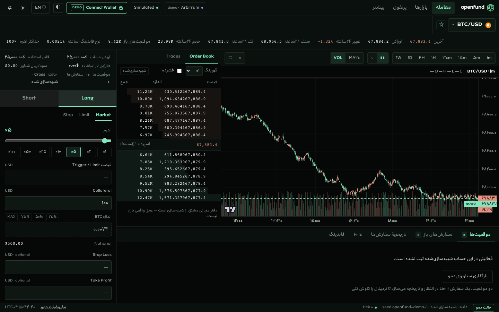

<div align="center">

<a href="https://github.com/algomanlife/openfund"></a>

# OPENFUND

### An open foundation for a unified trading experience

**A branded trading interface, modular charting architecture, and testnet-oriented integrations — built in the open.**

[](https://github.com/algomanlife/openfund)


[Overview](#overview) · [Preview](#product-preview) · [Architecture](#architecture) · [Development](#development-workflow) · [Documentation](#documentation)

</div>

---

## Overview

**Openfund** is an independent product and engineering project exploring a cohesive, brand-led trading experience. It brings together an existing web/terminal prototype, a shared design direction, and a structured foundation for future charting and network integrations.

> [!IMPORTANT]
> **Project stage: early prototype.** The terminal now renders a real **LuxAlgo Vela** chart with **live, verified Gains Network market data** (488 markets, REST + WebSocket) — see `dist/terminal.html`. Trading itself remains a clearly-labelled local simulation; no production or live-trading capability is claimed.

## Product preview

The following screenshots are maintained in this repository and illustrate the existing Openfund frontend. They are **not** evidence of completed Vela or Gains integration.

<table>
<tr><th>Openfund web experience</th><th>Openfund terminal prototype</th></tr>
<tr>
<td align="center"><a href="docs/images/openfund-platform.png"></a></td>
<td align="center"><a href="docs/images/openfund-terminal.png"></a></td>
</tr>
</table>

> For brand assets and the source brandbook archive, see [`brand/`](brand/). The screenshot files can be replaced as the UI evolves; keep captions aligned with the actual implementation.

## Platform foundations

| Area | Current state | Location |
| :--- | :--- | :--- |
| Landing and account UI | Existing frontend prototype | [`dist/index.html`](dist/index.html) |
| Trading terminal | Existing frontend prototype | [`dist/terminal.html`](dist/terminal.html) |
| Openfund visual identity | Logos, typography, imagery and brandbook archive | [`brand/`](brand/) |
| LuxAlgo Vela | npm package installed; upstream source vendored; **not integrated into UI** | [`vendor/vela/`](vendor/vela/) · [`packages/openfund-charts/`](packages/openfund-charts/) |
| Gains Network SDK | npm package installed; upstream source vendored; **not integrated into UI** | [`vendor/gains-sdk/`](vendor/gains-sdk/) · [`packages/openfund-gains-adapter/`](packages/openfund-gains-adapter/) |
| Agent collaboration | Shared instructions and GitHub workflow | [`AGENTS.md`](AGENTS.md) · [`.github/`](.github/) |

## Architecture

```text
openfund/
├── dist/                         # Existing web and terminal prototypes
├── src/                          # Existing frontend source
├── apps/
│   ├── web/                      # Future web application boundary
│   └── terminal/                 # Future terminal application boundary
├── packages/
│   ├── openfund-charts/          # Openfund-owned Vela integration boundary
│   ├── openfund-gains-adapter/   # Openfund-owned Gains integration boundary
│   └── openfund-ui/              # Future shared UI components
├── vendor/
│   ├── vela/                     # Upstream LuxAlgo Vela source
│   └── gains-sdk/                # Upstream Gains SDK source
├── brand/                        # Brandbook, marks, type and imagery
├── docs/                         # Product, architecture and integration specs
├── AGENTS.md                     # Shared agent instructions
└── README.md
```

**Separation of concerns:** `vendor/` preserves third-party upstream source and its license notices. `packages/` is where Openfund-specific adapters will be implemented. `dist/` contains the current frontend and must not be treated as disposable generated output.

Read [System Architecture](docs/architecture/ARCHITECTURE.md), [Vela Integration](docs/integrations/VELA.md), [Gains Integration](docs/integrations/GAINS.md), and [Upstream Management](docs/integrations/UPSTREAM.md).

## Technology and upstream projects

<table>
<tr>
<td align="center" width="50%"><a href="https://github.com/LuxAlgo/Vela"><strong>LuxAlgo Vela</strong></a><br/><sub>Charting source and SDK foundation</sub><br/><code>@luxalgo/vela 0.9.3</code></td>
<td align="center" width="50%"><a href="https://github.com/GainsNetwork-org/sdk"><strong>Gains Network SDK</strong></a><br/><sub>Integration SDK and upstream reference source</sub><br/><code>@gainsnetwork/sdk 1.8.10</code></td>
</tr>
</table>

Both upstream source trees are present in this repository. Their presence is **not** an endorsement, partnership, or completed integration. Keep the original licenses and notices intact, especially [`vendor/vela/NOTICE`](vendor/vela/NOTICE).

## Built with AI-assisted development

Openfund's development workflow is designed to coordinate human direction with multiple coding and research agents. These are **workflow tools**, not official Openfund partners or sponsors.

<div align="center">
<table>
<tr>
<td align="center" width="50%"><a href="https://chatgpt.com/"></a><br/><a href="https://chatgpt.com/"><strong>ChatGPT Work</strong></a><br/><sub>Planning, architecture, documentation and review</sub></td>
<td align="center" width="50%"><a href="https://qwenwork.ai/"></a><br/><a href="https://qwenwork.ai/"><strong>QwenWork</strong></a><br/><sub>UI implementation, iteration and development tasks</sub></td>
</tr>
</table>
</div>

**Collaboration model:** Each agent works on a scoped feature branch, records meaningful changes, updates the relevant documentation, and submits a Pull Request for review. See [`AGENTS.md`](AGENTS.md), [`CONTRIBUTING.md`](CONTRIBUTING.md), and [`CHANGELOG.md`](CHANGELOG.md). This section describes the intended workflow; it does not claim that every tool has already performed code changes.

## Getting started

**Requirements:** Git, Node.js/npm for package inspection, and Python 3 for the current static preview.

```bash
git clone https://github.com/algomanlife/openfund.git
cd openfund
npm install
python3 -m http.server 4173
```

- **Web preview:** http://127.0.0.1:4173/dist/
- **Terminal preview:** http://127.0.0.1:4173/dist/terminal.html

The static preview is for existing UI only. It does not automatically compile or mount the vendored Vela source or initialize Gains trading. Review `package.json` before assuming a build or test script exists.

## Development workflow

1. Read [`AGENTS.md`](AGENTS.md) and inspect the current branch and working tree.
2. Create a task-specific branch (`codex/*`, `qwen/*`, `docs/*`, or `feature/*`).
3. Keep upstream source modifications isolated and preserve licenses/attribution.
4. Update relevant specifications and [`docs/product/FEATURE_STATUS.md`](docs/product/FEATURE_STATUS.md).
5. Include verification results, known limitations, and screenshots where relevant in the Pull Request.
6. Merge to `main` only after review.

## Documentation

| Guide | Purpose |
| :--- | :--- |
| [Product vision](docs/product/VISION.md) | Product direction and scope |
| [Feature status](docs/product/FEATURE_STATUS.md) | Implemented vs prototype vs planned |
| [Architecture](docs/architecture/ARCHITECTURE.md) | Component boundaries and technical direction |
| [Vela integration](docs/integrations/VELA.md) | Charting integration plan |
| [Gains integration](docs/integrations/GAINS.md) | SDK, data and testnet integration plan |
| [Upstream sources](docs/integrations/UPSTREAM.md) | Origin, licensing and update process |
| [Design system](docs/design/DESIGN_SYSTEM.md) | Visual consistency |
| [Roadmap](docs/development/ROADMAP.md) | Delivery phases |
| [Security](docs/security/SECURITY.md) | Secure development rules |
| [Agent instructions](AGENTS.md) | Shared instructions for development agents |

## Roadmap

- [x] Establish the Openfund repository and existing UI prototypes
- [x] Add branding assets and initial engineering documentation
- [x] Import upstream Vela and Gains SDK source trees
- [x] Install `@luxalgo/vela` and `@gainsnetwork/sdk` npm dependencies
- [ ] Validate reproducible builds and component integration contracts
- [ ] Embed Vela charting in the Openfund terminal
- [ ] Implement and test Gains market-data adapters
- [ ] Validate supported testnet configuration and wallet lifecycle
- [ ] Build test coverage, CI, and deployment workflows

## Licensing, attribution and disclaimer

Openfund is an independent project, unaffiliated with LuxAlgo, Gains Network, OpenAI, Qwen, or Arbitrum. All third-party names and logos remain the property of their respective owners. Vendored projects retain their original license and notice files. The repository-wide license for original Openfund code and brand assets has not yet been finalized; do not assume those assets are freely reusable.

This repository is a development prototype, not a production trading platform or investment recommendation. Do not use real funds, production credentials, private keys, or sensitive user data in test environments.

---

<div align="center"><sub>OPENFUND · Built as a modular, reviewable foundation for future trading experiences.</sub></div>
