<div align="center">

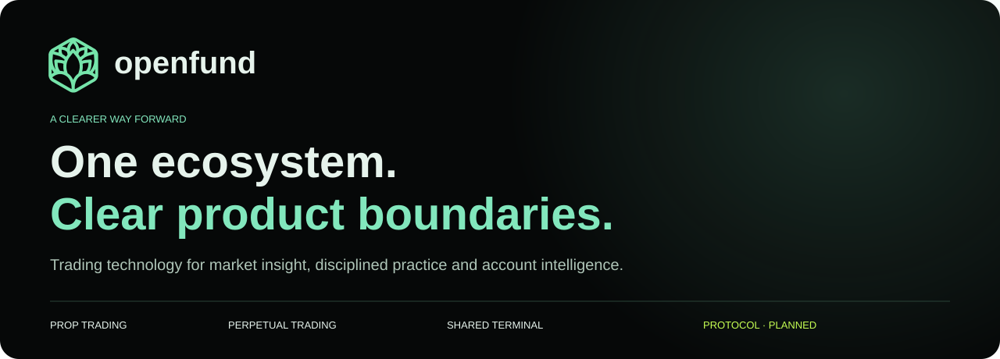

# Openfund

**A clearer way forward** — an open-development prop trading firm and trading technology platform.

[](https://github.com/algomanlife/openfund/releases/latest)
[](https://openfi.cloud/version)
[](https://github.com/algomanlife/openfund/actions/workflows/ci.yml)
[](https://github.com/algomanlife/openfund/actions/workflows/security.yml)
[](#regions)
[](#regions)


[**Website**](https://openfi.cloud) · [Iran site](https://openfi.live) · [Documentation](docs/README.md) · [Live status](docs/status/README.md) · [Roadmap](ROADMAP.md) · [Changelog](CHANGELOG.md) · [Security](SECURITY.md)

</div>

<a name="overview"></a>

##  Project overview

Openfund is an open-development prop trading firm and trading technology
platform: simulated trading evaluations, funded programs, trader rewards and
published financial transparency, built in a public repository so every rule
can be checked. Start with the [documentation index](docs/README.md).

<!-- stats -->

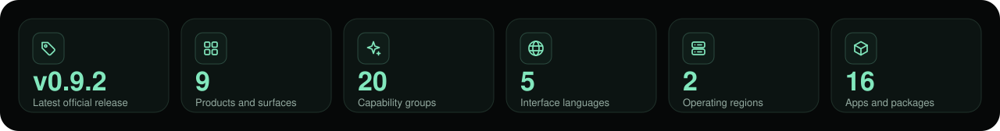

<!-- /stats -->

- **Prop trading evaluation.** Traders buy a challenge, trade a simulated
  account under published rules, and the server — never the browser —
  evaluates every rule from a frozen snapshot.
- **One professional terminal.** Prop and Perpetual share one workspace: Vela
  charts with Openfund Pine indicators, order panel with risk preview,
  positions, portfolio and a trade journal.
- **Read-only market intelligence.** Trade Radar, the Market Heatmap and Hybrid
  Footprint read public market data and never touch orders or accounts.
- **Transparency.** Rules, prices, the revenue model, partner commissions and
  governance limits are published; economic figures come only from
  operational records.

Openfund is early-stage. Nothing here claims revenue, user numbers, funding,
partnerships or regulatory approval.

**Jump to**

<!-- toc -->

<table>
<tr><td><a href="#overview">&nbsp;Project overview</a></td><td><a href="#ecosystem">&nbsp;Product ecosystem</a></td><td><a href="#features">&nbsp;Features</a></td></tr>
<tr><td><a href="#regions">&nbsp;Languages and regions</a></td><td><a href="#status">&nbsp;Feature status</a></td><td><a href="#gallery">&nbsp;Product gallery</a></td></tr>
<tr><td><a href="#business">&nbsp;Business model</a></td><td><a href="#architecture">&nbsp;Technical architecture</a></td><td><a href="#structure">&nbsp;Repository structure</a></td></tr>
<tr><td><a href="#stack">&nbsp;Technology stack</a></td><td><a href="#development">&nbsp;Development workflow</a></td><td><a href="#releases">&nbsp;Versioning and releases</a></td></tr>
<tr><td><a href="#roadmap">&nbsp;Roadmap</a></td><td><a href="#security">&nbsp;Security</a></td><td><a href="#docs">&nbsp;Documentation map</a></td></tr>
<tr><td><a href="#license">&nbsp;License</a></td><td><a href="#retired">&nbsp;Retired and no longer used</a></td><td><a href="#contributing">&nbsp;Contributing</a></td></tr>
</table>

<!-- /toc -->

<a name="ecosystem"></a>

##  Product ecosystem

Every product shares one wallet identity and one backend, while Prop and
Perpetual keep separate accounts, orders and financial records. Each card
links to the document that owns its detail; the full walk-through is the
[platform tour](docs/product/PLATFORM_TOUR.md).

<!-- products -->

<p align="center">
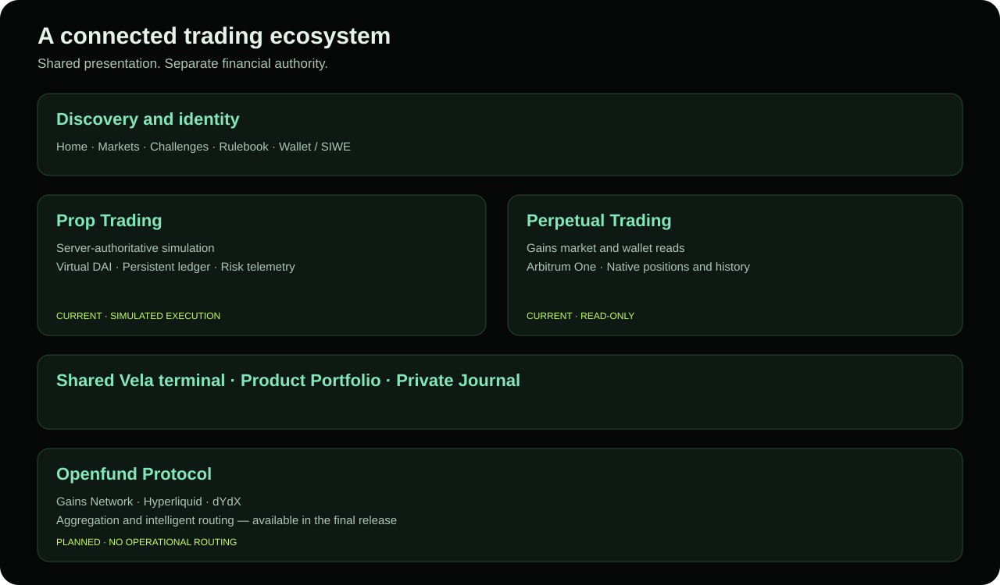
</p>

<p align="center">
<a href="https://openfi.cloud">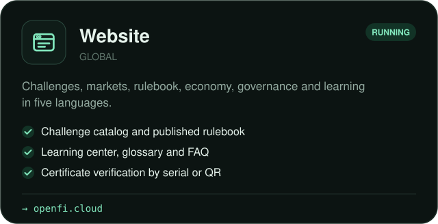</a>
<a href="docs/trading/TERMINAL.md">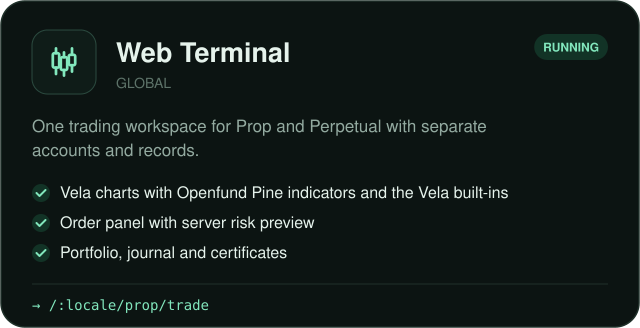</a>
<a href="docs/integrations/HYPERLIQUID_RADAR.md">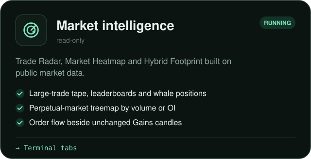</a>
<a href="docs/website/WEBSITE_EXPANSION.md">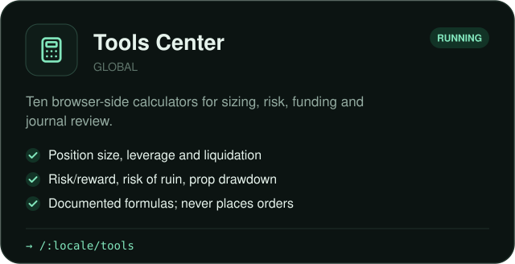</a>
<a href="apps/open-trade/README.md">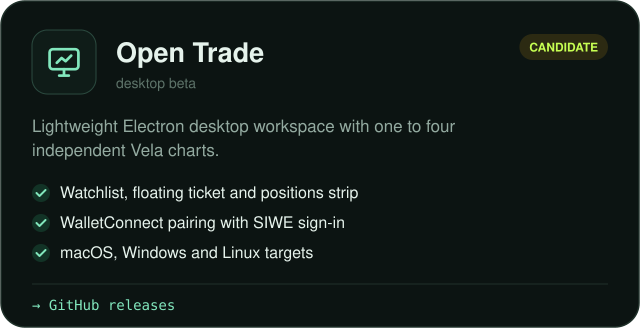</a>
<a href="docs/backstage/OPERATIONS_GUIDE.md">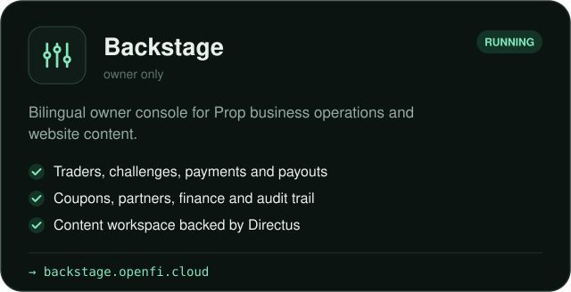</a>
<a href="docs/product/PLATFORM_TOUR.md">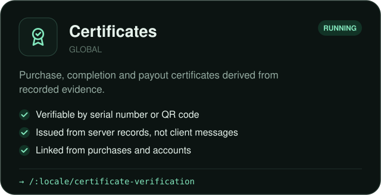</a>
<a href="packages/openfund-protocol/PROVENANCE.md">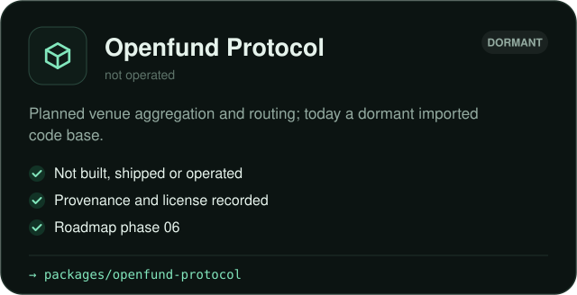</a>
</p>

<!-- /products -->

<a name="features"></a>

##  Features

What a trader, a learner and the owner can do today, grouped by area. The
complete capability list is in [capabilities](docs/product/CAPABILITIES.md) and
per-capability evidence is in the feature register below.

<!-- features -->

<table>
<tr><td width="50%" valign="top">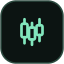&nbsp;<b><a href="docs/trading/TERMINAL.md">Trading workspace</a></b><ul><li>Dashboard, accounts, balances and challenge progress</li><li>Market, limit and stop orders with risk preview</li><li>Chart protection: SL/TP handles and P/L zones</li><li>Collateral, quantity and lot sizing conventions</li></ul></td><td width="50%" valign="top">&nbsp;<b><a href="docs/trading/JOURNAL_METRICS.md">Journal and analytics</a></b><ul><li>Daily journal, notebook, playbooks and missed trades</li><li>Net PnL, win rate, profit factor, drawdown</li><li>Edge Score v2 and calendar performance</li><li>Account-scoped notes with safe import</li></ul></td></tr>
<tr><td width="50%" valign="top">&nbsp;<b><a href="docs/trading/INDICATORS.md">Charts and Pine indicators</a></b><ul><li>Vela charts with the official Pine addon</li><li>Open Algo V5, Price Action Concepts, Smart Money Concepts</li><li>Original Pine sources run in a worker</li><li>Settings scoped by product and wallet</li></ul></td><td width="50%" valign="top">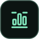&nbsp;<b><a href="docs/integrations/FOOTPRINT.md">Hybrid Footprint</a></b><ul><li>Bid/ask ladder and profiles</li><li>Volume and delta profiles, absolute delta</li><li>POC, value area and imbalances</li><li>Gains candles stay unchanged</li></ul></td></tr>
<tr><td width="50%" valign="top">&nbsp;<b><a href="docs/integrations/HYPERLIQUID_RADAR.md">Trade Radar</a></b><ul><li>Live large-trade tape from $10K to $1M</li><li>Leaderboards and long/short positioning</li><li>Whale positions and wallet profiles</li><li>Stale data is marked, never hidden</li></ul></td><td width="50%" valign="top">&nbsp;<b><a href="docs/integrations/HYPERLIQUID_RADAR.md">Market Heatmap</a></b><ul><li>Area by 24h volume or open interest</li><li>Color by 24h change or hourly funding</li><li>Drill-down, search and proportional +N tiles</li><li>Jump from a tile into the chart</li></ul></td></tr>
<tr><td width="50%" valign="top">&nbsp;<b><a href="docs/website/WEBSITE_EXPANSION.md">Tools Center</a></b><ul><li>Position size, leverage/margin, liquidation</li><li>Perp PnL, funding rate, risk/reward</li><li>Risk of ruin, prop drawdown, consistency rule</li><li>Journal analyzer in the browser</li></ul></td><td width="50%" valign="top">&nbsp;<b><a href="docs/website/WEBSITE_EXPANSION.md">Learning center</a></b><ul><li>Learning paths and lessons</li><li>Searchable glossary</li><li>FAQ hub, rulebook and whitepaper</li><li>Tools link to the matching lessons</li></ul></td></tr>
<tr><td width="50%" valign="top">&nbsp;<b><a href="docs/wallet/IDENTITY.md">Wallet identity</a></b><ul><li>Sign-In with Ethereum on Arbitrum One</li><li>Server-side HttpOnly sessions</li><li>Every record scoped to its owner</li><li>Product switch clears the previous view</li></ul></td><td width="50%" valign="top">&nbsp;<b><a href="docs/payments/ORDER_LIFECYCLE.md">Payments</a></b><ul><li>Pay with Wallet and manual transfer</li><li>On-chain verification of token, amount and finality</li><li>Ledger with partial payments and refunds</li><li>Exactly-once challenge activation</li></ul></td></tr>
<tr><td width="50%" valign="top">&nbsp;<b><a href="docs/decisions/0052-site-search.md">Site search</a></b><ul><li>Command palette with Ctrl/⌘+K and /, in five locales</li><li>Persian and Arabic normalization, typo tolerance and synonyms</li><li>Published content only, one index per region</li><li>Anonymous search analytics in Backstage</li></ul></td><td width="50%" valign="top">&nbsp;<b><a href="docs/decisions/0051-migration-to-openfund.md">Migration to Openfund</a></b><ul><li>Proof of payouts reviewed with KYC</li><li>Single-use pass: normal price, funded-stage start</li><li>Private, encrypted evidence storage with retention</li><li>Editable firm list and rules</li></ul></td></tr>
<tr><td width="50%" valign="top">&nbsp;<b><a href="docs/decisions/0050-openfund-premium-league.md">Openfund Premium League</a></b><ul><li>30-day demo competition with daily, maximum-loss and consistency rules</li><li>Email-verified registration, one entry per wallet</li><li>Frozen standings, owner-gated awards and review signals</li><li>Original prize artwork and rank badges</li></ul></td><td width="50%" valign="top">&nbsp;<b><a href="docs/backstage/OPERATIONS_GUIDE.md">Backstage operations</a></b><ul><li>Final-pass review and suspension decisions</li><li>Payment investigation, coupons, payouts</li><li>Partners, finance, risk board and audit</li><li>Owner re-authentication for privileged actions</li></ul></td></tr>
<tr><td width="50%" valign="top">&nbsp;<b><a href="docs/backstage/UNIVERSAL_VISUAL_EDITING.md">Editorial CMS</a></b><ul><li>Directus owns public editorial copy</li><li>Visual editing mapped to collection and field</li><li>Draft previews stay inside the editor</li><li>Financial collections are never editable</li></ul></td></tr>
</table>

<!-- /features -->

<a name="regions"></a>

##  Languages and regions

One reviewed source serves two independently operated regions in five
interface languages. Every page lives under an explicit locale path
(`/fa/home`, `/zh-CN/markets`, …) with `hreflang` alternates. The country
signal never decides authorization, payments or account access
([ADR 0043](docs/decisions/0043-canonical-domains-geo-routing-and-locale.md)).

<!-- regions -->

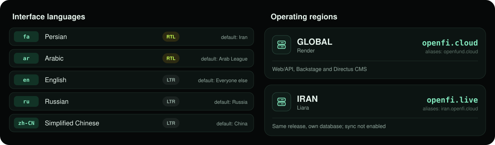

**Which language a visitor sees**

1. A locale in the URL always wins.
2. Otherwise the language the visitor picked in the menu.
3. Otherwise a first-visit default from the visitor's verified country.
4. Otherwise English. Choosing a language never changes the region.

<!-- /regions -->

<a name="status"></a>

##  Feature status

Runtime state per region is generated from
[docs/status/status.json](docs/status/status.json); the
[feature register](docs/product/FEATURE_STATUS.md) holds per-capability
evidence. A merge is not production until `/version` reports it.

<!-- status:summary -->

**Current status** (verified 2026-11-21; canonical: [docs/status](docs/status/README.md)):

- Latest official release: **v0.8.0** (`0320cf7`, 2026-11-20).
- GLOBAL (Render) Web/API runs v0.8.0 `0320cf7`; IRAN (Liara) web runs v0.6.5 `a87804a` (built as unofficial).
- Purchases: enabled in GLOBAL, disabled in IRAN; owner purchase acceptance open (see the purchases row in docs/status).
- Live execution: disabled (Approved signer/custody design, supported testnet contracts, simulation, security review and management activation).
- Desktop: Open Trade 0.0.4 published as the GitHub pre-release open-trade-v0.0.4 (unsigned experimental beta): macOS arm64 and x64 .dmg, Windows x64 .exe, Linux x64 AppImage and .deb from Open Trade desktop run 44895436607 on main 935d06f. All five files downloaded on 2026-11-21; each SHA-256 recomputed and matched GitHub's asset digest, sizes match. The attached SHA256SUMS.txt lists only the Windows installer. Not signed or notarized; not executed on a clean machine in this verification.

<!-- /status:summary -->

Full per-region table: [docs/status](docs/status/README.md).

<a name="gallery"></a>

##  Product gallery

Genuine captures of the website, terminal, market intelligence, Backstage,
desktop and mobile layouts. Every image has recorded provenance.

<!-- gallery -->

| Website — Persian (Dastkhat) | Website — Arabic (Dastkhat Arabic) |
| --- | --- |
| 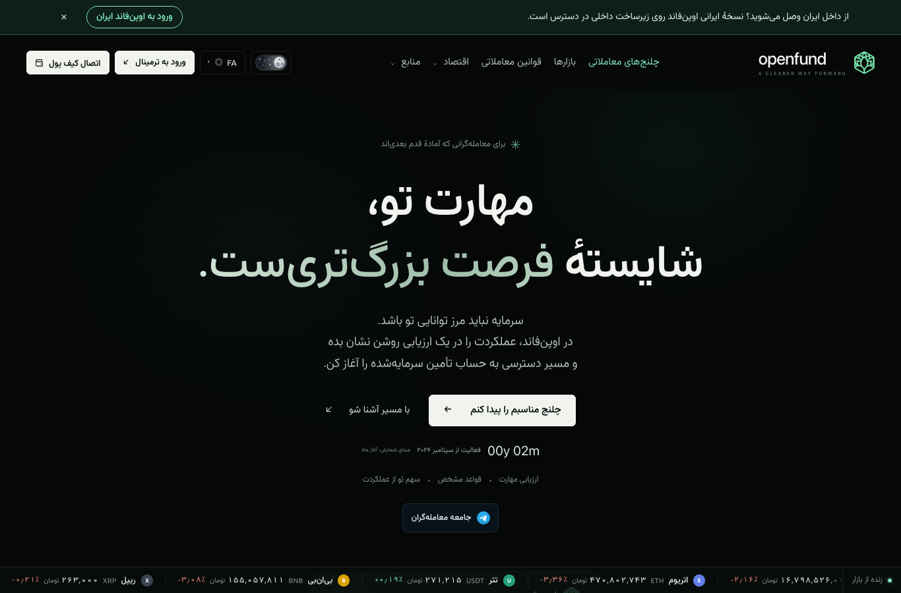 | 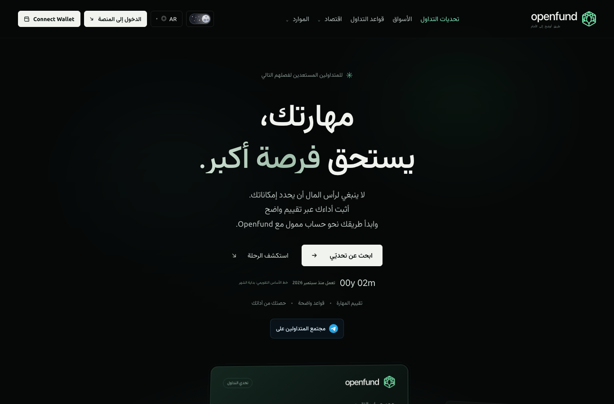 |

| Web Terminal — English | Web Terminal — Persian |
| --- | --- |
| 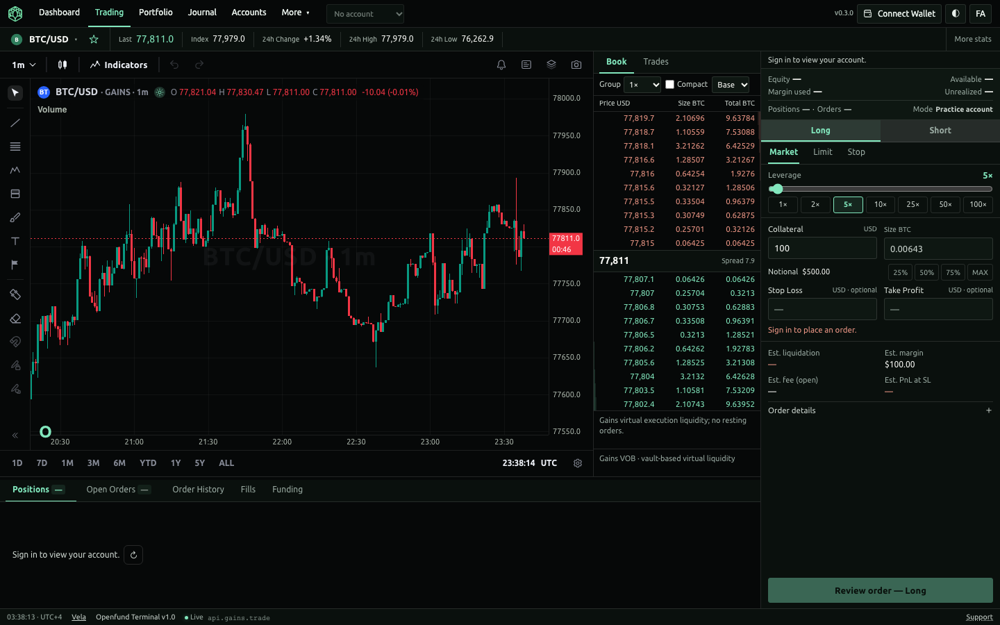 |  |

| Market intelligence — Market Heatmap | Market intelligence — Trade Radar |
| --- | --- |
|  |  |

| Backstage — English overview | Backstage — Persian sign-in |
| --- | --- |
| 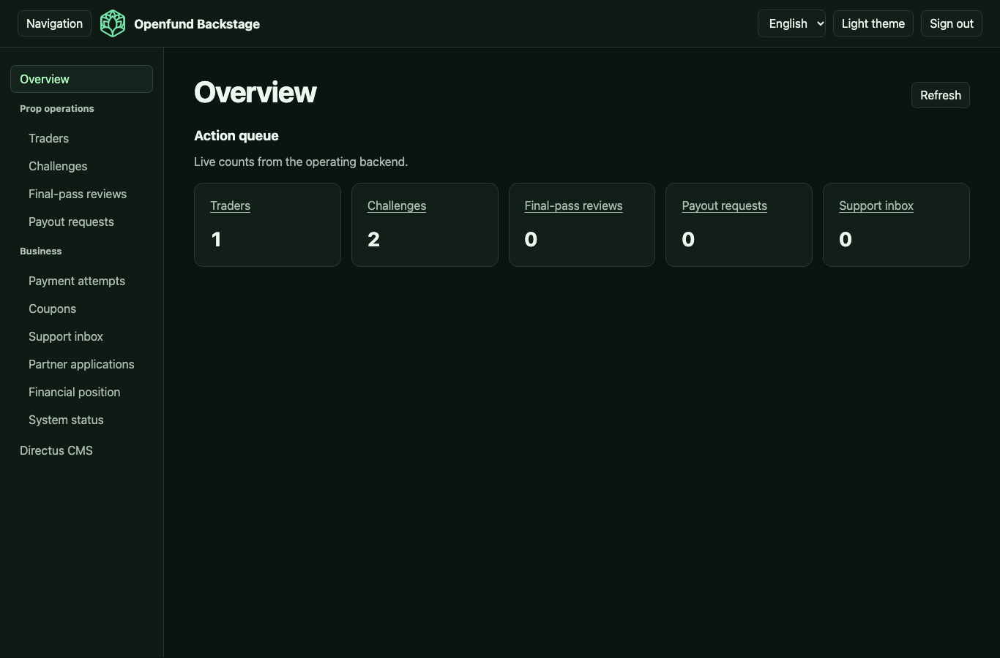 |  |

| Desktop and order flow — Open Trade — four charts | Desktop and order flow — Hybrid Footprint |
| --- | --- |
|  | 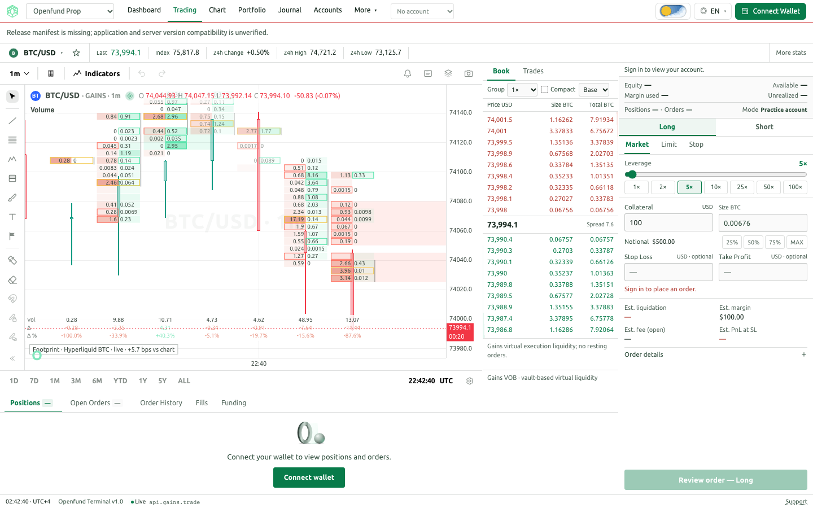 |

| Mobile — Persian terminal | Mobile — English navigation |
| --- | --- |
| 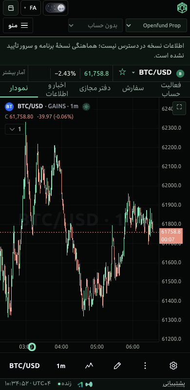 | 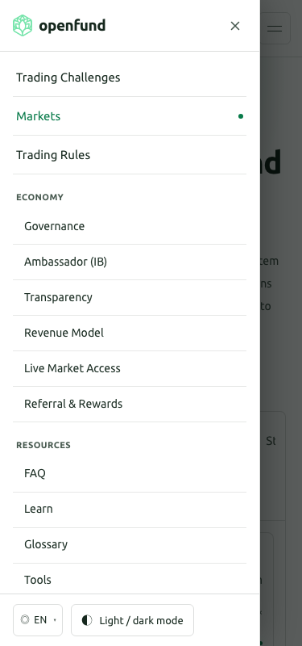 |

Curated from [docs/assets/gallery/gallery.json](docs/assets/gallery/gallery.json); provenance per image in the
[screenshot manifest](docs/assets/screenshots/manifest.json); older capture sets are [archived](docs/reviews/_archive/readme-galleries/README.md).

<!-- /gallery -->

<a name="business"></a>

##  Business model

Openfund sells one-time evaluation fees for simulated challenge accounts.
Prices come from the CMS plan catalog and the server prices every order;
current fees are published in the [plan catalog](https://openfi.cloud/purchases/plans).
A paid order activates exactly one challenge account after on-chain
verification of token, receiver, sender, amount and finality.

<!-- business -->

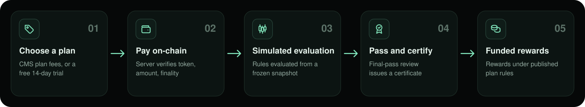

| Revenue | Costs |
| --- | --- |
| One-time evaluation fees for simulated challenge accounts | Trader rewards under published plan rules |
|  | Ambassador commissions |
|  | Coach compensation once live trading exists |
|  | Refunds and infrastructure |

<!-- /business -->

Treasury and funded-reward policies are versioned, and frozen terms are never
silently rewritten. No revenue, profitability or growth figures have been
published. The approved model is [ECONOMY.md](ECONOMY.md); pricing tables,
lifecycles, reward splits, treasury allocation and partner programs are in
[business model in detail](docs/economy/BUSINESS_DETAIL.md) and the
[business overview](docs/economy/BUSINESS_MODEL.md).

<a name="architecture"></a>

##  Technical architecture

One reviewed source serves two independently operated regions; each runs the
API and web app from one origin so session cookies stay first-party.

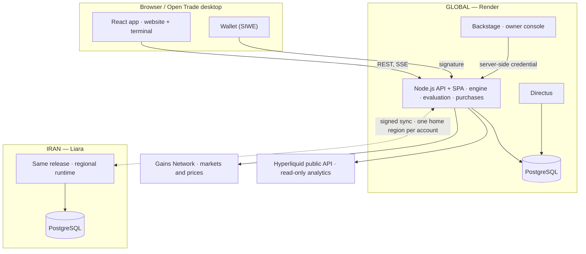

| Principle | What it means |
| --- | --- |
| Server authority | Orders, positions, PnL, evaluation and payments are decided only by the backend |
| Read-only analytics | Radar, Heatmap and Footprint cannot mutate accounts, trading or payments |
| Content isolation | Directus never writes financial tables |
| One origin per region | API and SPA share an origin; cookies stay first-party |

Details: [architecture](docs/architecture/ARCHITECTURE.md) ·
[infrastructure, test map and security controls](docs/architecture/PLATFORM_REFERENCE.md) ·
[flows](docs/architecture/FLOWS.md).

<a name="structure"></a>

##  Repository structure

A map of every application, package and top-level directory. CI fails when a
directory is added or removed without updating this map. Engineering detail
for each part is in the [engineering reference](docs/development/ENGINEERING_REFERENCE.md).

<!-- structure -->

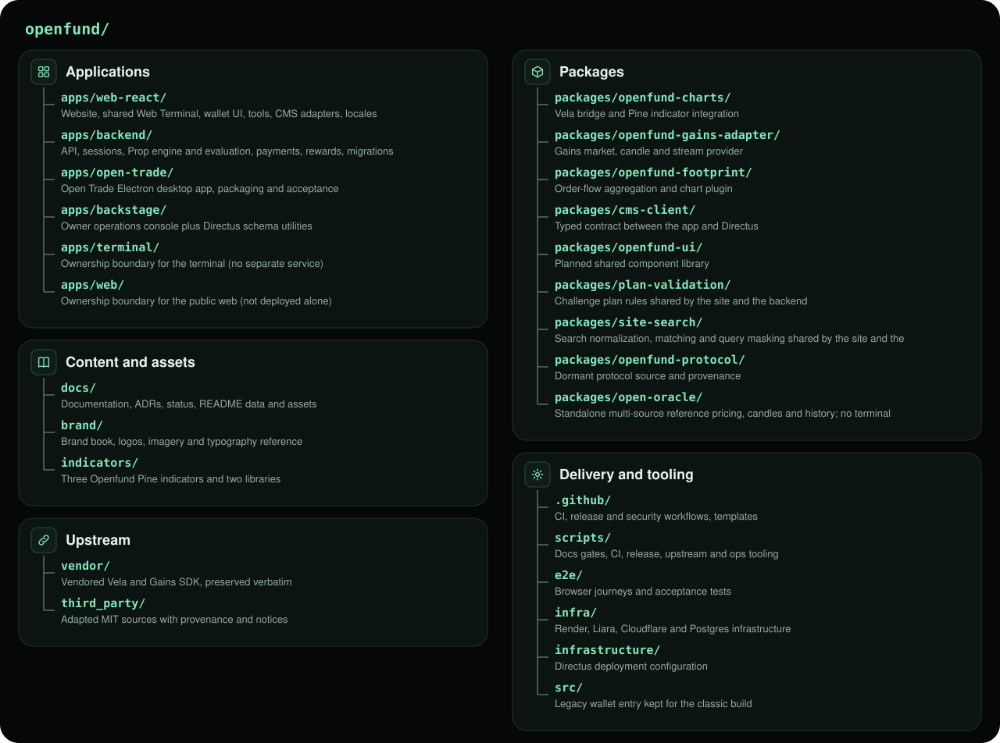

<details>
<summary>Repository map as a table</summary>

| | Path | Responsibility |
| --- | --- | --- |
|  | `apps/web-react/` | Website, shared Web Terminal, wallet UI, tools, CMS adapters, locales |
|  | `apps/backend/` | API, sessions, Prop engine and evaluation, payments, rewards, migrations |
|  | `apps/open-trade/` | Open Trade Electron desktop app, packaging and acceptance |
|  | `apps/backstage/` | Owner operations console plus Directus schema utilities |
|  | `apps/terminal/` | Ownership boundary for the terminal (no separate service) |
|  | `apps/web/` | Ownership boundary for the public web (not deployed alone) |
|  | `packages/openfund-charts/` | Vela bridge and Pine indicator integration |
|  | `packages/openfund-gains-adapter/` | Gains market, candle and stream provider |
|  | `packages/openfund-footprint/` | Order-flow aggregation and chart plugin |
|  | `packages/cms-client/` | Typed contract between the app and Directus |
|  | `packages/openfund-ui/` | Planned shared component library |
|  | `packages/plan-validation/` | Challenge plan rules shared by the site and the backend |
|  | `packages/site-search/` | Search normalization, matching and query masking shared by the site and the backend |
|  | `packages/openfund-protocol/` | Dormant protocol source and provenance |
|  | `docs/` | Documentation, ADRs, status, README data and assets |
|  | `brand/` | Brand book, logos, imagery and typography reference |
|  | `indicators/` | Three Openfund Pine indicators and two libraries |
|  | `dist/` | Tracked source-critical compatibility assets |
|  | `.github/` | CI, release and security workflows, templates |
|  | `scripts/` | Docs gates, CI, release, upstream and ops tooling |
|  | `e2e/` | Browser journeys and acceptance tests |
|  | `infra/` | Render, Liara, Cloudflare and Postgres infrastructure |
|  | `infrastructure/` | Directus deployment configuration |
|  | `src/` | Legacy wallet entry kept for the classic build |
|  | `vendor/` | Vendored Vela and Gains SDK, preserved verbatim |
|  | `third_party/` | Adapted MIT sources with provenance and notices |

</details>

<!-- /structure -->

<a name="stack"></a>

##  Technology stack

Typography uses exactly two faces: **Ubuntu** (general/Latin) and
**Dastkhat** (the only Persian/Arabic face), self-hosted with one shared
`@font-face` file. Pinned versions are in the lockfiles and the
[tech stack](docs/architecture/TECH_STACK.md); the typography policy and
tokens are in the [design system](docs/design/DESIGN_SYSTEM.md#typography-and-font-tokens).

<!-- stack -->

<p align="center">
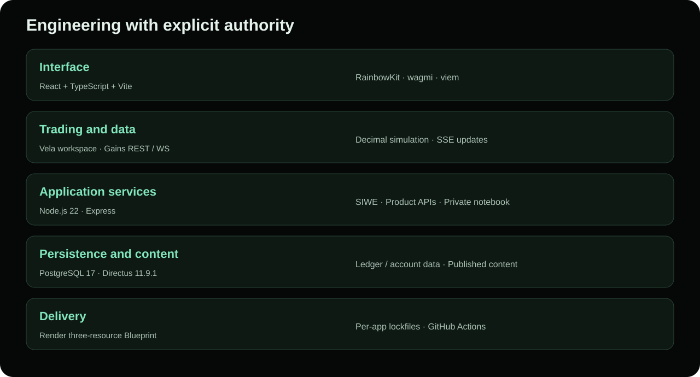
</p>

| Layer | Technology |
| --- | --- |
| **Web** |     |
| **Wallet** |     |
| **Charts and data** |      |
| **Backend** |      |
| **Data** |   |
| **Desktop** |   |
| **Delivery** |     |
| **Typography** |   |

Versions are read from the package manifests when the README is generated.

<!-- /stack -->

<a name="development"></a>

##  Development workflow

Requires Node.js 26 and a local PostgreSQL.

```bash
npm ci && npm ci --include=dev --prefix apps/web-react && npm ci --prefix apps/backend
createdb openfund_dev && export DATABASE_URL=postgresql://localhost:5432/openfund_dev
npm run migrate --prefix apps/backend && npm run seed-plans --prefix apps/backend
npm run build:web && PORT=8180 npm run dev:backend   # http://localhost:8180
```

| Command | What it checks |
| --- | --- |
| `npm run typecheck` | TypeScript across the web app |
| `npm run test:web` | Web unit and component tests |
| `npm run docs:check` | README contract, status, retired registry, fonts, language, links, Markdown and Mermaid |
| `npm run docs:write` | Regenerates README headings, blocks and graphics from `docs/readme/*.json` |

Backend suites need a disposable database. Guides:
[testing](docs/development/TESTING.md) ·
[local development](docs/development/LOCAL_DEVELOPMENT.md) ·
[engineering reference](docs/development/ENGINEERING_REFERENCE.md).

<a name="releases"></a>

##  Versioning and releases

The current official platform release is **v0.8.0**; **v0.9.0** (typography
consolidation, retired-file removal and repository restructure) is prepared
for the owner to publish through the release workflow.
Tags are `vMAJOR.MINOR.PATCH`, allocated from Conventional Commits; Open Trade
has its own `open-trade-vX.Y.Z` line. `/version` returns the deployed version,
commit and whether the build is official; merging deploys nothing.

[Release runbook](docs/deployment/RELEASES.md) ·
[Changelog](CHANGELOG.md) ·
[All releases](https://github.com/algomanlife/openfund/releases)

<a name="roadmap"></a>

##  Roadmap

The roadmap is organized as seven phases. A phase advances only on evidence:
deployment needs deployed proof, commercial services need verified product and
legal facts, and protocol routing needs validated execution paths. Phase
summary: [ROADMAP.md](ROADMAP.md); milestones and acceptance gates:
[milestones](docs/roadmap/MILESTONES.md).

<!-- roadmap -->

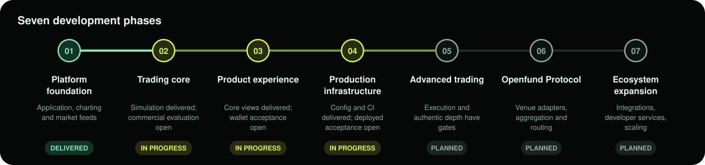

| Phase | State | Scope |
| --- | --- | --- |
| 01 Platform foundation | delivered | Application, charting and market feeds |
| 02 Trading core | in progress | Simulation delivered; commercial evaluation open |
| 03 Product experience | in progress | Core views delivered; wallet acceptance open |
| 04 Production infrastructure | in progress | Config and CI delivered; deployed acceptance open |
| 05 Advanced trading | planned | Execution and authentic depth have gates |
| 06 Openfund Protocol | planned | Venue adapters, aggregation and routing |
| 07 Ecosystem expansion | planned | Integrations, developer services, scaling |

<!-- /roadmap -->

<a name="security"></a>

##  Security

| Control | Implementation |
| --- | --- |
| Identity | Sign-In with Ethereum on Arbitrum One |
| Sessions | Server-side, HttpOnly cookies |
| Authorization | Every record scoped to its owner on the server |
| Payments | The chain verifier decides; the browser never does |
| Browser | Strict Content Security Policy |
| Scanning | Semgrep, Trivy, OSV-Scanner, OWASP ZAP baseline, gitleaks and dependency review in CI |

The November 2026 [self-assessment](docs/security/SECURITY-AUDIT-2026-11.md) was
written by the project's coding agent and is not an independent audit; open
findings and their states are in the
[remediation report](docs/security/SECURITY-REMEDIATION-2026-11.md).
Report vulnerabilities privately through [SECURITY.md](SECURITY.md).

<a name="docs"></a>

##  Documentation map

Every area of the [documentation index](docs/README.md), generated from it so
new documents appear here automatically.

<!-- docs-map -->

| | Area | Start with |
| --- | --- | --- |
|  | [Product and Business](docs/README.md#product-and-business) | [Platform tour](docs/product/PLATFORM_TOUR.md) · [Overview](docs/product/OVERVIEW.md) · [Vision](docs/product/VISION.md) · +5 more |
|  | [Architecture](docs/README.md#architecture) | [System](docs/architecture/ARCHITECTURE.md) · [Platform reference: infrastructure, repository map, tests, security controls](docs/architecture/PLATFORM_REFERENCE.md) · [Flows](docs/architecture/FLOWS.md) · +4 more |
|  | [Website](docs/README.md#website) | [Content architecture and ownership](docs/website/CONTENT_ARCHITECTURE.md) · [Product rules and launch blockers](docs/product/PRODUCT_RULES.md) · [Website expansion spec](docs/website/WEBSITE_EXPANSION.md) · +4 more |
|  | [Trading](docs/README.md#trading) | [Unified accounts and Free Trial](docs/trading/UNIFIED_ACCOUNTS.md) · [Journal metrics](docs/trading/JOURNAL_METRICS.md) · [Prop Trading](docs/trading/PROP.md) · +7 more |
|  | [Governance and Economy](docs/README.md#governance-and-economy) | [GOVERNANCE.md](GOVERNANCE.md) · [ECONOMY.md](ECONOMY.md) · [Operating governance: decisions, approvals and access](docs/governance/OPERATING_GOVERNANCE.md) · +4 more |
|  | [Wallet and Identity](docs/README.md#wallet-and-identity) | [Wallet, networks and sessions](docs/wallet/IDENTITY.md) · [Authentication technical reference](docs/architecture/WALLET_AUTHENTICATION.md) |
|  | [Economy and partner programs](docs/README.md#economy-and-partner-programs) | [Economy overview](docs/economy/README.md) · [Business model and operations overview](docs/economy/BUSINESS_MODEL.md) · [Business model in detail](docs/economy/BUSINESS_DETAIL.md) · +4 more |
|  | [Payments](docs/README.md#payments) | [Payment verification and recovery](docs/payments/VERIFICATION.md) · [Payment activation checklist](docs/payments/ACTIVATION.md) · [SIWE and DePay domain check](docs/payments/DOMAIN_READINESS.md) · +7 more |
|  | [Protocol (dormant)](docs/README.md#protocol-dormant) | [Overview](docs/protocol/OVERVIEW.md) · [Architecture](docs/protocol/ARCHITECTURE.md) · [Development](docs/protocol/DEVELOPMENT.md) · +1 more |
|  | [Integrations](docs/README.md#integrations) | [Gains VOB and Trades](docs/integrations/GAINS_DEPTH.md) · [Trade Radar and Heatmap](docs/integrations/HYPERLIQUID_RADAR.md) · [Gains Network](docs/integrations/GAINS.md) · +19 more |
|  | [Deployment](docs/README.md#deployment) | [Unified releases](docs/deployment/RELEASES.md) · [Release and deployment checklists](docs/deployment/CHECKLISTS.md) · [Operations and monitoring](docs/operations/README.md) · +7 more |
|  | [Development](docs/README.md#development) | [Local setup](docs/development/LOCAL_DEVELOPMENT.md) · [Developer portal source](docs/developer-portal/README.md) · [Testing and CI](docs/development/TESTING.md) · +11 more |
|  | [Security](docs/README.md#security) | [Reporting policy](SECURITY.md) · [Architecture and release gates](docs/security/SECURITY.md) · [November 2026 assessment](docs/security/SECURITY-AUDIT-2026-11.md) · +3 more |
|  | [Legal](docs/README.md#legal) | [Licensing audit and compatibility report](docs/legal/LICENSING.md) · [Production dependency licenses](docs/legal/DEPENDENCY_LICENSES.md) · [PineTS (AGPL) report](docs/legal/PINETS.md) · +1 more |
|  | [Roadmap](docs/README.md#roadmap) | [Seven-phase overview](ROADMAP.md) · [Product](docs/roadmap/PRODUCT.md) · [Engineering](docs/roadmap/ENGINEERING.md) · +2 more |
|  | [Architecture Decisions](docs/README.md#architecture-decisions) | [ADR index](docs/decisions/README.md) · [Purchases, invoices and withdrawal requests](docs/decisions/0009-challenge-purchases-and-payment-verification.md) · [Gateway routing](docs/decisions/0001-product-gateway-routing.md) · +3 more |
|  | [Brand, evidence and historical material](docs/README.md#brand-evidence-and-historical-material) | [Brand assets](docs/assets/brand/README.md) · [Screenshot gallery and provenance](docs/assets/screenshots/README.md) · [Asset inventory](docs/assets/README.md) · +4 more |
|  | [Historical records](docs/README.md#historical-records) | [reviews and audit index](docs/reviews/README.md) · [archive](docs/reviews/_archive/README.md) · [2026-11-03 website audit](docs/reviews/website-refresh/AUDIT.md) |

<!-- /docs-map -->

<a name="license"></a>

##  License

No first-party license has been chosen: Openfund's own code is all rights
reserved, and the repository being public grants no reuse license. The owner's
options and remaining blockers are in the
[license decision](docs/legal/LICENSE_DECISION.md) and the
[licensing report](docs/legal/LICENSING.md). Third-party components keep their
own terms:

<!-- license:summary -->

| Component | License |
| --- | --- |
| Vela charting library | Apache-2.0 + NOTICE |
| Vela Pine addon | AGPL-3.0-only |
| PineTS | AGPL-3.0-only |
| MetaMask SDK | ConsenSys proprietary license |
| LuxAlgo trade journal and journal-core | MIT |
| Trade Radar logic adapted from drkxbt/whales | MIT |
| Heatmap treemap layout adapted from drkxbt/charts | MIT |
| Gains Network SDK | MIT |
| DePay Payment Widget | MIT |
| Openfund Protocol | GPL-2.0 |
| Dastkhat, Dastkhat Arabic and Dastkhat FaNum fonts | SIL Open Font License 1.1 |
| Ubuntu font | Ubuntu Font Licence 1.0 |
| Simple Icons | CC0-1.0 |
| TradingView logo | Brand-owner terms |
| Interactive day/night toggle design | MIT |
| Public service brand assets | Brand-owner terms |
| npm packages | Per package |
| Directus | BSL 1.1 for the pinned 11.17.4 image |

Generated from [THIRD_PARTY_NOTICES.md](THIRD_PARTY_NOTICES.md), the authoritative list with license texts.

<!-- /license:summary -->

<a name="retired"></a>

##  Retired and no longer used

<!-- retired:summary -->

| Item | Status | Replacement |
| --- | --- | --- |
| Irancell font files (`irancell-*.ttf`) and their byte-identical copies `openfund-1.ttf`–`openfund-5.ttf` | retired | Dastkhat v1.210 — [typography policy](docs/design/DESIGN_SYSTEM.md#typography-and-font-tokens) |
| Renamed Irancell derivatives "Openfund Persian" (`openfund-persian-*-v4.woff2`), Backstage `/persian.woff2`, certificate face `OpenfundCertificateFa` | retired | Dastkhat v1.210 (`/assets/fonts/dastkhat/`); certificate face `Dastkhat Certificate` |
| Standalone Vazirmatn copies (`Vazirmatn.ttf`, `Vazirmatn-LICENSE.txt`, Google Fonts `family=Vazirmatn`, `typeface="Vazirmatn"`) | retired | Dastkhat v1.210, which is based on Vazirmatn (SIL OFL 1.1) and credits it |
| Superseded platform releases v0.6.5 and v0.7.0 as the README's current release | retired | The latest official release recorded in [docs/status/status.json](docs/status/status.json) |
| Dated README galleries ("Recent … captures — YYYY-MM-DD", "Full product gallery — recorded v0.6.5", the v0.4.4 capture set in `docs/assets/screenshots/readme/`) | retired | One curated gallery generated from [docs/assets/gallery/gallery.json](docs/assets/gallery/gallery.json); the old sets are in [docs/reviews/_archive/readme-galleries/](docs/reviews/_archive/readme-galleries/README.md) |
| Superseded release review snapshots (`docs/reviews/v0.4.1`, `v0.6.5`, `release-0.6.5`, `release-0.6.6`) | retired | Kept as history under [docs/reviews/_archive/](docs/reviews/_archive/README.md); current state lives in [docs/status](docs/status/README.md) |
| Vanilla JS/CSS legacy layer (`apps/web-react/public/legacy/`) and the tracked `dist/` snapshot | legacy-only pending removal | React application (`apps/web-react/src/`); `dist/` stays source-critical until AGENTS.md says otherwise |
| Openfund Protocol (dormant import of mux-protocol, `packages/openfund-protocol/`) | dormant | None — not retired; not built, shipped or operated ([provenance](packages/openfund-protocol/PROVENANCE.md)) |

Generated from [docs/development/RETIRED.json](docs/development/RETIRED.json); details and reference counts in [RETIRED.md](docs/development/RETIRED.md).

<!-- /retired:summary -->

<a name="contributing"></a>

##  Contributing

Start with [CONTRIBUTING.md](CONTRIBUTING.md): branch from `main`, use
Conventional Commits and open a pull request using the template; required
checks must pass and merging does not deploy. Coding agents follow
[AGENTS.md](AGENTS.md).

**Every merge keeps the repository current.** A pull request that changes a
product, feature, app, package, dependency, screenshot, release or status
updates the matching file in `docs/readme/` (or `docs/status/status.json`,
`gallery.json`, `CHANGELOG.md`) and runs `npm run docs:write` in the same
pull request. CI rejects a README that is out of sync with its data, drops
below its minimums, or misses a directory, and the docs-impact gate rejects a
code change that updates no record. The full rule is the
[README structure contract](docs/development/README_STRUCTURE.md).

Questions: [SUPPORT.md](SUPPORT.md) · [Code of conduct](CODE_OF_CONDUCT.md) ·
[Repository governance](docs/development/REPOSITORY_GOVERNANCE.md).
