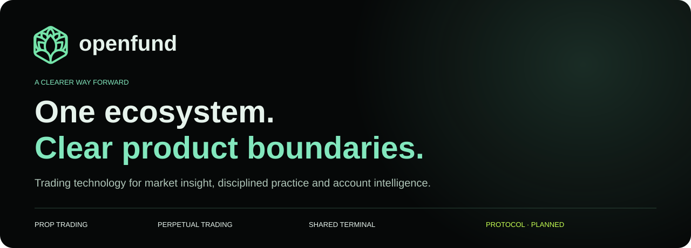
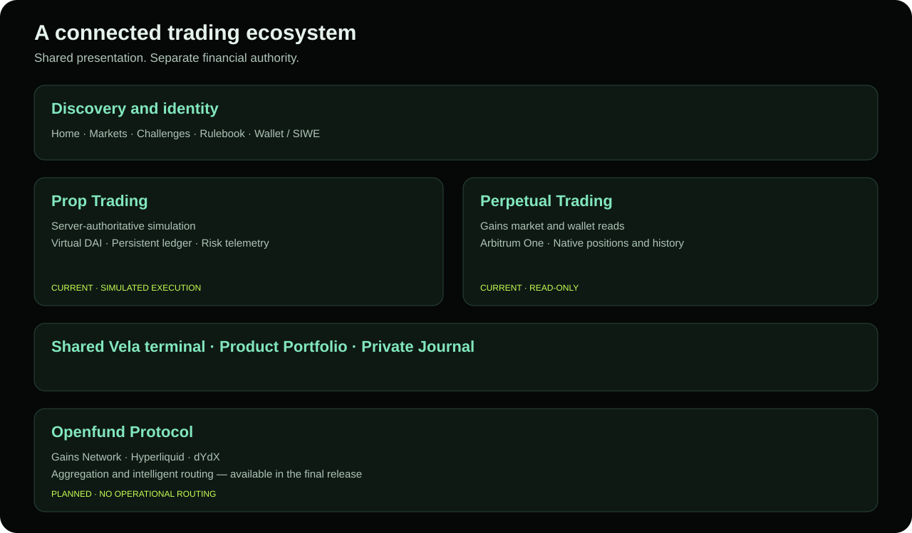
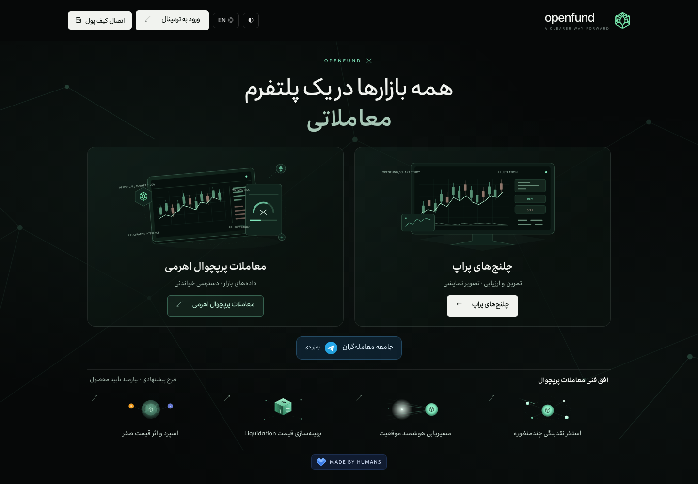
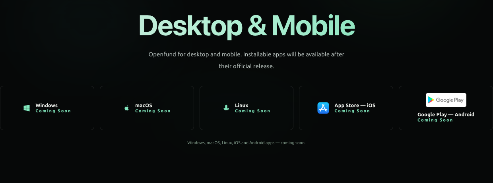
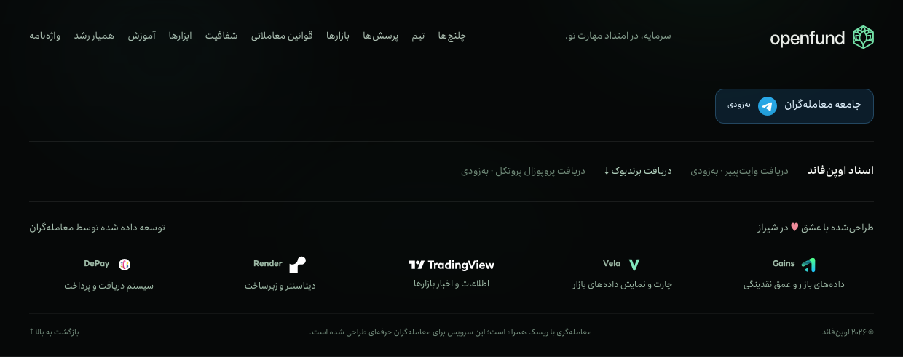
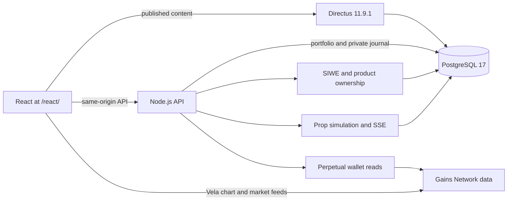
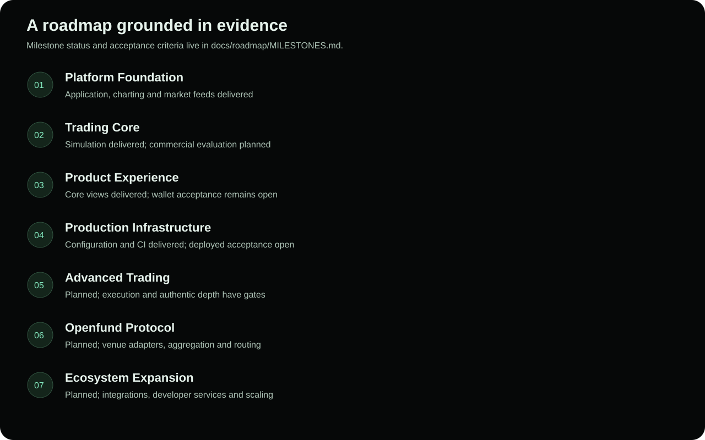

<div align="center">



**A connected trading ecosystem. Built with clear financial boundaries.**

[Product](docs/product/OVERVIEW.md) · [Documentation](docs/README.md) · [Architecture](docs/architecture/ARCHITECTURE.md) · [Roadmap](ROADMAP.md) · [Contributing](CONTRIBUTING.md)

[](https://github.com/algomanlife/openfund/actions/workflows/ci.yml)


</div>

## Trading technology with a coherent direction

Openfund is a FinTech and Web3 startup building an integrated environment for market discovery, trading, account intelligence and trader development. Prop Trading and Perpetual Trading share a consistent workspace while retaining distinct accounts, data sources and execution policies.

The repository contains an actively developed application: React product views, a Node.js backend, persistent simulated Prop execution, Gains Network market and wallet reads, SIWE sessions, portfolios and private trading journals. The next stages extend product workflows, operational readiness and execution capabilities through explicit acceptance gates.

**Current scope:** New Prop Free Trial accounts use 100,000 virtual USD; existing virtual-DAI ledgers are preserved. Perpetual integrates Gains read data on Arbitrum One with on-chain execution disabled. Challenge ordering, payment verification, invoices and withdrawal requests are merged with configuration gates; production payment acceptance, evaluation, funded capital, payouts and Protocol routing remain open. See the [capability register](docs/product/FEATURE_STATUS.md) for evidence and limits.

## Vision and mission

**Vision:** a coherent trading ecosystem in which traders can move from market insight to account review with trustworthy information and clear product boundaries.

**Mission:** give traders a connected environment to study markets, develop execution discipline and understand account performance.

Openfund addresses fragmented workflows across charts, market feeds, account portals and personal records. Its strategy centers on consistent tools, explicit financial authority and inspectable progress. [Business overview](docs/product/OVERVIEW.md) · [Vision](docs/product/VISION.md) · [Mission](docs/product/MISSION.md) · [Strategy](docs/product/STRATEGY.md)

## The Openfund ecosystem



| Product | Purpose | Current delivery |
| --- | --- | --- |
| **Prop Trading** | Practice execution and review account risk/performance | Server-side simulation, persistent orders/positions/ledger and observed risk telemetry |
| **Perpetual Trading** | Connect market insight to wallet-native account review | Gains market data and wallet-scoped Arbitrum One records; read-only |
| **Shared Terminal** | One consistent charting and trading interface | Vela workspace with separate product adapters and account contexts |
| **Wallet, Portfolio and Journal** | Identity, financial review and private decision records | SIWE sessions, product-specific data, analytics, notes and exports |
| **Openfund Protocol** | Future aggregation and execution-path selection | Planned for the final release; no operational routing |

[Explore the ecosystem](docs/product/ECOSYSTEM.md) · [Capability guide](docs/product/CAPABILITIES.md)

### Prop Trading

The current Prop account is a persistent practice environment with **100,000 virtual USD for new Free Trial accounts** (existing virtual-DAI ledgers are preserved), funded once per authenticated user. Trials have no time, trade-count or Challenge drawdown limits. Equity at or below zero permanently disables the trial after authoritative liquidation settlement; an individual position liquidation does not terminate a positive-equity account. A server-authoritative engine handles market/limit/stop orders, SL/TP, cancellation, partial closes and liquidation monitoring on real market marks.

Decimal valuation, fee-aware margin checks, owned idempotency and PostgreSQL transactions protect the simulated ledger. The Portfolio shows positions, history and net performance; the Journal records decisions in the same product context. Challenge catalog and account records exist; server-priced purchases and invoices are implemented behind the approved payment receiver gate; evaluation enforcement remains planned.

[Prop product and calculations](docs/trading/PROP.md) · [Trading lifecycle](docs/architecture/FLOWS.md#trading-lifecycle)

### Perpetual Trading

Perpetual uses Gains Network market data and official wallet-scoped positions, pending orders, history and statistics on **Arbitrum One**. Product views retain native collateral units and source provenance. Missing balances or fee-adjusted PnL remain unknown; upstream failures stay visible.

Wallet authentication supports private product views. Transaction execution, approvals and collateral transfers are disabled pending separate integration and security gates.

[Perpetual product](docs/trading/PERPETUAL.md) · [Gains integration](docs/integrations/GAINS.md)

### Openfund Protocol

> Openfund Protocol is designed to aggregate liquidity across Gains Network, Hyperliquid, and dYdX, enabling intelligent trade routing and improved execution-path selection. (Available in the final release.)

**Planned routing:** this describes product intent, not delivered aggregation. The dormant Solidity source foundation and provenance are already integrated in `packages/openfund-protocol/`; no active venue routing or execution is established.

[Protocol roadmap](docs/roadmap/PROTOCOL.md)

### Shared Trading Terminal

The trading workspace uses a compact 74px navigation/market header, fixed chart/book/order columns in both languages, and a form that fits the supported desktop viewport without scrolling. [Layout acceptance and limits](docs/reviews/terminal-ui/DELIVERY.md).

One Vela-based workspace serves both products: charting, market selection, theme/language controls and a consistent trading interface. React owns wallet/session/product context; established chart and market adapters remain integrated through the shared terminal bridge.

Prop receives authoritative state through the backend and SSE. Perpetual uses a separate read adapter. Sharing presentation never merges financial balances or execution rules. The catalog starts with Open Algo V5, Price Action Concepts and Smart Money Concepts, calculated from original Pine sources with repository-local libraries in a shared worker. Required linked Vela attribution remains in terminal status; upstream notices remain intact. [Indicator usage and limits](docs/trading/INDICATORS.md) · [Pine architecture](docs/trading/PINE_SCRIPT.md).

[Terminal guide](docs/trading/TERMINAL.md) · [Product architecture](docs/architecture/PRODUCT_TERMINALS.md)

### Wallet, Portfolio and Journal

Wallet connection and **Sign-In with Ethereum** are distinct steps. SIWE verifies identity; first-party HttpOnly sessions authorize private account views. Prop uses Ethereum Sepolia for its sign-in context and Perpetual uses Arbitrum One. Neither sign-in path submits a blockchain transaction.

Portfolios provide product-specific records and supported analytics. Private journals add notes, tags, search, classifications, calendar/statistics and version-aware metadata export/restore. Imports cannot create trades or financial balances.

[Identity and security model](docs/wallet/IDENTITY.md) · [Portfolio and Journal](docs/trading/PORTFOLIO_JOURNAL.md)

The shared [account directory](docs/trading/UNIFIED_ACCOUNTS.md) presents Free Trial, Challenge and Perpetual identities. [Journal modules and metrics](docs/trading/JOURNAL_METRICS.md) use persisted records and per-account preferences. The restored [Book/Trades panel](docs/integrations/GAINS_DEPTH.md) reads the verified public Gains VOB and executed-trade API.

## Product gallery

The [current website candidate gallery](docs/reviews/website-refresh/DELIVERY.md)
records the candidate source, runtime, capture states and historical checks; final review and recapture remain separate. These are actual
application captures; historical images keep their original provenance in the
[screenshot manifest](docs/assets/screenshots/manifest.json).

| Persian Home | English Prop |
| --- | --- |
|  |  |
| **Desktop & Mobile — all apps coming soon** | **Public service footer** |
|  |  |

[Terminal, dashboard, accounts, portfolio and journal captures](docs/assets/screenshots/README.md).

## Architecture



Financial state is product-specific. Directus is editorial/catalog administration; the backend enforces account ownership and financial mutations. The API process also hosts the simulation monitor and SSE, so it remains single-instance until coordination is designed.

[System architecture](docs/architecture/ARCHITECTURE.md) · [Authentication, trading, market-data and deployment flows](docs/architecture/FLOWS.md) · [Architecture decisions](docs/decisions/README.md)

## Technology

| Layer | Foundation |
| --- | --- |
| Interface | React 19, TypeScript, Vite, React Router; English/Persian UI with RTL support |
| Wallet and identity | RainbowKit, wagmi, viem, SIWE and first-party sessions |
| Charts and market data | Vela workspace, Gains REST/WebSocket adapters |
| Application | Node.js 22, Express, Decimal arithmetic, SSE |
| Persistence and content | PostgreSQL 17, Directus 11.9.1 |
| Delivery | Render Blueprint, GitHub Actions, per-app npm lockfiles, browser/integration checks |

[Detailed technology registry](docs/architecture/TECH_STACK.md) · [Technology graphic](docs/assets/graphics/technology.svg) · [Upstream provenance](docs/integrations/UPSTREAM.md)

## Development status

The current foundation includes working product navigation, market/chart integrations, backend identity, persistent Prop simulation, isolated Portfolio/Journal views, CMS content and CI/Render configuration.

Remaining gates include real wallet/device acceptance, deployed Render/HTTPS/recovery verification, commercial challenge activation/evaluation, advanced execution and production reporting. Transparency metrics are labelled sample data. A configured service, visible placeholder or vendored SDK is not proof of an operational capability.

[Feature Status](docs/product/FEATURE_STATUS.md) is the maintained source of truth. [Delivery evidence](docs/reviews/repository-transformation/DELIVERY.md) records checks actually run for this branch.

## Roadmap



1. **Platform Foundation:** repository, frontend/backend, charting and market data.
2. **Trading Core:** Prop simulation, calculations, risk controls and persistent state.
3. **Product Experience:** wallet, Portfolio, Journal, challenges, markets and multilingual UI.
4. **Production Infrastructure:** Render, PostgreSQL, Directus, CI/CD, security and observability.
5. **Advanced Trading:** extended order workflows, analytics and execution improvements.
6. **Openfund Protocol:** venue adapters, liquidity aggregation and intelligent routing.
7. **Ecosystem Expansion:** integrations, developer services and coordinated scalability.

[Roadmap](ROADMAP.md) · [Milestones, dependencies and acceptance criteria](docs/roadmap/MILESTONES.md)

## Local development

Prerequisites: Node.js 22, npm and PostgreSQL 17. Use a dedicated local database and your own connection credentials. Python 3 is used by optional Directus utilities.

```bash
npm ci
npm ci --include=dev --prefix apps/web-react
npm ci --prefix apps/backend
createdb openfund_dev
export DATABASE_URL=postgresql://localhost:5432/openfund_dev
npm run migrate --prefix apps/backend
npm run seed-plans --prefix apps/backend
npm run dev:backend
```

In a second terminal run `npm run dev:web`, then open [English Home](http://localhost:5173/react/#/en/home). Optional `VITE_BACKEND_URL`, `VITE_DIRECTUS_URL` and WalletConnect configuration are documented in [Local Development](docs/development/LOCAL_DEVELOPMENT.md) and [Environment](docs/deployment/ENVIRONMENT.md).

Build with `npm run build:web`; the backend serves the result at `/react/`. Keep source-critical `dist/` compatibility assets. Review generated `react/` changes before committing.

## Testing and CI

```bash
npm run docs:check
npm run typecheck
npm run test:web
npm run test:charts
npm run build:web
npm run validate:blueprint
```

Backend and browser integration suites require an **isolated test database and running test backend**. Follow [Testing](docs/development/TESTING.md) before `npm run test:backend` or `npm run test:browser:audit`. Price injection is local-test-only and must remain disabled in production.

GitHub Actions covers documentation, frontend checks/build, PostgreSQL-backed backend/browser tests, Blueprint structure, secret scanning and dependency reports. Local outcomes and any unexecuted external checks are recorded in the delivery report.

## Render deployment

The root [Blueprint](render.yaml) preserves three resources:

- **`openfund`** — Node API, simulation monitor and SSE, serving React same-origin at `/react/`.
- **`openfund-db`** — managed PostgreSQL 17 for application and CMS tables.
- **`openfund-cms`** — Directus 11.9.1 with persistent uploads.

There is no separate frontend service or worker. Review/apply and deployed acceptance are separate from a local build or schema check. [Render runbook](docs/deployment/RENDER.md) · [Database](docs/deployment/DATABASE.md) · [Rollback](docs/deployment/ROLLBACK.md)

## Security

Keep secrets server-side, preserve product/account ownership and require explicit wallet approval for any future transaction. On-chain execution remains disabled. Generated-signature tests do not certify real extensions, hardware wallets or remote sessions. The repository does not claim an independent security audit or regulatory approval.

[Security reporting](SECURITY.md) · [Security architecture and release gates](docs/security/SECURITY.md)

## Documentation and contributing

[Documentation index](docs/README.md) organizes product/business, architecture, trading, identity, integrations, deployment, development, security, roadmap and decisions. Repository prose is English; application localization and RTL support are preserved.

Read the latest contracts before coding. Keep feature status, roadmap gates and screenshots aligned with implementation. Open focused pull requests from the latest `main`, preserve working code/Render architecture and retain upstream licensing. [Contributing](CONTRIBUTING.md) · [Agent instructions](AGENTS.md) · [Changelog](CHANGELOG.md)

---

<div align="center"><sub>OPENFUND · A CLEARER WAY FORWARD</sub></div>

## Unified release management

The integrated app is packaged from `main` using `npm run release:build`; local work uses `-- --candidate` with Node 22 and an isolated PostgreSQL test database. Reviewed batch publication, official SemVer tags, checksummed payloads, manifests and future approved exact-SHA Render deployment are defined in [the release runbook](docs/deployment/RELEASES.md). Candidate builds and merged source are not production acceptance.

The [UI polish batch](docs/reviews/ui-polish/DELIVERY.md) records locale-specific
product availability, compact wallet controls and terminal theme acceptance.
Persian exposes both products; English exposes Prop. Language does not establish
residency eligibility.

The [Persian landing redesign](docs/reviews/landing-motion/DELIVERY.md) adds scoped
vector motion and compact proposed Perpetual concepts to the existing gateway.
English retains the existing Prop challenge experience. This work merged through PR #40 after v0.1.1;
technical concept claims require product review before production publication.

## Source and release snapshot — 2026-11-03

At 19:52 UTC, GitHub publication run [41705345213](https://github.com/algomanlife/openfund/actions/runs/41705345213)
succeeded. Official [v0.2.0](https://github.com/algomanlife/openfund/releases/tag/v0.2.0)
and its manifest identify `561e7f3101f3a43376068d9bba1a87c30e2b7d71`, including PR #40
and #41. Historical v0.1.1 (`ce9ddd0`) predates both. This dirty website-refresh
branch is **not included in v0.2.0**; its captures are unofficial candidates.
Publication does not verify a live port 8080 runtime or Render deployment;
local downloaded-release startup and identity verification remain separate acceptance.
See the [audit](docs/reviews/website-refresh/AUDIT.md) and
[delivery evidence](docs/reviews/website-refresh/DELIVERY.md). Payment receiver and
optional DePay widget remain gated. Challenge provisioning is not evaluation;
withdrawal requests are not payouts. All five platform cards say Coming Soon
because no installer/store listing is verified. The Telegram community destination
is unavailable until an owner-verified URL is configured; telegram.org is not an
Openfund group.

Repository licensing is component-specific: preserve [upstream notices](docs/integrations/UPSTREAM.md)
and package notices. No blanket license grant for all repository material is implied.
