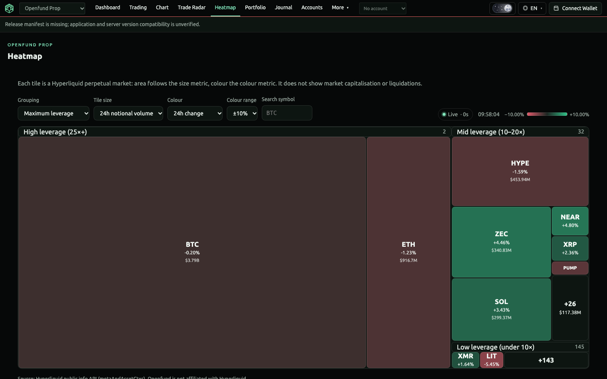
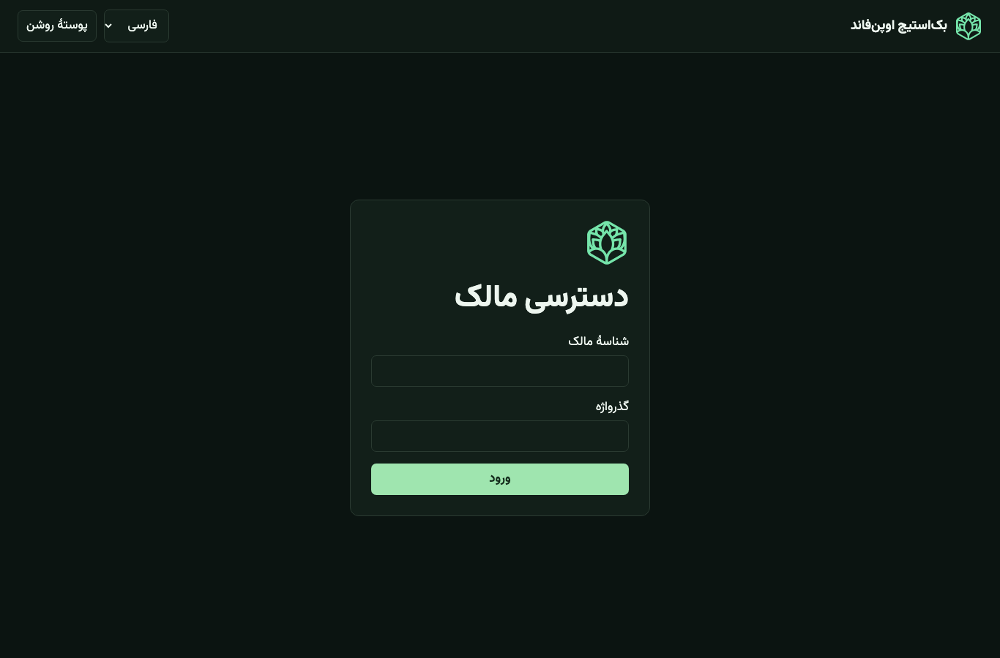
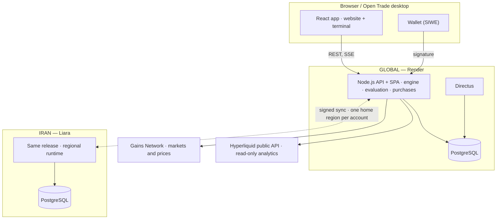

<div align="center">


# Openfund

**A clearer way forward**

[](https://github.com/algomanlife/openfund/releases/latest)
[](https://openfi.cloud/version)
[](https://github.com/algomanlife/openfund/actions/workflows/ci.yml)
[](https://github.com/algomanlife/openfund/actions/workflows/security.yml)


</div>

Openfund is an open-development prop trading firm and trading technology
platform: simulated trading evaluations, funded programs, trader rewards and
published financial transparency, built in a public repository so every rule
can be checked.
[openfi.cloud](https://openfi.cloud) (global) ·
[openfi.live](https://openfi.live) (Iran) ·
[Documentation](docs/README.md) · [Roadmap](ROADMAP.md) · [Changelog](CHANGELOG.md)

## Project overview

- **Prop trading evaluation.** Traders buy a challenge, trade a simulated
  account under published rules, and the server — never the browser —
  evaluates every rule from a frozen snapshot.
- **One professional terminal.** Prop and Perpetual share one workspace: Vela
  charts with Openfund Pine indicators, order panel with risk preview,
  positions, portfolio and a trade journal.
- **Read-only market intelligence.** Trade Radar and the Market Heatmap read
  public Hyperliquid data and never touch orders or accounts.
- **Transparency.** Rules, prices, the revenue model, partner commissions and
  governance limits are published; economic figures come only from
  operational records.

Openfund is early-stage. Nothing here claims revenue, user numbers, funding,
partnerships or regulatory approval. Start with the
[documentation index](docs/README.md).

## Product ecosystem

| Product | What it is | Where |
| --- | --- | --- |
| **Website** | Challenges, markets, rulebook, economy, governance, learning, tools and certificate verification in Persian, English, Arabic, Russian and Simplified Chinese | [openfi.cloud](https://openfi.cloud) |
| **Web Terminal** | Trading, charts, portfolio, journal, accounts, certificates, purchases, Trade Radar and Heatmap | `/:locale/prop/trade` |
| **Open Trade** | Lightweight Electron desktop workspace with one to four Vela charts | [desktop README](apps/open-trade/README.md) |
| **Certificates** | Purchase, completion and payout certificates verifiable by serial or QR | `/:locale/certificate-verification` |
| **Backstage** | Independent, bilingual owner console for Prop business operations | [backstage.openfi.cloud](https://backstage.openfi.cloud) |

Every capability in depth — workspace, indicators, Footprint, Radar, Heatmap,
Tools Center, desktop, Backstage, languages and regions — is in the
[platform tour](docs/product/PLATFORM_TOUR.md).

## Feature status

Runtime state per region is generated from
[docs/status/status.json](docs/status/status.json); the
[feature register](docs/product/FEATURE_STATUS.md) holds per-capability
evidence. A merge is not production until `/version` reports it.

<!-- status:summary -->

**Current status** (verified 2026-11-21; canonical: [docs/status](docs/status/README.md)):

- Latest official release: **v0.8.0** (`0320cf7`, 2026-11-20).
- GLOBAL (Render) Web/API runs v0.8.0 `0320cf7`; IRAN (Liara) web runs v0.6.5 `a87804a` (built as unofficial).
- Purchases: enabled in GLOBAL, disabled in IRAN; owner purchase acceptance open (see the purchases row in docs/status).
- Live execution: disabled (Approved signer/custody design, supported testnet contracts, simulation, security review and management activation).
- Desktop: 0.0.3 candidate merged (#171); internal unsigned builds, UI acceptance and integrity checks passed on all four CI targets. macOS x64 installer upload failed with a GitHub timeout; signed/public release and real-wallet acceptance remain pending.

<!-- /status:summary -->

Full per-region table: [docs/status](docs/status/README.md).

## Product gallery

<!-- gallery -->

| Website — Persian (Dastkhat) | Website — Arabic (Dastkhat Arabic) |
| --- | --- |
|  |  |

| Web Terminal — English | Web Terminal — Persian |
| --- | --- |
|  |  |

| Market intelligence — Market Heatmap | Market intelligence — Trade Radar |
| --- | --- |
|  |  |

| Backstage — English overview | Backstage — Persian sign-in |
| --- | --- |
|  |  |

| Desktop and order flow — Open Trade — four charts | Desktop and order flow — Hybrid Footprint |
| --- | --- |
|  |  |

| Mobile — Persian terminal | Mobile — English navigation |
| --- | --- |
|  |  |

Curated from [docs/assets/gallery/gallery.json](docs/assets/gallery/gallery.json); provenance per image in the
[screenshot manifest](docs/assets/screenshots/manifest.json); older capture sets are [archived](docs/reviews/_archive/readme-galleries/README.md).

<!-- /gallery -->

## Business model

Openfund sells one-time evaluation fees for simulated challenge accounts.
Prices come from the CMS plan catalog and the server prices every order;
current fees are published in the [plan catalog](https://openfi.cloud/purchases/plans).
A paid order activates exactly one challenge account after on-chain
verification of token, receiver, sender, amount and finality.

Costs are ambassador commissions, coach compensation once live trading
exists, trader rewards under published plan rules, refunds and
infrastructure. Treasury and funded-reward policies are versioned, and frozen
terms are never silently rewritten. No revenue, profitability or growth
figures have been published.

The approved model is [ECONOMY.md](ECONOMY.md); pricing tables, the
purchase and funded-account lifecycles, reward splits, treasury allocation and
partner programs are in [business model in detail](docs/economy/BUSINESS_DETAIL.md)
and the [business overview](docs/economy/BUSINESS_MODEL.md).

## Technical architecture

One reviewed source serves two independently operated regions; each runs the
API and web app from one origin so session cookies stay first-party.



Orders, positions, PnL, evaluation and payments are decided only by the
backend; analytics modules are read-only and Directus never writes financial
tables. Details: [architecture](docs/architecture/ARCHITECTURE.md) ·
[infrastructure, repository map, test map and security controls](docs/architecture/PLATFORM_REFERENCE.md).

## Technology stack

| Layer | Technology |
| --- | --- |
| Web | React, TypeScript, Vite, React Router |
| Wallet | RainbowKit, wagmi, viem, Sign-In with Ethereum (Arbitrum One) |
| Charts and data | Vela with the official Pine addon and PineTS; Gains Network API; Hyperliquid public API |
| Backend | Node.js, Express, `pg`, decimal.js, viem, `ws` |
| Data | PostgreSQL; Directus |
| Desktop | Electron, electron-builder |
| Delivery | GitHub Actions; Render Blueprint (`render.yaml`); Liara runtime image |
| Typography | Exactly two faces: **Ubuntu** (general/Latin) and **Dastkhat** (the only Persian/Arabic face), self-hosted with one shared `@font-face` file |

Pinned versions are in the lockfiles and the [tech stack](docs/architecture/TECH_STACK.md);
the typography policy and tokens are in the
[design system](docs/design/DESIGN_SYSTEM.md#typography-and-font-tokens).

## Development workflow

Requires Node.js 26 and a local PostgreSQL.

```bash
npm ci && npm ci --include=dev --prefix apps/web-react && npm ci --prefix apps/backend
createdb openfund_dev && export DATABASE_URL=postgresql://localhost:5432/openfund_dev
npm run migrate --prefix apps/backend && npm run seed-plans --prefix apps/backend
npm run build:web && PORT=8180 npm run dev:backend   # http://localhost:8180
```

Checks: `npm run typecheck`, `npm run test:web`, `npm run docs:check` (README
structure, retired registry and font gates included). Backend suites need a
disposable database. Guides: [testing](docs/development/TESTING.md) ·
[local development](docs/development/LOCAL_DEVELOPMENT.md) ·
[engineering reference](docs/development/ENGINEERING_REFERENCE.md).

## Versioning and releases

The current official platform release is **v0.8.0**; **v0.9.0** (typography
consolidation, retired-file removal and repository restructure) is prepared
for the owner to publish through the release workflow.
Tags are `vMAJOR.MINOR.PATCH`, allocated from Conventional Commits; Open Trade
has its own `open-trade-vX.Y.Z` line. `/version` returns the deployed version,
commit and whether the build is official; merging deploys nothing.

[Release runbook](docs/deployment/RELEASES.md) ·
[Changelog](CHANGELOG.md) ·
[All releases](https://github.com/algomanlife/openfund/releases)

## Security

Wallet sign-in is SIWE on Arbitrum One, sessions are server-side and
HttpOnly, every record is scoped to its owner on the server, the chain
verifier decides payments, and the browser runs under a strict CSP. The
November 2026 [self-assessment](docs/security/SECURITY-AUDIT-2026-11.md) was
written by the project's coding agent and is not an independent audit; open
findings and their states are in the
[remediation report](docs/security/SECURITY-REMEDIATION-2026-11.md).
Report vulnerabilities privately through [SECURITY.md](SECURITY.md).

## License

No first-party license has been chosen: Openfund's own code is all rights
reserved, and the repository being public grants no reuse license. The owner's
options and remaining blockers are in the
[license decision](docs/legal/LICENSE_DECISION.md) and the
[licensing report](docs/legal/LICENSING.md). Third-party components keep their
own terms:

<!-- license:summary -->

| Component | License |
| --- | --- |
| Vela charting library | Apache-2.0 + NOTICE |
| Vela Pine addon | AGPL-3.0-only |
| PineTS | AGPL-3.0-only |
| MetaMask SDK | ConsenSys proprietary license |
| LuxAlgo trade journal and journal-core | MIT |
| Trade Radar logic adapted from drkxbt/whales | MIT |
| Heatmap treemap layout adapted from drkxbt/charts | MIT |
| Gains Network SDK | MIT |
| DePay Payment Widget | MIT |
| Openfund Protocol | GPL-2.0 |
| Dastkhat, Dastkhat Arabic and Dastkhat FaNum fonts | SIL Open Font License 1.1 |
| Ubuntu font | Ubuntu Font Licence 1.0 |
| Simple Icons | CC0-1.0 |
| TradingView logo | Brand-owner terms |
| Interactive day/night toggle design | MIT |
| Public service brand assets | Brand-owner terms |
| npm packages | Per package |
| Directus | BSL 1.1 for the pinned 11.17.4 image |

Generated from [THIRD_PARTY_NOTICES.md](THIRD_PARTY_NOTICES.md), the authoritative list with license texts.

<!-- /license:summary -->

## Retired and no longer used

<!-- retired:summary -->

| Item | Status | Replacement |
| --- | --- | --- |
| Irancell font files (`irancell-*.ttf`) and their byte-identical copies `openfund-1.ttf`–`openfund-5.ttf` | retired | Dastkhat v1.210 — [typography policy](docs/design/DESIGN_SYSTEM.md#typography-and-font-tokens) |
| Renamed Irancell derivatives "Openfund Persian" (`openfund-persian-*-v4.woff2`), Backstage `/persian.woff2`, certificate face `OpenfundCertificateFa` | retired | Dastkhat v1.210 (`/assets/fonts/dastkhat/`); certificate face `Dastkhat Certificate` |
| Standalone Vazirmatn copies (`Vazirmatn.ttf`, `Vazirmatn-LICENSE.txt`, Google Fonts `family=Vazirmatn`, `typeface="Vazirmatn"`) | retired | Dastkhat v1.210, which is based on Vazirmatn (SIL OFL 1.1) and credits it |
| Superseded platform releases v0.6.5 and v0.7.0 as the README's current release | retired | The latest official release recorded in [docs/status/status.json](docs/status/status.json) |
| Dated README galleries ("Recent … captures — YYYY-MM-DD", "Full product gallery — recorded v0.6.5", the v0.4.4 capture set in `docs/assets/screenshots/readme/`) | retired | One curated gallery generated from [docs/assets/gallery/gallery.json](docs/assets/gallery/gallery.json); the old sets are in [docs/reviews/_archive/readme-galleries/](docs/reviews/_archive/readme-galleries/README.md) |
| Superseded release review snapshots (`docs/reviews/v0.4.1`, `v0.6.5`, `release-0.6.5`, `release-0.6.6`) | retired | Kept as history under [docs/reviews/_archive/](docs/reviews/_archive/README.md); current state lives in [docs/status](docs/status/README.md) |
| Vanilla JS/CSS legacy layer (`apps/web-react/public/legacy/`) and the tracked `dist/` snapshot | legacy-only pending removal | React application (`apps/web-react/src/`); `dist/` stays source-critical until AGENTS.md says otherwise |
| Openfund Protocol (dormant import of mux-protocol, `packages/openfund-protocol/`) | dormant | None — not retired; not built, shipped or operated ([provenance](packages/openfund-protocol/PROVENANCE.md)) |

Generated from [docs/development/RETIRED.json](docs/development/RETIRED.json); details and reference counts in [RETIRED.md](docs/development/RETIRED.md).

<!-- /retired:summary -->

## Contributing

Start with [CONTRIBUTING.md](CONTRIBUTING.md): branch from `main`, use
Conventional Commits, update docs and the changelog with the code, and open a
pull request using the template; required checks must pass and merging does
not deploy. Coding agents follow [AGENTS.md](AGENTS.md); the README's shape is
a [contract](docs/development/README_STRUCTURE.md) enforced by CI. Questions:
[SUPPORT.md](SUPPORT.md) · [Code of conduct](CODE_OF_CONDUCT.md) ·
[Repository governance](docs/development/REPOSITORY_GOVERNANCE.md).
