<div align="center">


# Openfund

**A clearer way forward**

Trading challenges, a professional trading terminal and a transparent economy,
in one wallet-native platform.

[**openfi.cloud**](https://openfi.cloud) · [**openfund.cloud**](https://openfund.cloud)

[](https://github.com/algomanlife/openfund/releases/latest)
[](https://openfi.cloud/version)
[](https://github.com/algomanlife/openfund/actions/workflows/ci.yml)


[Product](#product-ecosystem) · [Gallery](#product-gallery) · [Business model](#business-model) · [Architecture](#technical-architecture) · [Development](#development-workflow) · [Releases](#versioning-and-releases) · [Docs](docs/README.md)

<br />

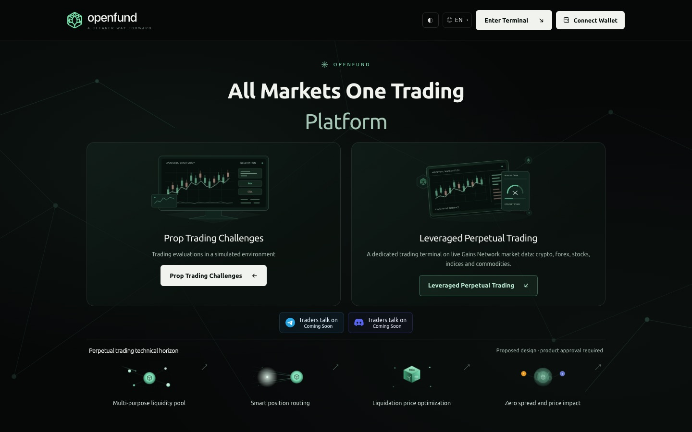

</div>

## Project overview

Openfund is a trading-technology company building a platform for traders who
want to prove their skill without risking their own capital first.

- **Who it serves.** Retail traders who want a structured, rules-based path to
  larger trading accounts, and partners (ambassadors and trading coaches) who
  bring and develop those traders.
- **The problem.** Traditional prop-trading evaluations are opaque: rules are
  hard to verify, purchases and payouts are hard to trace, and the business
  economics behind them are invisible to the trader.
- **The product.** A multilingual website (English and right-to-left Persian,
  plus Arabic, Russian and Simplified Chinese) and a shared professional terminal.
  Traders pick a challenge, trade a simulated account under published rules
  that the server evaluates, and follow their account in a dashboard, portfolio
  and journal. Sign-in is a wallet signature, not a password.
- **Commercial purpose.** Openfund sells challenge evaluations. Transparency is
  part of the product: rules, prices, the revenue model, partner commissions
  and governance limits are published, and economic figures come only from
  operational records.

Openfund is early-stage. Nothing in this repository is a claim of revenue,
user numbers, funding, partnerships or regulatory approval.

## Product ecosystem

Status reflects the [feature register](docs/product/FEATURE_STATUS.md) and the
running service at [`/version`](https://openfi.cloud/version), not plans.

| Module | What it does | Status |
| --- | --- | --- |
| **Openfund Prop** | Simulated challenge accounts: Free Trial, Standard (two-phase), One-phase and Instant models | **Live** (simulation) |
| **Trading terminal** | One shared terminal for Prop and Perpetual: Vela charts with Pine indicators, order book, market/limit/stop orders, SL/TP, positions and history | **Live** |
| **Perpetual** | Read-only Gains Network market data and wallet-scoped Arbitrum One positions | **Live, read-only** (no execution) |
| **User accounts** | Wallet identity, dashboard, portfolio, trade journal, purchase history and invoices | **Live** |
| **Challenge evaluation** | Server-authoritative rule engine over a frozen rules snapshot | **Live** |
| **Wallet authentication** | Sign-In with Ethereum on Arbitrum One, HttpOnly sessions | **Live** |
| **Checkout and purchases** | Server-priced orders, coupons, multi-chain DePay payments, on-chain verification, atomic provisioning | **Implemented, disabled in production** until the owner configures payments |
| **Economy** | Transparency, Revenue Model and Live Market Access pages driven by operational records | **Live pages**, no live revenue data yet |
| **Governance** | Hybrid Governance v1.0: off-chain Community Council, proposals and voting | **Implemented, not in production use** (no council seated) |
| **Ambassador (IB)** | Brand Ambassador referral program with application, approval and commission ledger | **Implemented, not production-active** |
| **Coach program** | Verified Trading Coach role with an independent approval track | **Implemented, not production-active** (depends on live trading) |
| **Administration and CMS** | Directus for content, plan catalog and coupon administration; token-gated operational API | **Live CMS**; coupon administration verified locally, pending production bootstrap |
| Desktop and mobile apps, rewards, protocol routing | — | **Planned** ([Roadmap](ROADMAP.md)) |

<a id="product-gallery"></a>

## Product gallery

Genuine captures of the running application. Public pages are from production
(openfi.cloud, v0.4.4) on 2026-11-11. Signed-in views use a disposable test
wallet on a local test runtime of the same code, because production purchases
are not yet enabled. Provenance for every image is in the
[screenshot manifest](docs/assets/screenshots/manifest.json).

**Challenges**

| Challenge selection | Challenge detail and rules |
| --- | --- |
|  | 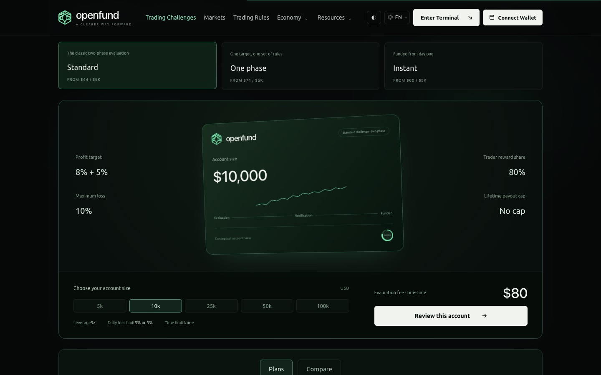 |
| 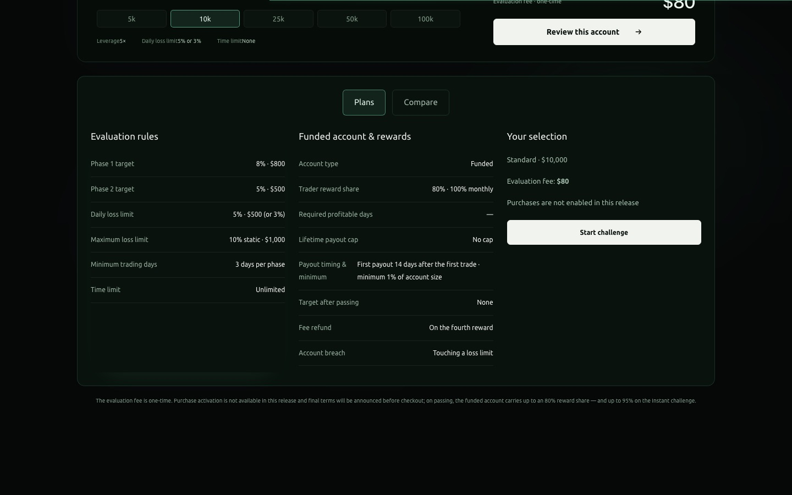 | 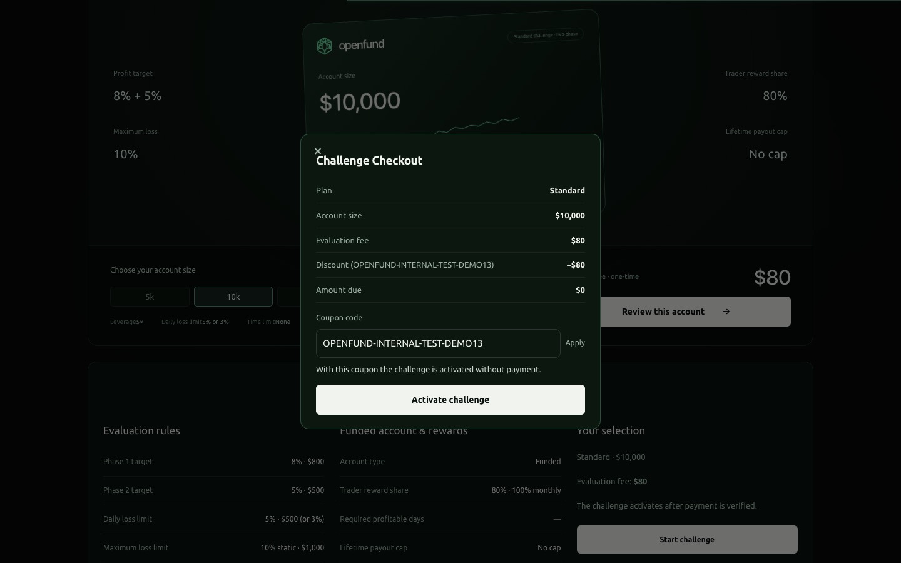 |

**Trading and accounts**

| Trading terminal | User dashboard |
| --- | --- |
| 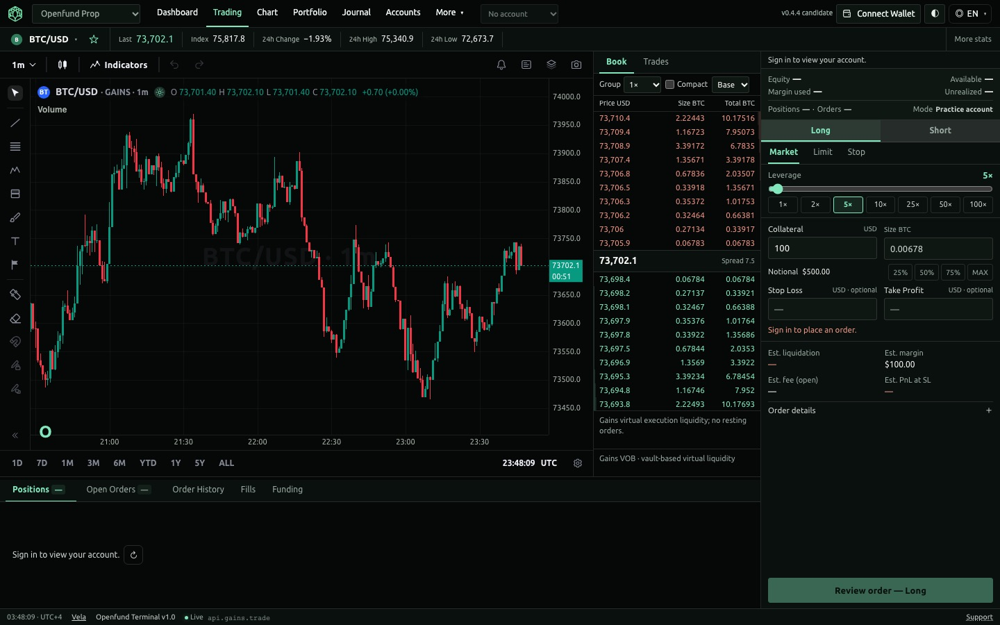 | 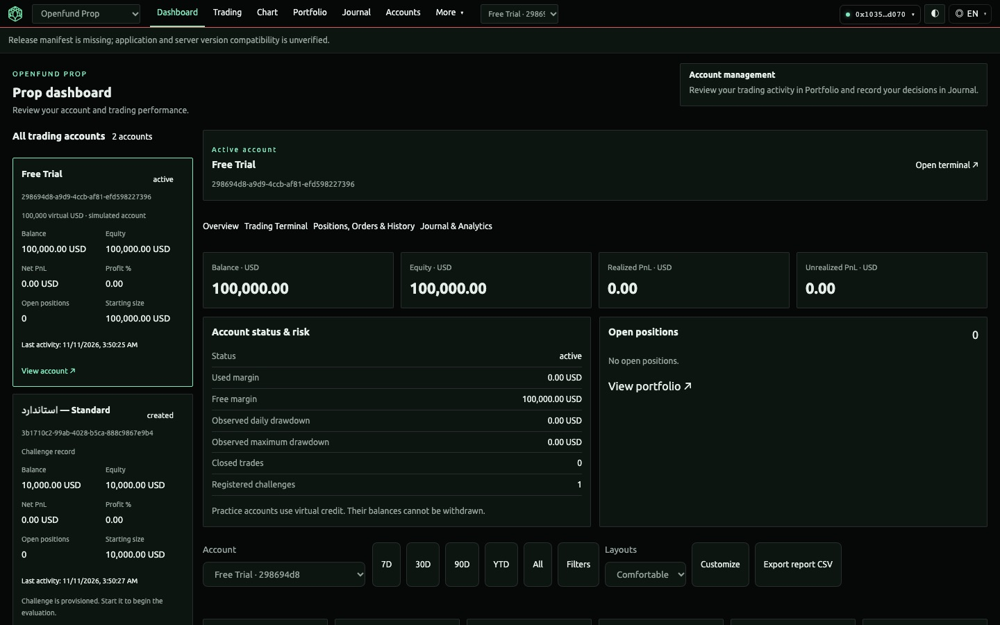 |

**Economy**

| Ambassador (IB) | Governance |
| --- | --- |
| 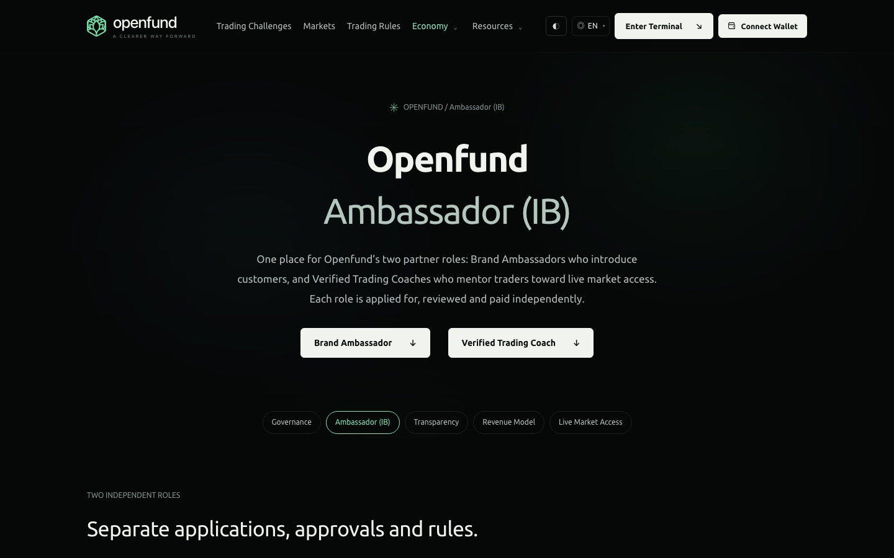 | 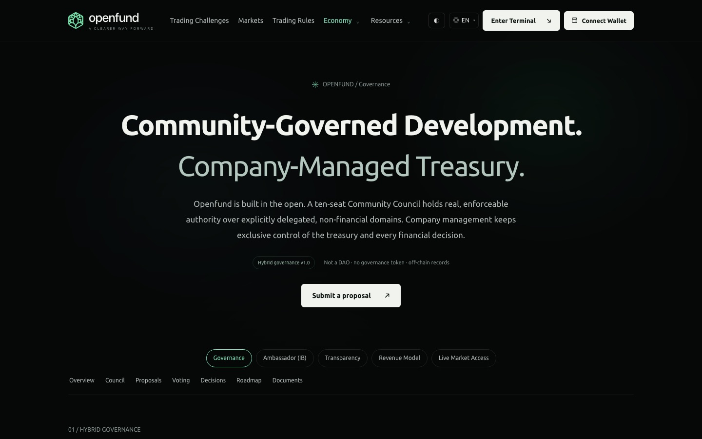 |
| 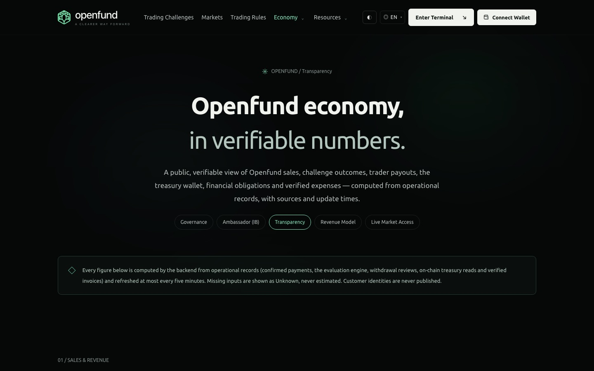 | 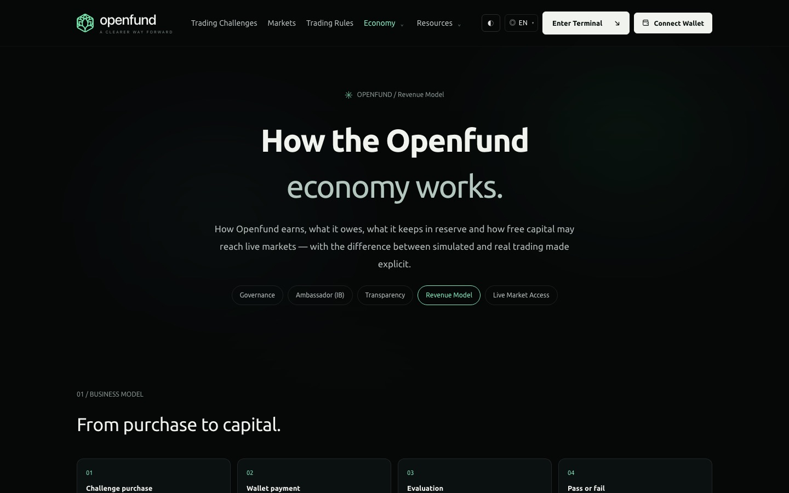 |

**Administration (Directus CMS, test data)**

| Coupon administration | Coupon with redemption counters |
| --- | --- |
| 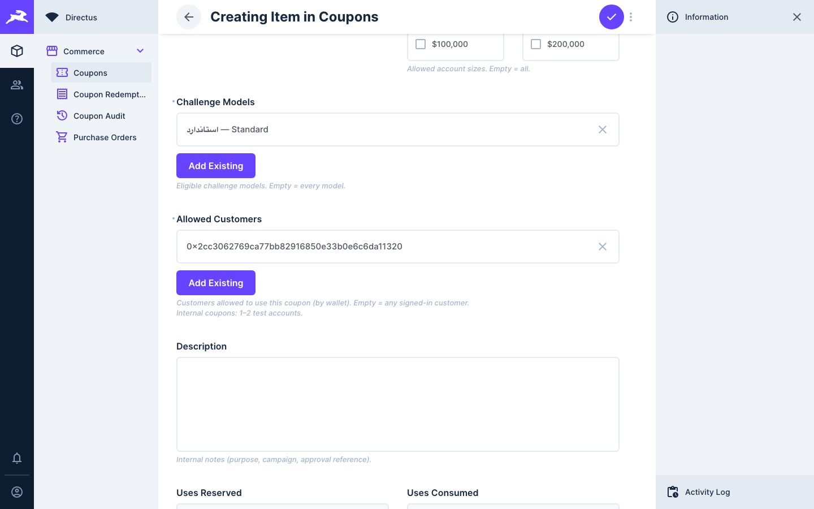 | 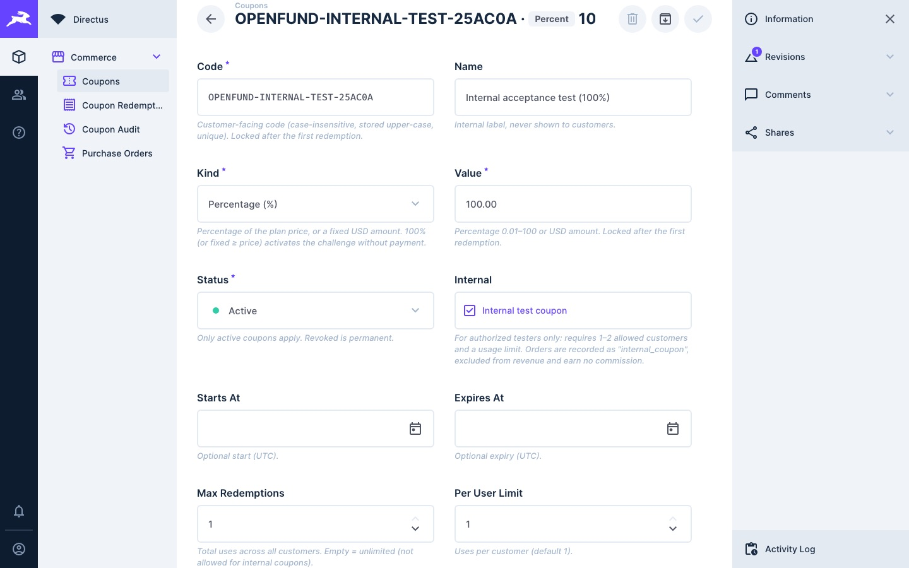 |

**Mobile and Persian**

| Home (mobile) | Terminal (mobile) | Challenges (mobile) | Persian home (desktop) |
| --- | --- | --- | --- |
| 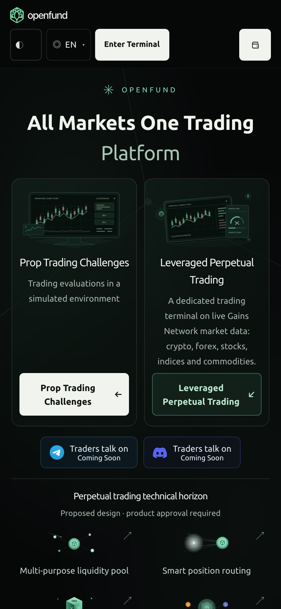 | 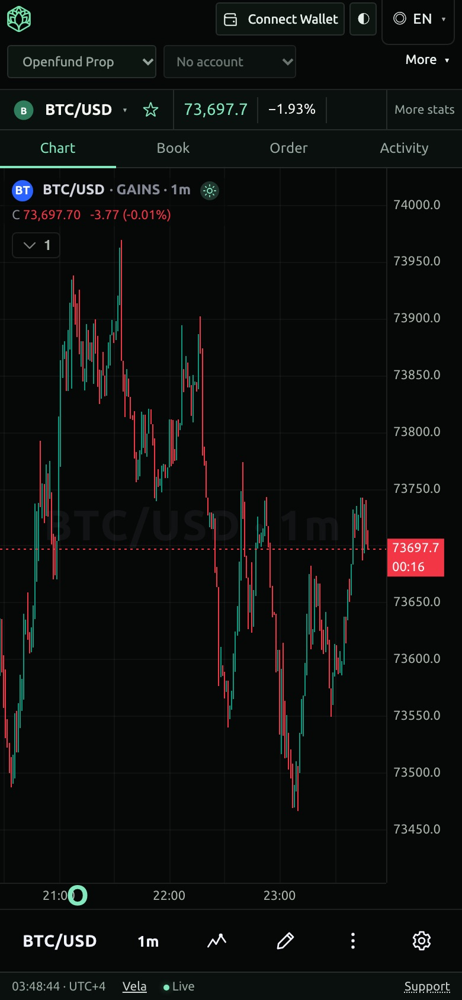 | 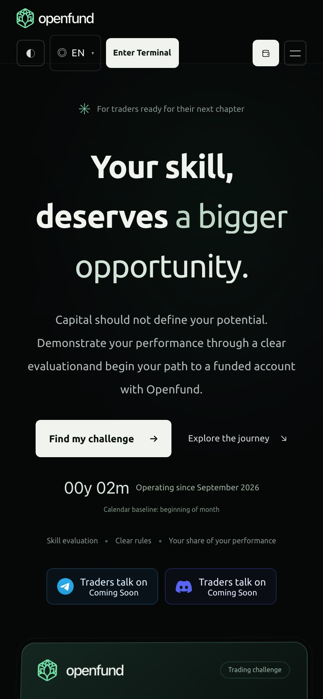 | 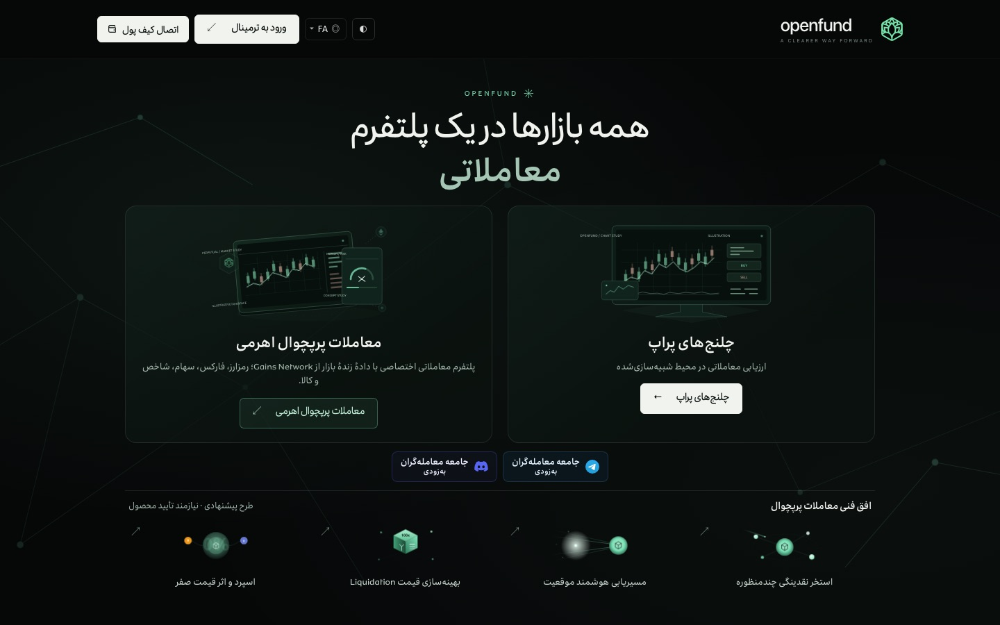 |

Not captured: a real paid checkout (purchases are disabled in production) and
a seated governance council (none exists).

## Business model

The approved model is recorded in [ECONOMY.md](ECONOMY.md) and summarised in
[Business model](docs/economy/BUSINESS_MODEL.md). No revenue, profitability or
growth figures have been published, and none are implied here.

**Challenge sales.** Openfund sells one-time evaluation fees for simulated
challenge accounts. Prices come from the plan catalog in the CMS; the server,
never the browser, prices every order. Current published catalog
([live](https://openfi.cloud/purchases/plans)):

| Model | Structure | Account sizes | Evaluation fee |
| --- | --- | --- | --- |
| Free Trial | Practice account | 5k – 100k | Free |
| Standard | Two-phase evaluation (8% + 5% targets, 10% max loss) | 5k – 100k | $44 – $652 |
| One-phase | Single target, one rule set | 5k – 100k | $74 – $666 |
| Instant | Funded from day one | 5k – 200k | $60 – $888 |

**Purchase lifecycle.** Order (server price, optional coupon) → payment through
DePay on any configured network → on-chain verification → atomic provisioning
of exactly one challenge account and one invoice. Every state change is
recorded. See [Order lifecycle](docs/payments/ORDER_LIFECYCLE.md).

**Revenue recognition principles.** Net collected revenue is gross sales minus
coupon discounts minus refunds, recognised from the verified settlement amount
on chain. Internal 100% test coupons are excluded from revenue and reported
separately. Ambassador commissions are an acquisition cost, recorded as
obligations.

**Costs.** Ambassador commissions, coach compensation (once live trading
exists), trader rewards under published plan rules, refunds and infrastructure
(Render, PostgreSQL, Directus, RPC providers).

## Economy and governance

| Program | Approved rule | Status |
| --- | --- | --- |
| **Brand Ambassador (IB)** | 10% of the referred customer's **first** eligible confirmed purchase, on the net amount after discounts, recognised at verified payment. Eligibility: 50,000+ followers on Instagram or YouTube plus an active second platform; approval by company management | Implemented, not production-active |
| **Verified Trading Coach** | 10% of distributable **realised** net profit from eligible live trades, after trading and execution costs; never on simulated or unrealised PnL | Implemented, inactive until live trading exists |
| Customer referral discount (20%) | **Proposed**, not approved, not active | — |
| Real-capital profit-sharing tiers | **Pending decision** | — |

**Governance.** Hybrid Governance v1.0: *community-governed development,
company-managed treasury*. A ten-seat Community Council holds binding
authority over delegated, non-financial domains through proposals and votes.
Company management keeps exclusive control of the treasury and every financial
decision. It is not a DAO: there is no governance token, and votes are recorded
off-chain. Role-based administration separates content editors, commerce
administrators and operators.

[ECONOMY.md](ECONOMY.md) · [GOVERNANCE.md](GOVERNANCE.md) · [Partner programs](docs/economy/PARTNER_PROGRAMS.md) · [Treasury](docs/economy/TREASURY.md)

## Technical architecture

One web service serves the React application and the API from the same
origin, so session cookies stay first-party. PostgreSQL is the single store,
shared with Directus, which edits content and catalog tables.

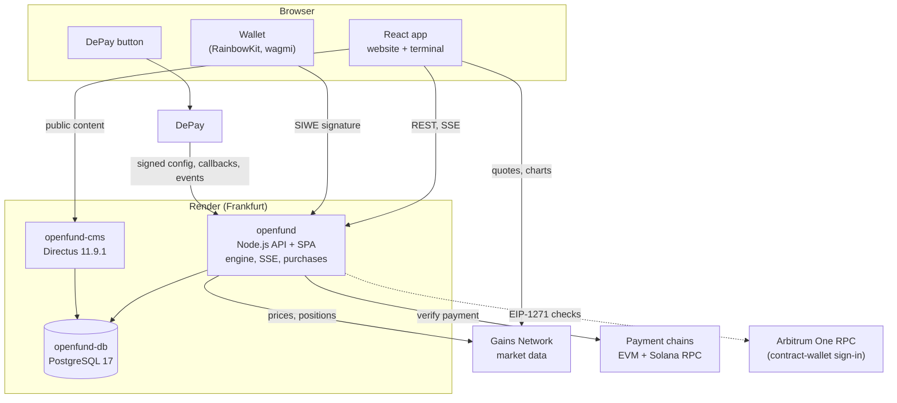

- **Wallet authentication** is Arbitrum One only. **Payments** are independent
  of it: DePay offers every settlement chain the owner configures, and the
  backend verifies each payment on its own chain. See [DePay](docs/payments/DEPAY.md).
- **Content versus data.** Directus holds editorial content, the plan catalog
  and coupon administration. Market data comes from Gains. Prices, orders and
  payments are decided only by the backend.
- More: [Architecture](docs/architecture/ARCHITECTURE.md) · [Flows](docs/architecture/FLOWS.md) · [Product contracts](docs/architecture/PRODUCT_TERMINALS.md)

## Technology stack

Verified against the package manifests.

| Layer | Technology |
| --- | --- |
| Frontend | React 19, TypeScript 5.9, Vite 6, React Router 7 |
| Wallet | RainbowKit 2, wagmi 2, viem 2, Sign-In with Ethereum |
| Charts and market data | Vela 0.9.3, Vela Pine addon 0.3.2, PineTS 0.13.1, Gains Network API |
| Backend | Node.js 22, Express 4, `pg`, decimal.js, viem, `ws` |
| Database | PostgreSQL 17 |
| CMS | Directus 11.9.1 (official Docker image) |
| Payments | DePay (button, dynamic configuration, signed callbacks and events) |
| Testing | Node test runner, Playwright browser suites |
| CI/CD | GitHub Actions (CI, unified release, gated deploy), gitleaks, Dependabot |
| Hosting | Render Blueprint (`render.yaml`): web service, Docker CMS, managed PostgreSQL |
| Monitoring | `/health`, `/version`, Render logs, payment review queue |

[Technology registry](docs/architecture/TECH_STACK.md) · [Upstream provenance](docs/integrations/UPSTREAM.md)

## Infrastructure

| Element | Setup |
| --- | --- |
| **GitHub** | Canonical repository; protected `main` with required checks; releases and tags |
| **Render** | `openfund` (Node web service, API + SPA), `openfund-cms` (Directus image with a persistent media disk), `openfund-db` (PostgreSQL 17), all in Frankfurt. Commit auto-deploy is off |
| **Domains** | `openfi.cloud` and `openfund.cloud` serve the same service |
| **Deployment** | A maintainer publishes a release; the release workflow deploys the exact tagged commit after environment approval and checks `/version` on both domains |
| **Build** | `node scripts/release/render-build.mjs` builds the frontend; migrations run at start-up and are additive and idempotent |
| **Health** | `/health` (API), `/server/ping` (CMS), `/version` (exact version and commit) |
| **Backups** | Render PostgreSQL backups plus manual `pg_dump` before risky changes; Directus media on its disk ([Backup and restore](docs/backstage/BACKUP_RESTORE.md)) |
| **Rollback** | Redeploy the previous official release; additive migrations keep older code compatible ([Rollback](docs/deployment/ROLLBACK.md)) |

[Render runbook](docs/deployment/RENDER.md) · [Environment variables](docs/deployment/ENVIRONMENT.md)

## Development workflow

```bash
npm ci
npm ci --include=dev --prefix apps/web-react
npm ci --prefix apps/backend
createdb openfund_dev
export DATABASE_URL=postgresql://localhost:5432/openfund_dev
npm run migrate --prefix apps/backend
npm run seed-plans --prefix apps/backend
PORT=8180 npm run dev:backend
```

In a second terminal: `VITE_BACKEND_URL=http://localhost:8180 npm run dev:web`.

| Topic | Where |
| --- | --- |
| Repository layout | `apps/web-react` (frontend), `apps/backend` (API, engine, payments), `apps/backstage` (Directus tooling), `packages/` (shared sources), `vendor/` and `third_party/` (upstream code), `docs/` |
| Environment | [.env.example](.env.example), [Environment variables](docs/deployment/ENVIRONMENT.md) |
| Checks | `npm run docs:check`, `npm run typecheck`, `npm run test:web`, `npm run validate:blueprint`, `npm run test:backend` (isolated test database) |
| Pull requests | Branch from `main`, Conventional Commits, PR template ([Pull requests](docs/development/PULL_REQUESTS.md), [CONTRIBUTING.md](CONTRIBUTING.md)) |
| Full engineering reference | [Engineering reference](docs/development/ENGINEERING_REFERENCE.md): installation, database, services, CMS, wallet, payments, coupons, testing, CI/CD, release, deployment, security, monitoring |
| Troubleshooting | [Local development](docs/development/LOCAL_DEVELOPMENT.md), [Testing](docs/development/TESTING.md) |

## Versioning and releases

- **Latest official release:** shown by the *release* badge above and on the
  [Releases page](https://github.com/algomanlife/openfund/releases); history in
  the [changelog](CHANGELOG.md).
- **Deployed version:** shown by the *deployed* badge, read live from
  [`/version`](https://openfi.cloud/version), which returns the version, exact
  commit and whether the build is an official release. A deployed build is not
  automatically an official release; a merged pull request is not deployed
  until `/version` says so.
- **Repository version:** tags are `vMAJOR.MINOR.PATCH`, allocated from
  Conventional Commits. `package.json` versions describe components, not the
  application. See [Releases](docs/deployment/RELEASES.md).

```bash
curl -s https://openfi.cloud/version
gh release list -R algomanlife/openfund
```

## License

**No first-party license has been selected yet (owner decision pending), so no
open-source licence is granted.** The repository is public for transparency.
Third-party components keep their own terms:

| Component | License | Note |
| --- | --- | --- |
| Vela | Apache-2.0 + NOTICE | Visible "Vela" attribution on chart screens |
| PineTS, Vela Pine addon | AGPL-3.0-only | Shipped in the web bundle, modified worker; source-offer obligations under review ([PineTS report](docs/legal/PINETS.md)) |
| LuxAlgo journal-core, Gains SDK | MIT | Vendored with notices |
| MetaMask SDK | ConsenSys licence | Notice shipped; commercial-use terms under review |
| Openfund Protocol (dormant) | GPL-2.0 | Not built or shipped |

[Licensing report](docs/legal/LICENSING.md) · [Third-party notices](THIRD_PARTY_NOTICES.md) · [Dependency licenses](docs/legal/DEPENDENCY_LICENSES.md)

## Contributing and security

Read [CONTRIBUTING.md](CONTRIBUTING.md) and the [documentation index](docs/README.md).
Report vulnerabilities privately through [SECURITY.md](SECURITY.md).

<div align="center">


[openfi.cloud](https://openfi.cloud) · [openfund.cloud](https://openfund.cloud) · [Releases](https://github.com/algomanlife/openfund/releases) · [Changelog](CHANGELOG.md)

</div>
