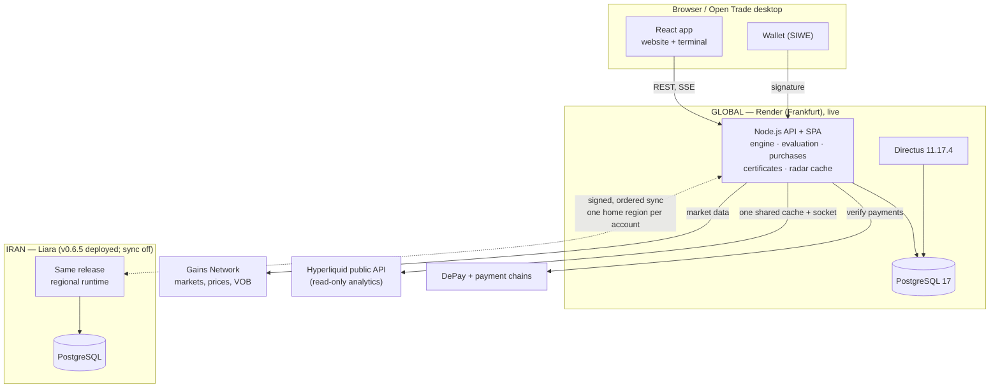

<div align="center">


# Openfund

**A clearer way forward**

An open-development prop trading firm and trading technology platform for
trading evaluations, funded programs, trader rewards and financial transparency.

[**openfi.cloud**](https://openfi.cloud) · [**openfund.cloud**](https://openfund.cloud) · [Documentation](docs/README.md) · [Roadmap](ROADMAP.md) · [Changelog](CHANGELOG.md)

[](https://github.com/algomanlife/openfund/releases/latest)
[](https://openfi.cloud/version)
[](https://github.com/algomanlife/openfund/actions/workflows/ci.yml)


<br />


</div>

---

**Contents** · [Overview](#project-overview) · [Products](#product-ecosystem) · [Backstage](#openfund-backstage--business-operations-console) · [Gallery](#product-gallery) · [Feature status](#feature-status) · [Business model](#business-model) · [Architecture](#technical-architecture) · [Technology](#technology-stack) · [Development](#development-workflow) · [Releases](#versioning-and-releases) · [Security](#security) · [License](#license) · [Contributing](#contributing-and-security)

<!-- status:summary -->

**Current status** (verified 2026-11-18; canonical: [docs/status](docs/status/README.md)):

- Latest official release: **v0.7.0** (`34ef7ec`, 2026-11-18).
- GLOBAL (Render) Web/API runs v0.7.0 `34ef7ec`; IRAN (Liara) web runs v0.6.5 `a87804a` (built as unofficial).
- Purchases: enabled in GLOBAL, disabled in IRAN; owner purchase acceptance open (see the purchases row in docs/status).
- Live execution: disabled (Approved signer/custody design, supported testnet contracts, simulation, security review and management activation).
- Desktop: 0.0.2 installers built and acceptance-tested in CI; unsigned and not published.

<!-- /status:summary -->

### Payments (current architecture and acceptance)

| Layer | v0.7.0 (released, GLOBAL) | Openfund Pay (implemented, **not released**) |
|---|---|---|
| Methods | DePay (multi-chain, converts tokens) and manual transfer with a TXID | **Pay with Wallet** (one server-prepared ERC-20 transfer, any configured network), manual transfer (TXID optional, red sender warning); DePay off for new payments (provider shuts down 2026-12-31) |
| Verification | On-chain: token, receiver, sender, amount, finality, reorg | Same verifier; a short amount is evidence, not a rejection |
| Accounting | One payment per order; underpayment rejected | Ledger: partial payments, multi-transaction orders, excess → refund liability, exactly-once activation |
| Discovery | Only a submitted hash or a DePay callback | Treasury watcher (cursor, reorg window, RPC failover); automatic attribution only when unambiguous |
| Operations | Attempt review and reverify | Backstage Payments: overview, investigation, deposit review, refund lifecycle, method switches, alerts |
| Acceptance | **Not accepted**: 2026-11-18 real purchases failed ([incident](docs/payments/INCIDENT_2026-11-18.md)) | Deterministic tests only; real-network checklist in [ACTIVATION](docs/payments/ACTIVATION.md) |

Sign-in stays Arbitrum-only (SIWE, chain 42161); payment networks are independent.
A DePay-attested payment settles automatically only when the order owner's
wallet signed it; any other payer waits for operator review unless the owner
sets `DEPAY_ATTESTED_ANY_PAYER=true` ([security assessment](docs/security/SECURITY-AUDIT-2026-11.md), OF-2026-11-05).

## Project overview

Openfund develops challenge and funded programs alongside the Web Terminal,
Open Trade desktop and market analytics. Evaluation and funded-demo trades are
simulated. Trader rewards follow the applicable terms and require human review.
Real-market allocation depends on verified free capital, controls and explicit
authorization.

- **Prop trading evaluation.** Traders choose a challenge, trade a simulated
  account under published rules, and the server — never the browser —
  evaluates every rule from a frozen snapshot.
- **One professional terminal.** Prop and Perpetual share a single terminal:
  Vela charts with Pine indicators, order panel with risk preview, positions,
  portfolio and a trade journal.
- **Read-only market intelligence.** Trade Radar follows public Hyperliquid
  whale activity; the Market Heatmap maps perpetual markets by volume or open
  interest. Neither touches orders or accounts.
- **Desktop.** Open Trade is a lightweight desktop workspace built around the
  chart — a focused workflow, not a cut-down web terminal.
- **Transparency.** Rules, prices, the revenue model, partner commissions and
  governance limits are published; economic figures come only from
  operational records. The repository is public so all of this can be checked.

Openfund is early-stage. Nothing here claims revenue, user numbers, funding,
partnerships or regulatory approval.

The [one-year roadmap](ROADMAP.md#one-year-product-roadmap) covers funded operations,
partner growth, platform expansion and operational scaling.

## Product ecosystem

| | What it is | Where |
| --- | --- | --- |
| **Website** | Product gateway, challenges, markets, rulebook, economy, governance, learning, certificates verification, roadmap — in Persian (RTL), English, Arabic (RTL), Russian and Simplified Chinese | [openfi.cloud](https://openfi.cloud) |
| **Web Terminal** | The complete workspace: trading, charts, portfolio, journal, accounts, leaderboard, certificates, purchases, Trade Radar and Heatmap | `/:locale/prop/trade` |
| **Open Trade (desktop)** | Lightweight Electron workspace: one to four independent Vela charts, compact watchlist, floating order ticket, positions strip, keyboard shortcuts | [Release preparation](docs/releases/open-trade-0.0.2.md) |
| **Certificates** | Purchase, completion and payout certificates issued from recorded events, verifiable by serial or QR in either region | `/:locale/certificate-verification` |
| **Backstage** | Independent, bilingual owner workspace for Prop business operations | [backstage.openfi.cloud](https://backstage.openfi.cloud) |

## Openfund Backstage — Business Operations Console

[Openfund Backstage](https://backstage.openfi.cloud) is the owner console for
the [main platform](https://openfi.cloud). It provides English and Persian
workspaces for trader and challenge inspection, final-pass review, payment
investigation, controlled test coupons, payout review and correspondence,
support intake, partner applications, financial position and system status.

The website serves buyers and traders, the terminal handles trading, and
Directus manages editorial content. Backstage runs independently on Render
and uses the existing Openfund backend for business records and decisions.
The service authenticates a single provisioned owner, keeps its backend
credential server-side and asks the owner to re-enter their password for
privileged decisions.

Since release v0.6.5 (official 2026-11-17; v0.7.0, official 2026-11-18, is the
latest — see [current status](docs/status/README.md)), Backstage includes commercial
coupon administration, trader support replies with a trader Inbox and in-app
notifications, partner review and commissions, finance records (expenses,
reserves, obligations), a unified audit trail, a read-only live risk board,
global search and a Content workspace for editing website copy in Directus.
External email delivery is not built. See the
[operator guide](docs/backstage/OPERATIONS_GUIDE.md) and
[feature status](docs/product/FEATURE_STATUS.md) for current coverage.

| English overview | Persian overview |
| --- | --- |
|  |  |


Additional local captures show [challenge inspection](docs/assets/screenshots/backstage-operations/backstage-challenge.png),
[controlled coupons](docs/assets/screenshots/backstage-operations/backstage-controlled-coupons.png),
[payout details](docs/assets/screenshots/backstage-operations/backstage-payout.png),
[support intake](docs/assets/screenshots/backstage-operations/backstage-support-intake.png)
and [financial position](docs/assets/screenshots/backstage-operations/backstage-financial-position.png).
Launch-completion captures (local, not deployed) show the
[coupon wizard result](docs/assets/screenshots/launch-completion/backstage-coupons.png),
the [audit trail](docs/assets/screenshots/launch-completion/backstage-audit.png),
the [Content workspace](docs/assets/screenshots/launch-completion/backstage-content-en.png)
and the [trader Inbox](docs/assets/screenshots/launch-completion/trader-inbox-en.png).

## Product gallery

Genuine captures. Website and terminal: local test runtime of the v0.6.5
candidate with live public market data and published CMS content (no
personal wallet). Desktop: Open Trade 0.0.2. Provenance for every image is in
the [screenshot manifest](docs/assets/screenshots/manifest.json).

| Trading terminal | Trade Radar — aggregated whale positioning |
| --- | --- |
|  |  |

| Market Heatmap | Open Trade desktop — four charts |
| --- | --- |
|  |  |

| Applications | Certificate verification | Completion certificate (test record) |
| --- | --- | --- |
|  |  |  |

| Home — light theme | Roadmap (Persian) | Mobile (Persian) |
| --- | --- | --- |
|  |  |  |

More: [challenges, checkout, dashboard and economy pages](docs/assets/screenshots/readme/) from production v0.4.4.

## Feature status

From the [feature register](docs/product/FEATURE_STATUS.md). "Production" means
served at [`/version`](https://openfi.cloud/version); a merged change is not
production until `/version` reports it.

| Status | Capabilities |
| --- | --- |
| **Production** | Prop simulation (Free Trial, Standard, One-phase, Instant); shared terminal; Perpetual read-only market data and wallet-scoped positions; dashboard, portfolio, journal, invoices; server challenge evaluation; CMS; transparency, revenue-model and live-market pages |
| **Released (v0.6.5 and v0.7.0); v0.7.0 deployed on GLOBAL Web/API, IRAN still on v0.6.5** ([PR #122](https://github.com/algomanlife/openfund/pull/122), [PR #132](https://github.com/algomanlife/openfund/pull/132), [v0.7.0](docs/releases/openfund-0.7.0.md)) | Trade Radar and Market Heatmap; certificate designs and verification page; terminal Persian terminology and footer; homepage and site-wide redesign; Applications and Roadmap pages; complete Backstage operations and Content workspace; trader Inbox and in-app notifications; post-deploy SIWE gate |
| **Implemented, not active** | Hybrid Governance v1.0 (no council seated); Ambassador and Coach programs; Iran regional runtime and synchronization ([ADR 0033](docs/decisions/0033-regional-authority-and-synchronization.md)) |
| **Beta** | Open Trade 0.0.2 — built and acceptance-tested for macOS, Windows and Linux; unsigned; publication awaiting owner approval |
| **Not accepted (real-payment defects)** | Checkout and purchases: payments are enabled in production. The owner's two real purchases on 2026-11-18 (DePay, manual) did not activate a challenge ([incident report](docs/payments/INCIDENT_2026-11-18.md)) |
| **Implemented, not released** | Openfund Pay — direct wallet payment, partial payments, refund liabilities, treasury watcher, Backstage payment operations ([ADR 0046](docs/decisions/0046-openfund-pay.md), [guide](docs/payments/OPENFUND_PAY.md)); real-network acceptance pending owner authorization |
| **Blocked** | Gains transaction execution (needs supported contracts, simulation and security review) |
| **Planned** | Mobile apps; protocol routing; advanced order workflows — see the [roadmap](ROADMAP.md) |

Controlled challenge acceptance uses two owner-issued test entitlements in an
isolated runtime. See the [operator procedures](docs/payments/CONTROLLED_CHALLENGES.md).

## Business model

The approved model is recorded in [ECONOMY.md](ECONOMY.md) and summarised in
[Business model](docs/economy/BUSINESS_MODEL.md). No revenue, profitability or
growth figures have been published, and none are implied here.

**Challenge sales.** Openfund sells one-time evaluation fees for simulated
challenge accounts. Prices come from the plan catalog in the CMS; the server,
never the browser, prices every order. Current published catalog
([live](https://openfi.cloud/purchases/plans)):

| Model | Structure | Account sizes | Evaluation fee |
| --- | --- | --- | --- |
| Free Trial | Practice account | 5k – 100k | Free |
| Standard | Two-phase evaluation (8% + 5% targets, 10% max loss) | 5k – 100k | $44 – $652 |
| One-phase | Single target, one rule set | 5k – 100k | $74 – $666 |
| Instant | Funded from day one | 5k – 200k | $60 – $888 |

**Purchase lifecycle.** Order (server price, optional coupon) → payment
(v0.7.0: DePay or a manual transfer with a TXID; Openfund Pay, not yet
released, adds a direct wallet payment) → on-chain verification of token,
receiver, sender, amount and finality → atomic provisioning of exactly one
challenge account and one invoice. No client message, callback or event marks
an order paid on its own. Every state change is recorded. See
[Order lifecycle](docs/payments/ORDER_LIFECYCLE.md) and
[Payment verification](docs/payments/VERIFICATION.md).

**Revenue recognition principles.** Net collected revenue is gross sales minus
coupon discounts minus refunds, recognised from the verified settlement amount
on chain. Internal 100% test coupons are excluded from revenue and reported
separately. Ambassador commissions are an acquisition cost, recorded as
obligations.

**Costs.** Ambassador commissions, coach compensation (once live trading
exists), trader rewards under published plan rules, refunds and infrastructure
(Render, PostgreSQL, Directus, RPC providers).

## Economy and governance

| Program | Approved rule | Status |
| --- | --- | --- |
| **Brand Ambassador (IB)** | 10% of the referred customer's **first** eligible confirmed purchase, on the net amount after discounts, recognised at verified payment. Eligibility: 50,000+ followers on Instagram or YouTube plus an active second platform; approval by company management | Implemented, not production-active |
| **Verified Trading Coach** | 10% of distributable **realised** net profit from eligible live trades, after trading and execution costs; never on simulated or unrealised PnL | Implemented, inactive until live trading exists |
| Customer referral discount (20%) | **Proposed**, not approved, not active | — |
| Real-capital profit-sharing tiers | **Pending decision** | — |

**Governance.** Hybrid Governance v1.0: *community-governed development,
company-managed treasury*. A ten-seat Community Council holds binding
authority over delegated, non-financial domains through proposals and votes.
Company management keeps exclusive control of the treasury and every financial
decision. It is not a DAO: there is no governance token, and votes are recorded
off-chain. Role-based administration separates content editors, commerce
administrators and operators.

[ECONOMY.md](ECONOMY.md) · [GOVERNANCE.md](GOVERNANCE.md) · [Partner programs](docs/economy/PARTNER_PROGRAMS.md) · [Treasury](docs/economy/TREASURY.md)

## Technical architecture

One reviewed source serves two independently operated regions. Each region
runs the API and web app from the same origin, so session cookies stay
first-party.



- **Trading engine boundary.** Orders, positions, PnL and evaluation are
  decided only by the backend engine; analytics modules (Radar, Heatmap) are
  GET-only and isolated from it.
- **Regions.** Every trading account has exactly one home region enforced by
  the database; the other region holds a read model through signed
  synchronization. The Liara runtime is deployed (v0.6.5); synchronization
  between the regions is not enabled yet.
- **Content versus data.** Directus holds editorial content, the plan catalog
  and coupons; market data comes from Gains (and Hyperliquid for read-only
  analytics); prices, orders and payments are decided only by the backend.
  Directus's public and editor roles have no access to financial or identity
  collections. Directus gets its own least-privilege PostgreSQL role
  (`openfund_directus`, [database roles](docs/security/DATABASE_ROLES.md)): it
  can read but never write challenge, trading, payment and other financial
  tables. The role is merged but **not yet deployed**; until the owner
  switches the production CMS credential, finding OF-2026-11-12 stays live in
  production.
- More: [Architecture](docs/architecture/ARCHITECTURE.md) · [Regional runtime](docs/decisions/0033-regional-authority-and-synchronization.md) · [Trade Radar](docs/integrations/HYPERLIQUID_RADAR.md) · [Gains](docs/integrations/GAINS.md) · [Certificates](docs/decisions/0039-certificate-event-attestations.md)

## Technology stack

Versions verified against the lockfiles and CI configuration.

| Layer | Technology |
| --- | --- |
| Web | React 19.3, TypeScript 7.0, Vite 8.3, React Router 7 |
| Wallet | RainbowKit 2, wagmi 2, viem 2, Sign-In with Ethereum (Arbitrum One) |
| Charts and data | Vela 0.10.6, Vela Pine addon 0.3.4, PineTS 0.13.1; Gains Network API; Hyperliquid public API |
| Backend | Node.js 26, Express 5.3, `pg`, decimal.js, viem, `ws` |
| Data | PostgreSQL 17; Directus 11.17.4 |
| Desktop | Electron 45.3, electron-builder (DMG, NSIS, AppImage, deb) |
| Payments | DePay (signed configuration, callbacks, events); on-chain verification |
| Quality | Node test runner, Playwright browser suites, CodeQL, gitleaks, dependency review, a blocking production-dependency audit, and security regression suites (HTTP penetration checks, financial invariants, browser session isolation) |
| Delivery | GitHub Actions; Render Blueprint (`render.yaml`); Liara runtime image (`infra/liara-iran-runtime`) |

Design system: shared tokens and primitives in
[`design-system.css`](apps/web-react/src/styles/design-system.css)
([guide](docs/design/DESIGN_SYSTEM.md)).

## Infrastructure

| Element | Setup |
| --- | --- |
| **GitHub** | Canonical repository; protected `main` with required checks; releases and tags |
| **Render** | `openfund` (Node web service, API + SPA), `openfund-cms` (Directus image with a persistent media disk), `openfund-db` (PostgreSQL 17), all in Frankfurt. Commit auto-deploy is off |
| **IRAN region** | Liara runtime image and desired-state manifest (`infra/liara-iran-runtime`, ADR 0033): same release, own database, signed synchronization. Deployed on Liara (web and worker, v0.6.5); synchronization **not enabled** |
| **Domains** | `openfi.cloud` and `openfund.cloud` serve the same service |
| **Deployment** | A maintainer publishes a release; the release workflow deploys the exact tagged commit after environment approval and checks `/version` on both domains |
| **Build** | `node scripts/release/render-build.mjs` builds the frontend; migrations run at start-up and are additive and idempotent |
| **Health** | `/health` (API), `/server/ping` (CMS), `/version` (exact version and commit) |
| **Backups** | Render PostgreSQL backups plus manual `pg_dump` before risky changes; Directus media on its disk ([Backup and restore](docs/backstage/BACKUP_RESTORE.md)) |
| **Rollback** | Redeploy the previous official release; additive migrations keep older code compatible ([Rollback](docs/deployment/ROLLBACK.md)) |

[Render runbook](docs/deployment/RENDER.md) · [Environment variables](docs/deployment/ENVIRONMENT.md)

## Development workflow

Requires Node.js 26 and a local PostgreSQL.

```bash
npm ci
npm ci --include=dev --prefix apps/web-react
npm ci --prefix apps/backend
createdb openfund_dev
export DATABASE_URL=postgresql://localhost:5432/openfund_dev
npm run migrate --prefix apps/backend
npm run seed-plans --prefix apps/backend
npm run build:web                 # the backend serves react/
PORT=8180 npm run dev:backend     # http://localhost:8180
```

For hot reload, run `VITE_BACKEND_URL=http://localhost:8180 npm run dev:web`
in a second terminal. Desktop: `npm ci --prefix apps/open-trade && npm run dev --prefix apps/open-trade`.

**Tests.** `npm run typecheck`, `npm run test:web`, `npm run test:release`,
`npm run validate:blueprint`, `npm run docs:check`; backend suites need a
disposable database: `TEST_BACKEND_URL=… DATABASE_URL=postgres://…/openfund_test npm run test:backend`.
The backend server under test runs with `SIM_TEST_MODE=1`, a test
`ADMIN_API_TOKEN` and the CI placeholder `PURCHASE_PAYMENT_RECEIVER` (see
`ci.yml`). Never point tests at a database you care about.

Security suites (all against local test runtimes only):

```bash
npm --prefix apps/backend run test:security   # auth hygiene + financial invariants (no server)
npm --prefix apps/backend run test:pentest    # HTTP penetration checks against TEST_BACKEND_URL
BASE_URL=http://localhost:8080 npm run test:browser:security   # browser session isolation
```

[Testing guide](docs/development/TESTING.md) · [Local development](docs/development/LOCAL_DEVELOPMENT.md) · [Engineering reference](docs/development/ENGINEERING_REFERENCE.md)

## Versioning and releases

| | Versioning | Where |
| --- | --- | --- |
| **Web platform** | `vMAJOR.MINOR.PATCH` tags allocated from Conventional Commits; an owner-approved manual dispatch may choose the patch inside a newly allocated line (e.g. v0.6.5) | [Releases](https://github.com/algomanlife/openfund/releases) · [runbook](docs/deployment/RELEASES.md) |
| **Open Trade desktop** | Independent version (0.0.2); pre-release tags `open-trade-vX.Y.Z` | [0.0.2 preparation](docs/releases/open-trade-0.0.2.md) |

`/version` returns the deployed version, the exact commit and whether the build
is an official release. Render and Liara deploy independently from the same
tagged commit; merging does not deploy either.

```bash
curl -s https://openfi.cloud/version
```

## Security

The first [security self-assessment](docs/security/SECURITY-AUDIT-2026-11.md)
(November 2026) was written by the project's coding agent. It is **not** an
independent audit. Its [penetration-test methodology and results](docs/security/PENETRATION-TEST-2026-11.md),
[test matrix](docs/security/SECURITY-TEST-MATRIX.md) and
[remediation plan](docs/security/SECURITY-REMEDIATION-PLAN.md) record what was
tested, what was fixed and what remains open. The
[remediation report](docs/security/SECURITY-REMEDIATION-2026-11.md) gives each
finding's state (fixed in code, merged, released, deployed). No production
system was tested or changed.

| Control | Implementation |
| --- | --- |
| Wallet sign-in | SIWE (EIP-4361) on Arbitrum One only: domain and URI binding, a single-use nonce bound to the address, a time window, ECDSA recovery and an EIP-1271 fallback |
| Sessions | Random 256-bit id stored hashed; HttpOnly, `SameSite=Lax`, `Secure` in production; checked on every request; expired rows swept hourly |
| Authorization | Every account, order, position and withdrawal is scoped to the session's user on the server; the admin API is disabled until a token is configured and needs a named operator for decisions |
| Payments | The chain verifier decides; provider callbacks are signed hints only; each transaction is single-use; partial payments and excess are recorded as ledger evidence or refund liabilities |
| Trading and evaluation | Server-authoritative engine with decimal arithmetic, frozen rule snapshots and fresh-mark requirements; stale marks never decide a pass or fail |
| Browser | Strict CSP with hashed inline scripts, `frame-ancestors`, `nosniff`, `Referrer-Policy`, `Permissions-Policy`, HSTS in production |
| Database | Separate owner/migration, runtime, Directus and read-only PostgreSQL roles with a version-controlled, table-by-table policy and a drift check ([database roles](docs/security/DATABASE_ROLES.md)) |
| CMS | Directus 11.17.4 with verified compensating controls (cache off, SSRF deny list, image/PDF-only uploads, WebSockets off); the 12.x upgrade waits for a licence |
| Rate limits | Per visitor IP (Cloudflare-verified `CF-Connecting-IP`; the Iran edge's keyed client IP); one API process by design |
| Supply chain | gitleaks; blocking production-dependency audit; Dependabot; dependency review; CodeQL; plus [security automation](docs/security/SECURITY-AUTOMATION.md): actionlint, zizmor, Semgrep (new findings), Trivy (lockfiles, configuration, edge image), ZAP baseline, OSV-Scanner and a CycloneDX SBOM on every release |

Open security risks: OF-2026-11-11 (Directus advisories, High, mitigated and
blocked by a licence decision), and OF-2026-11-12 and OF-2026-11-20, which
are fixed in `main` but not deployed. Nothing from the November remediation
is released or deployed yet. Payment acceptance is assessed separately. See
the [remediation report](docs/security/SECURITY-REMEDIATION-2026-11.md#outstanding-blockers).
Report vulnerabilities privately: [SECURITY.md](SECURITY.md).

## Roadmap

The [roadmap](ROADMAP.md) lists seven phases ordered by dependency, each tied
to milestones with acceptance criteria in the
[milestone register](docs/roadmap/MILESTONES.md). The website Roadmap page
mirrors it. The owner's product roadmap will be added there; no dates or
completion percentages are published before then.

## License

**No first-party license has been chosen yet.** Openfund's own code is
therefore all rights reserved: the repository is public for transparency, but
that does not grant a right to copy, modify or redistribute it. The options,
their consequences and the blockers are prepared for the owner in the
[license decision](docs/legal/LICENSE_DECISION.md).

Third-party components keep their own terms (full list in
[THIRD_PARTY_NOTICES.md](THIRD_PARTY_NOTICES.md)):

| Component | License | Note |
| --- | --- | --- |
| Vela | Apache-2.0 + NOTICE | Visible "Vela" attribution on chart screens |
| PineTS, Vela Pine addon | AGPL-3.0-only | Shipped in the web bundle; source-offer obligations under review ([report](docs/legal/PINETS.md)) |
| drkxbt/whales, drkxbt/charts | MIT | Logic adapted for Trade Radar and Heatmap ([provenance](third_party/drkxbt-whales/PROVENANCE.md)) |
| LuxAlgo journal-core, Gains SDK | MIT | Vendored with notices |
| MetaMask SDK | ConsenSys licence | Notice shipped; commercial-use terms under review |
| Directus | BSL 1.1 (11.17.4) | Separate service, not redistributed |
| Openfund Protocol (dormant) | GPL-2.0 | Not built or shipped |
| Irancell-derived fonts, Pine indicators | **Unresolved** | Provenance needed before any license decision |

[Licensing report](docs/legal/LICENSING.md) · [Dependency licenses](docs/legal/DEPENDENCY_LICENSES.md)

## Contributing and security

Contributions are welcome — start with [CONTRIBUTING.md](CONTRIBUTING.md):

1. Branch from `main` (`feature/…`, `fix/…`; agents use `agent/<name>/<task>`).
2. Use Conventional Commits; keep changes scoped; update docs, the feature
   register and the changelog with the code.
3. Run the checks above; open a pull request using the template — it lists
   tests, risks and screenshots, and CI enforces it.
4. Required checks must pass; merging does not deploy.

Until a license is chosen, the terms for accepting contributions are also an
open owner decision; the maintainer may ask you to confirm you have the right
to submit your work ([CONTRIBUTING.md](CONTRIBUTING.md)).

| | |
| --- | --- |
| Security vulnerabilities | Report **privately** via [SECURITY.md](SECURITY.md) — never in a public issue |
| Security assessment | [November 2026 self-assessment](docs/security/SECURITY-AUDIT-2026-11.md) (not an independent audit) |
| Questions | [SUPPORT.md](SUPPORT.md) |
| Conduct | [Code of conduct](CODE_OF_CONDUCT.md) |
| Review and release authority | [Repository governance](docs/development/REPOSITORY_GOVERNANCE.md) |
| Coding agents | [AGENTS.md](AGENTS.md) |

<div align="center">


[openfi.cloud](https://openfi.cloud) · [openfund.cloud](https://openfund.cloud) · [Releases](https://github.com/algomanlife/openfund/releases) · [Changelog](CHANGELOG.md)

</div>
