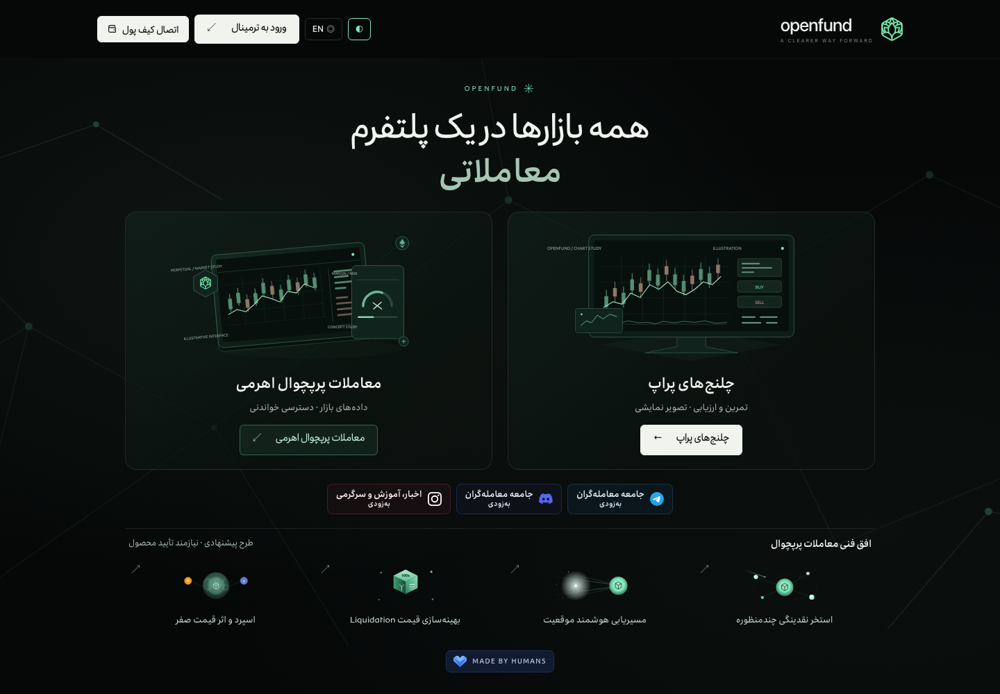
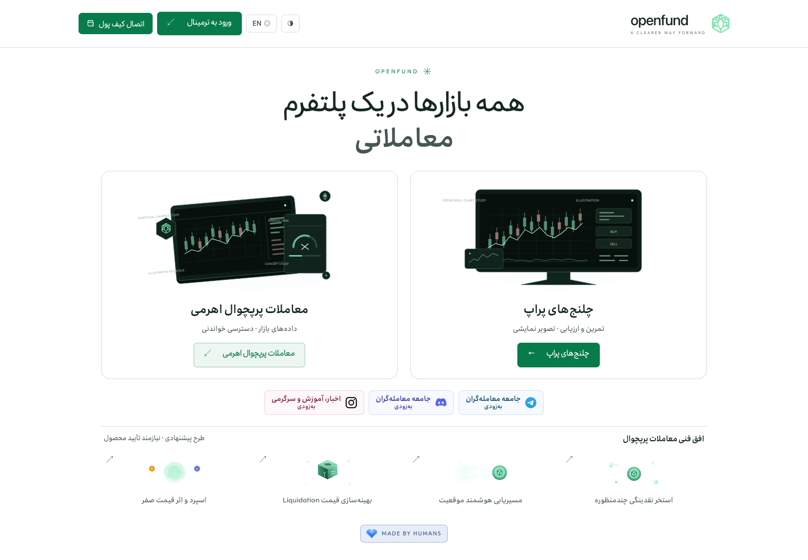
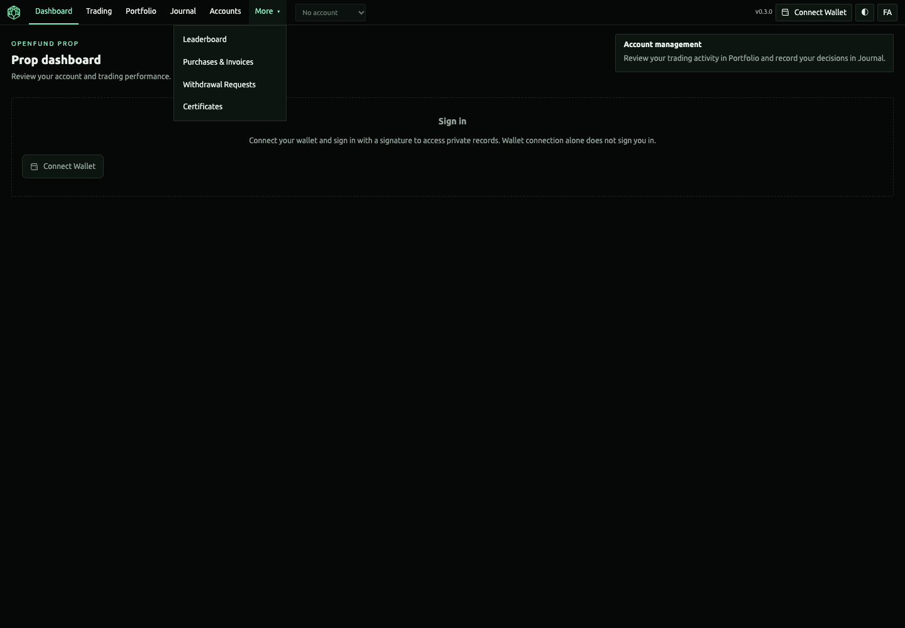
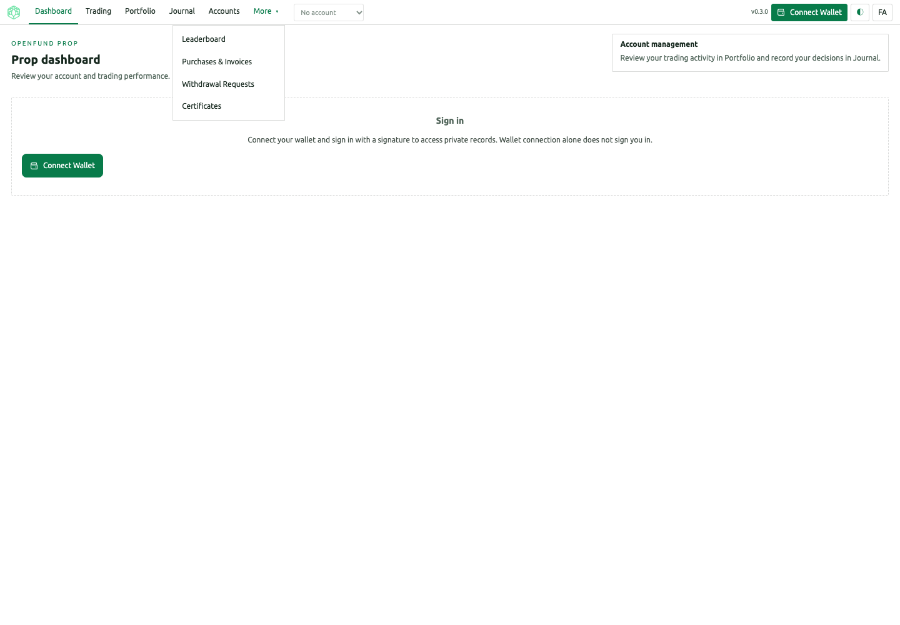
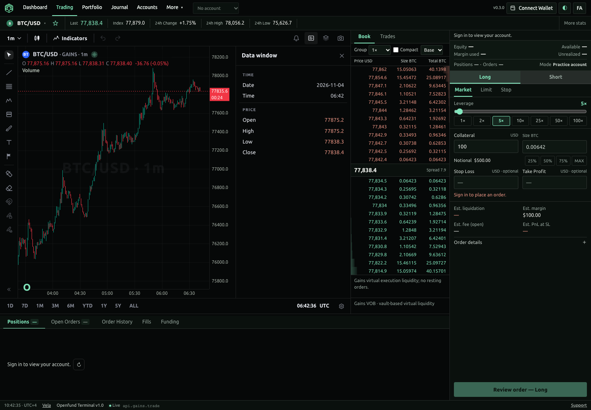
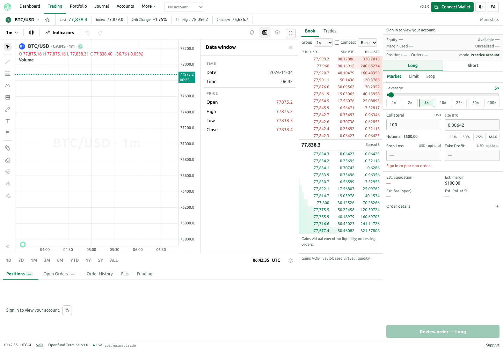

<div align="center">


# Openfund

**OPENFUND — A CLEARER WAY FORWARD**

Trading software for market discovery, simulated Prop trading and wallet-scoped Perpetual account review.

[Documentation](docs/README.md) · [Feature status](docs/product/FEATURE_STATUS.md) · [Roadmap](ROADMAP.md) · [Contributing](CONTRIBUTING.md)

[](https://github.com/algomanlife/openfund/actions/workflows/ci.yml)

</div>

## Status at a glance

> This README is not live status. The authority order is: GitHub Release/tag, then
> commit SHA, then the running service's `/version`, then the frontend manifest, then
> pull requests, then this file and the changelog
> ([version authority](docs/deployment/RELEASES.md#version-authority-hierarchy)).

**Verified production snapshot (read-only checks on 2026-11-10):**

| Source | Result |
| --- | --- |
| `https://openfund.cloud/version` and `https://openfi.cloud/version` | `status: matched`, version **0.4.4**, commit `c1cb7073e4f1eb16c2b204ec9b0b1158b1dde4b1`, backend and frontend identities equal |
| GitHub Release `v0.4.4` (latest, published 2026-11-08) | tag points to `c1cb707`, the live SHA |
| `https://openfund.cloud/purchases/plans` | `paymentsEnabled: false` (challenge purchases are not active in production) |

Check live status yourself with `curl https://openfund.cloud/version` and
`gh release list`. A merged pull request, a `main` commit or an open pull request is
**not** deployed until `/version` says so.

| State | What it covers |
| --- | --- |
| **Live (v0.4.4)** | Prop and Perpetual terminals, wallet sign-in, bilingual website, Prop engine with the v0.4.2 corrections, release-driven deployment |
| **Merged to `main`, not released, not deployed** | Economy / Transparency / Ambassador / Coach / Live Market Access (#59), explicit wallet choice and extra locales (#58), Whitepaper v1.0 (#60), terminal Chart tab with Quick Trade (#63) and Hybrid Governance v1.0 (#64, carried by #63), CI pipeline work (#62). Generate the exact list with `node scripts/release/summary.mjs --from v0.4.4` |
| **Open pull requests** | Payments verification and DePay reliability (#65) and the DePay checkout flow (#66, stacked on #65), plus tooling pull requests. Not on `main`, not deployed. See the [open pull requests](https://github.com/algomanlife/openfund/pulls) |
| **Disabled pending activation** | Challenge purchases (`PURCHASE_PAYMENT_RECEIVER` unset), funded capital and payouts, Gains transaction execution, Live Market Access allocation (needs verified capital of at least $500,000) |
| **Planned** | Desktop and mobile apps, rewards, operational Protocol routing |

## Product overview

Openfund is an early-stage trading technology project maintained in a public repository: a bilingual website, a shared trading terminal, wallet identity, portfolios and private journals. Prop and Perpetual share presentation, not financial balances or execution authority. The repository has **no root license granting blanket reuse rights**; component licenses apply separately ([Licensing](#licensing-and-upstream-attribution)). Source availability is not a claim of production readiness, audited security or an active funded-trading service.

| Area | Implemented scope | Boundaries |
| --- | --- | --- |
| **Prop** | Server-side simulation; market, limit and stop orders; SL/TP, partial close, liquidation; challenge evaluation; performance and journals | Free Trial accounts get 100,000 virtual USD. Purchases, funded capital and payouts are not active. |
| **Perpetual** | Gains Network market data; wallet-scoped Arbitrum One positions, orders, history | Read-only. Transactions, approvals and collateral transfers are disabled. |

[Prop guide](docs/trading/PROP.md) · [Perpetual guide](docs/trading/PERPETUAL.md) · [Capability guide](docs/product/CAPABILITIES.md) · [Feature status register](docs/product/FEATURE_STATUS.md)

## Capabilities and their status

The [feature register](docs/product/FEATURE_STATUS.md) is canonical; this table only orients you.

| Capability | Where it stands |
| --- | --- |
| Wallet authentication | Live: wallet connection and Sign-In with Ethereum, first-party HttpOnly sessions. Signing in is not a blockchain transaction. [Identity](docs/wallet/IDENTITY.md) |
| Charting (Vela, Pine indicators) | Live: shared Vela workspace with the Openfund bridge and Pine runtime. The terminal Chart tab with Quick Trade is merged, unreleased. [Vela](docs/integrations/VELA.md) |
| Gains Network | Live, read-only: REST/WebSocket market data and wallet reads. No order-book depth is inferred from oracle prices; execution is disabled by default. [Gains](docs/integrations/GAINS.md) |
| Prop engine | Live: server-authoritative simulation and challenge evaluation (daily and overall drawdown, targets, trading days). [Engine audit](docs/audits/PROP_ENGINE_AUDIT.md) |
| Payments and DePay checkout | Purchase verification exists in `main`, but **live payments are disabled** (`paymentsEnabled: false`). Verification/recovery hardening (#65) and the DePay checkout flow (#66) are open pull requests. [ADR 0009](docs/decisions/0009-challenge-purchases-and-payment-verification.md) |
| Funded accounts and payouts | Not active. A withdrawal approval records a decision, never a fund transfer. |
| Economy, Treasury, Ambassador, Coach, Live Market Access | Merged, unreleased. Figures come from operational records; treasury and allocatable capital stay `Not configured` or `Unknown` until configured. [Economy](docs/economy/README.md) |
| Governance | Merged, unreleased, not in production use: off-chain Hybrid Governance v1.0 (council, OFP proposals, voting, public Governance page). [GOVERNANCE.md](GOVERNANCE.md) · [ADR 0017](docs/decisions/0017-hybrid-governance.md) |
| Whitepaper v1.0 | Merged, unreleased: CMS-managed bilingual publication at `/{locale}/whitepaper`. [Whitepaper](docs/website/WHITEPAPER.md) |
| Portfolio and Trade Journal | Live. Analytics use only the vendored `journal-core` library of LuxAlgo Trade Journal; the journal application and its importers are **not** integrated. [Registry](docs/integrations/UPSTREAM_REGISTRY.md) |
| Localization | Persian and English with RTL are live; Arabic, Russian and Simplified Chinese are on `main` (unreleased). Language availability does not determine residency eligibility. |
| Directus CMS | Live: editorial content and plan catalog (Directus 11.9.1). Market data never flows through it. |

## Screenshots

<a id="product-gallery"></a>

Fresh P0 screenshots use real theme-button clicks, normal anonymous sessions and the actual canonical port 8080 application. The [gallery](docs/assets/screenshots/README.md) and [manifest](docs/assets/screenshots/manifest.json) identify each capture's runtime and distinguish the pre-packaging audit from final immutable-candidate evidence. No CSS injection, forced theme attributes, wallet injection or intercepted market/CMS responses are used. Prior `refinement-*` and `addendum-*` captures are historical, not evidence of the current build or owner acceptance.

| Persian Home — dark | Persian Home — light |
| --- | --- |
|  |  |
| **English Dashboard — dark** | **English Dashboard — light** |
|  |  |
| **English Prop Terminal — dark** | **English Prop Terminal — light** |
|  |  |

Charts retain live or explicit unavailable states. Anonymous Dashboard captures do not certify authenticated account contents. Chromium auto-dark emulation reproduces computed white backgrounds painted RGB(18,18,18); `color-scheme: only light` opts application-owned light surfaces out, including the nested workspace. Saved Vela cosmetics restore before the app palette. The existing polish gate runs `e2e/test-auto-dark.cjs` with real theme clicks, reloads, both OS preferences, persisted chart settings and screenshot-pixel assertions at 3360 × 1216. Owner Opera settings are not inspected; these images are not owner acceptance, an official release update or production deployment.

## Technology stack

| Layer | Technology |
| --- | --- |
| Web interface | React 19, TypeScript, Vite 6, React Router 7; Persian/English and RTL |
| Wallet and identity | RainbowKit, wagmi, viem, SIWE and HttpOnly sessions |
| Charting and market data | Vela 0.9.3, Vela Pine addon 0.3.2, PineTS 0.13.1, Gains adapters |
| API and simulation | Node.js 22, Express, Decimal arithmetic, WebSocket feeds and SSE |
| Persistence and content | PostgreSQL 17; Directus 11.9.1 for editorial/catalog administration |
| Quality and delivery | Per-app npm lockfiles, Playwright, GitHub Actions, Render Blueprint |

[Technology registry](docs/architecture/TECH_STACK.md) · [Upstream provenance](docs/integrations/UPSTREAM.md)

## Architecture

| Component | Implementation |
| --- | --- |
| Frontend | React 19 + Vite SPA in `apps/web-react/`, built into the **untracked** `react/` directory and served by the API same-origin. Public settings come from the no-store `runtime-config.js` ([ADR 0010](docs/decisions/0010-runtime-public-configuration.md)). |
| Backend | Express API in `apps/backend/server.js`: SIWE sessions, product-scoped accounts, purchases, portfolio/journal and the token-gated `/admin` API |
| Trading engine | `engine.js`, `trading-math.js` (decimal.js), `instruments.js`; server-authoritative fills, an in-process loop (about 1 s), SSE at `/trading/stream` |
| Challenge evaluation | `evaluation.js`: pure `evaluateRules()` over a frozen rules snapshot |
| Market data | `market-data.js` consumes Gains feeds; stale or future marks are rejected |
| Database | PostgreSQL 17; `schema.sql` + `migrate.js` (additive, idempotent) run on every start |
| CMS | Directus 11.9.1 (`openfund-cms`) |
| Infrastructure | Render Blueprint (`render.yaml`): `openfund`, `openfund-cms`, `openfund-db` in Frankfurt; commit auto-deploy is off |
| CI/CD | `ci.yml`, `release.yml`, `deploy-release.yml`, `package-image.yml` ([CI](docs/development/CI.md)) |

[System architecture](docs/architecture/ARCHITECTURE.md) · [Flows](docs/architecture/FLOWS.md) · [Product contracts](docs/architecture/PRODUCT_TERMINALS.md)

## Repository structure

| Path | Responsibility |
| --- | --- |
| `apps/web-react/` | React app, product routes, wallet/session context, public compatibility assets |
| `apps/backend/` | API, engine, purchases, product reads and additive migrations |
| `apps/backstage/scripts/` | Directus schema, content seeding and administration |
| `packages/` | Chart/Gains/CMS contracts; dormant Protocol source |
| `vendor/`, `third_party/` | Upstream source, licenses and notices ([registry](docs/integrations/UPSTREAM_REGISTRY.md)) |
| `dist/` | Source-critical classic compatibility deliverable; do not delete as build output |
| `react/` | **Generated** by `npm run build:web`; not tracked ([hygiene](docs/development/REPOSITORY_HYGIENE.md)) |
| `scripts/`, `infra/render/`, `e2e/` | Release/docs/CI tooling, Blueprint validation, browser checks |
| `docs/`, `brand/` | Contracts, evidence, approved brand assets |

The root package orchestrates commands; applications install from their own lockfiles.

## Development

Prerequisites: Node.js 22, npm, PostgreSQL 17 (Python 3 only for optional Directus utilities).

```bash
npm ci
npm ci --include=dev --prefix apps/web-react
npm ci --prefix apps/backend
createdb openfund_dev
export DATABASE_URL=postgresql://localhost:5432/openfund_dev
npm run migrate --prefix apps/backend
npm run seed-plans --prefix apps/backend
# Check port ownership first; keep 8080 for an official local runtime.
PORT=8180 npm run dev:backend
```

In a second terminal run `VITE_BACKEND_URL=http://localhost:8180 npm run dev:web`, then open the [English Home](http://localhost:5173/react/#/en/home) or the [Prop Terminal](http://localhost:5173/react/#/en/prop/trade).

For a same-origin build run `npm run build:web` first (the API reads `react/index.html` at start-up), then `PORT=8180 npm start --prefix apps/backend`. This is development output, not an official installation; run an official version with `npm run release:local -- --version current --migrate`. See [Local development](docs/development/LOCAL_DEVELOPMENT.md).

### Environment configuration

Use [.env.example](.env.example) as a reference, not a production credential file. Supply backend values through its shell environment; optional frontend values belong in `apps/web-react/.env` for development only. Release builds reject local frontend overrides.

| Variable | Use / safety boundary |
| --- | --- |
| `DATABASE_URL`, `PORT` | API database connection and listening port; use an isolated local DB and an unoccupied port |
| `ALLOWED_DOMAINS`, `CORS_ORIGINS` | SIWE/browser origins; custom ports require matching configuration |
| `VITE_BACKEND_URL` | Public development API origin; official packages use same-origin API |
| `VITE_DIRECTUS_URL` | Public CMS origin; content availability depends on the actual service |
| `VITE_WALLETCONNECT_PROJECT_ID` | Optional public remote-wallet configuration; real-device acceptance is separate |
| `VITE_TELEGRAM_COMMUNITY_URL`, `VITE_DISCORD_COMMUNITY_URL` | Public build-time owner-verified destinations; Telegram accepts HTTPS `t.me` community/invitation paths, Discord accepts HTTPS `discord.gg` or `discord.com/invite` paths; blank/invalid keeps actions unavailable |
| `PURCHASE_PAYMENT_RECEIVER` | Unset by default: purchases stay disabled until an approved destination is configured |
| `VITE_DEPAY_WIDGET`, `VITE_DEPAY_WIDGET_URL` | Opt-in public widget configuration; both required, with independent acceptance |
| `SIM_TEST_MODE` | Isolated local tests only; never enable in production |

Every `VITE_*` value is bundled publicly: never use it for secrets. Discord configuration is part of the in-progress addendum; follow the owning implementation and [environment reference](docs/deployment/ENVIRONMENT.md) rather than inventing an invitation. New variables must stay aligned with the existing Blueprint and template.

## Build and test commands

```bash
npm run docs:check          # language, links, Markdown, Mermaid, upstream registry
npm run typecheck
npm run test:web
npm run test:charts
npm run test:release
npm run build:web
npm run validate:blueprint
```

Backend and browser suites need an isolated test database (name contains `test`) and a running test backend; see [Testing](docs/development/TESTING.md) and [CI](docs/development/CI.md). `npm run release:build -- --candidate` runs the integrated package gates and produces an explicitly unofficial candidate.

## Pull request workflow

Branch from current `main`, use Conventional Commits, fill in the pull request template (checked by CI) and follow [Pull requests and merge readiness](docs/development/PULL_REQUESTS.md): stacked-PR rules, branch-update practice, scopes and the merge checklist. Required checks: `Web (React + Vite)`, `Backend (API + engine)`, `Render Blueprint`, `Secret scan`, `Release package gates`, `Release secret scan`. Never force-push or push directly to `main`. See [CONTRIBUTING.md](CONTRIBUTING.md) and [AGENTS.md](AGENTS.md).

## Versioning and release process

Tags are `vMAJOR.MINOR.PATCH`, allocated from Conventional Commits by `scripts/release/plan.mjs` (`feat` minor, `fix` and others patch, `!` major). A maintainer dispatches **Unified release** on `main` with `publish=true`; after the gates a tag and GitHub Release are created and, once the `production` environment is approved, Render deploys the exact commit and the workflow checks the live `/version`. Pushes and pull requests build unofficial candidates only. The `version` fields in `package.json` (`0.1.0`) are component provenance, not the application version. Render rebuilds either a published official tag or the fully gated current-`main` candidate (`scripts/release/render-build.mjs`). Details, artifacts, the GHCR image and rollback: [Releases](docs/deployment/RELEASES.md) · [Rollback](docs/deployment/ROLLBACK.md) · [Render](docs/deployment/RENDER.md) (including [production domains](docs/deployment/RENDER.md#production-domains): `openfund.cloud`, `openfi.cloud`).

## Upstream dependencies and licenses

The [upstream dependency registry](docs/integrations/UPSTREAM_REGISTRY.md) lists version, license, location, local modifications and update procedure for Vela, the Vela Pine addon, PineTS, the Gains SDK and APIs, LuxAlgo journal-core, Directus, the wallet libraries and the dormant Protocol source. [Dependency governance](docs/development/DEPENDENCY_GOVERNANCE.md) defines how they change.

External code is kept apart from Openfund's own work in three layers: upstream (vendored or pinned), integration (adapters, normalisation, error handling) and Openfund custom (branding, UI, indicators, trading logic). Vela, its Pine addon, the Gains API and SDK, the LuxAlgo journal core, Directus and the significant libraries are inventoried in the [upstream dependency registry](docs/integrations/UPSTREAM_REGISTRY.md), and their layers, patches and rollback limits are in the [upstream isolation and patch registry](docs/integrations/UPSTREAM_DEPENDENCIES.md). Direct edits to upstream source are limited to a registered patch list. `npm run check:upstream` and `npm run test:upstream` verify the isolation, and upgrades follow the [Vela](docs/integrations/VELA_UPGRADE.md) and [Gains](docs/integrations/GAINS_UPGRADE.md) procedures; no upstream is upgraded automatically. A weekly read-only workflow proposes observed updates with a risk classification ([automation](docs/integrations/UPSTREAM_AUTOMATION.md)); majors and high-risk updates need an explicit owner decision.

## Security and operational limits

Report suspected vulnerabilities privately through GitHub security advisories ([SECURITY.md](SECURITY.md)). Keep secrets, private keys and user data out of Git (gitleaks runs in CI). The repository does not claim an independent security audit, regulatory approval or production readiness. Generated-signature tests do not certify real wallet devices. Production runs one API instance that also hosts the simulation loop; scaling needs coordinated mutation ownership. [Security architecture](docs/security/SECURITY.md)

## Roadmap and documentation

[Seven-phase roadmap](ROADMAP.md) · [Milestones](docs/roadmap/MILESTONES.md) · [Documentation index](docs/README.md) · [Architecture decisions](docs/decisions/README.md) · [Governance](GOVERNANCE.md) · [Economy](ECONOMY.md) · [Design system](docs/design/DESIGN_SYSTEM.md) · [Screenshots](docs/assets/screenshots/README.md) · [Reviews](docs/reviews/README.md) · [Changelog](CHANGELOG.md)


## Licensing and upstream attribution

**No root `LICENSE` is present.** Do not interpret this public repository or its contribution workflow as a blanket open-source license grant. Before redistribution or commercial reuse, resolve first-party licensing with the maintainers and comply with each component's terms.

| Component | Preserved license / notice |
| --- | --- |
| Vendored LuxAlgo Vela | [Apache-2.0](vendor/vela/LICENSE) and [NOTICE](vendor/vela/NOTICE); retain required linked attribution in the terminal |
| Vendored Gains SDK | [MIT](vendor/gains-sdk/LICENSE); vendoring does not enable transaction execution |
| LuxAlgo trade journal and analytical core | [MIT](third_party/luxalgo-trade-journal/LICENSE) and [core license](third_party/luxalgo-trade-journal/packages-core/LICENSE) |
| Dormant Openfund Protocol | [GPL-2.0 license file](packages/openfund-protocol/LICENSE); component-specific scope, not a root license |
| Fonts and external logo artwork | [Vazirmatn license](apps/web-react/public/assets/Vazirmatn-LICENSE.txt), [TradingView logo notice](apps/web-react/public/assets/notices/TradingView-logo-LICENSE.txt) and recorded asset provenance |

Installed dependencies retain their own licenses. Brand marks, fonts, hosted Directus and external chart/payment/network services may carry separate terms; not every asset or integration is freely reusable. Preserve package/generated notices and exact upstream provenance. Service logos indicate technology references, not partnerships or endorsement. [Upstream registry](docs/integrations/UPSTREAM.md) · [Brand inventory](brand/README.md)

## Community and project links

[Canonical repository](https://github.com/algomanlife/openfund) · [Issues](https://github.com/algomanlife/openfund/issues) · [Releases](https://github.com/algomanlife/openfund/releases) · [Documentation](docs/README.md) · [Contributing](CONTRIBUTING.md)

Official Openfund Telegram and Discord destinations have not been verified in repository configuration. Do not substitute provider homepages or invented invitations. Public controls must remain non-navigating until owner-verified destinations are configured; the addendum pairs provider-branded controls in public Heroes/Footers only, never the Trading Terminal.
