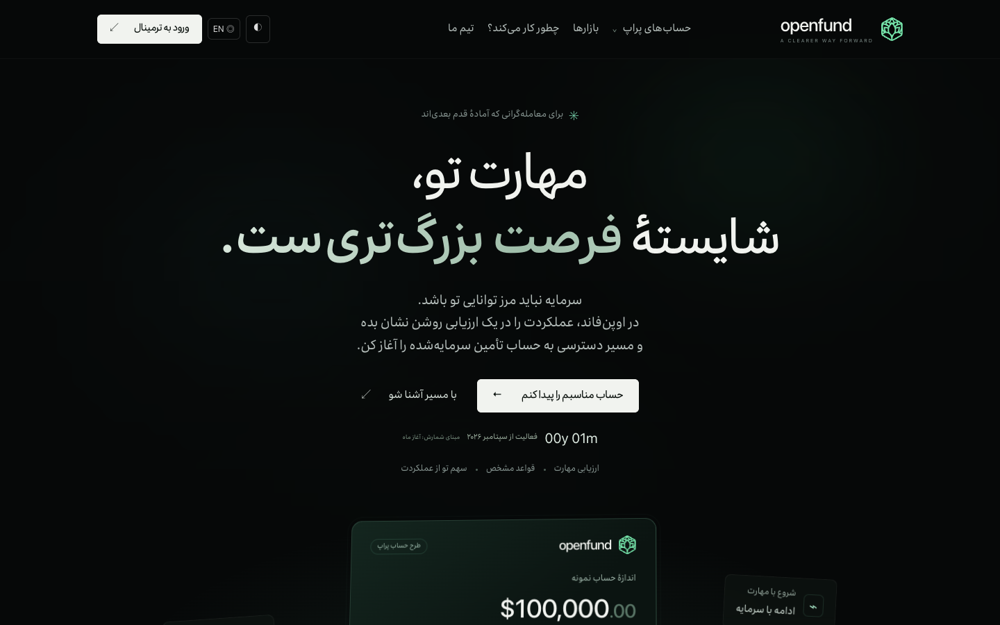
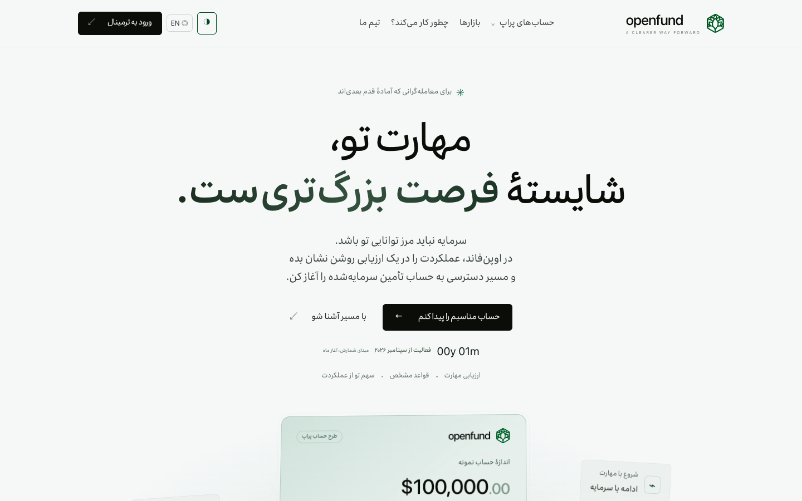
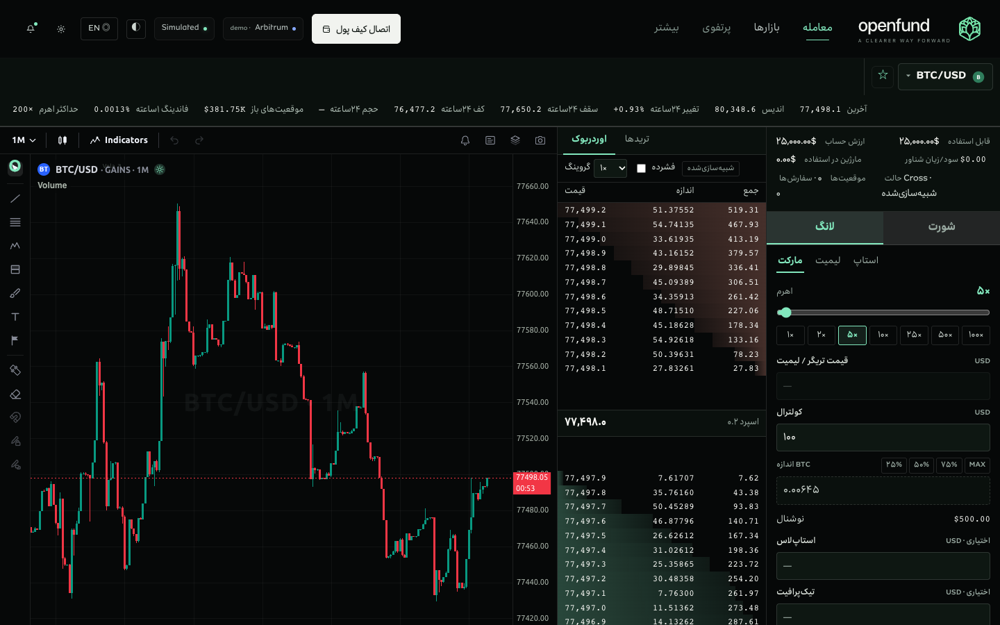
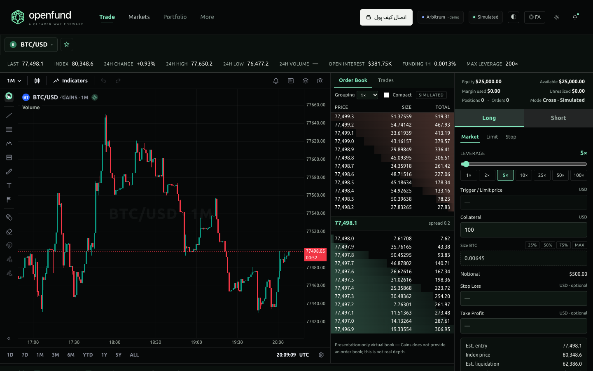
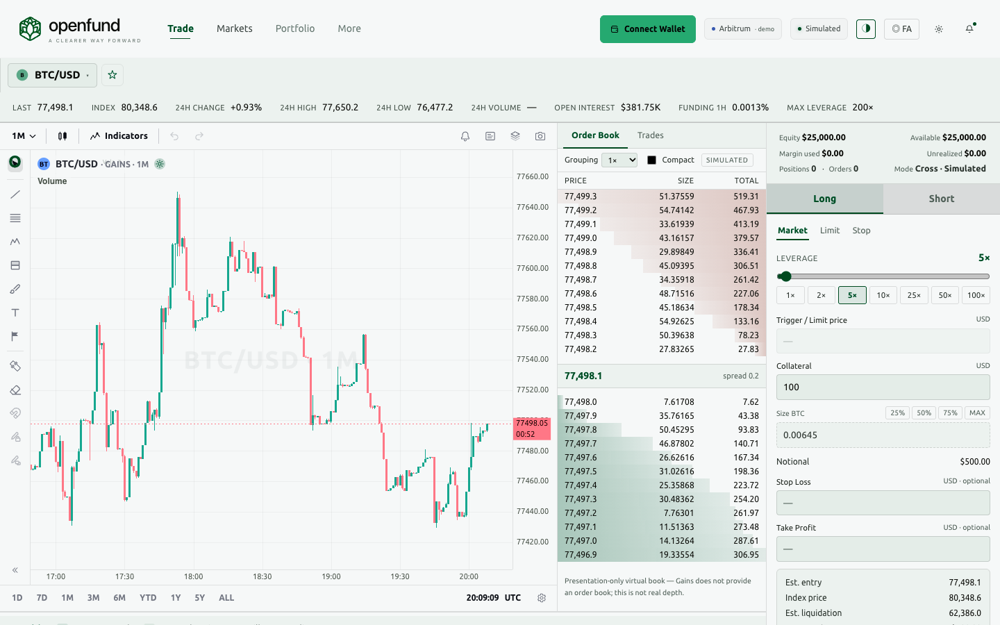
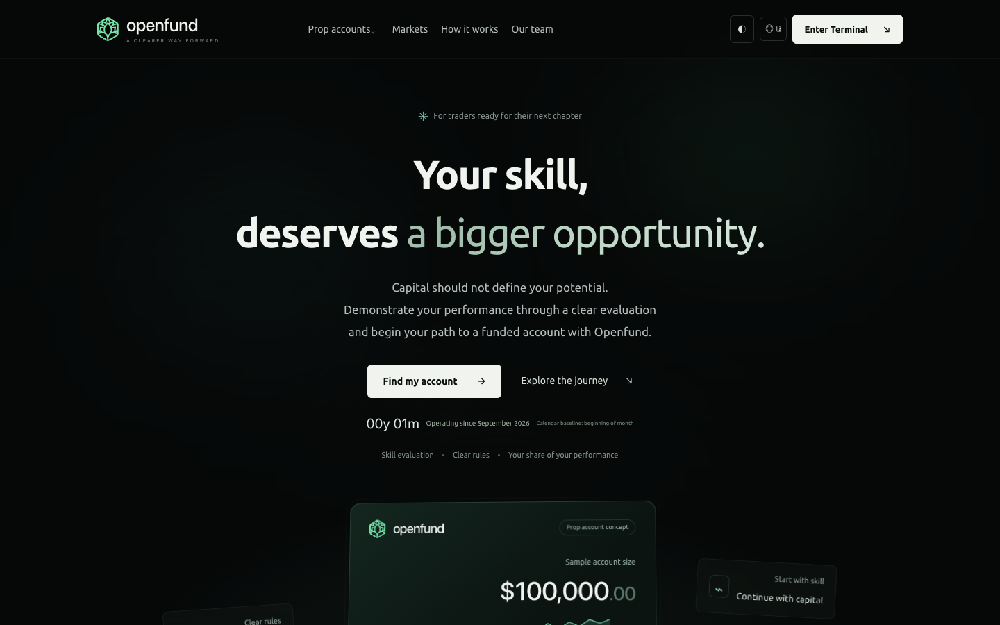
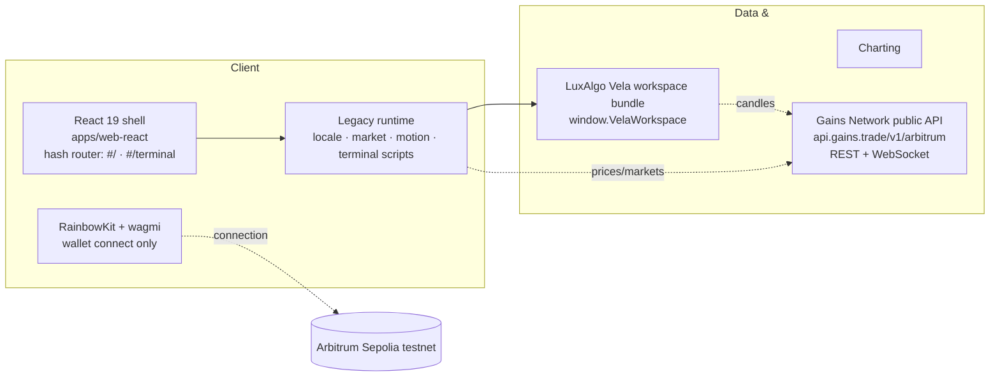

<div align="center">

<a href="https://github.com/algomanlife/openfund"></a>

# OPENFUND

### سرمایه، در امتداد مهارت تو — *Capital, in line with your skill*

**A bilingual (فارسی / English) prop-trading frontend: landing + live trading terminal, real LuxAlgo Vela charting, real Gains Network market data, and a React 19 + RainbowKit app shell on Arbitrum Sepolia.**

[](https://github.com/algomanlife/openfund)


[Product](#what-openfund-is) · [Gallery](#gallery) · [Quick start](#quick-start) · [Architecture](#architecture) · [Tech stack](docs/architecture/TECH_STACK.md) · [Roadmap](#roadmap) · [Docs](#documentation)

</div>

---

## What Openfund is

Openfund is an independent, open development project building a **prop-trading platform experience for Iranian traders** — inspired by funded-account platforms, rewritten with a Persian-first voice:

- **Landing** — a full bilingual marketing site (RTL Persian / LTR English, dark + light themes, Irancell font for FA, Ubuntu for EN) presenting the funding model: evaluation presets, an interactive account builder, philosophy and rules.
- **Trading terminal** — a professional workspace with a real **LuxAlgo Vela** chart, live **Gains Network** market data (488 markets, REST + WebSocket), a Gains-style market selector with real open-interest and funding stats, and a clearly-labelled **simulated demo trading engine** that executes against real marks. Trade labels use Iranian trader Finglish (اوردربوک، لانگ، شورت، مارکت، لیمیت، فاندینگ، کولترال، استاپ‌لاس، تیک‌پرافیت).
- **React app shell** — the whole experience is being migrated into a Vite + React 19 + TypeScript app (`apps/web-react`) with **RainbowKit/wagmi wallet connection** on Arbitrum Sepolia (connection only — no transactions).

> [!IMPORTANT]
> **Project stage: prototype with live data.** Market data, charts and wallet connection are real and verified; trading itself is a local simulation, clearly labelled on the page. No production or live-trading capability is claimed. See [`docs/product/FEATURE_STATUS.md`](docs/product/FEATURE_STATUS.md).

### The funding model presented

One-time fee → skill evaluation → funded account with a profit split (up to 80/20), transparent one-phase/two-phase evaluation presets, and a "we bet on traders, not against them" rule set (no hidden rules, no counterparty against the user). Content is inspired by public prop-funding models (e.g. carrotfunding.io) and customized for the Iranian audience.

## Gallery

All screenshots are from the **React app** (branch `qwen/react-migration`), captured with real-browser E2E on 2026-10-31 — live Gains data on every shot.

| Landing — فارسی (dark) | Landing — فارسی (light) |
| :---: | :---: |
| <a href="docs/images/react-landing-dark-fa.png"></a> | <a href="docs/images/react-landing-light-fa.png"></a> |

| Terminal — فارسی (dark, live BTC/USD) | Terminal — English (dark) |
| :---: | :---: |
| <a href="docs/images/react-terminal-dark-fa.png"></a> | <a href="docs/images/react-terminal-dark-en.png"></a> |

| Terminal — فارسی (light) | Landing — English (dark) |
| :---: | :---: |
| <a href="docs/images/react-terminal-light-fa.png"></a> | <a href="docs/images/react-landing-dark-en.png"></a> |

Legacy (pre-React) screenshots are kept in [`docs/images/`](docs/images/) for history.

## What works today

| Capability | Status | Where |
| :--- | :--- | :--- |
| Bilingual landing (fa/en, RTL/LTR, themes, fonts, motion) | Implemented | `dist/index.html` · React `#/` |
| Full Vela trading workspace (topbar, drawings, indicators, search) | Implemented | `dist/assets/vela-workspace.global.min.js` |
| Live Gains market data (488 markets, REST + WS ~90 upd/s) | Implemented | `dist/gains-adapter.js` |
| Gains-style market selector (OI L/S, funding, closed markets) | Implemented | `dist/terminal.js` |
| Demo trading engine on real marks (labelled simulated) | Implemented | `dist/terminal-data.js` |
| Wallet connection (RainbowKit, Arbitrum Sepolia) | Implemented | `apps/web-react` — connection only, no txs |
| React shell with both pages at visual/behavioural parity | Implemented | `apps/web-react` → `react/` |
| Real order-book / volume / trade tape | Blocked | Gains API does not provide these — shown as `—` or labelled simulated |
| Real trading (orders on-chain) | Planned | No Gains contracts assumed; requires verified contracts |

## Quick start

**Requirements:** Git, Node.js 20+ / npm, Python 3.

```bash
git clone https://github.com/algomanlife/openfund.git
cd openfund
npm install

# serve everything (legacy dist/ + built React app) on one port
python3 -m http.server 4173
```

- **Legacy (classic) pages:** http://127.0.0.1:4173/dist/ and http://127.0.0.1:4173/dist/terminal.html
- **React app (built):** http://127.0.0.1:4173/react/#/ and http://127.0.0.1:4173/react/#/terminal

**React dev server (hot reload):**

```bash
cd apps/web-react
npm install
npm run dev          # http://localhost:5173/react/#/
```

**Build the React app** (outputs to repo-root `react/`, served by the static server above):

```bash
cd apps/web-react && npm run build
```

**Wallet:** works out of the box with injected wallets (MetaMask/Rabby). For WalletConnect, put a project id in `apps/web-react/.env` (`VITE_WALLETCONNECT_PROJECT_ID=…`, see `.env.example`). Chain: Arbitrum Sepolia (421614).

## Architecture



The React shell currently embeds the proven legacy markup/logic (phase-2a strategy — see [`docs/migration/MIGRATION_STATUS.md`](docs/migration/MIGRATION_STATUS.md)) and progressively extracts real React components. Adapters live in `packages/openfund-gains-adapter/` and `packages/openfund-charts/`, mirrored verbatim into `dist/` for the classic pages.

```text
openfund/
├── dist/                        # Live classic pages (index.html, terminal.html + assets)
├── react/                       # Built React app (served at /react/)
├── apps/web-react/              # React 19 + Vite + TS source (the app being migrated)
├── packages/                    # Openfund-owned adapters (gains, charts)
├── vendor/                      # Upstream source (vela, gains-sdk) + license notices
├── brand/                       # Brandbook, marks, type, imagery
├── docs/                        # Product, architecture, integrations, migration docs
└── AGENTS.md                    # Shared agent instructions
```

Full technology registry with versions, roles and licenses: [`docs/architecture/TECH_STACK.md`](docs/architecture/TECH_STACK.md).

## Roadmap

- [x] **Phase 0** — brand, landing, bilingual UI, themes, motion
- [x] **Phase 1** — repository, docs structure, vendored upstreams
- [x] **Phase 2** — Vela workspace chart × live Gains data in the terminal
- [x] **Phase 3** — Gains-style market selector, demo engine on real marks, Finglish trade labels
- [x] **Phase 4** — React 19 + Vite + TS shell, both pages at parity (E2E-verified)
- [x] **Phase 5** — RainbowKit/wagmi/viem wallet connection (Arbitrum Sepolia)
- [ ] **Phase 6** — auth boundary: wallet ↔ Openfund session (SIWE-ready), no fake auth
- [ ] **Phase 7** — extract real React components from embedded legacy markup
- [ ] **Phase 8** — regression suite on production builds + CI
- [ ] **Phase 9** — production deployment, licensing finalization, public launch prep

Detailed plan: [`docs/development/ROADMAP.md`](docs/development/ROADMAP.md).

## Built with AI-assisted development

Openfund's workflow coordinates human direction with multiple coding agents. These are **workflow tools, not partners or sponsors**.

<div align="center">
<table>
<tr>
<td align="center" width="50%"><a href="https://chatgpt.com/"><strong>ChatGPT Work</strong></a><br/><sub>Planning, architecture, documentation, review</sub></td>
<td align="center" width="50%"><a href="https://qwenwork.ai/"><strong>QwenWork</strong></a><br/><sub>UI implementation, terminal/Vela×Gains engineering, iteration, E2E verification</sub></td>
</tr>
</table>
</div>

Each agent works on a scoped branch (`qwen/*`, `codex/*`), keeps docs in sync (`CHANGELOG`, `FEATURE_STATUS`, migration status), and submits a PR for review — merges to `main` only after human review. See [`AGENTS.md`](AGENTS.md) and [`CONTRIBUTING.md`](CONTRIBUTING.md).

## Documentation

| Guide | Purpose |
| :--- | :--- |
| [Feature status](docs/product/FEATURE_STATUS.md) | Implemented vs prototype vs planned — source of truth |
| [Tech stack registry](docs/architecture/TECH_STACK.md) | Every dependency: version, role, license |
| [System architecture](docs/architecture/ARCHITECTURE.md) | Component boundaries and direction |
| [Migration status](docs/migration/MIGRATION_STATUS.md) | React migration, phase by phase (resume file) |
| [Vela integration](docs/integrations/VELA.md) · [Gains integration](docs/integrations/GAINS.md) | Charting / market-data contracts |
| [Design system](docs/design/DESIGN_SYSTEM.md) | Visual identity, tokens, motion |
| [Roadmap](docs/development/ROADMAP.md) | Delivery phases |
| [Security](docs/security/SECURITY.md) | Secure development rules |
| [Changelog](CHANGELOG.md) | Notable changes |

## Licensing, attribution and disclaimer

Openfund is an independent project, unaffiliated with LuxAlgo, Gains Network, Reown/RainbowKit, Arbitrum, OpenAI, or Qwen. All third-party names and logos belong to their owners. Vendored projects keep their original licenses and notices (especially [`vendor/vela/NOTICE`](vendor/vela/NOTICE) — the terminal keeps a visible "Charts by Vela" credit for compliance). The repository-wide license for original Openfund code and brand assets is not yet finalized.

This is a development prototype, not a production trading platform or investment advice. Do not use real funds or private keys beyond explicit testnet experimentation.

---

<div align="center"><sub>OPENFUND · مسیری برای تبدیل مهارت معامله‌گری به فرصت تأمین سرمایه.</sub></div>
