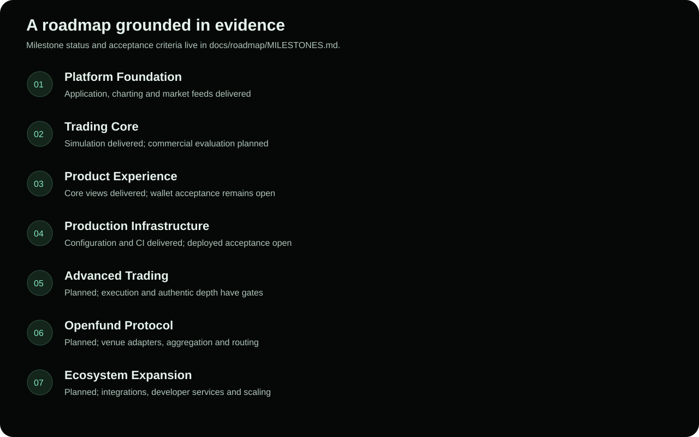

# Openfund roadmap

Openfund develops a shared trading environment in seven phases. The order expresses dependencies, not a delivery-date commitment. No entire phase is claimed complete: foundation and product capabilities coexist with unfinished commercial, operational and execution gates.

| Phase | Direction | Current assessment | Milestones |
| --- | --- | --- | --- |
| 1 — Platform Foundation | Repository, React/Node, charting, market data | Delivered within current app scope | F1, F2 |
| 2 — Trading Core | Prop engine, calculations, risk, positions and state | Simulation delivered; commercial evaluation planned | T1–T3 |
| 3 — Product Experience | Wallet, Portfolio, Journal, challenges, markets, multilingual UI | Core views delivered; external wallet and commercial acceptance open | X1–X4 |
| 4 — Production Infrastructure | Render, PostgreSQL, Directus, CI/CD, security and observability | Configuration/CI delivered; deployment and operational assurance open | I1–I3 |
| 5 — Advanced Trading | Extended orders, analytics and execution improvements | Planned, with live execution/data gates blocked | A1–A3 |
| 6 — Openfund Protocol | Venue adapters, aggregation and intelligent routing | Dormant source foundation integrated; operational routing planned | P1, P2 |
| 7 — Ecosystem Expansion | Integrations, developer services, scalability | Planned | E1, E2 |

Every milestone has a status, dependencies, acceptance criteria and evidence in [Milestones](docs/roadmap/MILESTONES.md). Use that register for completion decisions.

- [Product roadmap](docs/roadmap/PRODUCT.md)
- [Engineering roadmap](docs/roadmap/ENGINEERING.md)
- [Protocol roadmap](docs/roadmap/PROTOCOL.md)
- [Current feature status](docs/product/FEATURE_STATUS.md)

Do not advance a milestone because a folder, UI placeholder or dependency exists. Deployment requires deployed evidence; commercial services require verified product and legal facts; protocol routing requires validated execution paths.

## Proprietary chart indicators

**In Progress:** original Pine execution, local-library resolution, ordered catalog, persistent settings and chart interaction repairs are implemented. Local validation is recorded in [delivery evidence](docs/reviews/vela-pine/DELIVERY.md). Independent reference-platform conformance, genuine volume-dependent outputs, full optional-setting coverage and deployed acceptance remain open. No financial execution milestone changes.

## Unified account integration

The [unified dashboard and trial lifecycle](docs/trading/UNIFIED_ACCOUNTS.md), [journal definitions](docs/trading/JOURNAL_METRICS.md) and [Gains depth integration](docs/integrations/GAINS_DEPTH.md) extend phases 2, 3 and 5. Local acceptance and remaining release gates are tracked in the [delivery report](docs/reviews/unified-trading/DELIVERY.md); commercial activation and real execution are unchanged.

## Fresh delivery snapshot — 2026-11-03

| Capability | Status | Evidence / remaining acceptance |
| --- | --- | --- |
| Website / localization / public service presentation | Completed within candidate scope | Existing React/legacy system; [fresh audit](docs/reviews/website-refresh/AUDIT.md); bilingual and responsive browser acceptance recorded with delivery |
| Wallet sessions, profile editing, catalog, purchases, invoices | Completed within merged implementation scope | PR #41 `561e7f3`; receiver/widget gates retained; included in official v0.2.0; receiver/widget still gated |
| Production DePay / live-chain payment acceptance | Blocked | Approved destination and real-chain/widget acceptance required |
| Withdrawal requests | Completed within merged implementation scope | Requests recorded for later operator review; no review interface or payout execution |
| Challenge evaluation / payout processing | Planned | Operational rules, risk enforcement and settlement acceptance remain |
| Terminal / Vela / Gains / Portfolio / Journal | Completed within implemented scope | Shared workspace, simulation and read-only Gains; external conformance and real wallet/device gates remain |
| Desktop installers / mobile apps | Planned | Five honest Coming Soon cards; no verified installer/store listing |
| Unified GitHub release packaging | Completed within publication scope | v0.2.0 manifest/tag `561e7f3`, run 41705345213 success; current port 8080 startup remains unverified |
| Production deployment | Blocked | No live Render service/configuration verified |

The website-refresh branch remains dirty and excluded from official v0.2.0.
Community destination acceptance is blocked until an owner-verified URL is configured;
Telegram's homepage is not an Openfund group.

This snapshot supersedes older compound milestone wording where it conflates
implementation with production acceptance. Prior acceptance evidence remains
historical; no previous release is rewritten.
