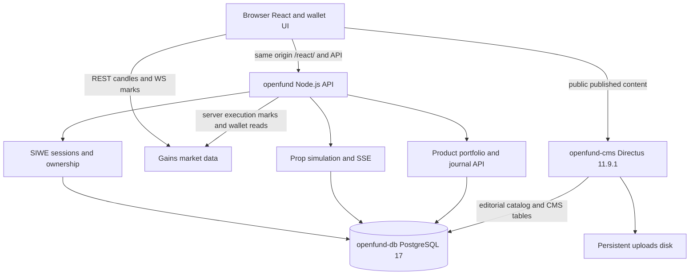

# System architecture

Verified repository baseline: `2f5cf93` (2026-11-02). The application is a React frontend and Node.js API with persistent Prop simulation, Gains read integrations, SIWE and editorial Directus. [Feature Status](../product/FEATURE_STATUS.md) records delivery boundaries.

## Runtime graph

## Source and build boundaries

| Location | Responsibility |
| --- | --- |
| `apps/web-react/` | React/TypeScript routes, product views, wallet/session contexts and authoritative public legacy assets |
| `apps/backend/` | Express auth, ownership, simulation engine, market data, portfolio and product APIs; additive schema migrations |
| `apps/backstage/scripts/` | Directus schema and published-content seeding/admin utilities |
| `packages/openfund-charts/` | Openfund Vela bridge; script-load mirror in `dist/` |
| `packages/openfund-gains-adapter/` | Gains REST/WS market provider; script-load mirror in `dist/` |
| `packages/cms-client/` | Shared CMS contract; actual React client lives in app source |
| `packages/openfund-ui/`, `apps/web/`, `apps/terminal/` | Ownership/contract directories; not additional deployed applications |
| `vendor/`, `third_party/` | Preserved upstream sources, attribution and analytical core provenance |
| `dist/` | Source-critical classic compatibility deliverable; not disposable build output |
| `react/` | Tracked historical build plus output of the current Vite build; Render rebuilds from `apps/web-react/` |

The root package orchestrates commands and repository tooling. Applications install from their own lockfiles. Do not import protocol sources in this documentation task.

## Financial authority

`engine.js` and `trading-math.js` own Prop simulated mutations and Decimal valuation. PostgreSQL stores virtual funding, orders, positions, ledger entries and sampled risk telemetry. Browser values never authorize execution. SSE pushes account updates while the engine monitors pending orders/protection in the API process.

Perpetual account data comes from official Gains wallet endpoints via `gains-portfolio.js`, using the SIWE session wallet. Missing values stay unknown. Prop-only aggregate APIs reject Perpetual use; product identity is not a cosmetic tab over shared money state.

Portfolios and notebooks use session ownership and product/account scope. Financial rows are distinct from editable journal metadata. [Product API contract](PRODUCT_TERMINALS.md) provides endpoint details; [Prop Trading](../trading/PROP.md) documents calculations and assumptions.

## Identity and editorial authority

SIWE establishes one normalized wallet identity and an opaque first-party session. Prop uses Sepolia sign-in context; Perpetual uses Arbitrum One. Both are connection/authentication paths, not transaction approval. [Identity](../wallet/IDENTITY.md) and [flows](FLOWS.md) describe replay, expiry and switch handling.

Directus shares the managed PostgreSQL service and edits catalog/editorial collections. Public read permissions allow published content only. The Node API remains the ownership and financial boundary; CMS public access must not expose user/session/trading tables. No second backend authentication system is introduced.

## Deployment boundary

The [Render Blueprint](../../render.yaml) preserves exactly `openfund`, `openfund-db` and `openfund-cms`. The Node service builds and serves React under `/react/`, redirects `/` there, and hosts the API, SSE and one engine loop. Directus uses its official image and persistent uploads disk. There is no separate frontend service, queue, worker or Redis. Horizontal engine scaling requires coordinated ownership before deployment.

See [Render operations](../deployment/RENDER.md), [Database](../deployment/DATABASE.md), [technology registry](TECH_STACK.md), and [ADRs](../decisions/README.md). Configuration and local checks do not establish a live deployment.
