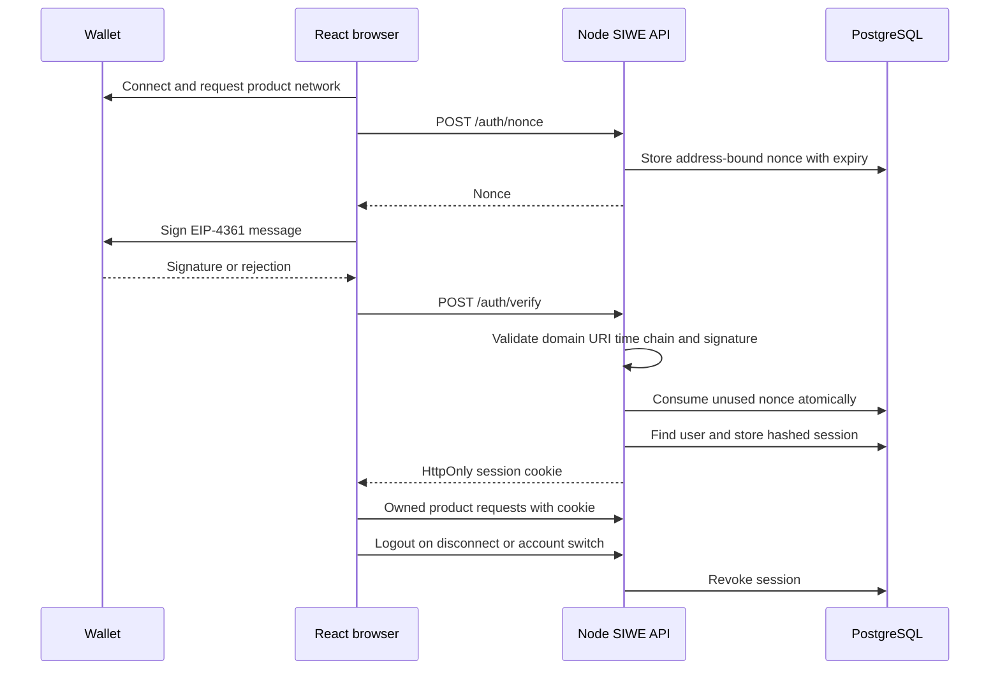
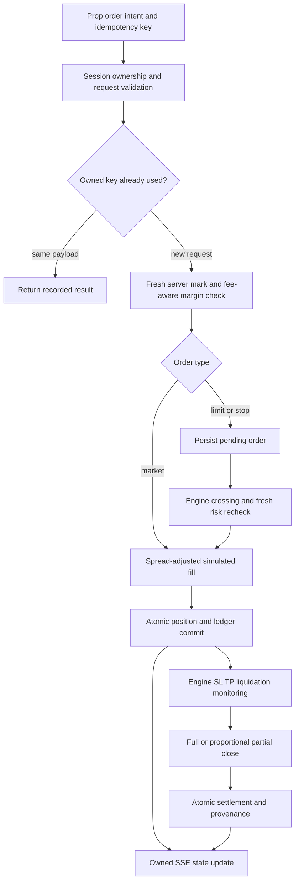
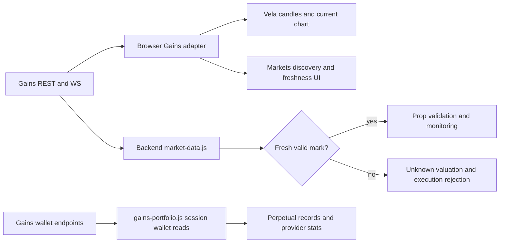
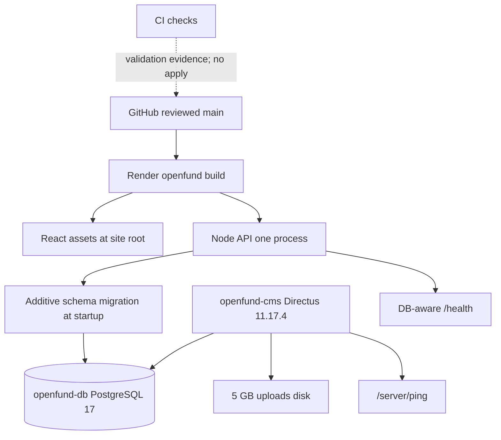

# System flows

These diagrams describe the current repository. Protocol routing and live perpetual execution are not implemented connections.

## Authentication

Wallet connection precedes SIWE. Only the backend creates an owned application session.

## Trading lifecycle

Prop execution is simulated. Rejection and retry states do not create duplicate financial events.

## Market data

Browser chart prices and server execution marks have separate freshness checks. Wallet records use native Gains endpoints.

## Deployment

Three Render resources share a region. Blueprint apply and deployed acceptance remain external operations.

[System architecture](ARCHITECTURE.md) · [Product contracts](PRODUCT_TERMINALS.md) · [Render runbook](../deployment/RENDER.md)
