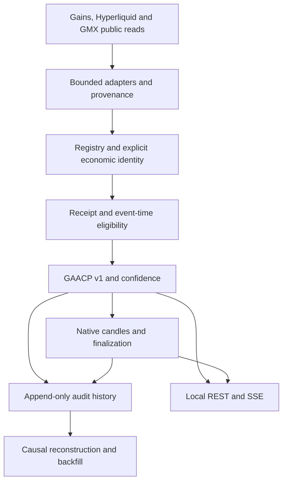
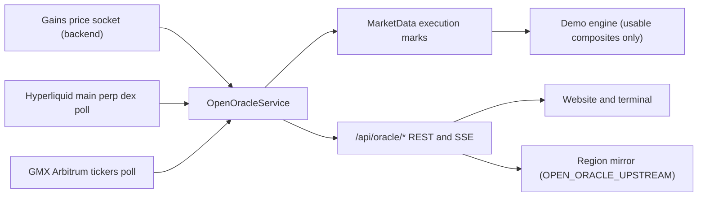

# Open Oracle architecture

## Independent processing boundary

The only production edge is the pricing service ([ADR 0059](../decisions/0059-open-oracle-pricing-service.md)):
the backend `market-data` role runs `OpenOracleService` and the browser reads
`/api/oracle/*` from its own origin.

The research package itself still uses Node built-ins, its own
pure typed decimal/pricing modules and one development-only compiler. Reusing
production financial services would create unnecessary coupling; those services
are not imported or modified. Existing footprint mappings were inspected, but
their small popular-market candidate table is not reused as the universe.

## State and ordering

Source raw observations retain provider timestamps, receipt timestamps,
semantics and source microstructure. Registry normalization occurs independently
of trading state. Duplicate source/time/price events are rejected within a
bounded window. Per-market/source buffers accept out-of-order arrivals within
the event watermark, sort deterministically, and never select data with an
event or receipt timestamp after the evaluation boundary. Invalid and excluded
observations remain diagnosable in append-only history and source contributions.

Each evaluation has a monotonically advancing timestamp. A new candle observation
requires changed source inputs; repeated evaluations of unchanged inputs only
refresh quality/staleness, without fabricating intermediate candle samples.
The live local runtime defaults to a one-second research evaluation interval.
A two-second event-time watermark finalizes closed buckets. Future updates do
not silently rewrite finalized candles. Explicit corrections preserve the prior
candle and evidence, increment revision and append a `CORRECTION` record.

## Bounded resources

| Resource | Initial bound | Overflow behavior |
| --- | --- | --- |
| Registry | 50,000 entries | Explicit capacity error |
| Source observation buffer | 256 per market/provider | Oldest removed; queue-drop counter increments |
| Health samples | 10,000 per provider within 300 seconds | Oldest expired/evicted; cold start remains explicit |
| Candle series | 10,000 | Explicit capacity error |
| Candle cache | 2,000 per series | Oldest cached candle evicted; persisted history remains |
| HTTP admission | 32 pending per transport | Explicit backpressure error |
| HTTP response | 8 MiB | Stop oversized body |
| Provider retry | 2 retries, 30-second backoff cap | Classified failure |
| Source diagnostics | 200 records | Oldest diagnostic evicted |
| SSE clients | 32 | Reject further subscribers; disconnect slow readers |
| Audit storage | 128 segments of 8 MiB | Explicit exhaustion; no silent history deletion |

The store flushes records synchronously for durability. This is suitable for
local research and imposes a throughput cost; benchmark results without storage
must not be represented as durable end-to-end capacity. Reopen validates the
hash chain. Hash chaining detects accidental edits when anchored externally; it
does not protect against an attacker who can rewrite the complete local chain.
The initial reader is segment-streamed; restart verification reads one bounded
segment at a time. A truncated record fails explicitly.

## Sessions, timeframes and provenance

The candle engine supports all requested intervals from one second to a UTC
calendar month; weeks start Monday. Market closure is explicit from provider
metadata when supplied. Detailed exchange holidays and builder-specific
calendars are not inferred and remain an acceptance limitation.

`NATIVE` means directly recorded running protocol observations;
`RECONSTRUCTED` means causal replay from suitable observations;
`PROVIDER_REFERENCE` means retained provider history. Trade OHLC is not an
oracle-price event series and cannot be backfilled as native oracle candles.
Source volume, trade counts, buy/sell flow, OI, funding and depth are never summed
across incompatible definitions or manufactured from reference prices.

[Methodology](../research/OPEN_ORACLE_METHODOLOGY.md) ·
[Validation](../research/OPEN_ORACLE_VALIDATION.md) ·
[Interface](../integrations/OPEN_ORACLE.md).
