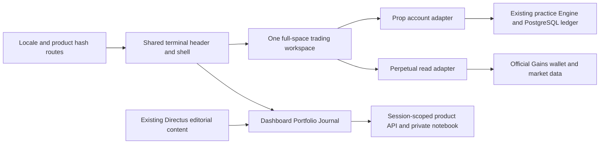

# Product terminals, portfolio and journal

## Routes

Hash routes use the existing fa/en locale convention. Both products share `TerminalShell` and `SharedTradingTerminal`.

| Product | Routes |
| --- | --- |
| Prop | `/:locale/prop/{dashboard,trade,portfolio,journal,leaderboard,withdrawals,certificates}` |
| Perpetual | `/:locale/perpetual/{dashboard,trade,portfolio,journal,leaderboard,rewards}` |

`/terminal`, `/portfolio`, `/journal` redirect to Prop in the stored locale. Locale-less `/prop/:page`, `/perpetual/:page` work. The public header stays separate. Product switching preserves destinations supported in the other product and otherwise goes to its dashboard.

## Backend contract

Existing `/auth/*` and `/trading/*` remain the SIWE/engine boundaries. All new endpoints are session-authorized under `/products/:product`.

| Method/path | Behavior |
| --- | --- |
| GET `/context` | Server-derived account, supported account list, capabilities; Prop state and engine fee-rate display configuration |
| GET `/overview` | Prop account totals and journal-core analytical curves/metrics/Edge Score v2; date filters apply to analytical records by opening time |
| GET `/buckets` | Prop symbol/direction/asset/hour/weekday/duration/tag aggregates; owned notes join privately |
| GET `/trades` | Prop date/symbol/direction/status/sort filters and pagination |
| GET `/orders` | Prop owned order history, date/symbol filters, pagination |
| GET `/trades/:id` | Owned Prop trade, order, ledger and annotation; Perpetual event records use `/gains` instead |
| PUT `/notes` | Existing private annotations, validated against an owned Prop trade |
| GET `/gains` | Perpetual wallet-derived live read model, official Arbitrum open positions/orders/history/stats, cursor and date/pair filters |
| GET `/journal` | Private scoped notebook; date/search/tag/classification filtering, limit/offset |
| PUT `/journal` | Create/update; UUID, strict date, field limits, tags and optional owned Prop trade; optimistic integer version |
| DELETE `/journal/:id?version=N` | Owned current version only; stale update/delete returns conflict |
| POST `/journal/import` | Versioned JSON, matching product/account, at most 50 entries per atomic batch; existing IDs skipped without overwriting |

The browser exports trades read-only as CSV (spreadsheet formula escaping) and notebooks as `openfund-journal-v1` JSON. Restore accepts up to 2 MiB and batches 50 entries, each atomic and idempotent. If a later batch fails, previous batches remain committed; importing again safely skips them. JSON is metadata only and cannot create financial trades, orders, balances or ledger entries. Exports contain private notes and should be handled accordingly.

## Data integrity

- Additive `schema.sql` creates only `journal_entries` and its scoped index; existing user/account/trade/ledger/note tables are reused. Run `npm run migrate --prefix apps/backend` with the intended DATABASE_URL. No database reset, historical delete or financial migration is performed.
- Each request derives Prop account ownership or the Perpetual wallet reference from the SIWE session. A client `account` query must match it; other account IDs return 404. Every note write validates an actual owned trade.
- Position UUIDs identify trades and new journal-core keys. Legacy timestamp annotation keys remain readable and editable; existing annotations are not deleted. This prevents new key collisions when identical markets open within the same millisecond.
- Money writes stay Engine Decimal/PostgreSQL NUMERIC. Analytics convert to JS numbers for display, not financial settlement. Existing `realized_pnl` excludes the separately charged opening fee; curves retain that explicit close-settlement basis. The ledger/account balance is the authoritative reconciliation, not an equity curve invented from historical marks.
- Missing/stale open marks yield null in portfolio unrealized/equity fields, never an assumed zero. Native Gains collateral amounts are decoded with the matching metadata decimals; entry prices use 1e10, leverage 1e3, matching vendored SDK converter. Gains unrealized net PnL/fees are not approximated.
- Async UI reads abort on route/query/user changes and hide the previous resource before a new scope resolves. Journal edits use revision checks. Request failures are explicit and do not silently overwrite drafts.

## Verified read sources

Verified locally on 2026-11-02 (HTTP 200, empty-address and nonempty public schema inspection):

- `https://backend-arbitrum.gains.trade/open-trades/{session-wallet}`
- `https://backend-arbitrum.gains.trade/trading-variables`
- `https://backend-global.gains.trade/api/personal-trading-history/{session-wallet}?chainId=42161&limit=100`
- `https://backend-global.gains.trade/api/personal-trading-history/{session-wallet}/stats?chainId=42161`

[Official history migration](https://docs.gains.trade/developer/integrators/guides/history-endpoints-migration) and [address-scoped open trades](https://docs.gains.trade/developer/api-reference/endpoint/core-open-trades-by-address). Upstream errors/schema changes produce 502 rather than fabricated empty data. Reads are cached for 20 seconds (metadata 60 seconds), with a bounded network timeout. Chart/market data continues through the existing Openfund Gains REST/WS/Vela adapter. On-chain execution remains disabled.

Aggregated Prop-only read endpoints (`overview`, `buckets`, `trades`, `orders`) return 409 for Perpetual and direct clients to native `/gains` records; they never return a fabricated empty account/history after that product has verified native read support.

