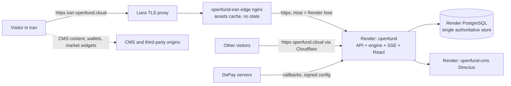

# Iran edge on Liara

Technical reference for the `iran.openfund.cloud` edge
([ADR 0031](../decisions/0031-iran-edge-on-liara.md)). The owner's step-by-step
setup guide is [LIARA_IRAN_SETUP.md](LIARA_IRAN_SETUP.md) (in Persian, as the
owner requested).

## Status (2026-11-14)

| Milestone | Status | Evidence |
| :--- | :--- | :--- |
| Source commit selected | Completed | `https://openfund.cloud/version` → 0.5.0, `d0e0909c57791e8a39f2840905098c22a1ce78fa`, `status: matched`. The edge does not pin an application commit: it serves whatever Render serves. Note that the live manifest says `official: false`; the last successful official deploy run was v0.4.4 (2026-11-08). |
| Edge config, image, workflow, verification script | Completed (local) | `infra/liara-iran`, `scripts/liara`, `.github/workflows/deploy-liara-iran.yml` |
| Contract tests (stub upstream, local nginx 1.31.8) | Completed (local) | 20/20 passed |
| Read-only proxy of the live Render origin (local edge) | Completed (local) | `verify-edge.mjs` 12/12. The browser loaded 41 resources through the edge, 7 CMS requests went directly to `openfund-cms.onrender.com`, and 1 went to `api.bitpin.ir`. |
| Docker image build and CI run | Not verified | No Docker on the authoring machine. The PR run of the workflow is the first build. |
| Liara app, domain, SSL | Blocked (owner action) | Needs the Liara account, the API token and DNS access |
| Reachability from Iranian ISPs, Liara→Render path | Not verified | Needs the deployed app |
| Wallet sign-in on the edge host | Blocked (owner action) | Needs `ALLOWED_DOMAINS` on Render to include the edge host |
| Country routing | Planned, disabled | Needs owner approval after acceptance |

## Topology



Liara runs **one** application, the edge. Everything else stays where it is.
The reasons for not running the backend on Liara are in ADR 0031: the engine,
payment and settlement jobs start unconditionally, and a second database would
be a second ledger.

## How the edge behaves

| Concern | Behaviour |
| :--- | :--- |
| Application version | Identical to Render by construction. `/version` through the edge equals Render's. |
| Cookies / sessions | `Set-Cookie` passes unchanged (no `Domain`), so the session is host-only on the edge host. A session from `openfund.cloud` does **not** carry over. |
| CSRF / Origin | Only `Origin: https://<edge host>` is translated to the Render origin. Every other value passes through and is rejected by the backend as before. |
| SIWE | The wallet signs a message for the edge host. The backend accepts it only when that host is in `ALLOWED_DOMAINS`. |
| SSE (`/trading/stream`, `/api/footprint/stream`) | Proxy buffering is off and the read timeout is 120 s (heartbeats every 1–5 s). Liara's own proxy timeouts are not documented and need the acceptance test. |
| WebSocket | The backend has no WebSocket endpoint. Browser WebSockets go to third parties directly. |
| Cache | Only `/assets/*` (content-hashed, `immutable`) is cached at the edge, keyed by URI, for 7 days. Nothing user-specific is cached. |
| Blocked at the edge | `/admin*`, `/internal*` and the DePay configuration, callback and events routes return 404. |
| Indexing | `robots.txt` → `Disallow: /`, `X-Robots-Tag: noindex, nofollow` and no sitemap. `openfund.cloud` stays canonical. |
| Logs | Time, method, path (no query), status, timing and cache status. No IPs or cookies. |
| Health | `/__edge/live` is local liveness, used by the image `HEALTHCHECK`. `/__edge/ready` proxies the backend's `/health`. `/__edge/info` reports the deployed edge commit. |

## Configuration

### Liara app environment (all public, none secret)

| Variable | Required | Value |
| :--- | :--- | :--- |
| `OPENFUND_UPSTREAM_HOST` | yes | Render service host, e.g. `openfund-our6.onrender.com`. Use the `onrender.com` host, not `openfund.cloud`: the latter goes back through Cloudflare. |
| `EDGE_PORT` | no | `8080`. Must equal the Liara app port. |

The image refuses to start without a valid upstream. Plain-http upstreams are
refused unless the test-only `EDGE_ALLOW_HTTP_UPSTREAM=1` is set. A template is
in [`infra/liara-iran/liara.env.example`](../../infra/liara-iran/liara.env.example).

### GitHub (owner)

| Name | Kind | Where | Value |
| :--- | :--- | :--- | :--- |
| `liara-iran` | Environment | Settings → Environments | Required reviewer: the owner. Deployment branches: `main` only. |
| `LIARA_API_TOKEN` | Secret | Environment `liara-iran` | Liara API key (console.liara.ir/API) |
| `LIARA_APP_NAME` | Variable | Environment `liara-iran` | Liara app id, e.g. `openfund-iran` |
| `LIARA_PUBLIC_URL` | Variable | Environment `liara-iran` | `https://<app>.liara.run` until the domain is live, then `https://iran.openfund.cloud` |
| `OPENFUND_UPSTREAM_HOST` | Variable | Repository | Same value as the Liara app variable. Also enables the live read-only check in PR runs. |

### Render (owner-approved, separate reviewed PR)

`ALLOWED_DOMAINS` in `render.yaml` must gain `iran.openfund.cloud`, and, during
testing only, the Liara default host. It is a Blueprint `value`, so it must be
changed in Git. A dashboard-only edit is reset by the next Blueprint sync. This
is a production configuration change and is **not** part of this branch. No
other Render variable changes: `CORS_ORIGINS` is not needed because of the
Origin translation, and DePay URLs keep pointing at Render.

### Mapping from the Render service

Everything that the `openfund` service reads (`DATABASE_URL`, the DePay keys,
RPC URLs, `ADMIN_API_TOKEN`, the treasury and live adapters, and the rest)
**stays on Render only**. The edge reads none of them. Public browser
configuration (`CMS_PUBLIC_URL`, `VITE_*`) is served by Render's
`/runtime-config.js` through the edge, so both hosts receive identical values.

## Deploy, verify and roll back

1. **Actions → Deploy Iran edge (Liara) → Run workflow** on `main`. Enter:
   - `edge_commit`: the full SHA of the `main` commit to deploy
   - `expect_app_commit`: optional
   - `confirm`: `DEPLOY-IRAN-EDGE`
2. `validate` builds the image, checks that it refuses to start without an
   upstream, runs the contract tests and, when `OPENFUND_UPSTREAM_HOST` is set,
   checks a local container against the live origin.
3. `deploy` waits for the `liara-iran` reviewer. It then stamps
   `edge-release.json`, runs `liara deploy` with CLI 9.6.7, and runs
   `verify-edge.mjs` against `LIARA_PUBLIC_URL` (up to 6 tries, 20 s apart).
   The status file is uploaded as `liara-edge-status-<run>`.
4. **Roll back the edge:** dispatch again with an earlier edge commit.
   Liara also lists every deploy under the app's **History** page. Liara keeps
   the previous release serving traffic when a deploy fails (zero-downtime
   deployment is on by default).
5. **Roll back the application:** use the existing Render procedure
   ([Rollback](ROLLBACK.md)). The edge follows automatically.
6. **Take the edge offline:** stop the app in the Liara console. Nothing else
   depends on it, and no data is lost.

Manual verification from any machine:

```bash
node scripts/liara/verify-edge.mjs --edge https://iran.openfund.cloud --upstream https://openfund-our6.onrender.com
```

## Domain and TLS

Liara's domain page shows the exact records after **Domains → Add domain**
(`iran.openfund.cloud`): a CNAME for the subdomain, a TXT ownership record and
an ACME (DNS-01) CNAME. Copy those values exactly. They are not published in
the docs and must never be guessed. Create them in Cloudflare as
**DNS only (grey cloud)**, then press **Get SSL certificate** in Liara. Liara
renews the certificate automatically through the ACME CNAME.

Do **not** disable Universal SSL on the Cloudflare zone: it serves
`openfund.cloud`. Do not touch the existing apex or `www` records. Sources:
[add subdomain](https://docs.liara.ir/paas/domains/add-subdomains/),
[enable SSL](https://docs.liara.ir/paas/domains/enable-ssl/),
[ACME record](https://docs.liara.ir/paas/domains/acme-challenge-record/).

## Country routing

The routing options, evaluated against the current setup (Cloudflare DNS,
plan unknown):

| Option | Keeps URL | Works when Cloudflare is unreachable from Iran | Plan needed | Risk | Verdict |
| :--- | :--- | :--- | :--- | :--- | :--- |
| A. Geo-aware DNS (Cloudflare Load Balancing geo steering) | yes | yes, for the DNS answer only | paid add-on | The apex would need a Liara certificate for `openfund.cloud`, and HTTP-01/DNS-01 conflicts with Render. Cookies and SIWE change per answer. | Not recommended now |
| B. Edge country routing (Worker proxying to Liara) | yes | no | Workers | Proxies Iranian traffic through Cloudflare twice, and SIWE domain confusion | Not recommended |
| C. Country redirect (Cloudflare Single Redirect, `ip.src.country`) | no, visible move to `iran.` | no | Free plan includes Single Redirects; field availability must be confirmed in the dashboard | Low: only document navigations match | **Recommended** |
| D. Publish the Iran URL (notice, links) only | n/a | yes | none | none | Already live (the notice) |

Rule for option C (create it **disabled**; enable only after acceptance and
explicit owner approval):

- When incoming requests match (expression editor):

  ```text
  (ip.src.country eq "IR"
   and http.host in {"openfund.cloud" "www.openfund.cloud"}
   and http.request.method eq "GET"
   and any(http.request.headers["sec-fetch-mode"][*] eq "navigate")
   and not cf.client.bot
   and not http.request.uri.query contains "region=global")
  ```

- Then: Dynamic redirect to `concat("https://iran.openfund.cloud", http.request.uri.path)`,
  status **302**, **preserve query string** on.

Why it is safe:

- Only top-level browser navigations carry `Sec-Fetch-Mode: navigate`. The
  rule therefore never matches API, SSE, asset or `/version` requests, DePay or
  other server callbacks, or uptime monitors.
- `302` is not cached permanently.
- Known bots are excluded.
- `?region=global` gives manual access to the Render site.
- Each host stays directly reachable.

Disabling the rule is the emergency switch: toggle it off in **Rules →
Redirect Rules**, and it takes effect within seconds. Not verified: the
availability of `http.request.headers` and `cf.client.bot` on the account's
plan. The dashboard rejects the expression if they are unavailable. In that
case drop the bot clause and keep the header clause, or stay with option D.

## Limitations

1. **No independence from the international internet.** If Liara cannot reach
   Render, every application request returns 502. The live Persian notice
   promises more than this phase delivers. The owner must reword or hide it
   (`apps/web-react/src/config/iranAccess.ts`) before country routing.
2. The CMS, wallet, chart and market-data origins are loaded directly by the
   browser and are not proxied.
3. All edge users share Liara's egress IP in backend rate limits and audit logs.
4. Sessions are per host. Users sign in again on the edge.
5. SEO: the mirror is deliberately `noindex`.
6. Reaching Render from an Iranian IP depends on the provider's policies and
   on network filtering. The first deploy's `/__edge/ready` result is the
   evidence.
7. The owner should confirm that hosting and payment flows for Iranian
   visitors are consistent with the terms of Render, Cloudflare, DePay and the
   wallet providers.
