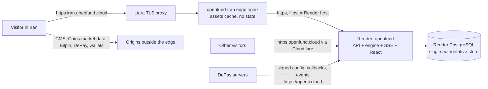
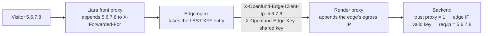

# Iran edge on Liara

Technical reference for the `iran.openfund.cloud` edge
([ADR 0031](../decisions/0031-iran-edge-on-liara.md)). The owner's step-by-step
setup guide is [LIARA_IRAN_SETUP.md](LIARA_IRAN_SETUP.md) (in Persian, as the
owner requested).

**What this is and is not.** The edge is a reverse proxy hosted in Iran in front
of the one Openfund deployment on Render. It is **not** an independent Iranian
deployment of Openfund:

- The backend, database, trading engine, payments, CMS and market data all
  stay outside Iran.
- The edge stops working when the international path to Render is cut.

## Status (2026-11-14)

| Milestone | Status | Evidence |
| :--- | :--- | :--- |
| Source commit | Completed | `https://openfund.cloud/version` → 0.5.0, `d0e0909c57791e8a39f2840905098c22a1ce78fa`, `matched`, manifest `official: false`. The edge pins no application commit: it serves what Render serves. |
| Edge image build and contract tests in CI | Completed | `Deploy Iran edge (Liara)` workflow, `validate` job on the PR |
| Contract tests (stub upstream) | Completed (local and CI) | 22/22, with and without a client-IP key |
| Read-only proxy of the live Render origin | Completed (local) | `verify-edge.mjs` passes against `openfund-our6.onrender.com` |
| Wallet sign-in, cookies, CSRF and client IP through the edge, real backend | Completed (local; CI job `edge-auth`) | `scripts/liara/test/edge-auth.integration.mjs` 15/15 on a disposable database |
| Trusted client IP in the backend | Completed (code, tests); not deployed | `apps/backend/edge-client-ip.js`, 5/5 unit tests. Takes effect only after a Render release and `EDGE_CLIENT_IP_KEY` on both sides. |
| Iran notice copy corrected | Completed (code); not deployed | `IranAccessNotice.tsx`, `ui-refinement` test |
| Staging deployment path | Completed (workflow); not run | `target=staging` and the production gate on staging evidence |
| Liara apps, domain, SSL | Blocked (owner action) | Needs the Liara account, API tokens and DNS access |
| Liara front-proxy behaviour (XFF, Host, timeouts, SSE) | Not verified | Not documented by Liara. Checked by `/__edge/whoami`, `verify-edge.mjs` and staging acceptance. |
| Reachability from Iranian ISPs and from Liara to Render | Not verified | Needs the staging app |
| Wallet sign-in on `iran.openfund.cloud` | Blocked (owner action) | `ALLOWED_DOMAINS` on Render must include the host |
| Country routing | Planned, disabled | Needs owner approval after acceptance |

## Topology



## How the edge behaves

| Concern | Behaviour |
| :--- | :--- |
| Application version | Identical to Render by construction. `/version` through the edge equals Render's. |
| Cookies and sessions | `Set-Cookie` passes unchanged: `openfund_session`, HttpOnly, SameSite=Lax, Path=/, no `Domain`, and Secure in production. The session is host-only on the edge host. A session from `openfund.cloud` does **not** carry over; the user signs in again. |
| CSRF / Origin | Only `Origin: https://<edge host>` is translated to the Render origin. Any other Origin passes through and is rejected with 403 `invalid_origin`. `CORS_ORIGINS` needs no change. |
| SIWE | The wallet signs for the edge host on Arbitrum One (42161). The backend accepts it only when the host is in `ALLOWED_DOMAINS`. Other hosts get `invalid_domain` and other chains get `invalid_chain`, as before. |
| Client IP | See [Client IP chain](#client-ip-chain) |
| SSE (`/trading/stream`, `/api/footprint/stream`) | No proxy buffering and a 120 s read timeout (heartbeats every 1–5 s). Liara's own timeouts are undocumented, so staging acceptance must hold a terminal open for at least 10 minutes. |
| WebSocket | The backend has none. The browser opens `wss://api.gains.trade/v1/arbitrum/ws` directly. |
| Cache | Only `/assets/*` (content-hashed, `immutable`) for 7 days, keyed by URI. Nothing user-specific is cached. |
| Blocked at the edge | `/admin*`, `/internal*` and the six DePay server-to-server paths return 404. See [DePay audit](#depay-audit). |
| Indexing | `robots.txt` → `Disallow: /`, `X-Robots-Tag: noindex, nofollow`, and no sitemap |
| Logs | Time, method, path (no query), status, timing and cache status. No IPs or cookies. |
| Health | `/__edge/live` (local liveness), `/__edge/ready` (backend `/health`), `/__edge/info` (deployed edge commit and target), `/__edge/whoami` (the visitor IP the edge forwards, echoed back to the caller only) |

## Client IP chain



- **Without a key** (the current production behaviour):
  - `trust proxy` = 1 resolves every edge visitor to the edge's egress IP.
  - Every per-IP limiter then becomes one shared bucket for all edge visitors.
    That includes the in-process limiter (for example `/auth/nonce` and
    `/auth/verify` at 60/min, support messages at 5 per 10 min, rewards and
    partners at 10/min) and the `express-rate-limit` limiters (receipt 60/min,
    verify 20/min).
  - `audit_log.ip`, `auth_sessions.ip` and the partner referral visitor hash
    all record that one address.
- **With `EDGE_CLIENT_IP_KEY`** (backend, Render secret) equal to
  `OPENFUND_EDGE_CLIENT_IP_KEY` (edge, Liara secret):
  - The backend sets `req.ip` from `X-Openfund-Edge-Client-Ip`, but only when
    `X-Openfund-Edge-Key` matches exactly (constant-time comparison) and the
    value is a single valid IP.
  - Both headers are always removed before routing.
  - The edge always replaces any client-supplied value of these headers.
  - Verified end to end: `auth_sessions.ip` and `audit_log.ip` record the
    visitor, and two visitors behind one edge get separate rate-limit buckets.
- **Assumption to verify on staging:** Liara's front proxy is a single hop that
  appends the visitor's address to `X-Forwarded-For`. Liara documents only
  `trust proxy` = 1 for Express. After deploying, open `/__edge/whoami` from a
  known connection; `clientIp` must equal that connection's public IP. If it
  does not, do not set the key, because rate limiting would key on the wrong
  address.

## DePay audit

| Route | Caller | Through the edge |
| :--- | :--- | :--- |
| `GET /purchases/plans`, `POST /purchases/quote`, `POST /purchases/orders`, `GET /purchases/orders/:id`, `.../events`, `.../attempts`, `.../receipt`, `POST .../cancel`, `POST /purchases/verify`, `GET /purchases/history`, `GET /invoices/:id`, `GET /withdrawals` | Browser (checkout page, receipts, account) | **Forwarded.** Same session, same CSRF rule. |
| `POST /purchases/depay/configuration`, `/api/payments/depay/config`, `/api/payments/depay/configuration` | DePay servers (signed) | **Blocked (404).** DePay calls `https://openfi.cloud/...` as configured on app.depay.com. |
| `POST /purchases/depay/callback`, `/api/payments/depay/callback` | DePay servers (signed) | **Blocked (404)** |
| `POST /purchases/depay/events`, `/api/payments/depay/events` | DePay servers (signed) | **Blocked (404)** |
| `/admin/payments/*` | Operator token | **Blocked (404)** |

- The widget is the vendored same-origin bundle, started with the public
  integration id only (`DePayWidgets.Payment({ integration, payload })`). It
  passes no Openfund URL, so DePay never learns the edge host.
- Payment confirmation stays with the signed callback plus on-chain
  verification on Render, so nothing can be duplicated by the edge or by
  routing.
- **Not verified:** whether DePay's own APIs and wallet RPCs are reachable from
  Iranian networks, and whether the DePay integration restricts allowed
  origins. Any real-money test needs the owner's explicit authorization.

## Resources that bypass the edge

Measured in a browser through a local edge proxying production (2026-11-14):

| Page | Through the edge | Direct |
| :--- | :--- | :--- |
| `/fa/` → `/fa/challenges` | 41 | `openfund-cms.onrender.com` 7, `api.bitpin.ir` 1 |
| `/en/challenges` | 38 | `openfund-cms.onrender.com` 7, `api.bitpin.ir` 1 |
| `/terminal` → `/en/prop/trade` | 36 | `api.gains.trade` 7, `openfund-cms.onrender.com` 2, plus the Gains WebSocket (from source; not in resource timing) |

The full list of direct origins, from the CSP and the source:

| Origin | Purpose | Notes |
| :--- | :--- | :--- |
| `CMS_PUBLIC_URL` (today `openfund-cms.onrender.com`) | Content, plan catalog text, media | Comes from Render's runtime config, which is the same on both hosts. Proxying it would need a second Liara app or a backend change. |
| `api.gains.trade`, `wss://api.gains.trade` | Market data, chart prices | The trading terminal needs it |
| `api.bitpin.ir` | Persian rial ticker | Domestic |
| DePay API, wallet extensions and RPCs, WalletConnect (if configured) | Checkout and sign-in | Third-party |
| `widgets.tradingview-widget.com` | Widgets | Third-party |

## Configuration

### Liara app environment

| Variable | Secret | Required | Value |
| :--- | :--- | :--- | :--- |
| `OPENFUND_UPSTREAM_HOST` | no | yes | Render service host, e.g. `openfund-our6.onrender.com` (not `openfund.cloud`, which goes back through Cloudflare) |
| `EDGE_PORT` | no | no | `8080`; must equal the Liara app port |
| `OPENFUND_EDGE_CLIENT_IP_KEY` | **yes** | no | At least 32 characters of `[A-Za-z0-9_-]`, identical to Render's `EDGE_CLIENT_IP_KEY`. Set it only after `/__edge/whoami` is verified. |

The image refuses to start without a valid upstream, with an http upstream
(except the test-only `EDGE_ALLOW_HTTP_UPSTREAM=1`), or with a malformed key.
Template: [`infra/liara-iran/liara.env.example`](../../infra/liara-iran/liara.env.example).

### GitHub (owner)

| Name | Kind | Where | Value |
| :--- | :--- | :--- | :--- |
| `liara-iran-staging` | Environment | Settings → Environments | Required reviewer: the owner. Deployment branches: `main`. |
| `liara-iran` | Environment | Settings → Environments | Same protection |
| `LIARA_API_TOKEN` | Secret | Each environment | Liara API key (console.liara.ir/API) |
| `LIARA_APP_NAME` | Variable | Each environment | Staging e.g. `openfund-iran-staging`; production e.g. `openfund-iran` |
| `LIARA_PUBLIC_URL` | Variable | Each environment | Staging `https://openfund-iran-staging.liara.run`; production `https://iran.openfund.cloud` once SSL is active |
| `OPENFUND_UPSTREAM_HOST` | Variable | Repository | Same as the Liara value. Also enables the live read-only check in PR runs. |

### Render (owner-approved; takes effect only after a reviewed release and Blueprint sync)

- `ALLOWED_DOMAINS` must gain `iran.openfund.cloud`. That change is prepared in
  its own draft PR, algomanlife/openfund#117. It also makes the validator
  require exactly four hosts. For wallet sign-in on staging, the staging
  `liara.run` host could also be added temporarily; that would be another
  separate decision. This is a Blueprint `value`, so it is changed in Git.
- `EDGE_CLIENT_IP_KEY` is declared `sync: false` in `render.yaml` by this
  branch. It has no value until the owner enters one. A malformed value stops
  the service at start-up.
- Nothing else changes. `CORS_ORIGINS` is not needed, and DePay URLs keep
  pointing at `openfi.cloud`.

## Staging, deploy, verify and roll back

Both targets proxy the **same production Render origin**: there is only one
backend. Staging is a separate Liara app on its `liara.run` host. It proves the
Liara build, the Liara-to-Render path, the front-proxy behaviour, reachability
from Iranian networks, latency and SSE duration, without a custom domain,
without country routing and without user-facing links.

1. **Staging.** In **Actions → Deploy Iran edge (Liara) → Run workflow** on
   `main`, enter:
   - `target`: `staging`
   - `edge_commit`: the full SHA
   - `confirm`: `DEPLOY-IRAN-EDGE`

   The run proceeds as follows:
   1. `validate` builds and contract-tests the image.
   2. `edge-auth` runs the real backend behind the image and tests wallet
      sign-in, cookies, CSRF and client IP.
   3. `deploy` waits for the `liara-iran-staging` reviewer, deploys with Liara
      CLI 9.6.7, and runs `verify-edge.mjs --target staging`.
   4. The status file is uploaded as `liara-edge-status-<run>`.
2. **Staging acceptance:** the manual checklist in the owner guide, run from
   Iranian connections.
3. **Production.** Dispatch again with:
   - `target`: `production`
   - the same `edge_commit`
   - `staging_run_id`: the staging run's id

   The job refuses to deploy unless that run is a successful `main` run of
   this workflow whose uploaded status is `verified` for the same edge commit
   and target `staging`.
4. **Roll back the edge:** dispatch with an earlier edge commit (staging
   first). Liara's **History** page lists every deploy, and a failed deploy
   leaves the previous release serving.
5. **Roll back the application:** use the Render procedure in
   [Rollback](ROLLBACK.md). The edge follows automatically.
6. **Take the edge offline:** stop the Liara app. It is stateless.

## Domain and TLS

Liara's **Domains → Add domain** (`iran.openfund.cloud`) shows the exact
records: a CNAME, a TXT ownership record and an ACME (DNS-01) CNAME. Copy them
exactly; they are not published and must never be guessed. Create them in
Cloudflare as **DNS only**, then press **Get SSL certificate**. Liara renews
the certificate through the ACME record.

Do **not** disable Universal SSL on the zone, and do not touch the apex or
`www` records. Sources:
[add subdomain](https://docs.liara.ir/paas/domains/add-subdomains/),
[enable SSL](https://docs.liara.ir/paas/domains/enable-ssl/),
[ACME record](https://docs.liara.ir/paas/domains/acme-challenge-record/).

## Country routing

Disabled, and no rule exists yet. Options, evaluated against the current setup
(Cloudflare DNS, plan unknown):

| Option | Keeps URL | Works when Cloudflare is unreachable from Iran | Plan needed | Risk | Verdict |
| :--- | :--- | :--- | :--- | :--- | :--- |
| A. Geo-aware DNS (Cloudflare Load Balancing geo steering) | yes | yes, for the DNS answer only | paid add-on | The apex would need a Liara certificate for `openfund.cloud`, conflicting with Render. Cookies and SIWE change per answer. | Not recommended |
| B. Edge country routing (Worker proxying to Liara) | yes | no | Workers | Iranian traffic transits Cloudflare twice | Not recommended |
| C. Country redirect (Cloudflare Single Redirect, `ip.src.country`) | no, visible move to `iran.` | no | Single Redirects; field availability must be confirmed in the dashboard | Low: document navigations only | **Recommended, after acceptance** |
| D. Publish the Iran URL only | n/a | yes | none | none | The corrected notice does this |

Rule for option C. Create it only after acceptance and the owner's explicit
approval:

- When incoming requests match:

  ```text
  (ip.src.country eq "IR"
   and http.host in {"openfund.cloud" "www.openfund.cloud"}
   and http.request.method eq "GET"
   and any(http.request.headers["sec-fetch-mode"][*] eq "navigate")
   and not cf.client.bot
   and not http.request.uri.query contains "region=global")
  ```

- Then: Dynamic redirect to `concat("https://iran.openfund.cloud", http.request.uri.path)`,
  302, preserve query string.

Why it is safe:

- Only top-level navigations match. API, SSE, asset and `/version` requests,
  DePay or other callbacks (sent to `openfi.cloud` in any case) and monitors
  never match.
- Known bots are excluded.
- `?region=global` gives manual access.
- Turning the rule off is the emergency switch.

Not verified: whether `http.request.headers` and `cf.client.bot` are available
on the account's plan.

## Limitations

1. **Not independent of the international internet.** If Liara cannot reach
   Render, every application request returns 502.
2. The CMS, Gains market data, DePay and wallet origins are loaded directly by
   the browser.
3. Until `EDGE_CLIENT_IP_KEY` is released and configured on both sides, all
   edge visitors share one rate-limit bucket and one audit IP.
4. Sessions are per host. The mirror is `noindex`.
5. The Liara front-proxy behaviour and timeouts are undocumented and must be
   verified on staging.
6. The owner should confirm that serving Iranian visitors complies with the
   terms of Render, Cloudflare, DePay and the wallet providers.
