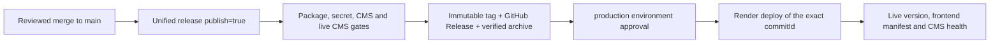

# Unified Openfund releases

## Current release state (2026-11-08)

The latest published and deployed release is **v0.4.1** at
`b8389cace71457f769b1042e87f4a53211b62ca0` (Render deploy
`dep-dbnn7mjl550s73fm4v7g`). The next allocated version from `main` is
**v0.4.2**: commits since v0.4.1 are `fix:`/`test:`/`docs:` only, so the
allocator bumps the patch. Resolve the latest state from GitHub at execution
time; this paragraph is a dated record, not live status.

## Release-to-production pipeline



- **Trigger:** only a `workflow_dispatch` of **Unified release** on `main`
  with `publish=true`. Branch pushes and pull requests build unofficial
  candidates and never publish or deploy. Releases are never drafts or
  prereleases when deployed.
- **Package:** the GitHub Release carries `openfund-vX.Y.Z.tar.gz`,
  `SHA256SUMS`, `release-manifest.json`, `verification.json` and
  `release-status.md`. This archive is the versioned package; Render rebuilds
  the same commit and refuses to start unless its frontend, backend and schema
  hashes equal the manifest
  ([ADR 0013](../decisions/0013-release-driven-production-deployment.md)).
- **Container image:** the chained `image` job builds
  `ghcr.io/algomanlife/openfund:X.Y.Z` (and `vX.Y.Z`) from the verified
  archive, smoke-tests migrate, `/health`, `/react/` and `/version` against a
  disposable database, pushes once, attests provenance and attaches
  `image-digest.txt` to the release. For an existing release, dispatch
  **Release container image** with its tag
  ([ADR 0014](../decisions/0014-ghcr-release-image.md)).
- **Deploy:** the chained `deploy` job calls **Deploy or roll back official
  release** with the published tag. It waits for the `production`
  environment's required reviewer, then posts the manifest's exact SHA as
  Render's `commitId` and polls until `live`.
- **Verification:** `RELEASE_PUBLIC_URL` `/version` must be `matched` with the
  release commit and backend ID; `/react/release-manifest.json` must match
  version, commit and frontend ID; `RELEASE_CMS_URL` must be healthy. The
  result is uploaded as `deployment-status-<run>-<attempt>`.
- **Ordering and retries:** the `openfund-production` concurrency group
  serializes deploys. A tag that is not the latest release is refused unless
  `rollback=true`. A retry against a service already serving the release
  skips the Render deploy and re-runs the checks.
- **Failure:** any failed check ends the job red with `blocked` or
  `failed_or_partial` in the status file; nothing is reported as deployed.
  Render keeps the previous deploy live when a build or health check fails.
- **Rollback:** dispatch the deploy workflow with an older tag and
  `rollback=true` ([Rollback](ROLLBACK.md)).
- **Version authority:** the Git tag allocated by `scripts/release/plan.mjs`
  is the application version, recorded in the manifest and served by
  `/version`. The `package.json` `version` fields stay `0.1.0`; they are
  internal component provenance, not the application version.

The frontend package now loads `/react/runtime-config.js` before its React
module. The backend serves this no-store script from `CMS_PUBLIC_URL` (preferred
custom domain) or the Render-provided `VITE_DIRECTUS_HOST` fallback. It contains
public browser settings only. A missing or non-HTTPS CMS origin prevents
production startup. To change the CMS domain, update `CMS_PUBLIC_URL` on the
existing `openfund` service and redeploy the same verified artifact; do not
edit bundled JavaScript. Keep the published archive and its SHA256SUMS
unchanged. `/version` verifies source/frontend/backend identity, while the
runtime script documents the separate environment choice. Verify both after
deployment.

The Render build queries GitHub's tag list at `RENDER_GIT_COMMIT`, requires its
published non-prerelease GitHub Release and checks the manifest digest and
identity before a clean rebuild. It does not require a named local Git remote.
All production-only `VITE_*` inputs are removed from the signed build; their
public values are supplied at runtime. A mismatch in frontend, backend or
schema hash still stops deployment.

The candidate gate requires `CMS_PUBLIC_URL` and probes health plus public
fa/en `ui_messages` and Home translations before the long build. For local
testing, point it at a disposable Directus instance with CORS enabled for the
test browser origin and set `CSP_EXTRA_CONNECT` to that HTTP origin. The GitHub
release workflow starts a disposable Directus instance for the integrated
candidate, so packaging does not depend on production CMS availability.
`RELEASE_DIRECTUS_URL` is checked as a separate live publication gate and is
never injected into the package. The current production CMS 403 response
blocks official publication until the permission migration is applied after
backup review.

The Unified release workflow also boots a separate pinned Directus 11.9.1 container
against a disposable PostgreSQL 17 database, runs the single CMS bootstrap
twice, verifies bilingual public Home/UI/website content, preserves a test
editorial edit on rerun and checks that a draft translation is not publicly
readable through its child endpoint. Publication depends on this CMS job.

## Authority and versioning

`main` is the integration authority. Feature branches, candidate archives and local screenshots are not official releases. At 2026-11-03 19:52 UTC, [publication run 41705345213](https://github.com/algomanlife/openfund/actions/runs/41705345213) completed successfully and published **v0.2.0**. Its annotated tag and official manifest identify `561e7f3101f3a43376068d9bba1a87c30e2b7d71`, including merged PR #40 and #41. v0.1.1 (`ce9ddd0`) predates those merges and remains historical rollback material. PR #42 is now merged at integrated source `d05b4b8`, but its website refresh is unreleased and not included in v0.2.0. The `qwen/community-theme-readme` addendum remains In Progress. No current port 8080 startup is verified by this documentation update. Resolve the latest official version from GitHub at execution time. Internal npm component versions remain provenance, not independent application releases.

Every main commit validates the integrated candidate through [Unified release](../../.github/workflows/release.yml). After a reviewed batch has reached main, manually dispatch that workflow with `publish=true`. The workflow serializes publication, installs all three lockfiles, tests and builds the actual app, then publishes one annotated tag and GitHub Release. Individual main commits do not allocate official releases. Conventional `feat:` messages bump minor, `fix:` and other changes bump patch, and `!` / `BREAKING CHANGE:` bump major. The highest reachable numeric SemVer tag is the baseline. All commits since the last tag enter generated notes, including changes combined while runs are pending. Existing tags are never moved. A rerun resumes a tag for the same SHA and never overwrites a published release's assets.

Pull requests run the same package gates as unofficial candidates. Publication runs only on an explicit main-branch batch dispatch after package and secret gates pass. Manual batches verify the successful required `Secret scan` check from the trusted GitHub Actions app on the exact source SHA; a missing, pending, failed or different-commit check blocks publication. This preserves the existing main CI scan contract instead of letting the action silently change to an unrelated full-history scan on manual events. Both scan workflows explicitly load the repository's existing `gitleaks.toml` policy. Do not merge until the required checks and review pass. Do not use an unmerged candidate as production evidence.

## Requested next target

The addendum requests **v0.2.1**, currently unallocated. PR #42 includes `feat(website)`, so the existing allocator selects a minor bump from v0.2.0 (currently **v0.3.0**). Maintainers must coordinate the exact target and any approved policy decision before publication. Do not force an override, bypass checks, rewrite commit history, move an immutable tag or overwrite release assets. Recheck latest main, official releases and target-tag availability at execution time; report any collision. Complete integrated tests, bilingual/theme/logo/community visual acceptance, manifests/checksums and rollback readiness, then obtain explicit merge/publication approval. No publication or merge is authorized by this documentation update.

## Architecture and gates

```mermaid
flowchart LR
  PR[Pull request] --> Checks[Install build tests browser checks]
  Checks --> Review[Review and merge into main]
  Review --> Package[Unified package and verification manifest]
  Package --> Tag[Immutable version tag and GitHub Release]
  Tag --> Approval[Production reviewer approval]
  Approval --> Render[Render deploy exact source SHA]
  Render --> Identity[Verify frontend API manifest and CMS health]
```



One root command orchestrates the existing application boundaries:

```sh
# Node.js 22, PostgreSQL 17, installed Playwright Chromium
# Create a NEW local database; never use the application's existing database.
createdb openfund_release_test
DATABASE_URL=postgresql://localhost/openfund_release_test npm run release:build -- --candidate
```

`release:build` installs root, frontend and backend lockfiles; validates the Blueprint, docs and TypeScript; runs frontend, chart and release integrity tests; produces and compares two production frontend builds; migrates the isolated database twice; seeds its catalog; boots a private backend; runs backend, wallet, account lifecycle, all-tab bilingual, authenticated layout, chart, release diagnostics and every bundled public content route browser scenarios. Test failures prevent packaging/publication. The script refuses nonlocal/shared databases and occupied test ports. It shuts down only its own server. `RELEASE_TEST_PORT` defaults to 8288.

Payment coverage is narrower than a production acceptance certificate. Main v0.2.0 packaging did not run the explicit `test:browser:purchase` suite or inject a receiver; CI separately enables a test-only placeholder and runs that browser lifecycle. The current website candidate adds `test:browser:website` to packaging. Inspect the current script and its verification stages before claiming coverage; [Testing](../development/TESTING.md) documents the isolated receiver setup. Receiver/widget defaults remain off for official runtime use.

Official mode additionally requires a clean checkout and the exact main GitHub Actions SHA. Node major 22 is required. Candidates are explicitly `official:false`; their SHA is a base commit, not proof that uncommitted changes were integrated. Only a clean main workflow can produce official identity.

The deployable archive contains current `react/`, backend source/lockfile/schema, the actual vendored journal-core dependency and licenses, the Blueprint, changelog, manifests and per-file checksums. It excludes `.env`, credentials, personal data, database contents, browser sessions and `node_modules`. Backend dependencies are installed from their lockfile on startup/deployment. Existing classic `dist/` source stays preserved in Git; the frontend build includes the assets it actually loads. CMS is the existing pinned Directus service; its schema tools and source are available at the release tag, not represented as a newly deployed service.

Build content reproducibility means the same lockfiles/source/config produce identical frontend content hashes. Timestamps, evidence, archive metadata and OS-specific dependency binaries are not asserted byte-identical. Repeated frontend builds are compared. Render separately checks its rebuilt frontend, backend and schema hashes against the official release before startup.

## Manifest and diagnostics

`release-manifest.json` records SemVer/tag, exact source SHA, build time, frontend content hash, backend content hash, additive schema hash, component versions, toolchain, CI verification stages and initial `not_deployed` status. The same file appears at `/react/release-manifest.json`. `/version` reports both identities, and responds with 503 on a mismatch. Unversioned development remains explicitly unversioned. Terminal pages display the release and a localized mismatch warning. HTML/manifests require cache revalidation.

At the 19:52 UTC checkpoint, the v0.2.0 official manifest reports frontend hash `d506eb1bf7b8360bffa6820a19a8a60f9fd67b5c5948ae8a6749fd19599585b8`, backend hash `36b182758a5f14b738b3d2e0572d93974dbbd94f258a7b47f052a24d2a99bb90`, Node `v22.23.4`, null CMS build URL, disabled WalletConnect and `not_deployed`. GitHub's archive digest is `913f448dae67795edc19ab136fe8095cf26e8199ba90f0f71fd543bf55baa145`; this query alone is not downloaded-payload verification or local startup acceptance.

Release artifacts also include `verification.json`, `SHA256SUMS` and release status notes. Deployment reports are separate immutable workflow artifacts; a published package is never silently relabelled as deployed. HTTP diagnostics expose build metadata only.

## GitHub and Render configuration

Configure the production environment with a required reviewer. The deployment script independently verifies that this policy exists and fails closed if absent. Preserve required main checks, disallow force pushes/deletion and protect `v*` tag updates/deletion. Repository settings need owner permissions; report whether these settings were actually applied.

| Setting | Location | Purpose |
| --- | --- | --- |
| `RELEASE_DIRECTUS_URL` | Repository Actions variable | Production CMS HTTPS URL checked before official publication; not embedded in the frontend build |
| `RENDER_API_TOKEN` | Production environment secret | Render deployment API authorization |
| `RENDER_SERVICE_ID` | Production environment variable | Existing `openfund` service ID |
| `RELEASE_PUBLIC_URL` | Production environment variable | Actual HTTPS frontend/API origin |
| `RELEASE_CMS_URL` | Production environment variable | Existing CMS HTTPS health origin |
| `DATABASE_URL`, `ALLOWED_DOMAINS` | Existing Render service | Managed DB and browser origin; no test-mode production |
| `VITE_WALLETCONNECT_PROJECT_ID` | Existing public build variable in both environments | Optional remote-wallet support; injected wallets remain usable without it |

The Blueprint now disables direct commit auto-deploy and invokes `scripts/release/render-build.mjs`. Existing deployed service settings do not change merely because the YAML changed: apply/reconcile the Blueprint and explicitly verify live auto-deploy is off. The deployment script refuses services whose auto-deploy remains enabled. It deploys an exact published manifest SHA using Render's `commitId`, clears cache, polls status and validates runtime identity plus CMS health. Application or CMS failure is `failed_or_partial`, never fully deployed. CMS health is not a complete content/schema/session acceptance certificate.

The build fails if Render's public build variables differ from official CI hashes. Since ADR 0013 the publication run chains the deployment; an authorized reviewer approves it in the `production` environment. Manual dispatch of **Deploy or roll back official release** remains for redeploys and rollback. The production environment is configured (v0.4.1 was deployed on 2026-11-07); the earlier 2026-11-03 "local only" statement is historical.

## Run an exact official version locally

```sh
# Requires authenticated gh, Git, tar, npm, Node 22, and local PostgreSQL.
# Pick a dedicated local database and an official published version.
createdb openfund_release_local
DATABASE_URL=postgresql://localhost/openfund_release_local PORT=8080 \
  npm run release:local -- --version current --migrate
```

`current` resolves the latest official GitHub Release once, prints its exact tag and then pins that identity for the entire run. An explicit `--version v0.1.0` selects a historical release. Missing releases fail without falling back to a development checkout. The runner downloads only that version's official archive, verifies its tag SHA, external archive checksum, every payload file and both manifests, then installs backend lockfile dependencies in a new temporary directory. It never edits the current checkout, never selects a fallback version and never enables test execution endpoints. `--migrate` explicitly authorizes additive migrations on the supplied local DB; omitting it verifies artifacts without starting services. Startup displays the exact version/commit and verifies `/version`. Stop with Ctrl-C; the extracted payload remains for inspection. The runner does not provision CMS or production secrets.

## Local unofficial candidate identity recovery

Do not use `release:local` to pretend an unmerged candidate is official. Build
with the existing `release:build -- --candidate` on a fresh isolated local test
DB, after documentation edits. Preserve the verified archive and external
SHA256SUMS; extract it into a separate workspace directory and run the existing
`scripts/release/verify.mjs` on that exact payload before installing backend
lockfile dependencies. Use Node 22 and the existing server entrypoint, never
mutable worktree frontend output. Do not rebuild frontend after packaging.

For authorized canonical 8080 preview, inspect and stop only the explicitly
owned PID after verifying its command/cwd. Preserve Directus 8055 and the existing
`openfund_release_local` database; schema is unchanged, so no migration is needed.
Back up before any later authorized migration. Disable test mode and payment
receiver injection. Check both manifests, `/version` matched identity,
`official:false`, frontend bytes and genuine real-click light/dark screenshots.
Payload verification establishes hashes; `/version` alone compares metadata and
is not a content-integrity or owner-browser acceptance certificate. Owner Opera
profile permission and official review/publication remain separate gates.

## Rollback

Retain the previous known-good official tag, manifest and database backup. Dispatch the same approved deployment workflow with that exact prior tag. The immutable release must still exist and its source must be compatible with the current additive database schema. Never automatically reverse SQL migrations or reset accounts. If a release requires destructive schema changes, prepare a reviewed restoration/compatibility plan before deployment. Version diagnostics and CMS health must pass again before calling rollback complete. A failed deploy report retains the attempted SHA/deploy ID and is not a successful rollback.

## External references

[Render deploy API](https://api-docs.render.com/reference/create-deploy) documents exact `commitId` deployment and notes that this does not disable auto-deploy. [GitHub environments](https://docs.github.com/en/actions/reference/workflows-and-actions/deployments-and-environments) describe environment protection. Actual settings and runtime evidence take precedence over configuration intent.

## Publish a reviewed batch

After required PR checks and review, merge the consolidated changes into main. Dispatch `gh workflow run release.yml --ref main -f publish=true`, then verify the resulting tag, assets and manifest. Without `publish=true`, pushes and manual runs only validate candidates. Later batches increment the version from all changes since the last official tag. A failed run publishes nothing; fix the cause and rerun from main.
