# Unified Openfund releases

## Authority and versioning

`main` is the integration authority. Feature branches, candidate archives and local screenshots are not official releases. The initial audit found no Git tags or GitHub Releases; the former root `1.0.0` package metadata did not establish a stable release. The first proposed integrated version is **v0.1.0**. Internal npm component versions remain provenance, not independent application releases.

Every main commit validates the integrated candidate through [Unified release](../../.github/workflows/release.yml). After a reviewed batch has reached main, manually dispatch that workflow with `publish=true`. The workflow serializes publication, installs all three lockfiles, tests and builds the actual app, then publishes one annotated tag and GitHub Release. Individual main commits do not allocate official releases. Conventional `feat:` messages bump minor, `fix:` and other changes bump patch, and `!` / `BREAKING CHANGE:` bump major. The highest reachable numeric SemVer tag is the baseline. All commits since the last tag enter generated notes, including changes combined while runs are pending. Existing tags are never moved. A rerun resumes a tag for the same SHA and never overwrites a published release's assets.

Pull requests run the same package gates as unofficial candidates. Publication runs only on an explicit main-branch batch dispatch after package and secret gates pass. Manual batches verify the successful required `Secret scan` check from the trusted GitHub Actions app on the exact source SHA; a missing, pending, failed or different-commit check blocks publication. This preserves the existing main CI scan contract instead of letting the action silently change to an unrelated full-history scan on manual events. Both scan workflows explicitly load the repository's existing `gitleaks.toml` policy. Do not merge until the required checks and review pass. Do not use an unmerged candidate as production evidence.

## Architecture and gates

```mermaid
flowchart LR
  PR[Pull request] --> Checks[Install build tests browser checks]
  Checks --> Review[Review and merge into main]
  Review --> Package[Unified package and verification manifest]
  Package --> Tag[Immutable version tag and GitHub Release]
  Tag --> Approval[Production reviewer approval]
  Approval --> Render[Render deploy exact source SHA]
  Render --> Identity[Verify frontend API manifest and CMS health]
```



One root command orchestrates the existing application boundaries:

```sh
# Node.js 22, PostgreSQL 17, installed Playwright Chromium
# Create a NEW local database; never use the application's existing database.
createdb openfund_release_test
DATABASE_URL=postgresql://localhost/openfund_release_test npm run release:build -- --candidate
```

`release:build` installs root, frontend and backend lockfiles; validates the Blueprint, docs and TypeScript; runs frontend, chart and release integrity tests; produces and compares two production frontend builds; migrates the isolated database twice; seeds its catalog; boots a private backend; runs backend, wallet, account lifecycle, all-tab bilingual, authenticated layout, chart, release diagnostics and every bundled public content route browser scenarios. Test failures prevent packaging/publication. The script refuses nonlocal/shared databases and occupied test ports. It shuts down only its own server. `RELEASE_TEST_PORT` defaults to 8288.

Official mode additionally requires a clean checkout and the exact main GitHub Actions SHA. Node major 22 is required. Candidates are explicitly `official:false`; their SHA is a base commit, not proof that uncommitted changes were integrated. Only a clean main workflow can produce official identity.

The deployable archive contains current `react/`, backend source/lockfile/schema, the actual vendored journal-core dependency and licenses, the Blueprint, changelog, manifests and per-file checksums. It excludes `.env`, credentials, personal data, database contents, browser sessions and `node_modules`. Backend dependencies are installed from their lockfile on startup/deployment. Existing classic `dist/` source stays preserved in Git; the frontend build includes the assets it actually loads. CMS is the existing pinned Directus service; its schema tools and source are available at the release tag, not represented as a newly deployed service.

Build content reproducibility means the same lockfiles/source/config produce identical frontend content hashes. Timestamps, evidence, archive metadata and OS-specific dependency binaries are not asserted byte-identical. Repeated frontend builds are compared. Render separately checks its rebuilt frontend, backend and schema hashes against the official release before startup.

## Manifest and diagnostics

`release-manifest.json` records SemVer/tag, exact source SHA, build time, frontend content hash, backend content hash, additive schema hash, component versions, toolchain, CI verification stages and initial `not_deployed` status. The same file appears at `/react/release-manifest.json`. `/version` reports both identities, and responds with 503 on a mismatch. Unversioned development remains explicitly unversioned. Terminal pages display the release and a localized mismatch warning. HTML/manifests require cache revalidation.

Release artifacts also include `verification.json`, `SHA256SUMS` and release status notes. Deployment reports are separate immutable workflow artifacts; a published package is never silently relabelled as deployed. HTTP diagnostics expose build metadata only.

## GitHub and Render configuration

Configure the production environment with a required reviewer. The deployment script independently verifies that this policy exists and fails closed if absent. Preserve required main checks, disallow force pushes/deletion and protect `v*` tag updates/deletion. Repository settings need owner permissions; report whether these settings were actually applied.

| Setting | Location | Purpose |
| --- | --- | --- |
| `RELEASE_DIRECTUS_URL` | Repository Actions variable | Public CMS URL used for official frontend builds; must equal Render's `https://$VITE_DIRECTUS_HOST` |
| `RENDER_API_TOKEN` | Production environment secret | Render deployment API authorization |
| `RENDER_SERVICE_ID` | Production environment variable | Existing `openfund` service ID |
| `RELEASE_PUBLIC_URL` | Production environment variable | Actual HTTPS frontend/API origin |
| `RELEASE_CMS_URL` | Production environment variable | Existing CMS HTTPS health origin |
| `DATABASE_URL`, `ALLOWED_DOMAINS` | Existing Render service | Managed DB and browser origin; no test-mode production |
| `VITE_WALLETCONNECT_PROJECT_ID` | Existing public build variable in both environments | Optional remote-wallet support; injected wallets remain usable without it |

The Blueprint now disables direct commit auto-deploy and invokes `scripts/release/render-build.mjs`. Existing deployed service settings do not change merely because the YAML changed: apply/reconcile the Blueprint and explicitly verify live auto-deploy is off. The deployment script refuses services whose auto-deploy remains enabled. It deploys an exact published manifest SHA using Render's `commitId`, clears cache, polls status and validates runtime identity plus CMS health. Application or CMS failure is `failed_or_partial`, never fully deployed. CMS health is not a complete content/schema/session acceptance certificate.

The build fails if Render's public build variables differ from official CI hashes. Configure public values identically before the first official release. No deployment is started automatically after publishing. An authorized reviewer must approve the manually dispatched **Deploy or roll back official release** workflow on `main`. The owner confirmed on 2026-11-03 that Openfund runs locally only; there is no active Render service or deployed CMS/application. Future deployment remains unconfigured. This does not block official GitHub publication or local release acceptance.

## Run an exact official version locally

```sh
# Requires authenticated gh, Git, tar, npm, Node 22, and local PostgreSQL.
# Pick a dedicated local database and an official published version.
createdb openfund_release_local
DATABASE_URL=postgresql://localhost/openfund_release_local PORT=8080 \
  npm run release:local -- --version current --migrate
```

`current` resolves the latest official GitHub Release once, prints its exact tag and then pins that identity for the entire run. An explicit `--version v0.1.0` selects a historical release. Missing releases fail without falling back to a development checkout. The runner downloads only that version's official archive, verifies its tag SHA, external archive checksum, every payload file and both manifests, then installs backend lockfile dependencies in a new temporary directory. It never edits the current checkout, never selects a fallback version and never enables test execution endpoints. `--migrate` explicitly authorizes additive migrations on the supplied local DB; omitting it verifies artifacts without starting services. Startup displays the exact version/commit and verifies `/version`. Stop with Ctrl-C; the extracted payload remains for inspection. The runner does not provision CMS or production secrets.

## Rollback

Retain the previous known-good official tag, manifest and database backup. Dispatch the same approved deployment workflow with that exact prior tag. The immutable release must still exist and its source must be compatible with the current additive database schema. Never automatically reverse SQL migrations or reset accounts. If a release requires destructive schema changes, prepare a reviewed restoration/compatibility plan before deployment. Version diagnostics and CMS health must pass again before calling rollback complete. A failed deploy report retains the attempted SHA/deploy ID and is not a successful rollback.

## External references

[Render deploy API](https://api-docs.render.com/reference/create-deploy) documents exact `commitId` deployment and notes that this does not disable auto-deploy. [GitHub environments](https://docs.github.com/en/actions/reference/workflows-and-actions/deployments-and-environments) describe environment protection. Actual settings and runtime evidence take precedence over configuration intent.

## Publish a reviewed batch

After required PR checks and review, merge the consolidated changes into main. Dispatch `gh workflow run release.yml --ref main -f publish=true`, then verify the resulting tag, assets and manifest. Without `publish=true`, pushes and manual runs only validate candidates. Later batches increment the version from all changes since the last official tag. A failed run publishes nothing; fix the cause and rerun from main.
