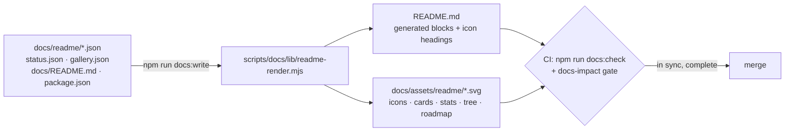

# README structure contract

The root `README.md` is Openfund's **complete, graphical front page**: a
banner, an icon on every section, product cards, generated graphics, a
gallery and a map of the whole repository. It is built from data, so it stays
current with every merge, and it is enforced by CI, so it cannot shrink back
to a stub.

This contract is owner-approved (2026-11-21) and replaces the earlier
"short entry point" contract with size budgets. Agents and contributors may
**add** to the README; they may **never remove** a section, icon, graphic,
generated block or single-source link to make an edit pass.

## How the README is built



| Layer | Files | Who edits |
| --- | --- | --- |
| Rules | this page, [`AGENTS.md`](../../AGENTS.md), [`CLAUDE.md`](../../CLAUDE.md) | Owner-approved PRs only |
| Data (single source) | [`docs/readme/`](../readme/) — `sections`, `products`, `features`, `regions`, `structure`, `stack`, `business`, `roadmap`; plus [`status.json`](../status/status.json), [`gallery.json`](../assets/gallery/gallery.json), [`RETIRED.json`](RETIRED.json), [`THIRD_PARTY_NOTICES.md`](../../THIRD_PARTY_NOTICES.md), [`docs/README.md`](../README.md) | Every PR that changes what they describe |
| Generator | [`scripts/docs/lib/readme-render.mjs`](../../scripts/docs/lib/readme-render.mjs), [`readme-icons.mjs`](../../scripts/docs/lib/readme-icons.mjs) | Tooling PRs |
| Output | `README.md` generated blocks and headings, `docs/assets/readme/` | Nobody by hand — `npm run docs:write` |
| Guard | [`check-readme.mjs`](../../scripts/docs/check-readme.mjs), [`check-docs-impact.mjs`](../../scripts/docs/check-docs-impact.mjs) | Tooling PRs |

## Sections (exact, in order)

Before the first section: the title block — the banner
(`docs/assets/graphics/hero.svg`), `# Openfund`, the tagline, at least four
badges and the navigation links. No other heading may appear before the first
section. Every section is written as `<a name="id"></a>` followed by
`## <icon> Title`; `npm run docs:write` renders both from
[`sections.json`](../readme/sections.json).

1. `## Project overview`
2. `## Product ecosystem`
3. `## Features`
4. `## Languages and regions`
5. `## Feature status`
6. `## Product gallery`
7. `## Business model`
8. `## Technical architecture`
9. `## Repository structure`
10. `## Technology stack`
11. `## Development workflow`
12. `## Versioning and releases`
13. `## Roadmap`
14. `## Security`
15. `## Documentation map`
16. `## License`
17. `## Retired and no longer used`
18. `## Contributing`

## The merge rule

**Every pull request leaves the README and the docs current for what it
changes.** Concretely, in the same pull request:

| When the PR changes… | It also updates… |
| --- | --- |
| A product, surface or its state | [`products.json`](../readme/products.json) |
| A user-visible capability | [`features.json`](../readme/features.json), [FEATURE_STATUS](../product/FEATURE_STATUS.md) and `CHANGELOG.md` (Unreleased) |
| An app, package or top-level directory (added, removed, repurposed) | [`structure.json`](../readme/structure.json) |
| A dependency in the tech stack | nothing by hand — versions are read from the manifests; run `npm run docs:write` |
| A language, domain or region | [`regions.json`](../readme/regions.json) and the ADR |
| Pricing, lifecycle or money flows | [`business.json`](../readme/business.json), [ECONOMY.md](../../ECONOMY.md), [business detail](../economy/BUSINESS_DETAIL.md) |
| A roadmap phase state | [`roadmap.json`](../readme/roadmap.json) and [milestones](../roadmap/MILESTONES.md) |
| A release or a runtime | [`status.json`](../status/status.json) |
| UI significantly | screenshots + [manifest](../assets/screenshots/manifest.json); curate in [`gallery.json`](../assets/gallery/gallery.json) |
| A document area | [`docs/README.md`](../README.md) (the Documentation map follows it) |
| Something removed or superseded | [`RETIRED.json`](RETIRED.json) |

Then run `npm run docs:write` and commit the data, `README.md` and
`docs/assets/readme/` together. A pull request with genuinely no documentation
impact states it in its description with one line, which reviewers check:

```text
Docs-impact: none — <reason>
```

After editing the description, re-run the `Web (React + Vite)` job (or push a
commit) so the gate sees it.

## Gates

### README gate (`scripts/docs/check-readme.mjs`, required check `Web (React + Vite)`)

| Rule | What fails |
| --- | --- |
| Structure | A section missing, added, renamed, duplicated or out of order; a missing `<a name>` anchor or icon heading; an orphan heading before the first section; a heading that skips a level |
| Minimums | Title block without the banner or with fewer than 4 badges; fewer than 60 images in the README; a section with fewer than 3 lines of content |
| In sync with data | Any generated block, icon heading or graphic in `docs/assets/readme/` differs from what the data produces (including orphan graphics) |
| Repository map | A tracked top-level directory, `apps/*` app or `packages/*` package missing from `structure.json`, or a listed path that no longer exists |
| One responsibility per section | Platform versions outside *Versioning and releases*; font names outside *Technology stack*; diagrams outside *Technical architecture*; license terms outside *License*; vulnerability reporting outside *Security* (generated blocks are exempt) |
| Freshness | A hand-written `vX.Y.Z` that is not the latest official release or the declared next release in [status.json](../status/status.json); a dated gallery/capture heading |
| Single source | A section that drops a required link from `sections.json` |
| Links | A local link or image that does not resolve, or a missing anchor |
| Rule carriers | `AGENTS.md` no longer references this page or `npm run docs:write` |

### Docs-impact gate (`scripts/docs/check-docs-impact.mjs`, pull requests, required check `Web (React + Vite)`)

| Changed | Must also change |
| --- | --- |
| `apps/**`, `packages/**` (not tests, lockfiles or READMEs) | `CHANGELOG.md`, `docs/readme/**`, `docs/product/**`, `docs/status/**` or `gallery.json` |
| Screenshot images | `docs/assets/screenshots/manifest.json` |
| `render.yaml`, `infra/`, `infrastructure/`, deploy workflows | `docs/deployment/**`, `docs/status/**`, `docs/operations/**` or `CHANGELOG.md` |
| `docs/readme/*.json`, `docs/status/status.json` | `README.md` (regenerated) |

Exempt: `Docs-impact: none — <reason>` in the description, or a bot author.

## Generated blocks

| Block | Section | Source | Regenerate |
| --- | --- | --- | --- |
| `<!-- stats -->`, `<!-- toc -->` | Project overview | `sections.json`, `products.json`, `features.json`, `regions.json`, `structure.json`, `status.json` | `npm run docs:write` |
| `<!-- products -->` | Product ecosystem | [`products.json`](../readme/products.json) | `npm run docs:write` |
| `<!-- features -->` | Features | [`features.json`](../readme/features.json) | `npm run docs:write` |
| `<!-- regions -->` | Languages and regions | [`regions.json`](../readme/regions.json) | `npm run docs:write` |
| `<!-- status:summary -->` | Feature status | [status.json](../status/status.json) | `npm run docs:write` |
| `<!-- gallery -->` | Product gallery | [gallery.json](../assets/gallery/gallery.json) | `npm run docs:write` |
| `<!-- business -->` | Business model | [`business.json`](../readme/business.json) | `npm run docs:write` |
| `<!-- structure -->` | Repository structure | [`structure.json`](../readme/structure.json) | `npm run docs:write` |
| `<!-- stack -->` | Technology stack | [`stack.json`](../readme/stack.json) + package manifests | `npm run docs:write` |
| `<!-- roadmap -->` | Roadmap | [`roadmap.json`](../readme/roadmap.json) | `npm run docs:write` |
| `<!-- docs-map -->` | Documentation map | [docs/README.md](../README.md) | `npm run docs:write` |
| `<!-- license:summary -->` | License | [THIRD_PARTY_NOTICES.md](../../THIRD_PARTY_NOTICES.md) | `npm run docs:write` |
| `<!-- retired:summary -->` | Retired and no longer used | [RETIRED.json](RETIRED.json) | `npm run docs:write` |

Edit the source, regenerate, commit both. Never hand-edit inside a block or a
file under `docs/assets/readme/`. Text outside the blocks is hand-written and
may be extended freely within its section's responsibility.

## Graphics and icons

- Brand palette and type: dark panels `#060808`/`#0c1412`, mint `#82e7bd`,
  lime `#c6ff52`, Ubuntu; matching the hand-made graphics in
  [`docs/assets/graphics/`](../assets/graphics/).
- Icons are outline glyphs on a 24-unit grid in
  [`readme-icons.mjs`](../../scripts/docs/lib/readme-icons.mjs). To add one,
  add a glyph there and reference its name from the JSON data.
- SVG text is English-only (the language gate scans `docs/assets/`).

## Retired registry (`scripts/docs/check-retired.mjs`)

[RETIRED.json](RETIRED.json) lists every retired, legacy-only and dormant
item with its replacement and the patterns that identify it. For an item with
status `retired`, CI fails if any active file, text or archive entry still
references it (dated evidence under the registry's `historical` paths is
exempt), or if `THIRD_PARTY_NOTICES.md`'s active table lists it. The gate
renders [RETIRED.md](RETIRED.md) and the README block. Retiring something
means adding it here in the same pull request that removes it.

## Font gate (`scripts/docs/check-fonts.mjs`)

Only two faces exist: **Ubuntu** (general/Latin) and **Dastkhat** (`Dastkhat`,
`Dastkhat Arabic`, `Dastkhat FaNum`; the only Persian/Arabic face). CI fails on
any retired font file, any retired face in a font context (CSS, canvas,
`FontFace`, Office `typeface`, Google Fonts URL, PDF font names, archives), any
`@font-face`/`FontFace` naming another family, or a Persian/Arabic
`@font-face` outside the one shared
[`dastkhat.css`](../../apps/web-react/public/assets/fonts/dastkhat/dastkhat.css).
Policy: [design system › typography](../design/DESIGN_SYSTEM.md#typography-and-font-tokens).

## Changing the contract

Change [`sections.json`](../readme/sections.json),
[`readme-contract.mjs`](../../scripts/docs/lib/readme-contract.mjs) and this
page together, in a reviewed pull request approved by the owner, with the
reason in the description. Do not lower a minimum or remove a section to make
a README edit pass; add the missing data instead.
