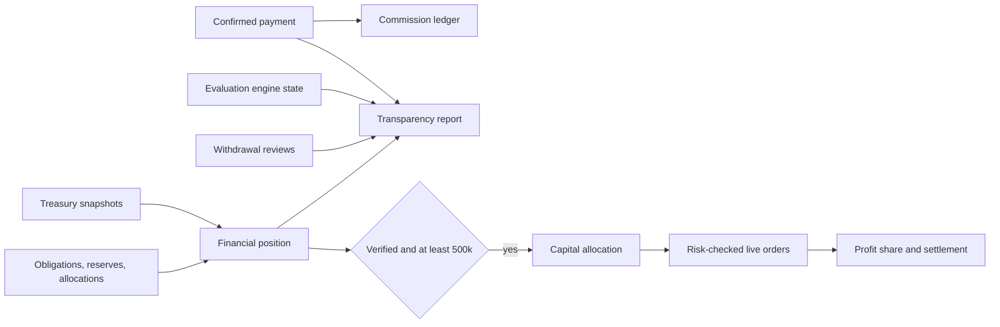

# Economy, partner programs and Live Market Access

This area covers four connected capabilities:

1. **Economy / Transparency**: a public, aggregated report computed from operational records.
2. **Economy / Revenue Model**: the business model, definitions, cited research and an illustrative scenario calculator.
3. **Economy / Live Market Access**: the control plane for allocating Openfund-owned capital to selected traders.
4. **Brand Ambassador and Verified Trading Coach**: two independent, reviewed partner roles.

Detailed policies: [Treasury and data sources](TREASURY.md) · [Partner programs and commission rules](PARTNER_PROGRAMS.md) · [Live Market Access, eligibility and settlement](LIVE_MARKET_ACCESS.md) · [ADR 0015](../decisions/0015-economy-ledgers-and-live-funding.md)

## Operational status

| Capability | State | What is still required |
|---|---|---|
| Transparency report (sales, challenges, payouts, expenses, position) | Operational | Real figures appear as records accumulate; empty states are zeros, not samples |
| Openfund Treasury balance | Ready, **not configured** | Management must supply the public `TREASURY_WALLET_ADDRESS`, chain and `TREASURY_ASSETS` with Chainlink price feeds |
| Financial position / allocatable capital | Operational, reports **Unknown** | Treasury configuration plus management-set operational and risk reserves |
| Verified expenses | Operational (admin API) | Operators record invoices; a second operator verifies each record |
| Brand Ambassador program | Operational | `ADMIN_API_TOKEN` and named reviewers for approvals; commission payouts are transferred by the operator and recorded with a reference |
| Verified Trading Coach program | Operational | Same admin review; coach revenue exists only once live trading produces realized profit |
| Live Market Access eligibility, requests and approvals | Operational | Management decides each request and selects the profit-share tier explicitly |
| Capital allocation | Gated | Verified allocatable capital ≥ $500,000 and an enabled execution adapter |
| Live order execution on Gains Network | **Not enabled** | Approved signer/custody design, supported testnet contracts, transaction simulation, security review and explicit activation ([AGENTS.md](../../AGENTS.md)) |
| Automatic settlement transfers | **Not enabled** | An approved payout adapter; until then settlements stay `pending` and operators reconcile with evidence |

The `sandbox` execution and settlement adapters are non-monetary. They exist for development and staging only and are refused when `NODE_ENV=production`.

## Architecture



| Module | Responsibility |
|---|---|
| [`economy-math.js`](../../apps/backend/economy-math.js) | Pure decimal policy arithmetic (commission, reversal, split, position, eligibility, risk, scenario) |
| [`treasury.js`](../../apps/backend/treasury.js) | Scheduled on-chain balance snapshots with Chainlink pricing and stale fallback |
| [`economy.js`](../../apps/backend/economy.js) | Public `/economy/*` report and `/admin/economy/*` financial records |
| [`partners.js`](../../apps/backend/partners.js) | Applications, approvals, ambassador attribution, commission ledger, coach links |
| [`live-funding.js`](../../apps/backend/live-funding.js) | Eligibility, approvals, allocations, orders, finalization, settlement |
| [`financial-audit.js`](../../apps/backend/financial-audit.js) | Append-only financial audit writer |

The backend and its PostgreSQL database are the source of truth for all operational and financial data. Directus is not used to write these records. Operators can read the tables in the Directus Data Studio, but every decision goes through the admin API so that it is validated and audited. The admin API is authorized by `ADMIN_API_TOKEN`, and each decision must name its operator in the `X-Admin-Actor` header.

## HTTP API

Public: `GET /economy/transparency`, `GET /economy/treasury`, `GET /live/status`, `POST /ambassador/visit`.

Authenticated (SIWE session): `GET /partners/me`, `POST /partners/applications`, `GET /ambassador/dashboard`, `GET|POST /coach/link`, `POST /coach/link/:id/end`, `GET /coach/dashboard`, `POST /coach/links/:id/respond`, `POST /coach/links/:id/qualification`, `GET /live/me`, `POST /live/apply`, `POST /live/orders`, `POST /live/trades/:id/close`.

Admin (`Authorization: Bearer`, `X-Admin-Actor`):

- `/admin/economy`: `treasury/refresh`, `expenses` (record, `verify`, `void`, `paid`), `reserves`, `obligations`, `payments/:id/adjustments` (refund or chargeback), `payments-lookup`, `position`, `audit`.
- `/admin/partners`: `applications` (list, detail, `decision`), `commissions`, `commissions/payout`.
- `/admin/live`: `approvals` (`decision`), `allocations` (create, `halt`, `resume`, `close`), `settlements` (`process`, `reconcile`), `trades/:id/reconcile`.

## Database migration notes

All changes are additive in [`schema.sql`](../../apps/backend/schema.sql) and applied by the existing idempotent `migrate.js`. No existing table is altered or rewritten. New tables:

- `financial_audit_log`, `payment_adjustments`, `treasury_snapshots`, `capital_reserves`, `financial_obligations`, `verified_expenses`
- `partner_applications`, `partner_application_events`, `ambassador_profiles`, `ambassador_attributions`, `referral_visits`, `referral_commissions`
- `coach_profiles`, `trader_coach_links`
- `live_funding_approvals`, `capital_allocations`, `live_trades`, `live_trade_events`, `profit_share_allocations`, `settlement_records`

Triggers reject `UPDATE`/`DELETE` on `financial_audit_log`, `referral_commissions` and `live_trade_events`. Running the migration twice is verified in CI. Rollback is non-destructive: the previous release ignores the new tables. Do not drop them, because they contain financial history.

## Code changes outside the four areas

- `purchases.js`: inside the existing payment-confirmation transaction, a savepoint-isolated call records the ambassador commission. Order creation first attempts attribution for a never-paid account. Pricing, verification and provisioning are unchanged.
- `server.js`: route mounting, ambassador attribution at sign-up, the treasury scheduler and the settlement retry loop.
- `admin.js`: the existing token middleware is exported as `adminAuth`, and `adminActor` is added. Behaviour is unchanged.
- The evaluation engine, Pass/Fail rules, drawdown logic, trading chart and market data are untouched.

## Testing

```bash
npm run test:economy --prefix apps/backend
```

This runs four suites. `economy-math` needs no database. `treasury` and `live-funding` need only an isolated test-named `DATABASE_URL`. `partners` needs a running test backend with `ADMIN_API_TOKEN` and the CI placeholder payment receiver. All four are included in `npm run test:backend` and CI. Frontend coverage is in `npm run test:web` (scenario arithmetic, no synthetic transparency source, Economy menu). See [Testing](../development/TESTING.md).

## Deployment readiness checklist

- [ ] `TREASURY_WALLET_ADDRESS`, `TREASURY_CHAIN_ID`, `TREASURY_ASSETS` (with verified Chainlink aggregator addresses) entered in Render; first snapshot status `ok` and `fully_priced=true`.
- [ ] Operational and risk reserves set through `/admin/economy/reserves`.
- [ ] Existing verified expenses recorded with invoice references and verified by a second operator.
- [ ] `ADMIN_API_TOKEN` set; reviewer names agreed for `X-Admin-Actor`.
- [ ] Ambassador and coach terms reviewed by counsel; terms version strings updated in `partners.js` if the text changes.
- [ ] Commission payout process agreed (wallet, asset, cadence); payouts recorded with transaction references.
- [ ] `LIVE_EXECUTION_ADAPTER` and `LIVE_SETTLEMENT_ADAPTER` remain `none` in production until a Gains execution adapter and payout adapter pass a separate security review and testnet acceptance.
- [ ] Management approval of the profit-share tier policy before the first live approval.
