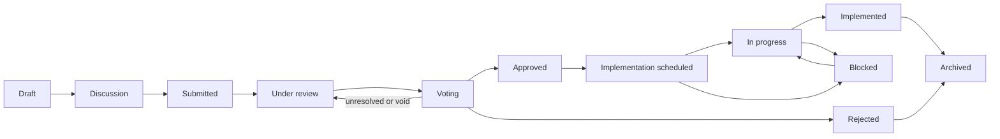

# Openfund Proposals (OFP)

Policy source: [GOVERNANCE.md](../../GOVERNANCE.md) sections 8 and 9.

## Identifiers

Each proposal receives an identifier such as `OFP-0001`. The number comes from a
database sequence and the identifier is a generated column. It is unique, stable and
cannot be edited, not even by the author.

## Lifecycle

Only the declared transitions are valid. Some transitions are not available through
the generic transition endpoint because they carry extra rules: opening voting,
finalizing a vote and recording implementation each have a dedicated operation.

| Transition | Who | Notes |
|---|---|---|
| Draft to Discussion | Author | The draft becomes public and revision 1 is stored |
| Discussion to Submitted | Author | Requires a description, expected benefits and risks |
| Submitted to Under review | Reviewer | |
| Under review to Voting | Reviewer or management | Dedicated operation; see [VOTING.md](VOTING.md) |
| Voting to Approved or Rejected | Reviewer or management | Only by finalizing the voting session |
| Approved to Implementation scheduled to In progress to Implemented | Reviewer or management | Implemented requires an evidence link |
| Implementation scheduled or In progress to Blocked | Management only | Reason, evidence and a future review date required |

History is append-only: every transition records the actor role, time and note.

## Data

A proposal carries a title, summary, description, author, category, binding or
advisory class, affected product area, technical implications, resource requirements,
expected benefits, risks, documentation links, related GitHub issue and pull request,
voting schedule, decision, decision rationale, implementation status and last-updated
time. Links must be HTTPS.

## Binding versus advisory

The category decides what a proposal may be.

| Group | Categories | Class |
|---|---|---|
| Delegated | product priority, community policy, open source, roadmap, documentation, accessibility, governance amendment | May be binding |
| Reserved to management | treasury, pricing, commissions, coach compensation, marketing budget, operating budget, capital allocation, trading risk, payouts, liquidity, commercial partnership, contract deployment, other financial | Always **Advisory — Non-Binding** |

A reserved category cannot be classified as binding. This is checked in the service
and by a database CHECK constraint, so it also holds against direct writes. The
interface and API never display an advisory proposal as binding.

Binding proposals in the roadmap and product-priority categories also need a
management-confirmed capacity envelope before voting can open, because binding
authority never creates an unapproved budget.

## Editing rules

- Only the author can edit, and only in Draft or Discussion.
- Each edit during Discussion creates a new immutable revision.
- After Submitted the proposal is locked. A material change returns it to Discussion (a reviewer action with a note) and needs a new voting cycle.
- After voting opens, the category, classification, author and identifier are frozen by a database trigger, and the voting rules and snapshot are frozen separately.

## Public discussion

Anyone signed in can leave feedback with an optional stance (support, oppose,
neutral). Feedback is not a vote and is labelled as non-binding. Moderators and
reviewers can hide a comment with an audit entry. GitHub Discussions remain the place
for broad conversation and polls; they are never counted as council votes.
