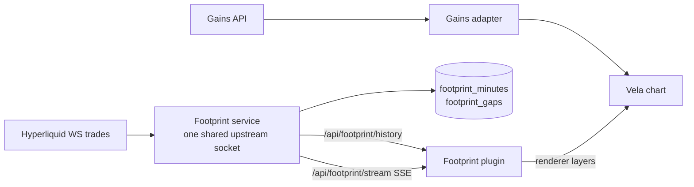

# Footprint chart — Gains price, Hyperliquid order flow

Status: **Implemented on branch `agent/claude/hybrid-footprint`, not deployed.**
Disabled by default (`FOOTPRINT_ENABLED=0`). Decision record:
[ADR 0024](../decisions/0024-hybrid-footprint-chart.md).

## Boundary

| Concern | Source | Notes |
| :--- | :--- | :--- |
| Chart price, OHLC candles, market list, indicators | **Gains Network** (unchanged) | `packages/openfund-gains-adapter`, `apps/backend/market-data.js` |
| Trading engine, positions, SL/TP, PnL, drawdown, evaluation | **Gains Network** (unchanged) | the footprint module cannot reach them |
| Aggressor buy/sell volume per price, delta, POC, value area, imbalances | **Hyperliquid executed trades** | read-only, chart-only |

The two sources meet only in the chart's renderer layers. The footprint
backend module (`apps/backend/footprint/`) imports nothing from the engine,
market data, accounts, wallets, payments or the CMS, and it exposes no write
endpoint. `apps/backend/test/footprint.test.mjs` enforces both rules, plus the
exact way `server.js` constructs, mounts, starts and stops the service.

## Data model

- **Trade side.** Hyperliquid `WsTrade.side`: `B` = the taker bought, so it
  prints in the ASK column. `A` = the taker sold, so it prints in the BID
  column. The docs list `users` as `[buyer, seller]` but do not define `side`.
  The aggressor meaning was checked live on 2026-11-12 against the best
  bid/offer feed (BTC: 58 `B` trades at the ask, 0 at the bid). Side is never
  inferred from price movement or candle color.
- **Identity.** `(time, coin, tid)`, as the docs specify. Duplicates (for
  example the snapshot that every (re)subscribe returns) are dropped. A trade
  lands in its own minute whatever order it arrives in.
- **Exactness.** Prices are integer price units (`price × 10^(6 − szDecimals)`)
  parsed from Hyperliquid's decimal strings. Sizes are integer lots
  (`size × 10^szDecimals`). Sums never accumulate floating-point error.
  Prices are never shifted.
- **Base aggregation.** One slice per coin per UTC minute:
  `levels = [[pu, bidLots, askLots, bidCount, askCount], …]`. Any chart
  timeframe (1, 5, 15, 30, 60, 240 minutes, D) sums the minute slices per
  level. It never aggregates OHLCV, so POC, delta and imbalances survive.
  Gains bars use the same epoch-aligned UTC buckets.
- **Privacy.** Counterparty addresses and transaction hashes in the public
  feed are discarded at normalization and never stored or forwarded.

## Service (`FOOTPRINT_ENABLED=1`)

| Route | Purpose |
| :--- | :--- |
| `GET /api/footprint/markets` | verified mapping per Gains market, feed state, calibration |
| `GET /api/footprint/history?symbol&tf&from&to` | footprint bars for **closed** minutes (≤ 1000 bars; closed ranges cached) |
| `GET /api/footprint/stream?symbol` | SSE: `status` heartbeat every 5 s, `slices` batches every 500 ms; the forming and previous minute are replayed on connect |
| `GET /api/footprint/health` | upstream state, accepted/rejected/duplicate counts, streams |

- **Shared ingestion.** One WebSocket per backend process carries every
  coin's `trades` subscription. Viewers never multiply upstream connections.
  The documented per-IP limits are 10 connections and 1000 subscriptions.
- **Reliability.** A ping every 20 s; no message for 60 s replaces the
  socket. Reconnects use exponential backoff with jitter (1–30 s). When the
  first snapshot after a reconnect starts later than the last trade seen,
  the interval is stored in `footprint_gaps`. Bars touching a gap are drawn
  dimmed and the tooltip says "partial coverage".
- **Storage.** `footprint_minutes` / `footprint_gaps` (additive, no foreign
  keys), in `FOOTPRINT_DATABASE_URL` or the main database. Retention is
  `FOOTPRINT_RETENTION_DAYS`. Slices written under a different price or size
  precision are skipped, never rescaled.
- **History boundary.** History returns only closed minutes and reports its
  edge (`to`). The browser adds live minutes from the edge onward, so the bar
  spanning the edge is never double counted. After a stream drop the browser
  re-reads history from its earliest loaded bar.

## Historical coverage

**Coverage starts when the service first runs.** Hyperliquid offers no
market-wide historical trades endpoint (`recentTrades` returns the last few
trades). Its only official archive of fills is
`s3://hl-mainnet-node-data/node_fills_by_block` (older:
`node_fills`, `node_trades`), and the requester pays for it. No synthetic or
interpolated history is ever generated.

The chart already separates complete from partial history. Every interval
without verified capture is stored in `footprint_gaps` (`coverage_start` before
the first trade the service saw, `restart` and `reconnect` after outages). Bars
that touch such an interval are drawn at reduced opacity, and their tooltip
says "partial coverage".

### Archive importer (prepared; not yet run against real files)

`apps/backend/footprint/archive.js` and `scripts/footprint/import-archive.mjs`
import decompressed `node_fills_by_block` files:

- Only the taker fill of each trade (`crossed: true`) is used; its `side` is
  the aggressor side, the same meaning as the live `WsTrade.side`. User
  addresses, hashes, fees and PnL are never read into the output.
- Trades pass through the live path's `normalizeTrade` and `MinuteBook`, so
  units, the aggressor rule and `(time, tid)` deduplication are identical.
- Market precision comes from the live Hyperliquid meta and the same
  verification as the service. Unsupported markets are skipped.
- The run fails closed: any malformed line, any taker fill that fails
  normalization, any hour of the window without a block (a missing file), or
  no trades at all stops it before anything is written.
- `--apply` writes in one transaction to `FOOTPRINT_DATABASE_URL`, else
  `DATABASE_URL`. Archive rows carry `source = 'archive'`. A live minute is
  kept unless it touches a recorded gap (then it is partial and the archive
  minute replaces it). Gaps that overlap the window are trimmed to the part
  outside it. A window older than `FOOTPRINT_RETENTION_DAYS` is refused,
  because the service would prune it.
- Tests: `apps/backend/test/footprint-archive.test.mjs` (hand-built lines in
  the documented shape; the write test runs only against an isolated test
  database).

The line shape is taken from Hyperliquid's node output documentation and has
**not** been checked against a real archive file. The fail-closed checks mean a
different shape stops the import instead of writing wrong rows.

Owner steps (requires an AWS account; the requester pays transfer costs):

1. Download the hourly files for the window, for example
   `aws s3 cp --request-payer requester --recursive s3://hl-mainnet-node-data/node_fills_by_block/hourly/20261110/ ./fills/20261110/`.
2. Decompress: `lz4 -d <file>` for each file.
3. Dry run: `node scripts/footprint/import-archive.mjs --from 2026-11-10T00:00Z --to 2026-11-11T00:00Z ./fills/20261110/*`.
   Review the statistics and confirm there is no `PROBLEM` line.
4. With approval, repeat with `--apply` and the production
   `FOOTPRINT_DATABASE_URL` or `DATABASE_URL`.

## Price compatibility

Footprint rows are drawn at their **exact Hyperliquid prices** on the Gains
price scale. `packages/openfund-footprint/src/compat.mjs` decides only whether
that is meaningful:

- It compares each bar's last Hyperliquid trade (taken within the final
  quarter of the bar, or within 60 s of its end) with the Gains close.
- Per-market limits come from measured calibration
  (`packages/openfund-footprint/src/calibration.json`, produced by
  `scripts/footprint/measure-basis.mjs`). With band = the measured p05–p99
  spread around the median, **warn** when the recent median deviates by more
  than `max(2 × band, 2 ticks)` and **hide** beyond `max(5 × band, 6 ticks)`.
- A market without calibration estimates its band from at least 30 of its
  own bars; until then it shows "checking price compatibility".
- A disconnected stream, or a heartbeat older than 20 s, is shown as
  **stale**, never live.
- The status chip at the bottom left of the price pane always names the
  source (`Footprint · Hyperliquid <coin> · <state>`). Hidden or failed
  states paint nothing but the chip. Gains candles are never touched.

## Markets

See [Supported markets](#supported-markets) below. A market is supported
only when it is listed in Hyperliquid's live `meta` universe (re-checked
hourly), is not delisted, has a size precision, and has a measured,
compatible basis. Name similarity alone is never enough. Gains markets
without a candidate (for example DOGE/USD) show "not available for this
market".

## Chart integration (Vela plugin SDK only)

`packages/openfund-charts/src/footprint/` — no vendored Vela file is modified.

- **Mode A, chart style "Footprint".** `registerChartType('footprint')`, with
  a data engine and the `footprint` renderer layer. Gains candles remain the
  OHLC base and slim down while cells are legible. They cross-fade back to
  full candles when zoomed out.
- **Mode B, overlay.** The `footprint-overlay` native indicator and its own
  layer, on top of untouched Gains candles. The default position is right of
  the candle; there is a single instance.
- Both modes share one page-wide stream per symbol (reference-counted). It
  closes when the last consumer leaves, so a hidden or removed footprint
  holds no subscription and no timer.
- Layer canvases are created by Vela with `pointer-events: none`. Drawings,
  position overlays and SL/TP editing are untouched. The plugin emits no
  trading events.
- The bridge registers the plugin before the workspace mounts, and only when
  the runtime config says `footprint: true`. A saved Footprint style without
  the flag falls back to candles (Vela's own rule). Stored settings are never
  rewritten.

### Display (default **Bid × Ask Ladder**)

Five modes, as in Vela's documentation: Bid × Ask Ladder, Bid × Ask Profile,
Volume Profile, Delta Profile and Absolute Delta. Cell values are Auto,
Bid × Ask, Total, Delta, Trades, or Bid × Ask Trades. Trade counts are real
per-side counts.

Other features:

- Position: Within, Right or Left (at most one Within).
- Up to three instances in chart-style mode.
- Row size: Auto (a nice multiple of the real tick, about 12 px per row) or
  Manual (1–64 ticks).
- POC outline, and naked POC extended until a later bar trades through it.
- Value area bracket (default 70 %).
- Diagonal imbalance at 300 % by default, as an outline or as recolored
  values.
- Stacked imbalance zones (at least 3 rows), extended until revisited.
- Volume, bid and ask filters (rows outside the range are blanked).
- Stat table above or below the bars: total, buy and sell volume, buy %,
  sell %, delta, delta %, trades, and cumulative delta over the loaded range.
- Visible-range profile.
- Hover readout: price range, bid × ask, total, delta, trades.
- Numbers fade out first when zoomed out; then the footprint fades to plain
  candles.

### Settings persistence

Chart-style settings are stored by Vela under `chartTypes.footprint` in the
renderer config. Overlay settings are stored as that indicator's inputs. Both
live inside the existing per-wallet chart workspace document
([ADR 0023](../decisions/0023-per-wallet-chart-workspaces.md)). There is no
new storage, ownership or revision logic, and no trade data is ever written
to user settings.

### RTL and localization

`beginPlotFrame` forces left-to-right plotting: the bid column is always left
and the ask column right, in every locale. A browser test checks this on
pixels in Persian (RTL). Chart numerals use ASCII digits. Footprint labels
are translatable messages; Persian strings are included.

## Supported markets

| Gains | Hyperliquid (dex) | Size unit / decimals | 24 h notional | Basis vs Gains, median (p05…p99) bps | Status |
| :--- | :--- | :--- | ---: | :--- | :--- |
| BTC/USD | `BTC` (main) | BTC / 5 | $2.71 B | +5.98 (+4.18…+9.05), n=322 | Supported (local verification) |
| ETH/USD | `ETH` (main) | ETH / 4 | $640.1 M | +6.45 (+3.75…+9.24), n=319 | Supported (local verification) |
| SOL/USD | `SOL` (main) | SOL / 2 | $143.4 M | +5.57 (+3.44…+9.36), n=319 | Supported (local verification) |
| XAU/USD | `xyz:GOLD` (xyz (HIP-3)) | troy oz / 4 | $41.2 M | +6.53 (+5.30…+8.96), n=322 | Supported (local verification) |
| XAG/USD | `xyz:SILVER` (xyz (HIP-3)) | troy oz / 2 | $41.3 M | +6.03 (+4.62…+8.10), n=322 | Supported (local verification) |
| EUR/USD | `xyz:EUR` (xyz (HIP-3)) | EUR / 1 | $5.7 M | +4.33 (+2.71…+5.14), n=257 | Supported (local verification) |
| GBP/USD | `xyz:GBP` (xyz (HIP-3)) | GBP / 0 | $48.7 K | +0.90 (+0.60…+3.01), n=306 | Supported (local verification) — thin market: sparse rows |
| USD/JPY | `xyz:JPY` (xyz (HIP-3)) | USD (JPY-quoted) / 2 | $4.3 M | -6.07 (-6.51…-5.38), n=314 | Supported (local verification) |

- **Existence, dex, size precision:** Hyperliquid `meta` / `metaAndAssetCtxs` (main dex and `xyz`), checked live on 2026-11-12. The service re-checks hourly.
- **Price orientation:** every pair is quoted in the Gains direction. USD/JPY on `xyz:JPY` quotes JPY per USD (~159.8), like Gains.
- **Basis:** a 30-minute measurement on 2026-11-12, 5-second sampling of Hyperliquid `allMids` against the Gains `/prices` mark, with stale Gains marks skipped. This is one session; FX and metals can behave differently across sessions and weekends. Re-measure with `scripts/footprint/measure-basis.mjs` before enabling in production.
- **Trading session:** Hyperliquid trades 24/7. Gains closes metals and FX outside their sessions (for example XAU/USD and XAG/USD were closed at 22:40 UTC on 2026-11-11). Footprint rows paint only on bars Gains has, so a closed Gains session shows no footprint. Hyperliquid trades from that time remain stored.
- **Live feed:** all eight subscribed on one shared socket; trades were accepted for every coin during local runs.
- **History:** from the service's first run onward. No archive import yet (see *Historical coverage*).
- **Contract unit:** `meta` does not publish a contract unit. For GOLD and SILVER, "troy oz" is inferred from price parity with XAU/USD and XAG/USD per ounce (basis below 10 bps).
- **Volume units:** footprint volume is the Hyperliquid base size (`sz`), never Gains collateral or notional. 24 h notional is from `dayNtlVlm` at the same check.

## Testing

| Suite | Command |
| :--- | :--- |
| Core: side, exactness, dedup, ordering, POC, VA, imbalance, filters, row sizing, validator, mapping | `npm run test:footprint` |
| Service: ingestion, gaps, reconnect, privacy, flag off, routes, SSE fan-out, isolation, Postgres store | `npm --prefix apps/backend run test:footprint` |
| Browser: modes, overlay, single stream, Gains bars unchanged, unsupported market, outage, RTL pixels, mobile, frame timing | `TEST_FRONTEND_URL=… npm run test:browser:footprint` |
| Positions under Footprint (style + overlay): every SL/TP and overlay assertion | `RISK_TEST_FOOTPRINT=1 npm run test:browser:risk` |
| Flag off (CI) | `FOOTPRINT_EXPECT_OFF=1 npm run test:browser:footprint` |
| Load | `node scripts/footprint/load-test.mjs --chart N --visitors V --pid <server pid>` |

## Load and recovery measurements

Measured 2026-11-12 on one local machine (10 cores, 16 GB). One backend
process on an isolated port and database, live Gains and live Hyperliquid
data. Each row ran for 120 s with `scripts/footprint/load-test.mjs`. "Chart"
users hold a live footprint stream: 55 % BTC, 20 % ETH, the rest SOL, gold,
silver, EUR and JPY, and 10 % switch symbol or timeframe every 15–25 s.
"Visitors" request ordinary pages (`/en`, `/en/markets`, `/fa/prop/trade`,
`/health`) at about 2,000 / 30 s, and never touch the footprint. The load
generator runs on the same machine, so absolute latencies are optimistic.
The comparison against the flag-off baseline is the meaningful part.

| Scenario | Server CPU avg / max % | RSS max MB | Upstream sockets | SSE opened / errors | Out KB/s | Live event lag p50 / p95 / p99 ms | History p50 / p95 / p99 ms (n, errors) | Visitor p50 / p95 / p99 ms (n, errors) |
| :--- | ---: | ---: | ---: | ---: | ---: | ---: | ---: | ---: |
| Flag off — 0 chart + 2,000 visitors (baseline) | 4 / 7.2 | 169 | — | 0 / 0 | 0 | — | — | 2.3 / 3.2 / 4.2 (7886, 0) |
| Flag on — 0 chart + 2,000 visitors | 4 / 9.2 | 172 | 1 | 0 / 0 | 0 | — | — | 2.3 / 3.2 / 4.2 (7886, 0) |
| Flag on — 100 chart + 2,000 visitors | 4 / 7.5 | 156 | 1 | 147 / 0 | 21 | 1 / 2 / 3 | 2.9 / 5 / 6.2 (147, 0) | 2.3 / 3 / 4.3 (7893, 0) |
| Flag on — 500 chart + 2,000 visitors | 6 / 27.6 | 166 | 1 | 799 / 0 | 140 | 4 / 8 / 9 | 2.1 / 3.7 / 4.8 (799, 0) | 2.1 / 3 / 5.9 (7900, 0) |
| Flag on — 1,000 chart + 2,000 visitors | 7 / 30.7 | 172 | 1 | 1456 / 0 | 362 | 8 / 16 / 22 | 2.1 / 3.6 / 8.2 (1456, 0) | 2.1 / 3.4 / 8.8 (7900, 0) |
| Flag on — 1,500 chart + 2,000 visitors | 7 / 25.5 | 193 | 1 | 2255 / 0 | 661 | 12 / 23 / 25 | 1.9 / 3.7 / 9.5 (2255, 0) | 2 / 3.4 / 12.2 (7900, 0) |

- One upstream Hyperliquid socket at every load level (shared ingestion).
- Zero stream, history or visitor errors in every row. Visitor latency stays
  at the flag-off baseline. The p99 rises from 4.2 ms to 12.2 ms at 1,500
  chart users.
- Live fan-out lag (heartbeat created to received) is about 12 ms p50 and
  25 ms p99 at 1,500 streams.
- Browser, headless, 120 animation frames while panning: footprint p50
  16.6–16.8 ms and p95 17.9–18.3 ms per frame, the same as candles; no frame
  over 33 ms.
- **Upstream drop drill.** A relay cut the Hyperliquid connection and refused
  reconnects for 20 s. The service reported `connected: false` immediately,
  retried 5 times with backoff, recovered about 5 s after the upstream came
  back, and dropped 135 replayed snapshot trades as duplicates. It recorded
  gaps only where the snapshot did not reach back (BTC 23.8 s, ETH 5.5 s,
  SOL 12.0 s). The drill found and fixed a reconnect storm: backoff used to
  reset when a socket opened, so 27 attempts were made in 20 s against an
  accept-then-drop upstream. A test now covers this.
- **Not measured.** Production hardware, multi-instance deployments, real
  mobile devices, and runs longer than 2 minutes.

## Rollback

Set `FOOTPRINT_ENABLED=0` and restart. The routes then return 404, nothing is
registered in the browser, and saved styles fall back to candles. The
`footprint_*` tables may stay; nothing else reads them.

## Remaining work

- Historical backfill: the importer is prepared and tested on hand-built
  input; a first run needs owner AWS access to the requester-pays archive and
  a check against real files (see *Archive importer*).
- Shift-hover magnifier and unfinished-auction markers from the Vela reference
  are not implemented.
- A dedicated service process or instance, if production load requires it.
  Today it runs inside the API process behind the flag.
