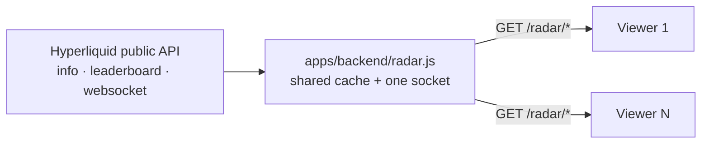

# Trade Radar and Market Heatmap (Hyperliquid, read-only)

Two terminal tabs beside Chart, in both products: **Trade Radar**
(`/:locale/:product/radar`) and **Market Heatmap** (`/:locale/:product/heatmap`).
Both are lazy-loaded and read public Hyperliquid data through the Openfund
backend. They never touch accounts, orders, balances, pricing, evaluation or
the trading engine.

Logic adapted from [drkxbt/whales](https://github.com/drkxbt/whales) and
[drkxbt/charts](https://github.com/drkxbt/charts) (both MIT). See
[whales provenance](../../third_party/drkxbt-whales/PROVENANCE.md) and
[charts provenance](../../third_party/drkxbt-charts/PROVENANCE.md).

## Architecture

Browsers never call Hyperliquid directly. One process-wide cache serves every
viewer, so upstream load does not grow with the audience.

| Endpoint | Upstream | Cache | Notes |
| --- | --- | --- | --- |
| `GET /radar/markets` | `metaAndAssetCtxs` | 15 s | Mark, 24h change (`markPx / prevDayPx − 1`), 24h notional volume, open interest in USD, funding, max leverage; `openfund` names the open Gains market for the same base, when one exists |
| `GET /radar/board?window=` | leaderboard file (~40 MB) | 15 min | Condensed in a short-lived child process (heap capped at 384 MB) so the API process stays near 120 MB; keeps the top 200 per window among accounts with ≥ $100K monthly volume |
| `GET /radar/positions?window=&top=` | `clearinghouseState` per wallet | 60 s | Top 10/20/30/50 wallets; per-coin long/short traders and value, size-weighted entry, value-weighted leverage, concentration |
| `GET /radar/wallet/:address` | `clearinghouseState`, `userFills`, `portfolio` | 30–120 s | Positions, last 100 fills, win/loss record, perp PnL series |
| `GET /radar/tape?min=&since=&coin=` | websocket `trades` | live | One shared socket for the 30 busiest perps, started on first view and closed after 5 idle minutes; keeps 400 trades ≥ $10K; thresholds $10K, $50K, $100K, $500K, $1M |

Shared in-flight requests, at most four concurrent upstream calls, and back-off
on 429/5xx keep the backend inside Hyperliquid's per-IP weight budget. A failed
refresh serves the last good answer marked `stale`. With no answer at all the
endpoint returns `503 radar_unavailable`; the interface shows an outage state
and never invents data. All routes are GET and rate-limited (120/min/IP).

## Coverage limits (shown in the interface)

- Only Hyperliquid perpetuals, not "all crypto markets".
- Whales are the top wallets of Hyperliquid's public leaderboard, not all large
  traders. The tape covers trades ≥ $10K on the 30 busiest perps.
- The heatmap is a **market treemap**, not a liquidation or order-book heatmap.
  Tile area is 24h notional volume or open interest (labelled, never market
  cap); colour is the real 24h change. Only the 24h window is offered because
  that is the only change Hyperliquid serves in one request. Grouping uses real
  data only: maximum-leverage tier or Openfund availability.

## Regional behaviour

GET routes pass the region guard in both regions. If the Iran runtime cannot
reach Hyperliquid, the endpoints answer 503 and the tabs show the outage state;
no other function depends on them.

## Interface (2026-11-18 overhaul)

Data, polling and sources are unchanged; only presentation changed.

- **Heatmap size and colour are separate.** Tile area is the size metric (24h notional volume or open interest). Colour is a selectable real value (24h change or hourly funding) on a symmetric ±range the user chooses.
- **Readable tiles.** Markets too small to label are grouped into one "+N" tile per level, worth exactly their summed metric, so area stays proportional. Opening it shows those markets at readable size (breadcrumb; Escape steps back). Tiles show symbol and change, or symbol only when compact; values are always in the tooltip, the details and the accessible name. The layout logic is in `treemap.ts` (`collapseSmall`, `stableOrder`, `colourWeight`) with unit tests.
- **Stable layout.** Live refreshes keep tile order unless a market clearly overtakes another (20 % hysteresis).
- **Contextual details.** Nothing is shown until a selection: a side panel on desktop, a bottom sheet on phones (closes on Escape or a tap outside). Hover shows a tooltip; symbol search opens the level holding a grouped market and selects it.
- **Trade Radar.**
  - Compact rows with a sticky header and tabular numbers.
  - Duplicate trade ids are shown once.
  - New trades get a highlight that fades after 2.4 s.
  - The reader's scroll position holds while trades arrive above it.
  - Rendering is capped at 200 rows, with a count.
  - Wallets can be copied.
  - Phones get labelled cards; RTL puts labels at the start and keeps numbers LTR.

## Tests

`apps/backend/test/radar.test.mjs` (transforms, shared requests, stale fallback,
tape threshold/de-duplication, 503 behaviour, Openfund market mapping) and
`apps/web-react/test/radar.test.mjs` (treemap maths, routing, read-only
isolation, honest metric labels, shipped notices).
