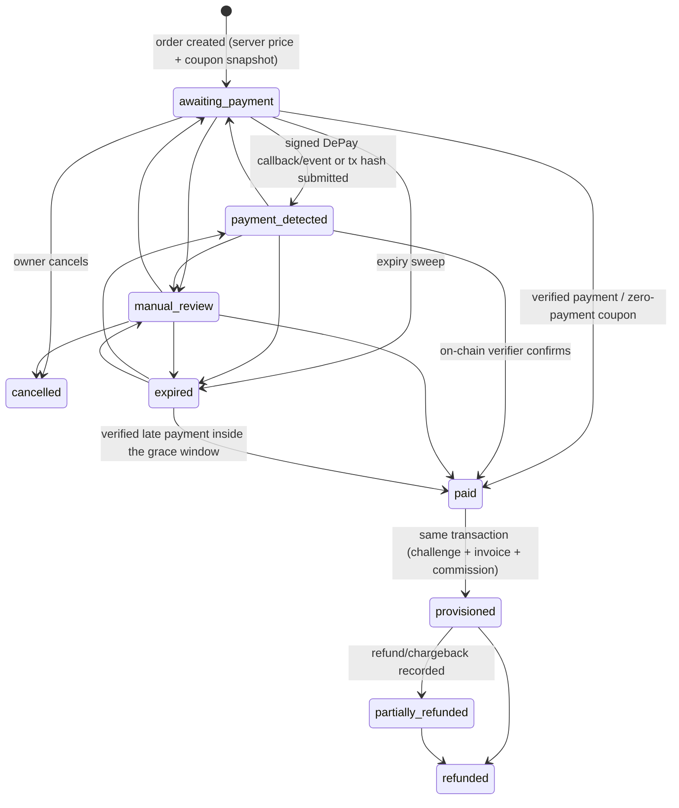

# Purchase order lifecycle

Status: **IMPLEMENTED — LIVE VERIFICATION PENDING** (branch
`codex/production-readiness`). The database is the authority: a trigger on
`purchase_orders` validates every transition with `order_transition_allowed()`
and appends it to `purchase_order_events`. That table is append-only: no
UPDATE, and no DELETE while the order exists. The coarse `status` column
(`pending | paid | cancelled | expired`) remains for compatibility and is
derived from `lifecycle_state`.

## States

| State | Meaning | `status` |
| --- | --- | --- |
| `awaiting_payment` | Order exists; price frozen; nothing received | `pending` |
| `payment_detected` | A transaction was reported; **not paid** until verified | `pending` (`expired` if it was) |
| `manual_review` | Needs an operator; still payable by a correct transaction | `pending` |
| `paid` | Verified payment (or zero-payment coupon); transient inside the provisioning transaction | `paid` |
| `provisioned` | Challenge account, ownership, invoice, coupon consumption and commission decision committed | `paid` |
| `cancelled` | Owner cancelled before any payment was detected | `cancelled` |
| `expired` | Unpaid past `expires_at` (late verified payments are still accepted within the grace window) | `expired` |
| `partially_refunded`, `refunded` | Set by a recorded `payment_adjustments` row; payment, invoice and challenge rows are never edited | `paid` |

## The lifecycle steps of the brief, mapped to code

| # | Step | Where |
| --- | --- | --- |
| 1–2 | Select a challenge, authenticate | Website plans → `CheckoutPanel`; SIWE session (`server.js /auth/*`), Arbitrum only |
| 3 | Wallet association validated | `requireAuth` session → `openfund_users.wallet_address`; the verifier requires the transaction sender to be that wallet |
| 4–6 | Plan, authoritative price, coupon | `POST /purchases/quote`, `planPrice()`, `evaluateCoupon()` |
| 7 | Order created | `POST /purchases/orders` (idempotency key, coupon lock) |
| 8 | Payment only if amount > 0 | `payment_required`; zero-payment flow otherwise |
| 9 | Payment verified | `verifyAndConfirm()` → `payment-verification.js` (EVM chains) or `solana-verification.js` (Solana), on the payment's own chain |
| 10–13 | Paid, provisioned, ownership, receipt | `confirmPurchaseTx()`: one transaction |
| 14 | Dashboard updated | Checkout polling, `/purchases/history`, `/auth/me` challenges |
| 15 | Commission events | `recognizeCommissionTx()` inside the same transaction (savepoint) |
| 16 | Audit records | `purchase_order_events`, `audit_log`, `financial_audit_log`, `depay_events`, `coupon_audit` |

## Safe retry and recovery

- Retried order creation: the same `idempotencyKey` returns the same order.
- Retried verification, duplicate callbacks and events: unique keys plus an
  order row lock give exactly one payment, one challenge and one commission.
- Interrupted browser: the checkout resumes the open order and re-checks a
  saved transaction hash. DePay callbacks do not need the browser.
- RPC or chain not ready: the attempt stays retryable and the sweep retries
  it.
- Provisioning error: the transaction rolls back completely and is retried.
- Customers cannot cancel once a payment is detected, so money in flight is
  never dropped.
- Refunds and administrative corrections are appended (`payment_adjustments`,
  `payment_attempts.review_*`, `financial_audit_log`). Historical purchase
  records are never rewritten. Pricing columns are immutable (trigger).
