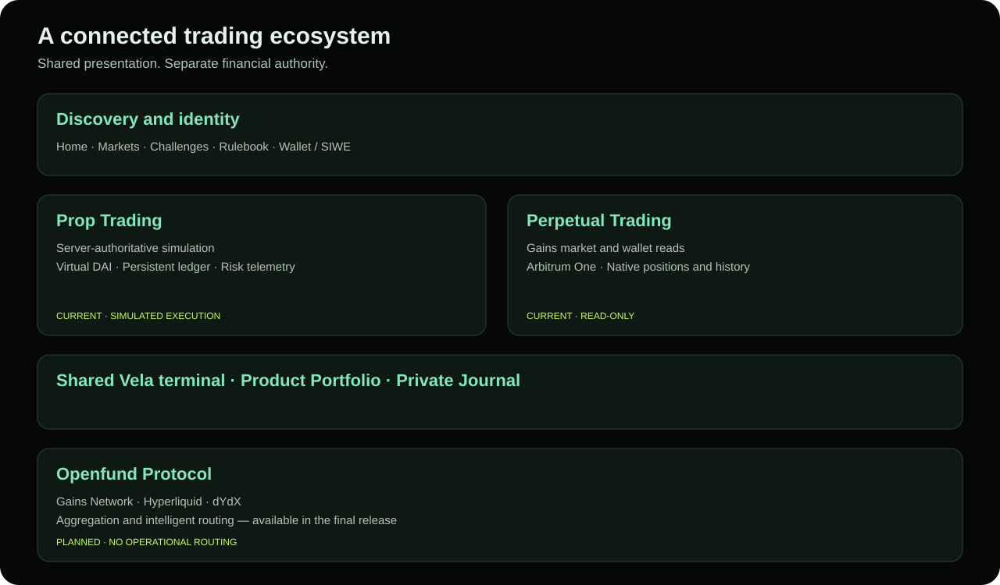

# Ecosystem

Openfund organizes related trading workflows around a common identity and presentation layer. Each financial product retains its own account records and execution policy.

## Products and shared services

| Surface | Responsibility | System of record |
| --- | --- | --- |
| Public discovery | Home, challenges, markets, rulebook and sample transparency | Published CMS content; Gains market metadata; labelled sample fixtures |
| Prop Trading | Virtual DAI accounts, simulated orders, positions and risk telemetry | Openfund backend and PostgreSQL ledger |
| Perpetual Trading | Gains positions, pending orders, history and provider statistics | Official Gains Arbitrum wallet endpoints |
| Shared Terminal | Vela chart, market selection and trading presentation | Product adapter selects financial authority; UI is shared |
| Wallet and Identity | Connection, SIWE, session and ownership | Wallet signatures and backend session tables |
| Portfolio and Journal | Product-specific review, reporting and private notes | Financial records from the corresponding product; notebook metadata in PostgreSQL |
| Openfund Protocol | Planned aggregation and intelligent routing | Future venue adapters; no operational routing in this repository |

## Boundaries that matter

The Prop product uses Ethereum Sepolia for its current sign-in policy; its collateral is virtual DAI in a database, not a Sepolia token deposit. Perpetual uses Arbitrum One identity and wallet-derived read records. A valid session does not authorize a blockchain transaction. Switching product or wallet clears and reloads private account state.

Directus and the backend use one PostgreSQL service. Directus edits the shared challenge catalog and published editorial collections. Backend APIs enforce wallet ownership and financial invariants. Public CMS permissions must never expose private account tables.

The Gains market feed supplies market information to both products and Vela. It does not supply an authentic central limit order book or executed trade tape. On-chain routing, Hyperliquid and dYdX adapters are future work.

See [System Architecture](../architecture/ARCHITECTURE.md), [Wallet and Identity](../wallet/IDENTITY.md) and [Protocol Roadmap](../roadmap/PROTOCOL.md).
