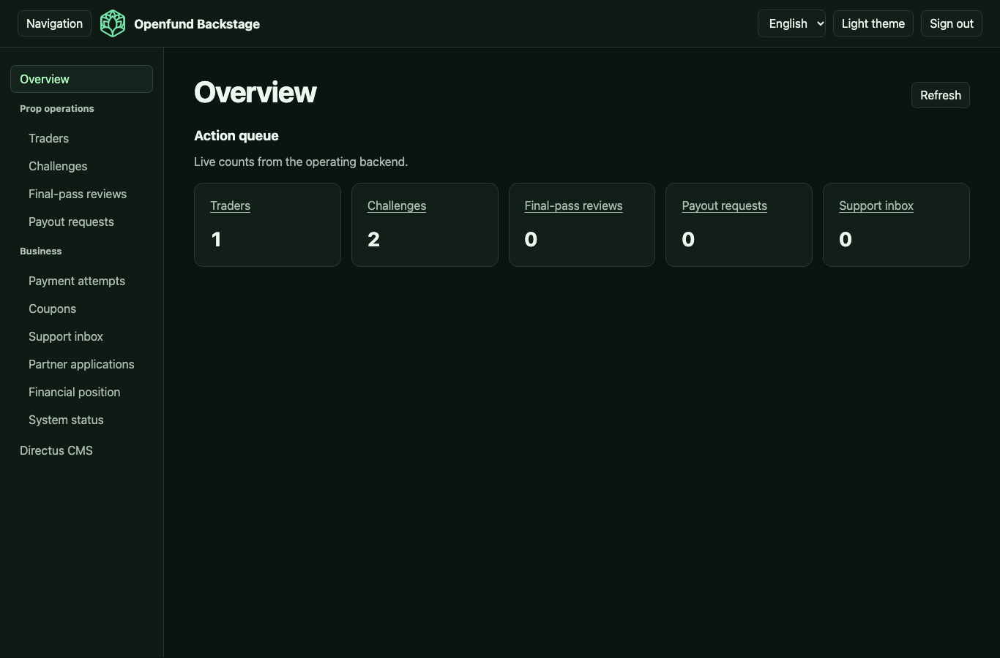
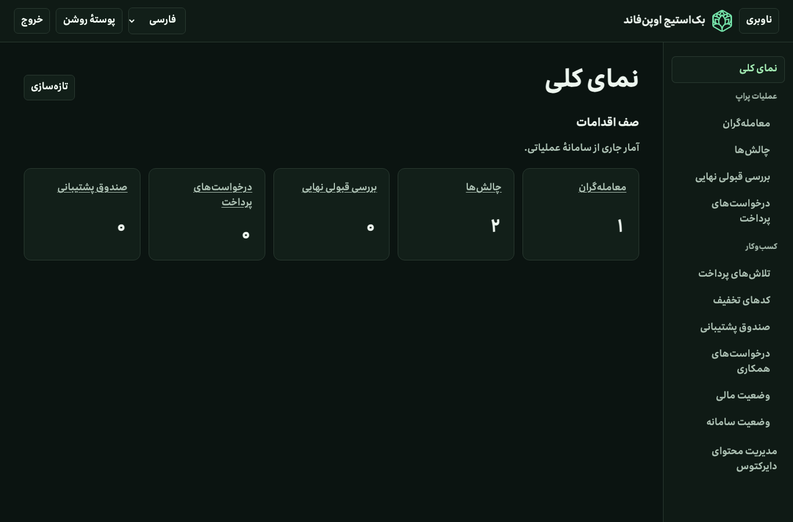

# Platform tour

Detailed product capabilities: the long-form companion to the README's product cards and
feature groups, which are generated from `docs/readme/*.json`
([structure contract](../development/README_STRUCTURE.md)).
Current per-environment state is in [docs/status](../status/README.md); the feature
register is [FEATURE_STATUS.md](FEATURE_STATUS.md).

## Trading workspace and account tools

The Web Terminal is the complete browser workspace. Prop and Perpetual reuse
the same chart and navigation while keeping their accounts, orders, positions
and financial records separate. Switching a product or wallet clears the
previous private view before loading the next one.

| Workspace | Capabilities | Authority and limits |
| --- | --- | --- |
| Dashboard and accounts | Account directory, balances, equity, challenge progress, account selection and observed risk | Backend-owned records; simulated Prop balances are not wallet funds |
| Trade | Market selection, chart, order form, pending orders, positions, account state and execution preview | Prop simulated execution uses fresh server marks; Perpetual writes remain disabled |
| Chart and Quick Trade | Full chart layout, compact market-order controls, shared symbol/interval/indicator/drawing state | Uses the existing validation, preview and submission path; no separate engine |
| Order and position management | Market, limit and stop workflows; pending-order cancellation, full/partial close, SL/TP changes | Each mutation checks ownership and account rules; idempotent requests prevent duplicate execution |
| Chart protection | Entry markers, profit/loss zones, creation and movement of SL/TP with chart handles | Changes display confirmed server state; rejected updates restore confirmed levels |
| Sizing | Collateral and quantity equivalents, notional, leverage, risk preview and supported lotage conventions | Lots are an Openfund display convention, not a Gains contract-size claim; unsupported markets explain why |
| Portfolio | Open/closed positions, pending/history views, filters and position details | Engine settlement records for Prop; provider-native records for Perpetual |
| Journal and analytics | Trade review, performance dashboards, calendar, private notes, playbooks and exports/imports | Notes cannot create financial results; missing provider metrics remain unknown |
| Inbox and support | Trader correspondence, payout messages, reconsideration requests and in-app notifications | Private account-owned threads; external email delivery is separate infrastructure |
| Certificates and purchases | Purchase history, invoices, challenge records, issued certificates and verification links | Derived from recorded events and evidence, not client-side success messages |

[Terminal contract](../trading/TERMINAL.md) ·
[Chart workspaces](../trading/CHART_WORKSPACES.md) ·
[Lotage](../trading/LOTAGE.md) ·
[Accounts](../trading/UNIFIED_ACCOUNTS.md).

### Journal, performance and review

The journal supports Daily Journal, Notebook, Playbooks, Progress, Missed
Trades and Prop Firms research notes. Financial history remains separate from
these editable records. The dashboard includes date ranges, instrument and
direction filters, layouts and card visibility; settings persist by product
and account. Metadata import restores account-scoped notes with duplicate and
revision protection; it does not import financial performance.

| Analysis | What it measures |
| --- | --- |
| Net PnL | Settled price result after allocated opening and closing fees |
| Trade win rate | Positive-net closed slices divided by eligible closed slices |
| Profit factor | Total positive net results divided by the absolute negative total |
| Average win/loss | Mean positive net result relative to mean negative result |
| Day win rate | Positive-net UTC close days relative to eligible close days |
| Cumulative and daily PnL | Settled net results in closing-time order |
| Balance and observed equity | Actual ledger balance records and persisted equity observations |
| Drawdown | Realized-equity decline from its peak; live risk is shown separately |
| Edge Score v2 | Weighted descriptive score using win rate, profit factor, payoff, drawdown, recovery and winning-day concentration |

Partial closes remain traceable slices with proportional quantities, margin
and opening fees. Analytics do not reconstruct missing historical marked
equity or sum incompatible collateral currencies.
[Metric definitions](../trading/JOURNAL_METRICS.md) ·
[Portfolio and journal](../trading/PORTFOLIO_JOURNAL.md).

## Charts, indicators and market intelligence

### Vela charts and Pine execution

The chart workspace uses Vela 0.10.6, the official Vela Pine addon 0.3.4 and
PineTS 0.13.1. The catalog contains the three Openfund Pine indicators ahead
of the existing 77 built-ins. Original Pine sources run in a worker; the
integration resolves two repository-local libraries and rejects unknown
imports. Chart settings are scoped by product and wallet.

| Indicator | What the trader can inspect | Current source changes |
| --- | --- | --- |
| **Open Algo V5** | Buy/Sell signals, Smart Trail, TP/SL annotations, support/resistance, supply/demand, structure, trend lines, reversals, ribbons and retest zones | SMRT Algo dashboard, its three settings and five higher-timeframe requests removed; retired saved inputs migrate; disabled overlays skip work |
| **Price Action Concepts** | Internal/swing structure, BOS/CHoCH, multi-timeframe order blocks, liquidity, equal highs/lows, previous-period levels and scanner | Completed previous-period levels replace forming-period lookahead; Trendline Liquidity crash fixed; default secondary requests reduced; invisible drawings avoid rebuilding |
| **Smart Money Concepts** | Structure, order blocks, equal highs/lows, fair value gaps, multi-timeframe levels, premium/discount zones and alerts | Higher-timeframe gaps confirm when the relevant candle closes, avoiding early historical information |

These tools are observational. An indicator signal or a drawn TP/SL label
does not submit an order or alter evaluation. Gains candles contain no traded
volume: volume-dependent outputs are unavailable rather than filled with
invented numbers. Corrected lookahead changes the affected historical
behavior; optimization is not a claim of more profitable signals.

The optimization report records reproducible benchmark conditions,
configuration snapshots and independent regression checks. Licensing of the
Pine scripts remains separate from Vela and PineTS.
[Indicator sources](../../indicators/README.md) ·
[Settings](../trading/INDICATORS.md) ·
[Runtime](../trading/PINE_SCRIPT.md) ·
[Optimization evidence](../reviews/pine-optimization/README.md) ·
[Adding indicators](../trading/CUSTOM_INDICATORS.md).

### Hybrid Footprint

Footprint combines **Gains chart prices** with **Hyperliquid executed-trade
order flow** at the renderer layer. It is not a claim that Hyperliquid volume
was traded on Gains. The independent footprint service cannot mutate
accounts, trading, evaluation or payments.

| Footprint surface | Display |
| --- | --- |
| Bid/Ask Ladder | Aggressor sell/buy volume at each price level |
| Bid/Ask Profile | Per-price bid/ask profile |
| Volume Profile | Executed volume distribution by price |
| Delta Profile | Difference between aggressor buy and sell volume |
| Absolute Delta | Magnitude of per-level delta |
| Candle overlay | Order-flow layer beside the unchanged Gains candles |
| Additional analysis | POC, value area, imbalances and supported cumulative/statistical views |

The collector deduplicates executed trades and aggregates exact price/size
units into minute records. History and SSE serve chart readers; gaps,
unsupported symbols and service outages stay visible. Footprint availability
depends on the feature flag, supported market mapping and fresh upstream data.
[Source separation and data model](../integrations/FOOTPRINT.md).

### Trade Radar

Trade Radar exposes public Hyperliquid activity through a shared backend
cache: live large-trade tape, leaderboard windows, aggregated long/short
positioning, whale positions and wallet profiles. Tape thresholds range from
$10K to $1M. Position summaries include trader counts, long/short values,
weighted entry/leverage and concentration; wallet views include provider
positions, recent fills and available performance series.

The interface supports compact tables, phone cards, wallet copy, symbol
filters, duplicate suppression and new-trade highlights without losing the
reader's scroll position. The tape covers selected busy perpetuals and
qualifying trades; leaderboard sampling is not a list of every whale.
Failed refreshes return marked stale data or an explicit unavailable state.

### Market Heatmap

The Heatmap is a **perpetual-market treemap**, with independently controlled
tile area and color. Area uses real 24-hour notional volume or open interest;
color uses 24-hour change or hourly funding with a selectable symmetric
range. It is not a liquidation map, order-book depth map or market-cap map.

Small markets group into proportional “+N” tiles. Traders can drill down,
search for a symbol, inspect tooltips, open contextual desktop details or
the mobile bottom sheet, and follow a mapped Gains market into the chart.
Stable ordering reduces unnecessary tile motion during refresh.

Both Heatmap and Radar are read-only. A shared cache, bounded concurrency,
one shared tape socket and stale fallback limit upstream load.
[Data contracts, routes and limitations](../integrations/HYPERLIQUID_RADAR.md).

## Tools Center and learning

Ten browser-side tools support trade planning and record review. Each has
documented inputs, formulas, assumptions, validation and limitations; none
places orders or changes an account. Editorial wording is CMS-managed while
the arithmetic remains test-covered application code.

| Tool | Purpose | Route suffix |
| --- | --- | --- |
| Position Size Calculator | Convert a chosen money risk and stop distance into position sizing, with fee allowance | `position-size` |
| Leverage and Margin Calculator | Estimate required/free margin, usage and effective leverage | `leverage-margin` |
| Liquidation Price Estimator | Explore isolated-position liquidation assumptions | `liquidation-price` |
| Perpetual Futures PnL Calculator | Compare gross/net outcomes, fees, funding and break-even exit | `perp-pnl` |
| Funding Rate Calculator | Estimate holding-period funding and annualized rate extrapolation | `funding-rate` |
| Risk/Reward Calculator | Compare stop/target distances, money risk, expectancy and break-even win rate | `risk-reward` |
| Risk of Ruin Calculator | Explore loss-risk scenarios from the supplied assumptions | `risk-of-ruin` |
| Prop Drawdown Calculator | Explore account loss-limit scenarios | `prop-drawdown` |
| Consistency Rule Calculator | Examine concentration of results under the entered consistency rule | `consistency-rule` |
| Trading Journal Analyzer | Review uploaded journal records in the browser | `journal-analyzer` |

Tools live under `/:locale/tools/:slug`; the index groups position sizing,
risk/limits and record analysis. Calculator outputs are planning estimates,
not venue quotes or proof that the account is eligible for a challenge/payout.

The learning center includes paths, lessons and a searchable glossary.
Tool pages link to relevant lessons and terms, and describe the formulas
instead of returning unexplained numbers. FAQ, Rulebook, Whitepaper,
company/contact pages and public market discovery provide the wider product
and business context.
[Tools UI and copy](../../apps/web-react/src/features/tools) ·
[Calculator implementation](../../apps/web-react/src/data/calculators.ts) ·
[Learning sources](../../apps/web-react/src/features/learn).

## Open Trade desktop application

Open Trade is an Electron application with its own version and release
pipeline. It reuses the existing Vela charting and backend account boundaries
while offering a compact desktop workspace.

| Area | Source capabilities and acceptance limits |
| --- | --- |
| Workspace | One, two, three or four independent charts; watchlist, floating ticket, positions strip, shortcuts and settings |
| Startup and server | Connection/start screen, regional backend selection and region readiness controls |
| Wallet | WalletConnect pairing and SIWE on Arbitrum One; pairing alone never authenticates |
| Product selection | Prop simulated accounts and Perpetual Gains account in one wallet session; product switch stops prior streams/polling and clears prior data |
| Gains view | Read-only positions, orders and latest history events with network, source and freshness; no approvals or live orders |
| Localization | Persian/English plus Arabic/Russian/Chinese coverage; untranslated desktop-only strings remain English with a notice until reviewed |
| Security | Session token kept out of renderer; isolated Electron boundaries, controlled IPC, canonical backend allowlist, bounded JSON responses and validated external links |
| Updates | Notification opens the official GitHub release; no automatic installation |
| Identity | Settings expose version, commit, channel, server and signing state |
| Distribution | Native macOS arm64/x64, Windows x64 and Linux x64 targets; internal unsigned builds are distinguished from signed beta/stable channels |

The 0.0.3 candidate is merged. Its latest reviewed CI passed build, UI
acceptance, internal packaging and integrity on all four targets; macOS x64
artifact upload timed out. This does not verify real WalletConnect use,
clean-machine upgrade, signed/notarized publication or performance budgets.
[Desktop README](../../apps/open-trade/README.md) ·
[Release notes](../releases/open-trade-0.0.3.md) ·
[Acceptance](../../apps/open-trade/ACCEPTANCE.md) ·
[Reown/signing setup](../releases/OPEN_TRADE_0.0.3_OWNER_SETUP.md).

## Openfund Backstage — Business Operations Console

[Openfund Backstage](https://backstage.openfi.cloud) is the owner console for
the [main platform](https://openfi.cloud). It provides English and Persian
workspaces for trader and challenge inspection, final-pass review, payment
investigation, controlled test coupons, payout review and correspondence,
support intake, partner applications, financial position and system status.

The website serves buyers and traders, the terminal handles trading, and
Directus manages editorial content. Backstage runs independently on Render
and uses the existing Openfund backend for business records and decisions.
The service authenticates a single provisioned owner, keeps its backend
credential server-side and asks the owner to re-enter their password for
privileged decisions.

Since release v0.6.5 (official 2026-11-17; the latest platform release is
v0.8.0 — see [current status](../status/README.md)), Backstage includes commercial
coupon administration, trader support replies with a trader Inbox and in-app
notifications, partner review and commissions, finance records (expenses,
reserves, obligations), a unified audit trail, a read-only live risk board,
global search and a Content workspace for editing website copy in Directus.
External email delivery is not built. See the
[operator guide](../backstage/OPERATIONS_GUIDE.md) and
[feature status](FEATURE_STATUS.md) for current coverage.

| English overview | Persian overview |
| --- | --- |
|  |  |

Additional local captures show [challenge inspection](../assets/screenshots/backstage-operations/backstage-challenge.png),
[controlled coupons](../assets/screenshots/backstage-operations/backstage-controlled-coupons.png),
[payout details](../assets/screenshots/backstage-operations/backstage-payout.png),
[support intake](../assets/screenshots/backstage-operations/backstage-support-intake.png)
and [financial position](../assets/screenshots/backstage-operations/backstage-financial-position.png).
Launch-completion captures (local, not deployed) show the
[coupon wizard result](../assets/screenshots/launch-completion/backstage-coupons.png),
the [audit trail](../assets/screenshots/launch-completion/backstage-audit.png),
the [Content workspace](../assets/screenshots/launch-completion/backstage-content-en.png)
and the [trader Inbox](../assets/screenshots/launch-completion/trader-inbox-en.png).

### Backstage operations coverage

| Owner workspace | Functions |
| --- | --- |
| Traders and challenges | Wallet/reference search, linked purchases/accounts/payouts, frozen rules, positions/equity, final-pass review and suspension decisions |
| Payments | Attempt inspection, retry verification, deposits, reconciliation, refunds and method controls |
| Coupons | Inactive draft creation, percent/fixed discounts, eligibility, usage/window limits, activation, disable/revoke and redemption-aware pricing locks |
| Payouts | Review, rejection reasons, correspondence, reconsideration, recipient/amount inspection and verified settlement recording |
| Partners | Separate ambassador/coach application decisions, verification evidence, commission balances and settlement references |
| Finance | Financial position, treasury refresh, expenses, reserves, obligations and distinct IB distributions |
| Risk | Read-only exposure, open positions, loss-limit distance, feed freshness and engine-loop lag |
| Support and Inbox | Departments, replies, private notes, trader-visible conversations and notification delivery/read records |
| Audit and search | Operational/financial event filters and cross-record search by wallet, reference, id or transaction hash |
| Content | Page/language selection, plain-text editing, draft/publish transitions, previews and Directus visual-mode entry |

Privileged decisions reauthenticate the owner and retain their existing
backend authorization. Recording a paid settlement requires finalized matching
receipt evidence; it does not sign or send money. Real-settlement controls are
disabled until configured and accepted.

### Editorial CMS and visual editing

Directus owns public editorial copy; market prices and financial decisions
remain outside its visual-editing scope. A confirmed Studio session maps
editable content to a collection, item and field. Draft previews stay within
the editor session; anonymous visitors read published content.

Backstage's Content workspace edits permitted plain text with placeholder
validation and links to the same visual editor. Missing editor credentials
make it read-only. Financial collections, market values and unauthorized
destinations are excluded from editing.

The recorded visual-content inventory contains 4,285 source records, 54
registered routes and 74 explicit exceptions. These are the audit's recorded
counts, not a new claim that every runtime string was recounted here.
Persian/English are required source locales; additional locales use reviewed
dictionary paths and published CMS overrides. Desktop's own localization
does not mount the web Studio session.
[Visual protocol and inventory](../backstage/UNIVERSAL_VISUAL_EDITING.md) ·
[Content model](../backstage/CONTENT_MODEL.md) ·
[Content registry](../backstage/CONTENT_REGISTRY.md).

## Languages and regions

Openfund ships five interface languages: Persian (`fa`, RTL), Arabic (`ar`,
RTL), English (`en`), Russian (`ru`) and Simplified Chinese (`zh-CN`). Every
page lives under an explicit locale path (`/fa/home`, `/zh-CN/markets`, …),
and the server publishes `hreflang` alternates and a sitemap for them.

**Which language a visitor sees** ([ADR 0043](../decisions/0043-canonical-domains-geo-routing-and-locale.md)):

1. A locale in the URL always wins.
2. Otherwise, a language the visitor explicitly picked in the language menu.
3. Otherwise, a first-visit default from the visitor's trusted country.
4. Otherwise, English.

| Visitor country | Default |
| --- | --- |
| Iran | Persian |
| The 22 Arab League members | Arabic |
| Russia | Russian |
| China | Simplified Chinese |
| Any other or unknown country | English |

The country comes only from a verified source — Cloudflare's `CF-IPCountry`
from a published Cloudflare address on GLOBAL, or a licensed local IP database
on the Iran runtime — and never decides authorization, payments or account
access. The pre-paint script sets `lang` and `dir` before the first frame, so
there is no flash of another language.

**Typography.** Two faces only: Ubuntu (general/Latin) and Dastkhat (Persian/Arabic). Policy, tokens and the one shared `@font-face` file: [design system](../design/DESIGN_SYSTEM.md#typography-and-font-tokens).

**Regions.** `openfi.cloud` (alias `openfund.cloud`) is the GLOBAL site on
Render; `openfi.live` is the Iran site on Liara. Choosing a language never
changes the region. An automatic redirect of Iranian visitors to `openfi.live`
exists as a disabled rule and stays off until every gate in ADR 0043 passes
and the owner approves; `node scripts/ops/geo-redirect-readiness.mjs` reports
the gates read-only.

## Payments architecture

| Layer | v0.7.0 (released, GLOBAL) | Openfund Pay (released in **v0.8.0**; acceptance pending) |
|---|---|---|
| Methods | DePay (multi-chain, converts tokens) and manual transfer with a TXID | **Pay with Wallet** (one server-prepared ERC-20 transfer, any configured network), manual transfer (TXID optional, red sender warning); DePay off for new payments (provider shuts down 2026-12-31) |
| Verification | On-chain: token, receiver, sender, amount, finality, reorg | Same verifier; a short amount is evidence, not a rejection |
| Accounting | One payment per order; underpayment rejected | Ledger: partial payments, multi-transaction orders, excess → refund liability, exactly-once activation |
| Discovery | Only a submitted hash or a DePay callback | Treasury watcher (cursor, reorg window, RPC failover); automatic attribution only when unambiguous |
| Operations | Attempt review and reverify | Backstage Payments: overview, investigation, deposit review, refund lifecycle, method switches, alerts |
| Acceptance | **Not accepted**: 2026-11-18 real purchases failed ([incident](../payments/INCIDENT_2026-11-18.md)) | Deterministic tests only; real-network checklist in [ACTIVATION](../payments/ACTIVATION.md) |

Sign-in stays Arbitrum-only (SIWE, chain 42161); payment networks are independent.
A DePay-attested payment settles automatically only when the order owner's
wallet signed it; any other payer waits for operator review unless the owner
sets `DEPAY_ATTESTED_ANY_PAYER=true` ([security assessment](../security/SECURITY-AUDIT-2026-11.md), OF-2026-11-05).
