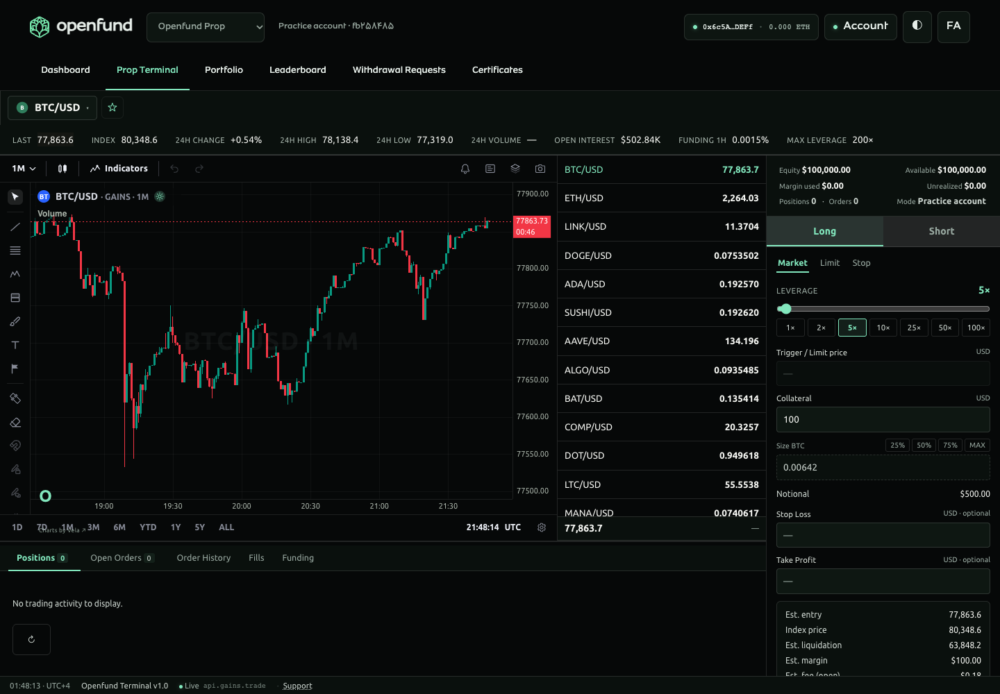
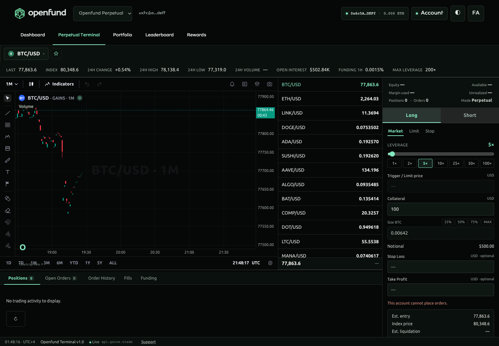

# Shared product terminals — delivery and validation

Date: 2026-11-02. The user's second specification supersedes the first: **one shared trading terminal interface**, independent product routes/adapters/accounts, and a full-space Terminal tab without surrounding editorial UI.

This report distinguishes the supported implementation from service dependencies and broader upstream gaps. It is not a claim that on-chain trading or all original acceptance criteria are complete. No merge or production deployment was performed.

## A. Repository audit

- Canonical repository: `https://github.com/algomanlife/openfund`.
- Base: `origin/main`, full SHA `61c70fee6936670ed82f7c3698ba08ea63f8e776`.
- Dedicated worktree: `/Users/algoman/Documents/ChatGPT/openfund/dual-terminals`.
- Branch: `codex/dual-terminals-portfolio-journal`.
- Remote fetched before initial implementation, after the correction, and before delivery. Existing `landing-pages` and `Openfund_Landing_FA` worktrees were preserved. All inspected remote feature heads were ancestors of main.
- Recent merged work: PRs #13/#14 (persistent practice trading and math/Vela fixes), #15–17 (journal-core and dashboard), #18 (bilingual information pages), #19 (Home gateway/Markets), #20 (production editorial CMS).
- Audited root AGENTS/README/manifests, migrations/schema, architecture/ADR, CMS/publication/permissions, shared adapters, recent PRs and worktrees. The base had no root workspace manager, application CI or Render blueprint. Vendor Vela workflows are upstream-only.
- Existing React/Vite/hash-router architecture retained; source-critical `dist/`, approved brand assets, vendor sources and Engine settlement arithmetic unchanged.
- Confirmed fixes: wrong `realized_pnl` column read, user-only rather than account-specific analytics queries, arbitrary trade-note keys, timestamp-key collisions, stale cross-scope UI responses, and injected wallet connection with no WalletConnect project configuration. Legacy annotations remain readable/editable.

The complete pre-implementation inventory and implementation matrix are in [AUDIT.md](AUDIT.md). The latest correction and architecture decision are in [ADR 0002](../../decisions/0002-shared-product-terminal.md).

## B. Implementation

### Routing and header

- `#/{fa,en}/prop/{dashboard,trade,portfolio,journal,leaderboard,withdrawals,certificates}`.
- `#/{fa,en}/perpetual/{dashboard,trade,portfolio,journal,leaderboard,rewards}`.
- Required primary order retained exactly (6 Prop / 5 Perpetual); Journal lives in Portfolio secondary navigation.
- One reusable `TerminalShell` header, active tab, product switch, SIWE wallet/account context, language/theme controls and horizontal mobile tabs. Public marketing header markup remains separate.
- Legacy `/terminal`, `/portfolio`, `/journal` bookmarks redirect to Prop; locale-less product routes work. Home's Perpetual CTA uses its dedicated product route.

### Shared workspace and account adapters

- Both Trade routes mount **the same `SharedTradingTerminal`**, same Vela chart/workspace markup, market list, controls and interactions. The product selects its adapter/configuration.
- Terminal fills the viewport below the header. No page title, subtitle, editorial banners, introduction cards, decorative containers, outer padding or unrelated content is rendered on that tab. Mobile workspace panels scroll internally.
- Existing legacy chart runtime is contained in a disposable first-party same-origin frame; leaving it tears down the old runtime without reloading the application shell.
- Prop uses the existing authenticated server Engine/stream. Perpetual uses read-only actual Gains wallet records. Anonymous accounts never construct a local guest TradingProvider or show a fallback balance.
- Presentation order depth/tape is not generated in new product routes; the common market panel shows actual selectable live prices. Fee estimates read the existing engine's fee schedule; no financial settlement calculations changed.

### Portfolio and Journal

- Prop: account totals, owned positions and all order history, trade details and ledger, persistent trade notes/tags, search/date/direction/status/sort filters, pagination, read-only CSV, realized curves/drawdown, upstream Edge Score v2, daily calendar and symbol/direction/asset/hour/weekday/duration/private-tag reports.
- Perpetual: authenticated wallet context; official address-scoped positions/pending orders, cursor-paginated native event history and provider statistics, event/transaction details, currency-separated PnL fields, recent closing-event curve/calendar, date/pair filters and native page CSV. Small native crypto amounts retain fractional precision.
- Native Gains events, including partial closes, remain events; they are not falsely reconstructed into completed round trips. The aggregate Prop read endpoints explicitly reject Perpetual clients and direct them to native Gains records.
- Both Journals: independent private daily entries, notes, tags, classification, date/text/tag/classification search, versioned edits, delete, full JSON export and matching-scope restore. Prop links validate an owned position. Gains history starts a reflection containing its transaction link; the reference is private note metadata, not an invented financial record.
- JSON restore processes 50-entry atomic batches, skipping existing IDs without overwriting newer edits. Earlier successful batches remain after a later batch failure; retry is idempotent. It never imports trades, balances or ledger events.
- Account selector exposes only the actual supported practice account. Funded challenge accounts are not fabricated.

### CMS, backend, database and deployment

- Existing Directus `pages`, `ui_messages` and normalized translations reused; additive `terminal_sections`/translations support product/page ordering, status, bilingual content, approved illustrations and HTTPS support/help links.
- Published-only parent and translation policies; frontend sends no administrative token. Mounted editorial content refreshes without a frontend rebuild. No financial state comes from CMS. Terminal editorial sections intentionally do not mount on Trade.
- One additive PostgreSQL notebook table/index, reusing all existing trading/account/annotation records. Session-derived product/account ownership, field/date/pagination validation and optimistic revisions. No database reset or historical record deletion.
- Optional `render.yaml`, Node 22 same-origin frontend/API hosting and DB-aware health check. Existing PostgreSQL/Directus URLs are required. One existing engine process; automatic deploys disabled. Blueprint was not applied.
- Root/module READMEs, feature status, changelog, architecture/API/CMS/deployment guides updated. Exact source/output inventory: [FILES_CHANGED.txt](FILES_CHANGED.txt).

## C. LuxAlgo comparison

Upstream `LuxAlgo/trade-journal` was cloned and inspected at `834e7b68f553d1aba0d7777875cdc4622f5a7eb5`, matching the vendored MIT core. The audit examined the original app's journal/notebook/reports/calendar/import/export routes, related tests and core algorithms. Only compatible financial semantics are reused; the Next/SQLite server is not copied into Openfund.

See [GAP_MATRIX.md](GAP_MATRIX.md) for original features, backend/model requirements, delivered behavior and remaining gaps. MIT/Vela attribution remains intact.

## D. Executed validation

Environment: Node **22.23.4**, PostgreSQL database `openfund_dual_terminals_test_20261102`, isolated backend `localhost:8091`, dev `localhost:5186/react/`, production build served locally at `localhost:8091/react/`, existing Directus `localhost:8055`. Tests use generated SIWE signers and a test EIP-1193 wallet, not a browser extension. SIM_TEST_MODE is enabled only in the isolated test backend. No on-chain transaction is sent.

The following commands were executed with PATH selecting Node 22, DATABASE_URL selecting the isolated database, and TEST_BACKEND_URL selecting port 8091 where applicable. Database credentials and session secrets are intentionally not recorded here.

| Command / check | Result |
| --- | --- |
| `npm ci --no-audit --no-fund` in backend and web-react | Passed; existing wallet dependency deprecation/peer warnings |
| `node apps/backend/migrate.js` and `node apps/backend/seed-plans.js` | Applied to isolated database; additive schema/catalog ready |
| `python3 apps/backstage/scripts/seed_terminal_content.py` | 13 product pages, 10 messages, 4 sections created on existing local Directus; correction refreshed only script-owned product copy |
| `npm run typecheck --prefix apps/web-react` | Passed, no TypeScript errors |
| `node --test apps/web-react/test/*.test.mjs` | 17 passed, 0 failed |
| `npm run build --prefix apps/web-react` | Passed on Node 22; existing wallet bundle size/comment warnings remain |
| `npm run test:all --prefix apps/backend` | 170 passed, 0 failed: SIWE 22, Engine 54, Portfolio 31, product/legacy annotation 58, Gains/key tests 5 |
| `node e2e/test-dual-terminals.js` against production build | 94 passed, 0 failed, including 52 product/locale/viewport route cases, file export/restore, currency/calendar controls and anonymous privacy checks |
| `node e2e/test-terminal-cms.js` against production build | 10 passed: draft privacy, private tables, denied writes, published render, live edit, unpublish and no browser admin token |
| Render published JSON schema via Python jsonschema/PyYAML | Passed; configuration only, not a deployment |
| `node --check` on new backend/runtime scripts; Python compile of seeder; authored-file whitespace check | Passed |
| Local `/react/` and DB-aware `/health` | HTTP 200 |

Browser coverage includes actual SIWE/session recovery, chart rendering, same shared workspace structure, exact menus, product switch, owned Prop activity/notes, filters/charts, persistent notebooks, JSON download/restore, CSV download, real Gains wallet reads, collateral selection/calendar, full-space layout, no staged status labels, themes, every route fa/en at desktop/mobile, legacy redirects, wallet disconnect privacy and anonymous unknown balances/disabled execution. The final production browser run completed with zero uncaught page exceptions.

The authored-file whitespace check was `git diff --check origin/main -- . ":!react/assets"`. The unfiltered generated-assets check reports five blank-line trailing-space warnings inside bundled third-party style template strings; these are generated dependency content, not altered application logic.

## E. Remaining dependencies and limits

1. **Gains on-chain execution remains disabled** under root AGENTS: supported contracts/network, transaction simulation/validation, signing/submission/reconciliation and release authorization are not established by this repository. Wallet connection is not represented as execution.
2. **Complete Gains balances/net unrealized PnL/fee/liquidation analytics** require verified collateral/RPC and full settlement/borrowing-fee modeling. Unknown values remain absent. Recent event analytics use the retrieved native history page and separate collateral currencies; they are not an all-time combined wallet equity curve. Live reads were verified for generated empty wallets and nonempty public source schemas; there was no user's populated-wallet acceptance test.
3. **Challenge purchasing/provisioning and evaluation eligibility, rankings, payouts/withdrawal approvals, certificates and rewards** lack authoritative services/rules in the audited base. Routes and content exist; operational records/workflows are not fabricated. These are dependencies, not completed financial features.
4. **Broader upstream app features** still not implemented: broker/manual financial import, configurable matching of partial fills, replay/MAE-MFE, attachments/Markdown editor/voice, playbooks/routines, AI provider credentials/reflection, saved drag layouts/privacy mode and PDF/PNG review export. Some require additional services/data; some are additional presentation/workflow work. Their absence is explicit in the gap matrix.
5. **Production operations** remain unverified: no Render deployment, production migration, TLS/domain configuration, production CMS policy migration, real wallet extension or transaction testing. Media replacement uses existing approved file permissions and was schema-wired, not separately upload-tested. Draft preview is not a new tokenized frontend preview implementation.
6. Existing wallet bundles produce build-size/dependency warnings. This PR retains those dependencies and does not claim a performance optimization or dependency/security audit.

These limits prevent claiming that every original acceptance criterion or the full upstream application is complete. The supported product interface, ownership/persistence boundary and audited read capabilities are reviewable and locally verified.

## F. Git delivery and merge considerations

- Feature branch: `codex/dual-terminals-portfolio-journal`; base SHA above.
- Implementation commit: `61b90be` (`feat(terminal): share product workspace and scope portfolio journals`). The final documentation commit and review URL are provided in the delivery message; no direct push to main, merge, force push or deployment.
- Review the additive PostgreSQL migration, optional Render blueprint and Directus setup before an approved rollout. Run the seeder against the existing instance; do not provision a competing CMS/database.
- Generated `react/` output is refreshed to match source for the repository's prebuilt preview convention. Source-critical `dist/` and vendor/brand assets remain unchanged.
- Existing external worktrees are preserved. If main changes after this base, integrate conflicts deliberately and rerun affected checks.

## Review screenshots

Screenshots use generated wallets and records in the isolated test database, not customer accounts.

| Prop: shared full-space terminal | Perpetual: the same workspace |
| --- | --- |
|  |  |

[Persian mobile Portfolio](images/perpetual-portfolio-fa-mobile.png) · [English light-theme Portfolio](images/prop-portfolio-light-en.png).
