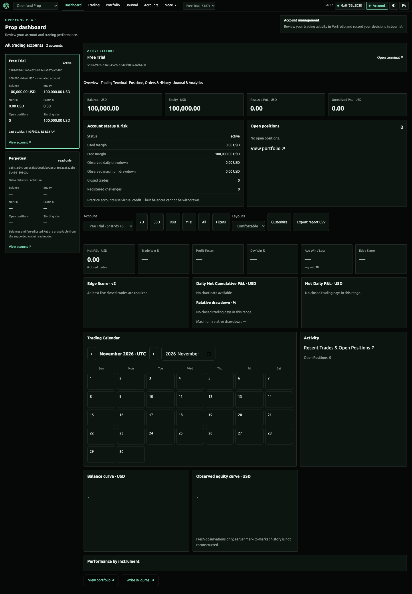
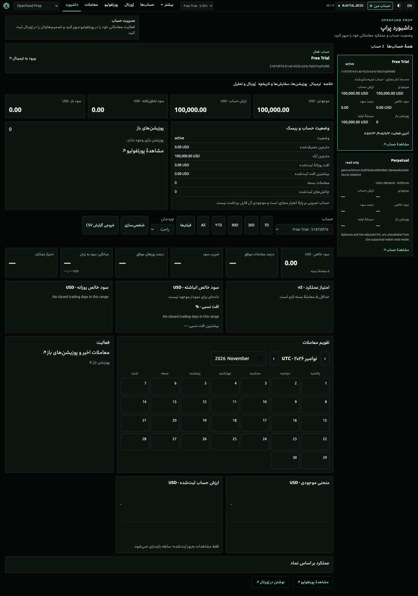
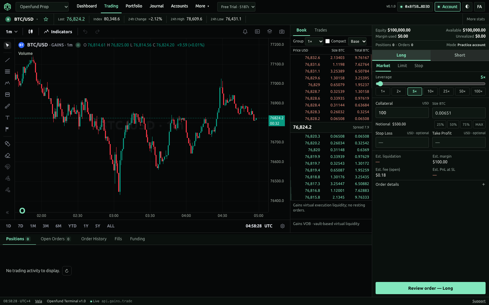
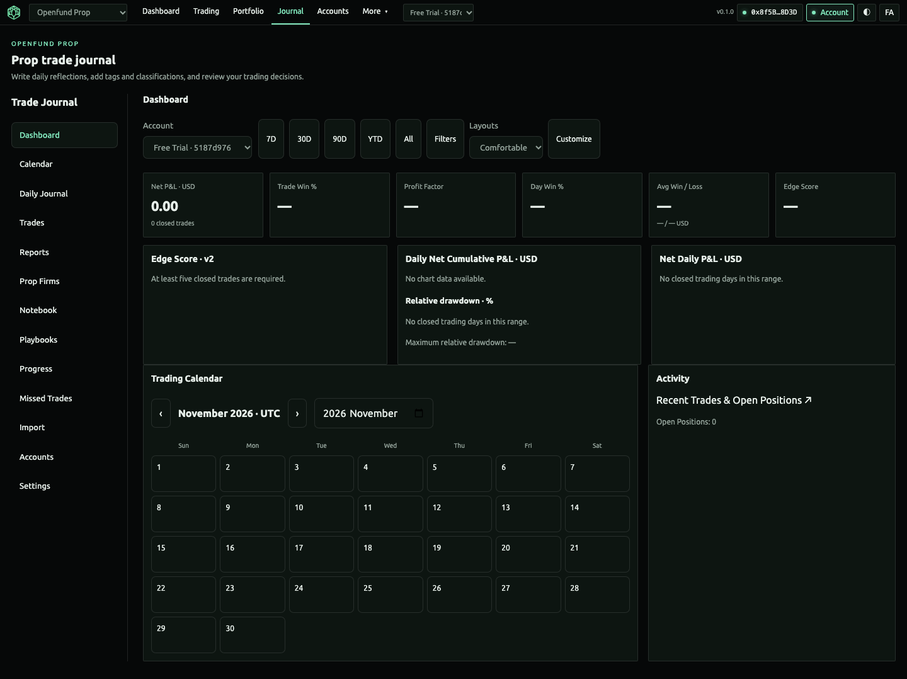
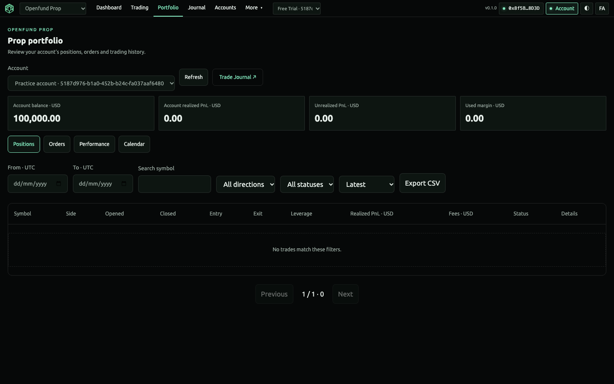
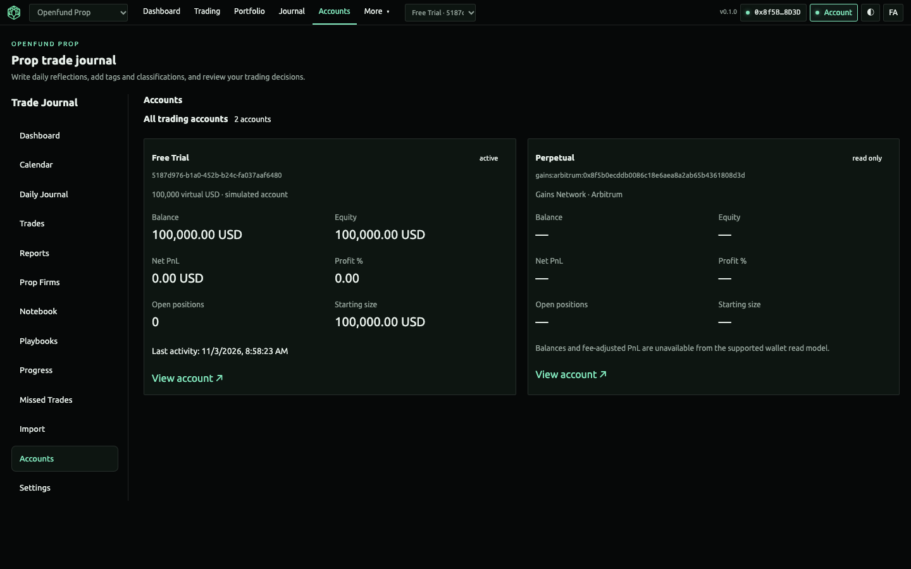

# Final integration recovery and release acceptance

Status: integration and release tooling in verification. This document does not certify a deployed release. Baseline: remote `main` `9508990226aa95df239f15b8b07b8c82ddb55024`, fetched 2026-11-03. Canonical repository: `https://github.com/algomanlife/openfund`; local root `/Users/algoman/openfund`. Working branch: `codex/unified-integration-release` in a worktree of that repository.

## Audit and preservation

[Inventory](inventory.json) records both local Git stores, all relevant branches/PRs/worktrees, stashes and uncommitted status before recovery. The historical store remains under the former landing checkout; the canonical checkout and historical store share remote ancestry but have independent Git metadata. No worktree, stash or existing uncommitted change was deleted/reset. The canonical main checkout had only untracked Finder metadata. The old `terminal-completion` worktree contained reviewed unfinished fixes; these were copied individually into the canonical branch, retaining the originals.

PRs #17, #22, #24, #31 and #32 were merged, but merged source does not certify its runtime. The old Qwen round-eight portfolio remains in `pages/Portfolio.tsx`; active routes use `features/terminal/*`. The historical tracked React entrypoint last changed at `638269d`; active dashboard source last changed at `5c956df`. Source and tracked bundles therefore have separate histories. The canonical build is `npm run build:web`, Vite under `apps/web-react`, producing root `react/`, served by the existing API at `/react/`. Production must rebuild the actual release SHA, not reuse another checkout's bundle.

The original Trade Journal and FundingPips images were recovered from the earlier execution's image attachments and inspected. They are reference information architecture, not Openfund financial evidence; their personal account contents are not republished. Existing screenshots in earlier reports retain their original commit/worktree provenance.

## Feature recovery matrix

| Issue / expected behavior | Original implementation | Current source / root cause | Action and evidence |
| --- | --- | --- | --- |
| Wallet detection / real SIWE | `qwen/wallet-identity`, PR #11; product policy PR #24 | `wallet/RainbowConnect.tsx`: injected-only path assumed `window.ethereum`, excluding discovered EIP-6963 providers | Recover connector discovery, visible rejection and connection state; actual local SIWE signed with disposable EIP-6963 provider |
| Product network follows navigation | PR #24 | Session provider outside router subscribed only to hashchange; router history transitions could retain the previous product network | Observe terminal route changes and resolve the actual product at signing time; Arbitrum switch/rejection/reload tests |
| Shared terminal header and navigation | `61b90be`, PR #22; `9f48b33`, PR #32 | `TerminalShell.tsx` and CSS applied compact navigation only to Trading; Journal active state pointed to Portfolio | Recover shared compact header for all private tabs, exact active destinations, account control and Accounts entry; bilingual route/size measurements |
| Boxed account Dashboard | `e75685b`, Qwen round eight, PR #17; `6cc64dd` / `5c956df`, PR #31 | `Dashboard.tsx` returned only the directory without an account query; selected mode stacked cards ahead of detail; legacy Portfolio is not mounted | Recover account sidebar/detail grid and show default owned account overview immediately; retain unknown challenge/Gains financial values and existing analytics |
| Journal reference | `e75685b`, PR #17; `61b90be`, PR #22; `6cc64dd` / `5c956df`, PR #31 | Existing 13-module Journal and server persistence were mounted; divergent outer shell, lost account query in detail links and missing reference gauges | Preserve modules/contracts; recover scoped links and ratio gauge geometry over server metrics; remount dated/trade detail editors when detail identity changes |
| Journal write scope | PR #31 preference queue | A queued preference write resolved the global account at execution time | Capture the initiating account in the queued write; unit regression verifies account switching cannot retarget it |
| Active trading account | PR #31 engine/account APIs | Bridge HTTP/SSE lifetime did not carry selected account; framed UI could retain previous adapter | Recover account-scoped reads/mutations/SSE, stopped-adapter rejection and current adapter adoption; verify challenge cannot borrow trial state |
| Reviewed order retry and form | Existing engine idempotency, PR #24 / #31 | UI made a fresh key on every retry, discarded failed review, parsed Persian values inconsistently, MAX omitted opening fees | Recover stable reviewed intent, explicit retry, numeric validation and fee-aware sizing; no engine rewrite |
| Protection display/edit | Original Vela integration | Missing SL/TP were invented as drawing levels; renderer edit events could issue unscoped mutations | Draw protection only when actual values exist; route changed protection through the scoped adapter and suppress renderer feedback writes |
| Release/build/deployment consistency | Render foundation PR #23; tracked historical `react/` | No official versions/manifests/releases, no branch protection, direct commit auto-deploy configured | Add unified release gates, checksummed payload, main-only immutable publication, diagnostics, exact-release runner, approved Render deployment and rollback |

All frontend paths above are within `apps/web-react/src` unless named otherwise. Engine, schema, Vela algorithms, Gains execution policy and unrelated public website pages are preserved.

## Runtime acceptance and data sources

Terminal routes are `/react/#/{en,fa}/{prop,perpetual}/…`. Dashboard, Trading, Portfolio, Journal, Accounts (`journal?section=accounts`) and capability pages use the same shell. Prop reads the actual local PostgreSQL/Engine and owned product endpoints. Perpetual reads the Gains wallet adapter; execution remains disabled. Unavailable external reads are explicit and are not fabricated financial success.

The browser matrix covers four desktop sizes, both products/languages, all terminal destinations and all 13 Journal sections. The functional scenario uses actual SIWE/PostgreSQL with disposable signers and controlled price/native-read fixtures for deterministic failure/lifecycle checks. Layout captures use fresh local persisted trial records and public reads, without injected financial trades. These are not production, hardware-wallet or WalletConnect acceptance.

## Unified release delivery

[Architecture, versioning, manifests, local runner, approval and rollback](../../deployment/RELEASES.md). The first proposed version is v0.1.0 because neither Git tags nor GitHub Releases existed during audit; the old root package's 1.0.0 was not a published release. Candidate packages are not official releases.

[GitHub settings evidence](github-policy.json) records main required checks, production reviewer protection and immutable tag rules configured during this task. The owner confirmed that Openfund runs locally only; no public application, deployed CMS or active Render service exists. The repository homepage currently lists `openfund.cloud`, but it is not an active release endpoint. No deployment was initiated. Changing `render.yaml` does not reconcile an already deployed service by itself.

The first official release must be created by the passing main pipeline after review and merge. Repository instructions require review before merging; this branch does not bypass that condition. Local/GitHub acceptance gates: review/merge, official workflow publication and startup of the downloaded official payload. Future production setup, HTTPS/CMS acceptance and deployment rollback are prepared separately and do not block the owner's clarified local release objective.

## Verification record

The exact-source local candidate at `6c436e4` passed the complete release command, including all three lockfile installs, docs/Blueprint/TypeScript, 74 frontend tests, 9 original chart tests, 4 release integrity tests, 224 backend checks, 35 controlled browser checks, 547 terminal/account/Journal checks, 535 anonymous plus 535 authenticated geometry checks, 17 chart checks, 7 release diagnostics checks and all 266 public source/locale route cases plus the brandbook ZIP download. Two production builds produced identical content hashes. The archive passed manifest/file integrity verification.

GitHub Linux CI then exposed a real chart race: an authoritative redraw could replace a user's dragged protection before the delayed save read it. The correction captures the user intent immediately, suppresses programmatic edit events and serializes position risk writes; its regression explicitly forces a redraw during debounce. The forced-redraw functional scenario passed all 34 local checks after this correction. Full GitHub Linux revalidation is required before merge. No failing candidate has been released.

[Route-by-route measurements](route-matrix.json) cover all 120 terminal route/locale/viewport cases, mounted components, connected product context, header/active state and overflow. The Journal's 52 product/locale/section cases and asset/runtime checks are included in the browser results. [Central screenshot manifest](../../assets/screenshots/manifest.json) records genuine captures and hashes; its `finalIntegration` group retains exact source and test-provider provenance. Existing captures are preserved.

Earlier exploratory failures were: the release badge test used a hidden narrow viewport; a test initially required a new context request on every navigation despite legitimate reuse; a separate public-route process outlived its temporary server after finishing its 266 route cases. Corrected complete scenarios passed locally. The Linux protection race was corrected without waiving a check. A second CI-only failure was reproduced locally by making the CMS unavailable: the existing Challenges detail renderer dereferenced an absent plan. It now shows an accurate unavailable state, disables activation and tolerates route teardown. The controlled functional scenario explicitly exercises CMS failure and passes all 35 checks locally. Final Linux acceptance remains required before merge.

## Screenshots

| English account overview | Persian account overview |
| --- | --- |
|  |  |

| Trading | Journal |
| --- | --- |
|  |  |

| Portfolio | Accounts |
| --- | --- |
|  |  |

Wallet modal and both Perpetual language captures are listed in the central manifest. They are local disposable-provider evidence, not a personal wallet or deployment certificate.
