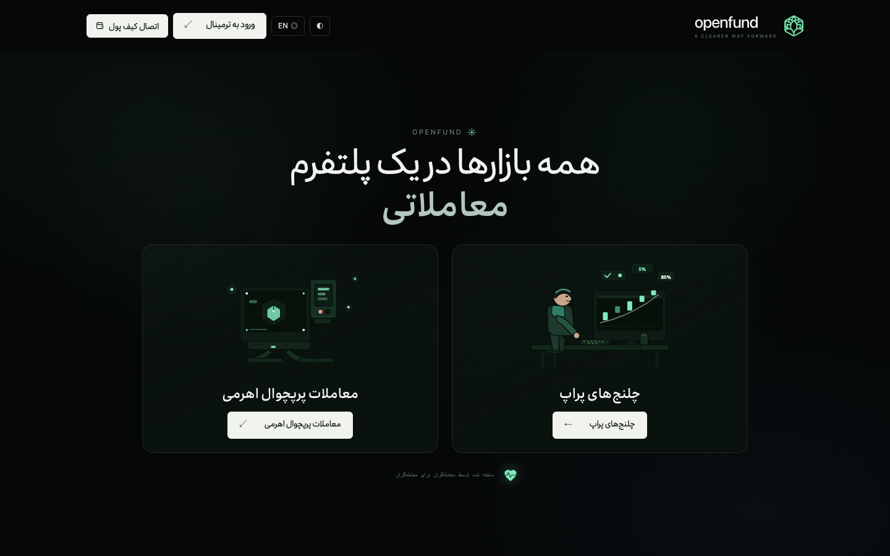
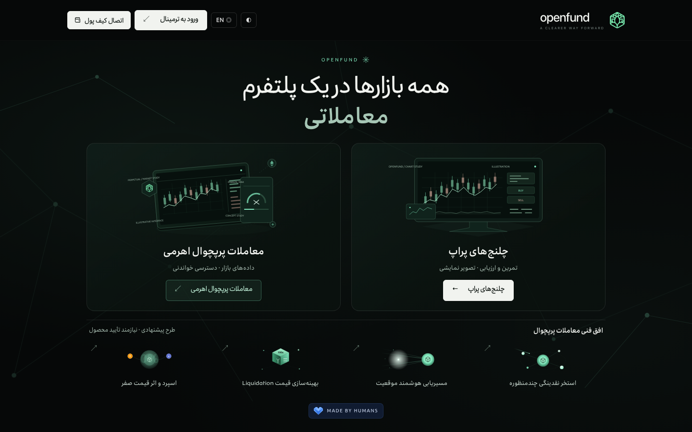
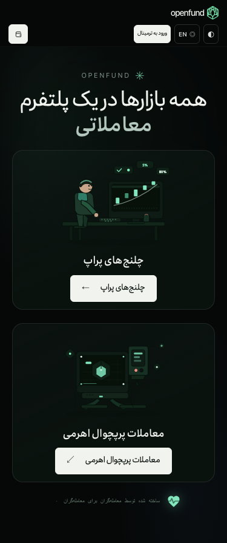
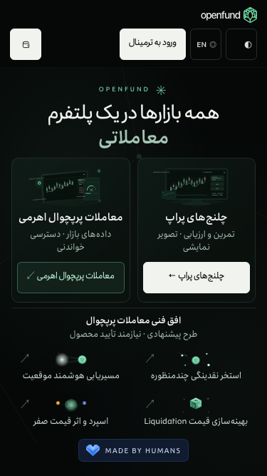

# Persian landing motion redesign

## Baseline and isolation

Official baseline: [v0.1.1](https://github.com/algomanlife/openfund/releases/tag/v0.1.1),
`ce9ddd0e4ead5da899fba512870e369820489187`, published 2026-11-03.
The canonical port 8080 returned matching official frontend/backend identity.
Recent merged PRs #35 through #39 established the shared navigation and release
pipeline. There were no open PRs at initial inspection. The local Qwen purchase
branch contains uncommitted backend work; it was preserved.

Implementation uses a dedicated worktree and `codex/landing-persian-motion-redesign`.
[File ownership](OWNERSHIP.md) defines the boundary. No router, shared chrome,
terminal, wallet/session, challenge/purchase, payment, database or backend source
is changed. Port 8080 remains the official application; local previews are
explicitly development/unmerged work.

## Architecture and vector provenance

- `Home.tsx` retains Directus `home_content`, CTA whitelists and `InformationShell`.
- `AnimatedTradingTerminalIllustration` replaces the cartoon with original SVG
  candles, a price trace, chart grid, compact widgets and decorative order labels.
  Both code and visible copy identify it as an illustration. No quote/order API.
- `LandingMotionBackground` uses sparse SVG networks and soft emerald light.
  Pointer updates schedule at most one pending animation frame, use element-local
  CSS properties and cause no React state updates or idle full-screen render loop.
  A ResizeObserver accounts for the actual responsive shared header height.
- `TechnicalFeatureStrip` and `TechnicalFeatureIllustration` provide four compact
  proposed Perpetual concepts using the original four SVGs and source descriptions with native modal disclosures, keyboard/touch
  access, focus restoration, Escape and a visible close action.
- `MadeByHumansBadge` uses an original blue geometric SVG heart with exact text.
- `LeveragedMarketIllustration` replaces the previous Perpetual machine on the
  user's follow-up request. A tilted vector chart, depth-shaped bars, margin/risk
  concept panel and network nodes share the Prop illustration's palette and
  motion vocabulary. No actual leverage, market value or execution is claimed.
- Existing Irancell/Ubuntu, palette tokens, `assets/mark-mint.svg` and the four
  original inline SVGs in `pages/landing-body.html` are reused read-only.
  Product illustrations are now dedicated original components; CMS still owns
  the headline, product names and CTA labels/destinations.

No new package or dependency. Only transforms, opacity and short SVG stroke
animations are used. Pointer following is disabled without hover/fine input and
with reduced motion. All new animations pause when the document is hidden;
listeners, ResizeObserver and pending frames are cleaned up on unmount.

## Copy and product review

The attachment contains the brief only, with no feature-card or badge image.
The four original cards were located in the legacy landing HTML after a broader
markup inspection. The four requested titles are retained; the original SVGs and Persian descriptions are extracted read-only from
`pages/landing-body.html`, preserving their geometry and wording. The separate
badge reference image was not supplied; its icon follows the written brief.
The strip visibly says proposed / product verification required. Original descriptions are preserved as reference
copy in the detail dialog, alongside current-status qualifications. Details identify
unimplemented routing/aggregation and explicitly flag zero spread/price impact
as an unverified design claim, never a current execution guarantee. These concepts
are scoped to Perpetual, whose present access is read-only, never to Prop.
Product approval remains required before turning
these proposed concepts into operational marketing claims.

## Routing and regression boundary

Existing `LocalizedHome` already mounts the existing `Landing` challenge experience
for `/en/home`. It is retained without a router or purchase-page edit. Persian
continues to expose both existing product destinations; English does not mount
the dual-product gateway. Existing English Perpetual restriction is retained.
Language preference is presentation only, never geographic/regulatory eligibility.

## Verification

The dedicated local preview passed 199 checks against existing Directus content.
All eight requested viewport sizes fit without document scrolling or clipped
content. Keyboard/touch dialogs preserve original Persian copy, and product,
language, wallet-modal, reduced-motion and visibility checks passed.

The first integrated candidate attempt passed frontend, chart, release integrity,
reproducible production builds and all backend gates, then stopped on the old
`.home-ambient i` selector in the landing audit. That assertion is updated to
check the replacement SVG networks, negative stacking and input transparency;
its reduced-motion assertion still verifies animation is disabled. No financial
assertions or implementation were changed. The candidate is rerun afterward.
The existing integrated candidate pipeline is run with Node 22, an isolated local
test database and its own test server. It is not an official release or deployment.
CI additionally invokes `e2e/test-landing-motion.cjs` in the existing backend job.
No release publication, merge or production deployment is authorized by this PR.

## Accessibility and small-screen limits

The tested matrix checks visible content bounds, horizontal text clipping, RTL,
44px product/feature actions, all four detail dialogs, keyboard focus and touch.
Mobile gateway controls receive scoped 44px minimum targets without editing the
shared header implementation. Reduced motion and tab visibility are checked.
The document retains natural flow: no overflow-hidden fix or fixed content height
is used to force the viewport acceptance. Below tested sizes, extreme landscape,
large browser zoom, larger user fonts or unusually long future CMS content may
require accessible scrolling. Dialogs can scroll internally at constrained sizes.
External hardware-wallet/WalletConnect acceptance and a formal accessibility audit
are separate and are not inferred from an opening connection modal.

## Measured limits and bundle impact

Additional probes at 320 x 568 and 640 x 360 require natural vertical scrolling
(document heights 717 and 594 respectively), with no horizontal overflow. Content
remains reachable rather than being clipped. The eight requested sizes retain
single-screen acceptance. Large browser zoom can create these smaller effective
CSS viewports and therefore takes the same accessible-scrolling compromise.

The production entry JavaScript compared with the running official v0.1.1 grew
by about 4.8 kB gzip (593,555 to 598,365 bytes in the measured build). This is
less than 1% of the existing entry chunk; no animation package was added.
Existing large wallet/application chunks and upstream annotation warnings remain.
This is bundle evidence, not a device-level performance certification.

## Follow-up illustration revision

The user requested a fresh Perpetual illustration matching the new Prop artwork.
The previous machine and its CMS-image rendering are replaced with the original
leveraged-market SVG component; no terminal or financial implementation changed.
An in-flight candidate was stopped to incorporate this request. Final acceptance
and screenshots use the revised illustration.

## Review captures

| Official v0.1.1 before | Unmerged local redesign |
| --- | --- |
|  |  |
|  |  |

Full matrix screenshots and machine-readable results are generated under
`output/playwright/landing-motion/` and retained as CI artifacts. Screenshot
provenance is recorded in the shared screenshot manifest. No personal wallets or
invented financial records are captured.
