# Compact trading terminal delivery

Implemented and locally verified on 2026-11-02. This is a frontend presentation change; it does not establish production deployment or new execution capabilities.

## Audit and isolation

- Latest main at start: `c4cf6025108e137cf157a33ce0956d604760c4e3`.
- Branch: `codex/terminal-ui-density`; isolated worktree `terminal-ui-redesign`.
- Implementation commits: `726ebd2`, `0aae9da` and `64b23c9`; screenshot and acceptance source: `64b23c9ac3ef2e38854600854a71df29a789609d`.
- Inspected Git status, remotes, worktrees, open PRs, current contracts, feature status, roadmap, route registration, shared shell, account adapters, legacy markup/styles, brand tokens and Vela container before editing. QwenWork's separate website branch and unfinished FAQ/Learning seeds were inspected read-only and preserved.
- Both actual products were rendered in English and Persian before implementation. Before captures show the tall two-row outer navigation, wrapped market ticker and order controls continuing below the visible panel at 1440 × 900.
- Both products use `TerminalShell` and one disposable `SharedTradingTerminal` iframe. The original 300/336px side columns, vertical form, scrollable order panel, wrapping statistics and outer header consumed chart space. The classic terminal already fixed the primary grid to LTR, but local text and short-window alternatives needed explicit direction boundaries.

## Implemented presentation

The trading route has a 40px application row and 34px market row. Logo, product switch, Dashboard, Terminal, Portfolio, Journal, More, wallet/account controls, theme and language remain available. More holds low-frequency routes and provides the collapsed destinations on small screens. Existing account-scoped route construction is reused.

The workspace retains chart, Gains VOB/Trades and order entry in fixed physical columns. It uses the existing Obsidian, dark-green surfaces, mint, negative color and typography assets. Thin structural dividers separate panels, tabs, summary, field groups and status. The chart occupies more than half the supported desktop width. The existing resizable activity area defaults to a compact height, with scrolling reserved for variable account tables and market levels.

Book grouping and denomination selectors reserve native arrow width, with a localized compact Group caption. This preserves the full 100× grouping value and corrects the order-book controls overflow caught by the first Linux CI run; the same browser acceptance remains enforced.

The order panel uses a compact account summary, Long/Short segment, order-type tabs, existing leverage slider/presets, paired collateral/size and SL/TP fields, and accessible percentage controls. Market orders reserve no space for a disabled trigger input. Liquidation, margin, opening fee and maximum loss remain visible. Entry, index and price-impact estimates are in an adjacent Order Details disclosure, which opens without moving the form or action. Existing validation and submission handlers are unchanged.

All original IDs and event targets remain. No trading engine, API, schema, wallet/session hook, Gains integration, subscriptions, depth adapter, Vela bridge, proprietary indicator source or generated Vela bundle was changed. `dist/` and the historical tracked `react/` output are unchanged in the PR. The exact locally tested production build is retained in the ignored verification output; Render keeps its existing source-build path.

## Rendered acceptance

Each account-state run covers both products, both languages, all four requested desktop sizes and Market/Limit/Stop: **48 cases per run**. The tests measure document/iframe dimensions, actual control and warning rectangles, order-panel content height, input label overflow, numeric direction and column geometry. Passing is not based only on overflow CSS.

| Product / language | 1920 × 1080 | 1440 × 900 | 1366 × 768 | 1280 × 720 |
| --- | --- | --- | --- | --- |
| Prop / English | Pass | Pass | Pass | Pass |
| Prop / Persian | Pass | Pass | Pass | Pass |
| Perpetual / English | Pass | Pass | Pass | Pass |
| Perpetual / Persian | Pass | Pass | Pass | Pass |

For every desktop case, the document and iframe fit without horizontal or vertical overflow; the order panel's scroll height equals its available height; all essential controls, applicable price input, risk values, warnings and review action fit. The header totals 74px. Persian and English have equal column positions and widths; symbols, numeric fields and numeric data retain LTR isolation.

At 1280 × 600, 1024 × 768 and 390 × 844, explicit Chart / Book / Order / Activity controls provide an alternative workspace. Short desktops use a horizontal form arrangement. The alternative form's geometry is also compared between languages. The final short-window Persian correction is covered by six additional assertions per run.

The browser checks cover order types, direction, leverage presets, collateral edits, risk/market disclosures, Escape, all activity tabs, secondary-route access and unavailable execution. The authenticated run additionally uses a real local SIWE session and persisted virtual account, exercises a large invalid collateral warning, and confirms that invalid input cannot open order confirmation. Existing review-button eligibility remains unchanged; invalid request validation still blocks confirmation in the established handler.

## Checks executed

| Check | Result |
| --- | --- |
| TypeScript | Pass |
| Vite production build | Pass; existing large-chunk advisory remains |
| Web unit tests | 20 passed |
| Backend identity, trading, portfolio, products, Gains, audit and unified suites | 206 passed against an isolated local test database |
| Original Pine/runtime unit tests | 9 passed |
| Anonymous layout and interaction acceptance | 535 passed |
| Authenticated layout and interaction acceptance | 535 passed |
| Existing controlled browser audit | 31 passed |
| Existing unified account/trading browser scenario | 26 passed |
| Existing chart/indicator browser regression | 17 passed |
| English documentation, links/images, Markdown and Mermaid | Pass |
| Render Blueprint structural validation | Pass; topology unchanged |

There is no separate frontend lint script. TypeScript, the existing web suites and repository documentation lint were run. The production frontend was built with `npm --prefix apps/web-react --ignore-scripts run build`, retaining the checked-in Vela assets as requested instead of rebuilding generated chart bundles. Acceptance runs target that built frontend, not only Vite development mode. [Machine-readable results and all desktop dimensions](validation.json).

Both layout error collections are empty. The anonymous production run has no console errors. The authenticated run records one expected `/auth/me` 401 before sign-in; no uncaught browser exceptions occurred. Existing browser scenarios also report no uncaught errors.

Reproduce after building and starting the existing backend:

```bash
TEST_FRONTEND_URL=http://localhost:8080/react npm run test:browser:layout
TEST_FRONTEND_URL=http://localhost:8080/react TEST_LAYOUT_AUTH=1 npm run test:browser:layout
```

The authenticated run requires the normal local SIWE domain allowlist to include the frontend host. It generates its own signer and uses real local sessions and account records. Its injected native-wallet balance is a test transport fixture, not external-wallet acceptance. No real chain transaction is sent. The published terminal screenshots below are anonymous and contain no wallet fixtures or personal data. CI runs both acceptance modes and retains the browser artifacts.

## Before and after

All captures are native, unedited Chromium screenshots. Market information is live public Gains data; unknown balances and disabled execution remain explicit. Before screenshots use the baseline source; after screenshots use the current production build. Routes, viewports, timestamps, source commits and SHA-256 hashes are recorded in the [central manifest](../../assets/screenshots/manifest.json). Prices differ with capture time.

| 1440 × 900 | Before | After |
| --- | --- | --- |
| Prop / English | 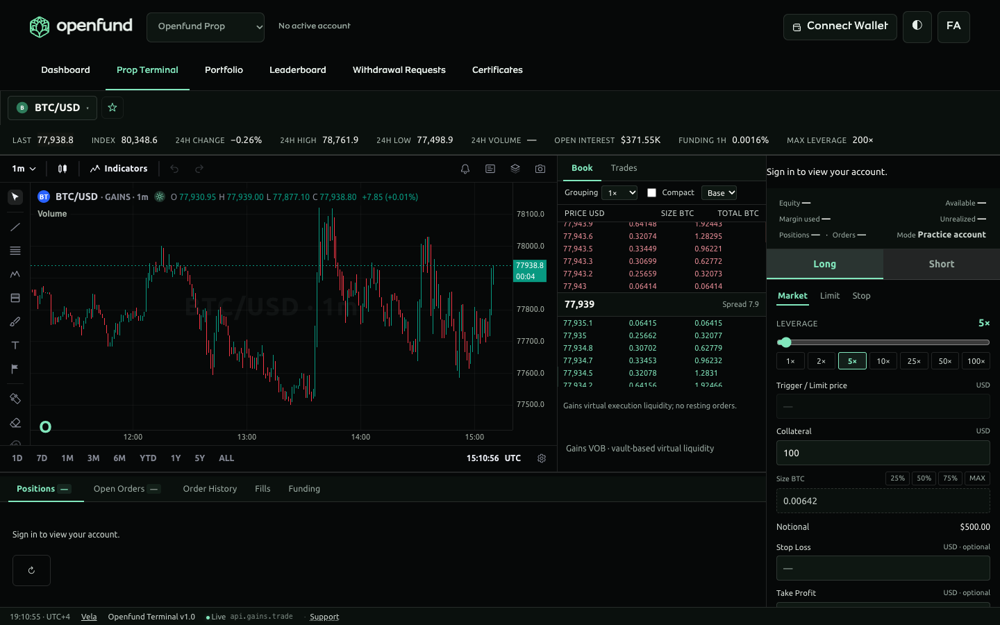 | 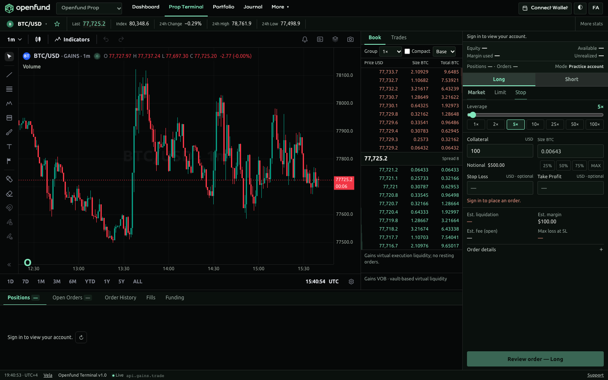 |
| Prop / Persian | 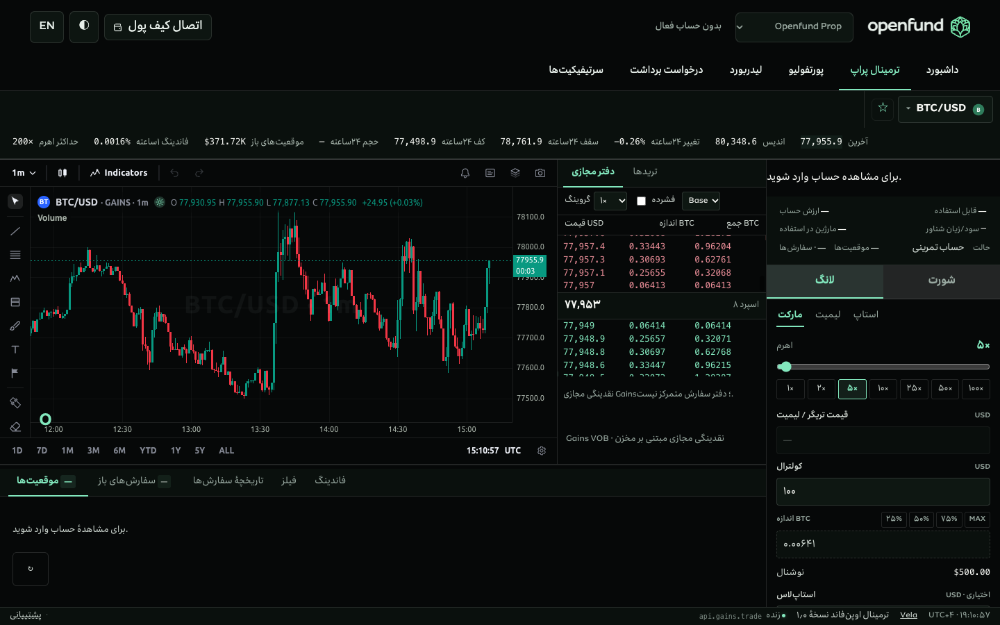 | 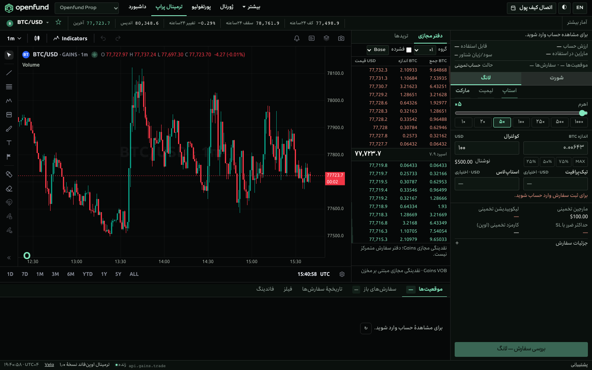 |
| Perpetual / English | 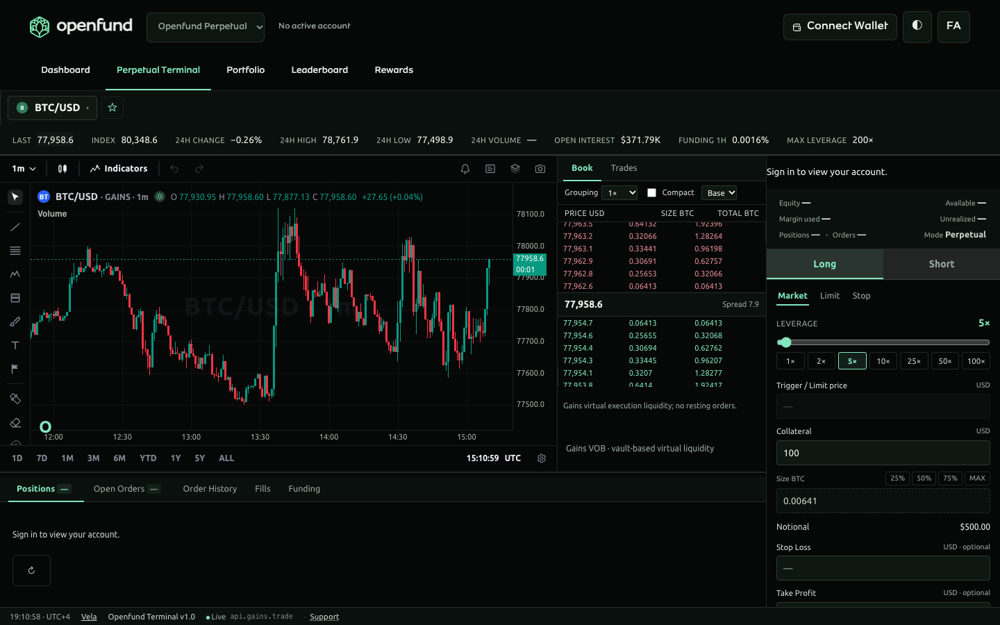 | 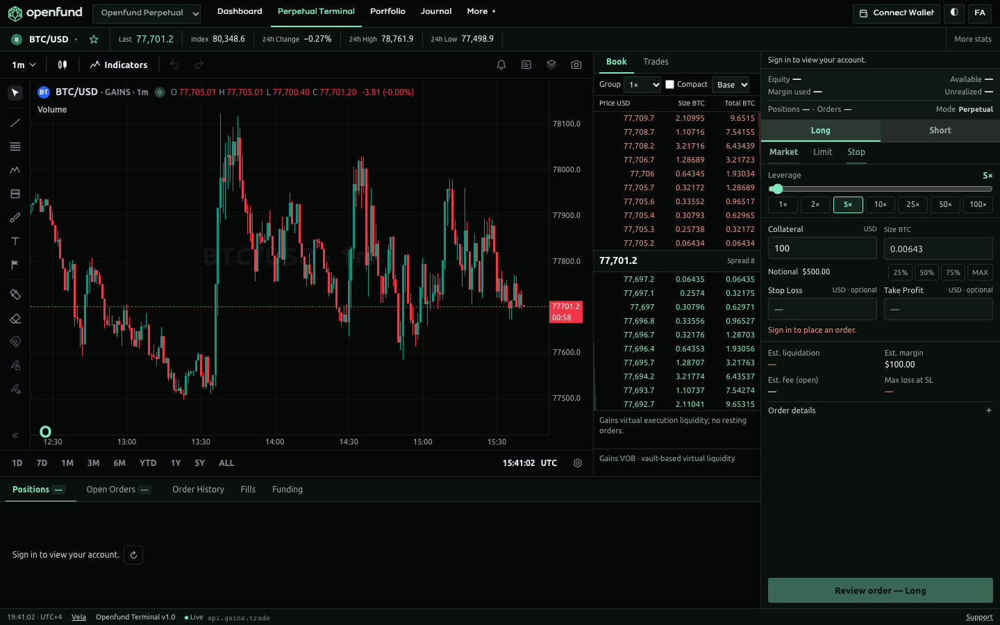 |
| Perpetual / Persian | 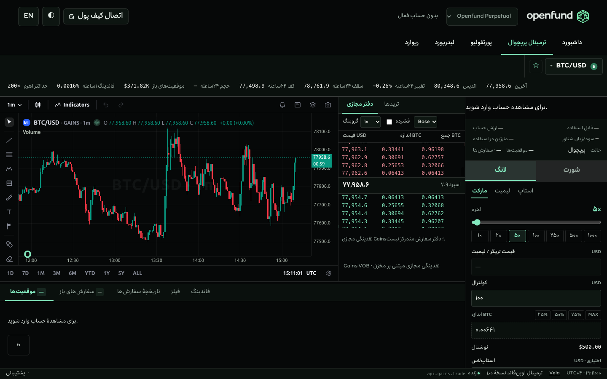 | 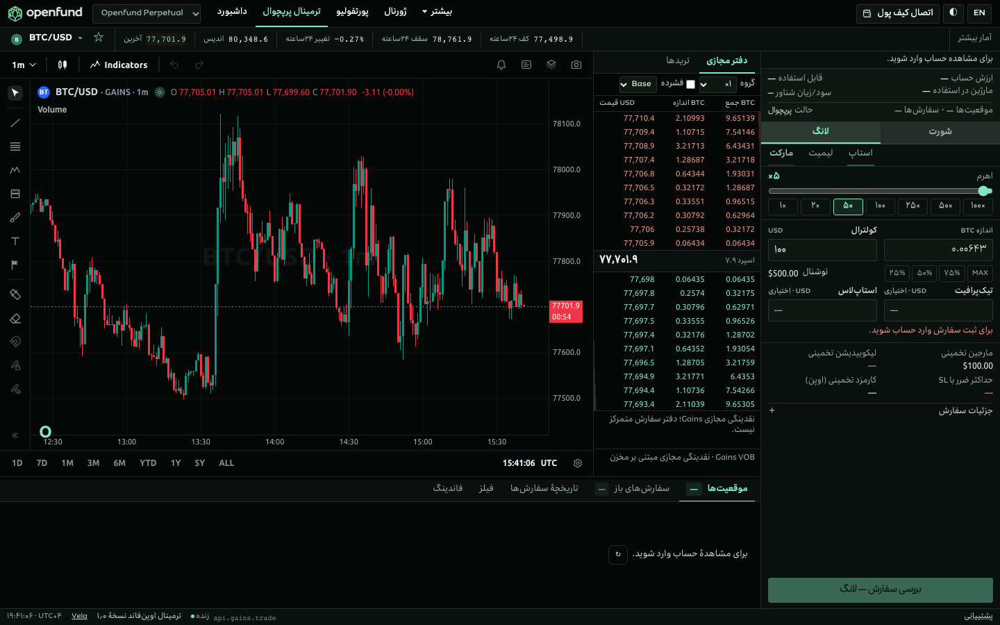 |

| 1280 × 720 | English | Persian |
| --- | --- | --- |
| Prop | 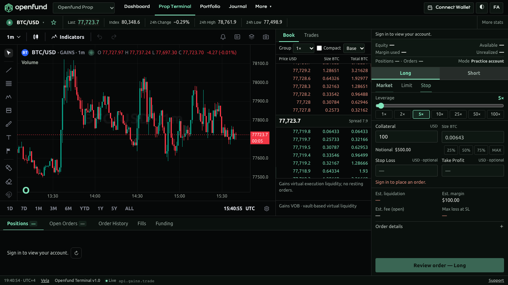 | 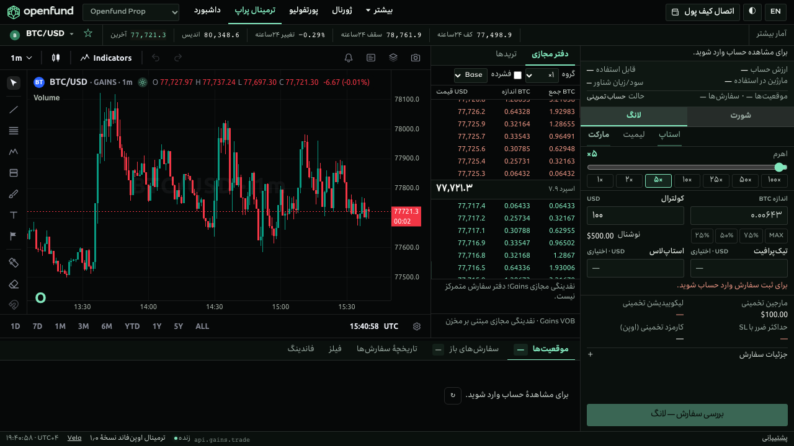 |
| Perpetual | 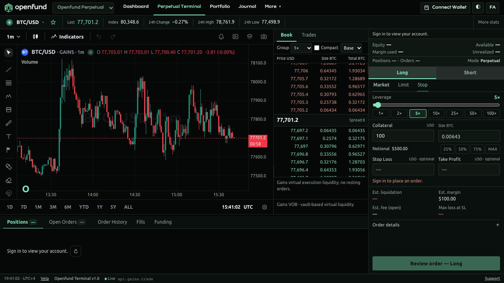 | 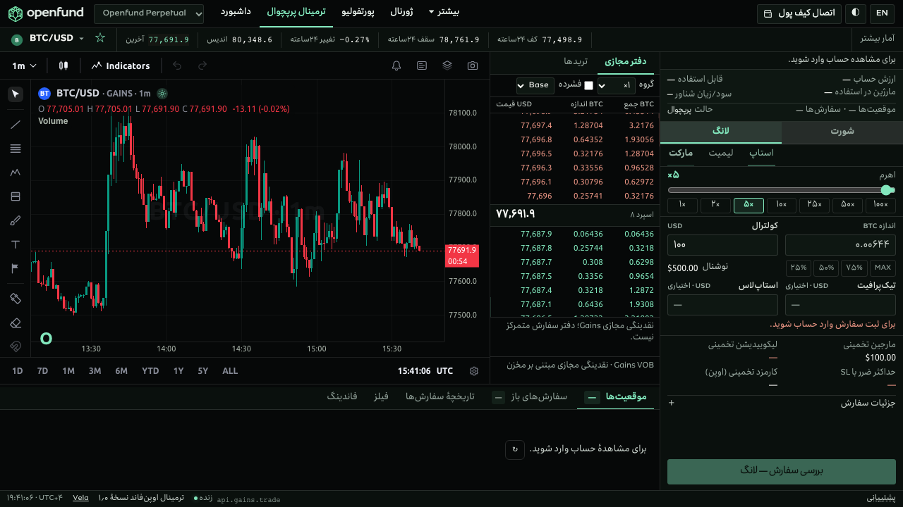 |

Alternative layouts: [1280 × 600 Persian Order view](../../assets/screenshots/terminal-compact-fa-1280.png) · [390 × 844 Persian Order view](../../assets/screenshots/terminal-compact-fa-390.png). All 16 desktop screenshots per account state and the responsive screenshots remain in local `output/playwright/terminal-layout*`.

## Files and boundaries

- `apps/web-react/src/features/terminal/TerminalShell.tsx`: compact trade-route navigation, More and journal access.
- `apps/web-react/src/features/terminal/TradingPages.tsx`: presentation markup arrangement and iframe stylesheet integration; financial adapters unchanged.
- `apps/web-react/src/features/terminal/terminal.css`: trading-route-only outer-header styles.
- `apps/web-react/src/features/terminal/workspace.css`: iframe layout, tokens, density, panel boundaries, text direction and responsive alternatives.
- `apps/web-react/src/features/terminal/workspaceLayout.ts`: responsive view controls, presentation translations and disclosure Escape handling.
- `apps/web-react/test/market-depth.test.mjs`: existing reduced-motion source assertion follows the extracted stylesheet.
- `e2e/test-terminal-layout.cjs`, `package.json`, `.github/workflows/ci.yml`: executable acceptance, command and CI artifact retention.
- README, changelog, terminal/design/architecture contracts, status/milestone entries, ADR, review report and screenshot manifest: current UI and verification scope.

## Remaining limits

Production deployment, actual extension/hardware/remote WalletConnect and real on-chain execution are not verified or changed. Live Gains availability remains upstream-dependent. Optional desktop panel-width customization and a desktop book toggle were not added; the existing activity resize and the responsive view selector remain available. Extremely short portrait windows below the tested 390 × 844 alternative are outside the verified range. The supported desktop matrix has no unresolved clipping or scrolling findings.
