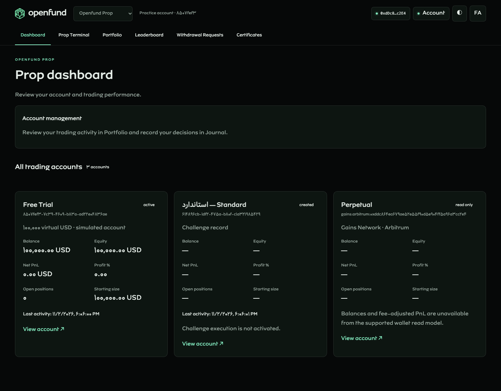
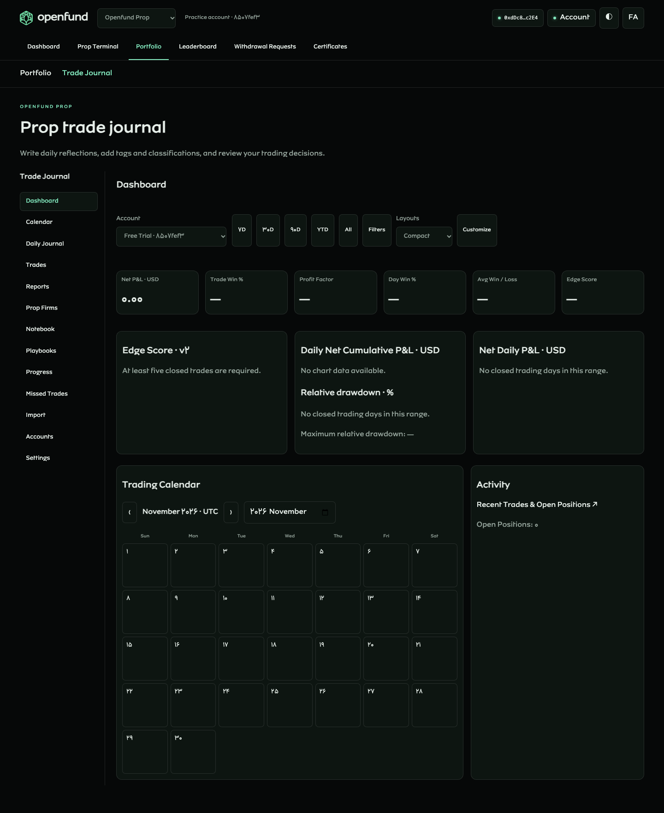
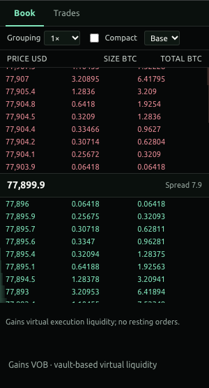
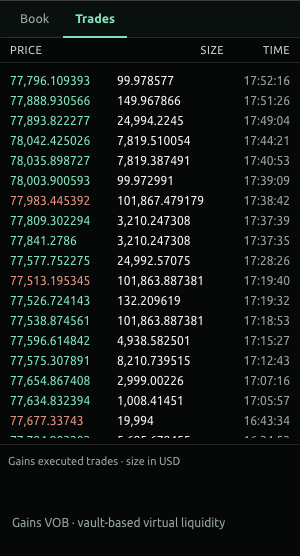
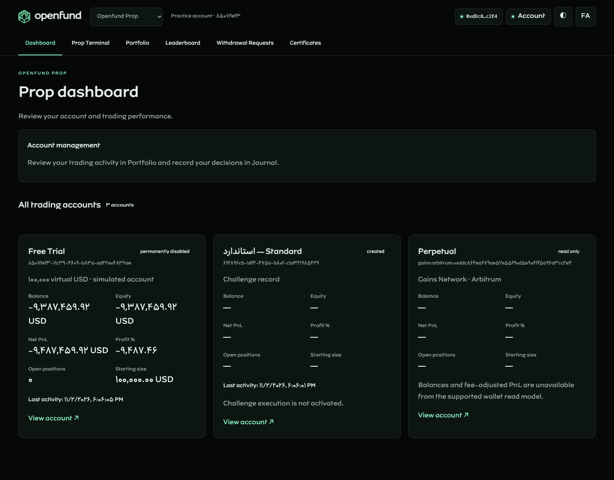

# Unified trading delivery and verification

Status: locally verified implementation; production and external wallet acceptance remain unverified. This is a local implementation and review report, not a deployment certificate.

## Baseline and ownership

- Starting main commit: `da4bfed223de3ffadd13d86be38680a15421a8db`.
- Branch: `feat/unified-trading-dashboard-engine`, isolated worktree of the canonical repository.
- First five commits: `6daaa6b` audit, `4f81ea4` account/risk foundation, `a4f3c20` market-depth integration, `6cc64dd` account/journal UI, `fbf6400` instrument/risk tests.
- [Audit and capability inventory](AUDIT.md), [QwenWork coordination and preserved artifacts](COORDINATION.md).
- After the read-only coordination audit, approved main through `3a1d8ca` was incorporated at `572647a` to include its existing documentation-gate fix. No QwenWork website branch was merged. The PR diff excludes Protocol source changes. No proprietary Pine algorithms, website FAQ/Referral/Tools/Learning modules, CMS content seeds, Home, shared website navigation or Render service topology were changed by this task.

## Implemented scope

The existing Engine remains authoritative. Additive schema changes add irreversible trial-disable fields/state, read-only metadata guards, per-account journal preferences and observed equity samples. New trials receive one 100,000 virtual USD funding event; existing DAI denomination/history is preserved without resets. Zero-equity risk is independent of the existing 10% position maintenance rule. Transactions settle remaining positions and cancel pending orders before persisting permanent disablement. Reauthentication cannot replenish/recreate that account.

The unified directory has individual Free Trial, Challenge record and Perpetual wallet cards, owned detail navigation and unknown financial states where execution/data is unavailable. Challenge journals use distinct owned IDs; their financial APIs reject access rather than return trial values. Perpetual execution remains disabled.

Trading follow-ups add validated backend estimates, quantity precision/minimums, explicit supported USD linear contracts, executable stop-gap pricing, stale/out-of-order quote protection and settlement-date report filtering. Tests independently derive long/short results for BTC, EUR/USD, AAPL, SPX and XAU. Unsupported quote conversions and non-unit contracts reject explicitly instead of using an unverified uniform lot formula.

All thirteen journal navigation entries have workflows: account dashboard, month calendar, dated daily notes, existing trade details/annotations, reports/CSV, firm research notes, notebook, playbooks, progress review, missed-trade notes, scoped metadata import/export, account directory and preferences. Metrics, balance/observed-equity curves and calendars read persisted records. Layout/range/metric visibility persist per account. [Exact definitions](../../trading/JOURNAL_METRICS.md).

Book/Trades were removed by explicit iframe CSS and a market-list rendering override. Restore the existing panel and use the verified [Gains VOB/Trades API](../../integrations/GAINS_DEPTH.md). VOB is vault-based execution liquidity, not central resting orders. WebSocket acknowledgement, malformed payload, sequence gap, symbol isolation, reconnect and cleanup handling are covered. No synthetic replacement liquidity or trade prints are used in product routes.

## Verification record

The pre-resumption full backend run passed 202 checks: identity 22, trading 54, portfolio 31, product/journal 58, Gains adapter 5, audit 11, new trial/instrument tests 21. The final full backend suite passes **206/206**: existing identity 22, trading 54, portfolio 31, product 58, Gains 5, audit 11 and new trial/instrument/API/quote/precision checks 25. Three depth-message unit tests pass.

Final gates pass: TypeScript, production Vite build, **20 web unit tests**, **9 original Pine tests**, additive migrations twice, English documentation/link/Markdown/Mermaid checks and structural Render Blueprint validation. Existing controlled browser regression: **31 checks**; live unified browser scenario: **26 checks**; proprietary chart browser regression: **17 checks**. All browser error collections are empty. [Machine-readable validation](validation.json). The three new depth unit tests pass. The chart browser regression passed original source calculations, settings, intervals, rapid switching, symbols, reload and responsive dialogs for both products.

The live unified browser scenario exercised actual SIWE with a disposable EIP-1193 signer, real PostgreSQL/API, live public Gains reads and controlled test-only execution prices. It verified directory isolation, playbook persistence, terminal order review, partial/full close, history/calendar reconciliation and permanent disablement after reload. It discovered and led to fixes for a preference-write/navigation race, journal mobile overflow and a payload-free Gains subscription acknowledgement. The corrected live unified browser scenario passes all 26 checks, including English/Persian mobile overflow and no uncaught errors. A separate live socket probe verified the payload-free acknowledgements and envelope-only Book market symbol.

No real on-chain transaction was submitted. External wallet extensions, hardware, WalletConnect, deployed HTTPS, authenticated Render validation, deployment apply/recovery and production acceptance remain unverified.

## Screenshots and provenance

Validated source commit: `06abc6a589a4e712eee2f920e5d6a61103fa5563`. Final genuine captures are in the [central manifest](../../assets/screenshots/manifest.json), with timestamps, hashes and test-wallet provenance. The local empty-account Dashboard and Journal screenshots use real persisted virtual account records, not seeded performance. The Challenge card is an actual controlled local catalog record, not commercial activation. Book/Trades use live public provider responses. The generated EIP-1193 wallet is a test signer and reports fixture native-wallet balance; this is not evidence of a real connected wallet/device balance. Controlled price injection starts only after the empty-account and live-panel captures.

## Remaining boundaries

- Existing DAI trials are preserved; no undocumented currency conversion, reset or new trial is introduced.
- Non-USD quote conversion, non-unit contract specifications, venue fee/funding/borrowing/market-impact parity and partial liquidity fills are unsupported and explicit. The simulation does not claim exchange or Gains-contract parity.
- Challenge commercial activation/evaluation and Perpetual on-chain execution remain outside the approved scope. Their unavailable financial fields stay unknown.
- Historical equity only contains fresh observations from actual sampling; unavailable past marks are never reconstructed.
- Prop Firms, Missed Trades and Progress use persistent private research/review notes and actual account analytics; they do not establish third-party relationships or executed trades.
- Generated React output and both pre-existing modified Vela bundles are preserved locally, excluded from authored commits, and covered by a recovery archive. The new source is rebuilt by Render's existing build path.
- No current QwenWork file overlap was found; its work is unfinished and separate. Shared root documentation/package files may require normal integration review when both branches are submitted.

## Review screenshots

| Live Gains VOB | Live executed trades |
| --- | --- |
|  |  |

## Delivery classification

| Classification | Scope |
| --- | --- |
| Implemented and locally verified | One-time USD trial provisioning, permanent zero-equity lifecycle, independent position liquidation, owned account directory/journals, supported linear simulation operations, backend estimates, five-category accounting fixtures, actual Gains VOB/Trades, journal modules/preferences/reports and regression gates |
| Implemented; external acceptance outstanding | Real wallet/device sessions and Render deployment/HTTPS/recovery; current live Gains reads are verified for this run, not an availability guarantee |
| Explicitly unsupported | Non-USD conversion/non-unit contracts, venue funding/borrowing/impact parity, commercial Challenge activation, Perpetual on-chain execution and reconstructed historical marked equity |

The full acceptance rerun also exposed a legacy portfolio test helper that discarded its supplied request headers. It now forwards them, exercising required opening-order idempotency correctly. Test mode is restricted to explicit non-production isolated-database configuration; production rate limits and disabled injection remain intact.
