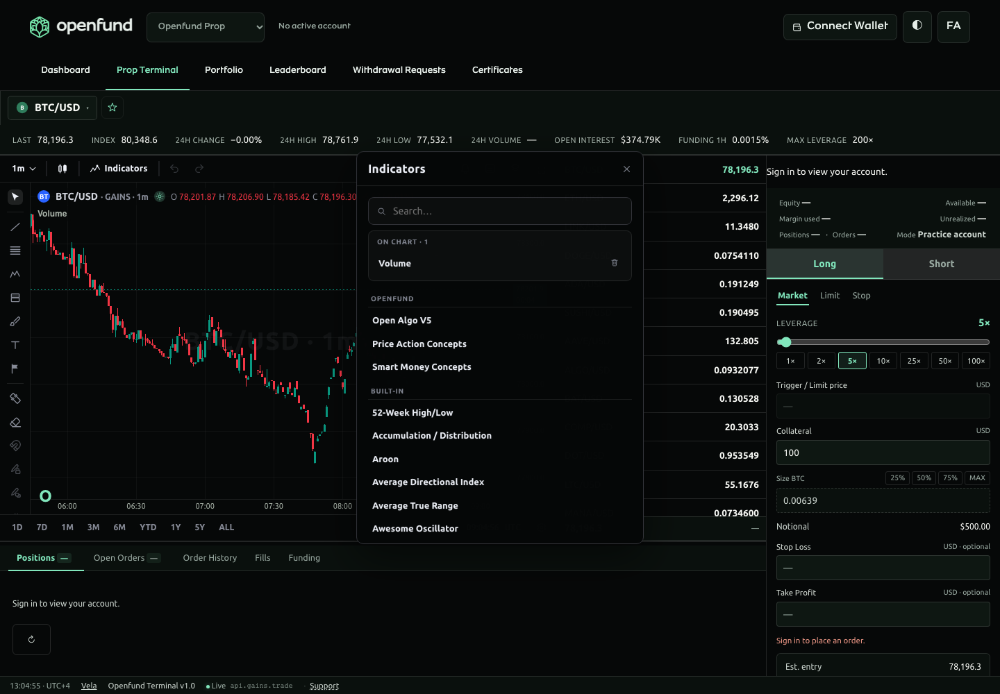
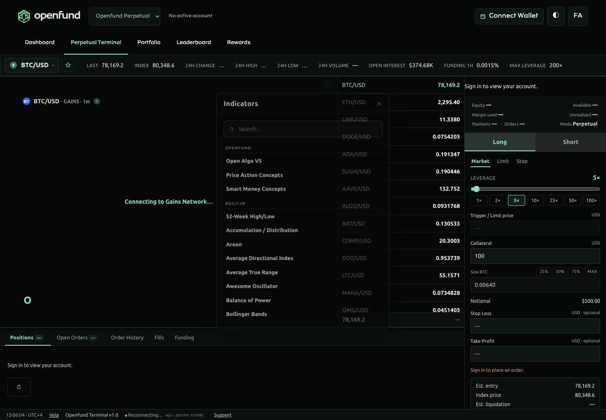
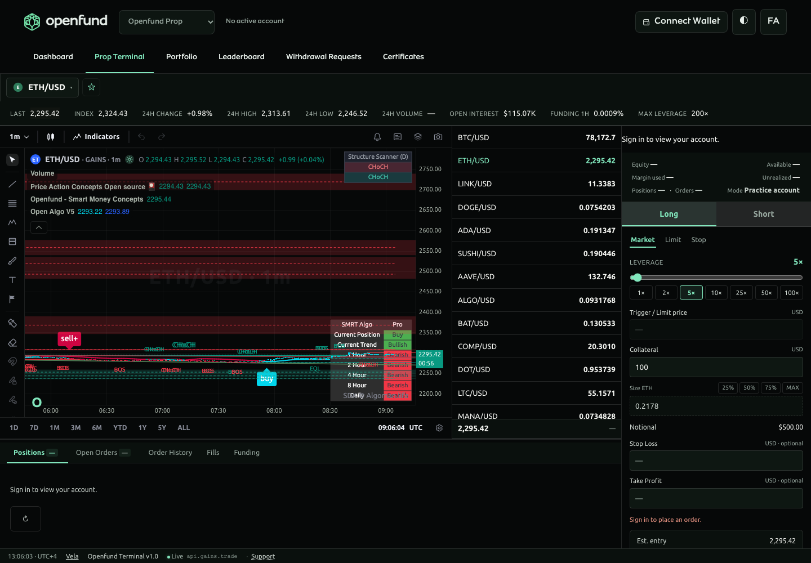
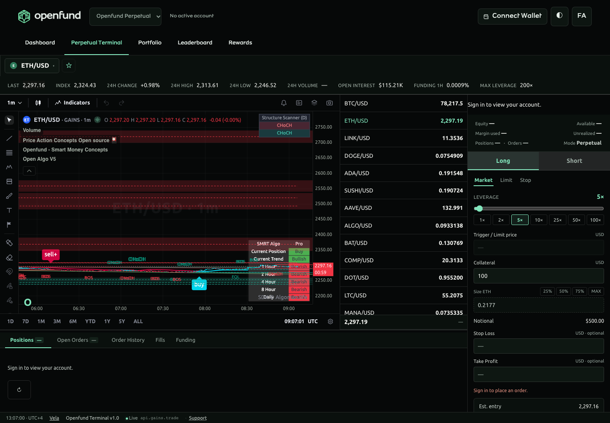

# Vela and proprietary Pine implementation evidence

Baseline: `08cb68afab48c596a953bfd93ee1e29c81cd37ab` (latest `origin/main` fetched on 2026-11-02). Implementation branch: `feat/vela-pine-custom-indicators`. No merge, production deployment or financial transaction is performed.

## Implemented scope

- Preserve the five user-supplied Pine files byte-for-byte. Open Algo V5, Price Action Concepts and Smart Money Concepts execute their original algorithms through the official Pine worker addon.
- Pin Vela 0.9.3, addon 0.3.2 and PineTS 0.13.1. Use the existing Vela core, scene renderer and settings UI, without introducing a second product-specific engine.
- Resolve the two exact Open Algo import IDs locally: `LAF -> openfund/Overlayslibrary/1`, `kernels -> openfund/sdk/1`. The sole accessed imported symbol is `getSmartTrail(10,4,8)`; the kernels alias is unused. All exports/signatures/state dependencies are inventoried in [Pine architecture](../../trading/PINE_SCRIPT.md).
- Register exactly three source entries in the requested order before all 77 built-ins; retain native order and index mapping. Libraries are not selectable. Inputs total 79, 49 and 52.
- Preserve source plots, fills, lines, labels, boxes, tables and historical state. Fix the PAC runtime's nested-request optimization through its existing full-script secondary path, without modifying the Pine algorithm.
- Preserve unavailable volume as Pine `na`. Resolve canonical intervals and aggregate additional supported intervals from genuine OHLC; never silently substitute hourly candles for other requests.
- Persist indicators/settings per product and exclude position drawings from workspace persistence. Keep existing product-specific financial adapters unchanged.

## Root causes and repairs

| Failure | Reproduction / cause | Repair |
| --- | --- | --- |
| Timeframe/style menu clicks fail | Real browser click retries show the price canvas intercepting menu rows. Hover/machine re-projection removes the floating positioner's inline z-index after its entry animation. | Scoped menu positioner stacking rule; actual pointer-click regression |
| Minute labels appear as months | The UI parser treats lowercase `1m` as calendar-month syntax when creating labels. | Canonical Pine minute IDs in toolbar and bridge; explicit Gains mappings |
| Symbol display disagrees with chart | `selectMarket(id)` updates text but never assigns `S.marketId`; dependent refresh still uses the previous symbol. | Commit selected ID before refresh, scope drawing restore to handler and catch chart-switch failures |
| Missing intervals calculate hourly data | Provider uses `TF_MAP[timeframe] || '1h'`, including secondary Pine requests. | Explicit resolution/aggregation and errors for unsupported requests |
| PAC fails with secondary data | Nested `getTFData -> reqSeq` expression is absent from the secondary parameter store after request slicing. | Full-script secondary execution for this exact source; no mathematical rewrite |
| Unavailable volume becomes zero | Official addon uses `bar.volume ?? 0`. | Host wrapper sends `NaN` for unavailable volume in main/live/secondary bars |
| Chart notices and badges | Native picker emits `vela`; footer is static markup; workspace owns a separate mark from the per-chart renderer. | Remove optional badge/footer; public renderer defaults disable shared mark; equivalent visible linked notice in terminal status |

## Validation executed

Commands are run from the repository root unless a prefix/directory is shown. Local tools use Node 22.23.4 for the deployment-compatible gates. The isolated database is `openfund_pine_test_20261102`; test backend port 8197.

| Command | Result |
| --- | --- |
| `npm run test:charts` | Passed: 9 source/dependency/runtime/provider tests |
| `npm run typecheck` | Passed |
| `npm run test:web` | Passed: 17 existing frontend tests |
| `npm run build:web` | Passed: shared chart/worker build and Vite production build; existing chunk-size warnings |
| `npm run test:backend` with isolated database/backend | Passed: SIWE 22, trading 54, portfolio 31, products 58, Gains 5 and audit 11 |
| `npm run test:browser:audit` against port 8197 | Passed: 31 existing browser/account/trading checks |
| `npm run test:browser:charts` | Passed: 17 grouped checks on controlled protocol fixtures; the separate live production-build run also passed all 17 grouped checks |
| Vendored Vela `npm run typecheck` and `npm run lint` | Passed |
| Vendored Vela `npm test -- --maxWorkers=2` | Passed: 198 files, 2,465 tests |
| Vendored Vela `npm run build` | Passed: all package entries and declarations |
| Browser loading-overlay retry-button click probe | Passed: actual pointer click reaches the retry control while passive messages remain pointer-inert |
| `npm run validate:blueprint` | Passed: existing two services and one PostgreSQL resource |

The initial fully parallel Vela run hit temporary-disk exhaustion and one timing timeout; the complete rerun with two workers passed. jsdom canvas warnings are expected and are not used as visual evidence. Real browser execution supplies the visual/interaction evidence.

## Screenshots and live acceptance

Production-build live acceptance uses the same browser suite with `CHART_TEST_LIVE=1 TEST_FRONTEND_URL=http://localhost:8197/react`. It checks committed market events and computed contexts after every timeframe transition, rather than accepting a changed toolbar label alone. The capture process is anonymous, reads actual Gains market data and performs no wallet signing, order placement or financial mutation. Controlled protocol fixture runs are separate and never presented as genuine market screenshots.

## Original source integrity

The source hashes below match the starting commit; no original Pine file is modified.

| File | SHA-256 |
| --- | --- |
| `Open algo v5.pine` | `9e1a8f5d8e1dfc24b35ec7c48a35dfed7df18fa6af4aafd397ebcb927bf5675e` |
| `Overlayslibrary.pine` | `8a6fea01509b40216e4e763306fec10362b33caaabc594ddfadb8d30ffe037a5` |
| `pac v1.pine` | `ec329d3e5193eb17bd7b0949d1415faf5cdd10f612591f5423e8757c4b34a434` |
| `sdk.pine` | `0ca9d0260874b0288b00d0f3b88430a2d2942f751a054961605b862012a47ae7` |
| `smc-v1.pine` | `d66bd986ba8e82fb95a624cbf3e5fbb00fa36d80343c8c95795cd8ea65aa8421` |

## Live browser results and screenshots

The final live production-build run passed all **17 grouped checks**, including seven committed interval transitions with recalculated indicator contexts for each product, repeated menus, built-in index mapping, settings edits, symbol reload, fullscreen notice and responsive timeframe/indicator/settings drawers. There were no uncaught page errors. Capture time: **2026-11-02T09:07:02.553Z**. These are anonymous actual market captures, not protocol fixtures.

| Prop catalog | Perpetual catalog |
| --- | --- |
|  |  |
| Prop active originals | Perpetual active originals |
|  |  |

[Responsive terminal capture](../../assets/screenshots/pine-mobile.png). Full capture provenance is in the [screenshot manifest](../../assets/screenshots/manifest.json). The local backend is the isolated test instance; no wallet, position, balance or performance record is invented for these captures.

## Documentation

Updated root README/roadmap, source inventory, indicator/Pine/custom-indicator guides, terminal/Vela specifications, feature/milestone registers, deployment dependencies, changelog, architecture decision and CI. Repository-facing documentation is English. Generated chart bundles, worker and readable runtime licenses are reproducible from the pinned frontend lockfile.

## Remaining release limits

- Current Gains candles have no volume. Volume-based parts of PAC and other studies remain unavailable; no substitute volume is fabricated.
- Independent reference-platform output conformance is unverified. Differential tests compare original and localized imports against the supplied local libraries; the external published implementations were not supplied.
- Exhaustive combinations of optional settings, long-running streaming/reconnect behavior and all Pine language constructs are not certified. Matrices and unsupported external data request namespaces are not claimed implemented.
- Provider history limits constrain warm-up and higher-timeframe calculations. Derived week/month candles follow UTC boundaries; no unsupported provider period is silently replaced.
- Authenticated Render validation, deployment/HTTPS acceptance and AGPL release/distribution review are not performed by local build success. No production release is claimed.
- All sources are delivered to the client runtime. They remain proprietary product sources in the repository, not protected server secrets.
