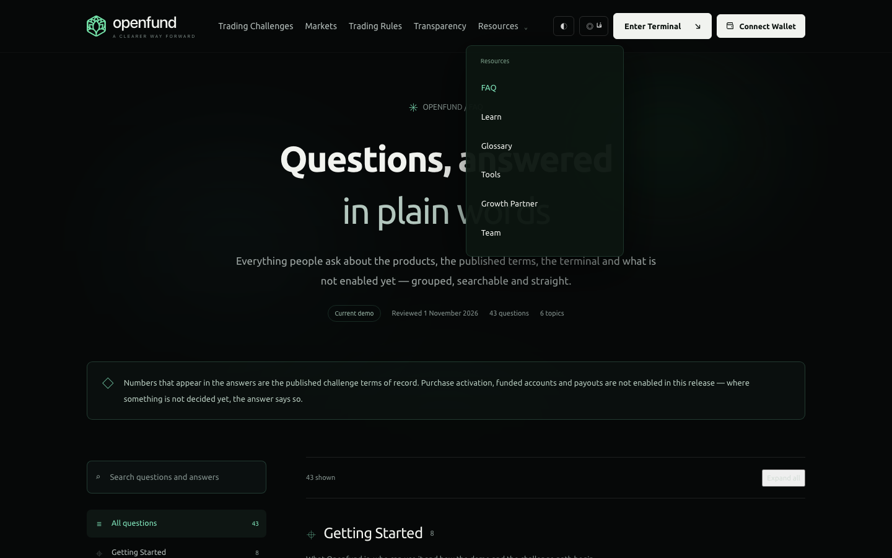
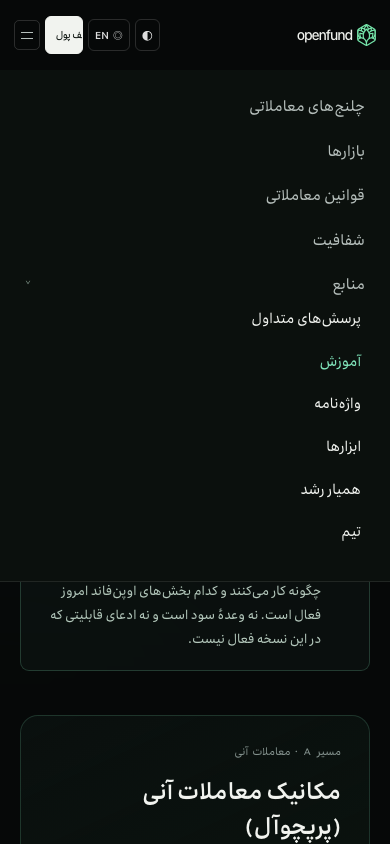

# Website navigation and routing repair

Baseline: latest merged `main`, `c8a8dea`, including PR #33 and the CI/security-only PR #34. The navigation audit began at `0a4cfcb`; the later baseline update changes no frontend code. Work is isolated on `codex/website-navigation`. No terminal, wallet, backend, database, CMS content, page copy or generated Vela files are changed.

## Audit and implementation

The router in `apps/web-react/src/main.tsx` is the route authority. Public localized routes are:

- `/:locale/home`, `challenges`, `markets`, `rulebook`, `transparency`, `faq`, `tools`, `learn`, `referral`.
- `/:locale/faq/q/:key`.
- `/:locale/tools/:slug`.
- `/:locale/learn/paths/:slug`, `learn/lessons/:slug`, `learn/glossary`, `learn/glossary/:slug`.
- `/:locale/ref/:code` is the existing attribution entry redirect, not a website section to add to menus.
- Root and single-segment legacy hash aliases are existing migration routes. Product application routes remain separate and unchanged.

`InformationShell.Chrome` supplies the modern public header and footer. Challenges uses `Landing` and legacy scripts with the same source header/footer markup. Previously these two consumers rendered different navigation: Challenges omitted Resources; its legacy footer mapped newer CMS destinations to Challenges; modern footer section links attempted to scroll into sections absent from the current page; partial CMS menus hid existing sections; the Resources trigger navigated to FAQ instead of acting as a disclosure; tablet CSS hid its children; language switching discarded query parameters; the brandbook URL referred to an unserved React download directory.

Both consumers now call one navigation renderer. Existing CMS navigation labels remain usable, missing structural destinations are filled, duplicate footer destinations are removed (including the legacy accounts/Challenges alias), and the fixed four primary items remain flat. Resources contains FAQ, Learning, Glossary, Tools, Growth Partner and Team. It retains the existing dropdown appearance, bridge between trigger and submenu, LTR/RTL alignment and mobile group presentation. Its native button supports click/touch, Enter/Space, arrows, Home/End and Escape; links retain native browser navigation. The mobile list scrolls when needed. Section highlighting distinguishes a descendant from the exact current page.

Home now exposes the shared navigation as requested; its body, layout and no-footer behavior are preserved. Team targets the existing Challenges section with a localized, bookmarkable query parameter; no Team page is invented. Challenges language switching updates the router while retaining that parameter. The brandbook link imports the existing archive so Vite emits the actual download asset.

## Corrected destinations and tested chrome links

Persian labels are preserved in the application navigation dictionaries and verified in browser results. All localized route links use `/react/#/{locale}/…`, with `{locale}` equal to `fa` or `en`. Labels below are structural defaults; published CMS navigation labels continue to apply.

| Link | Default English label | Destination | Placement |
| --- | --- | --- | --- |
| Brand | Openfund home | `home` | Header, footer |
| Challenges | Trading Challenges | `challenges` | Header, footer |
| Markets | Markets | `markets` | Header, footer |
| Rules | Trading Rules | `rulebook` | Header, footer |
| Transparency | Transparency | `transparency` | Header, footer |
| Resources | Resources | Disclosure button; no navigation | Header |
| FAQ | FAQ | `faq` | Resources, footer |
| Learning | Learn | `learn` | Resources, footer |
| Glossary | Glossary | `learn/glossary` | Resources, footer |
| Tools | Tools | `tools` | Resources, footer |
| Partner | Growth Partner | `referral` | Resources, footer |
| Team | Team | `challenges?section=team` | Resources, footer |
| CMS accounts alias | Published label | `challenges?section=accounts` | Footer when configured |
| CMS FAQ section alias | Published label | `faq` | Footer when configured; deduplicated against FAQ |
| CMS Team section alias | Published label | `challenges?section=team` | Footer when configured; deduplicated against Team |
| Terminal CTA | Existing localized label | `prop/trade` | Header; destination only, no terminal behavior changed |
| Brandbook | Existing localized label | Existing archive emitted as a Vite asset | Footer |
| Back to top | Back to top ↑ | Local `#top` | Footer |
| GitHub | Published label | `https://github.com/algomanlife/openfund` | Footer when configured |
| Gains credit | Existing localized label | `https://gains.trade` | Footer, unchanged |
| Vela credit | Existing localized label | `https://github.com/LuxAlgo/Vela` | Footer, unchanged |
| Render credit | Existing localized label | `https://render.com` | Footer, unchanged |

External links retain their intended new-tab and `noopener` behavior. External service availability is not a routing acceptance claim.

## Exact files changed

- `apps/web-react/src/features/information/navigation.ts`: shared navigation rendering, destination normalization, disclosure interaction.
- `apps/web-react/src/features/information/InformationShell.tsx`: use the renderer, preserve language-switch query parameters.
- `apps/web-react/src/features/information/information.css`: minimum disclosure, tablet/mobile, focus and directional navigation rules.
- `apps/web-react/src/features/home/Home.tsx`: enable existing shared header navigation.
- `apps/web-react/src/pages/Landing.tsx`: reuse navigation, retain localized section routes and handle section scrolling.
- `apps/web-react/test/website-expansion.test.mjs`: navigation regression checks in the existing frontend/CI test suite.
- `e2e/test-website-navigation.cjs`: repeatable browser acceptance and public-link audit.
- `CHANGELOG.md`: scoped fix entry.
- `docs/reviews/website-navigation/DELIVERY.md`, `validation.json`, `navigation-en-desktop.png`, `navigation-fa-mobile.png`: exact inventory, verification evidence and genuine screenshots.

## Validation

Local production-preview verification passed:

- Frontend TypeScript check: passed.
- Existing frontend suite plus navigation regressions: 70 tests passed.
- Vite production frontend build: passed; existing dependency annotation and chunk-size warnings remain.
- Documentation checks and Render Blueprint validation: passed.
- Header/footer website link clicks: 620 successful clicks across 14 page types in both locales. This exercised a superset of the final footer links; the redundant accounts/Challenges entry was subsequently collapsed and covered by the regression suite.
- Public content routes: 266 localized URLs (133 per language), with no unexpected redirects, missing content pages or unresolved internal route/anchor destinations. Three existing installer placeholders per locale are recorded separately below.
- Keyboard, mouse hover, language switching and tablet/mobile cases: 10 source/locale cases, at 1440px, 900px and 390px.
- Touch and keyboard activation/section-preservation checks: 14 cases, including real touch-capable browser contexts, Enter/Space and localized Team section switching.
- Ancillary checks: both languages on FAQ and Challenges for back-to-top, preserved external-link attributes and the terminal CTA destination, plus preservation of a nested-tool query during a language switch.
- Brandbook download: HTTP 200 and a genuine ZIP signature.

The final footer deduplication and legacy mobile toggle use the same destinations tested by the click matrix; final-build interaction and full route checks were rerun. Detailed public-only inventories are in [validation.json](validation.json).





Run against a production preview with:

```sh
TEST_FRONTEND_URL=http://127.0.0.1:5187/react/ node e2e/test-website-navigation.cjs
```

The script writes inspectable results to `output/playwright/navigation-all-results.json`. Optional `NAVIGATION_PHASE=desktop`, `interactions`, `routes`, `touch` or `ancillary` runs a single phase. Routes are enumerated from the existing bundled content contracts, not invented slugs. Tests cover every header/footer website destination from Home, Challenges, Markets, Trading Rules, Transparency, FAQ, a question permalink, Learning, a learning path, a lesson, Glossary, Tools, an individual tool and Growth Partner in both languages. Keyboard, hover, mobile/tablet and language-switch checks cover both page systems and nested pages. Home intentionally has no footer.

The asset check requires an HTTP 200 response whose body starts with the ZIP signature. No deployment is implied. Production builds write outside tracked `react/`, bypassing the chart-generation prebuild to honor the prohibition on generated Vela changes.

## Unresolved and out-of-scope links

The Challenges page body has three pre-existing desktop-download placeholders (`href="#"`) for Windows, macOS and Linux. No existing installer destinations were found. These are unchanged because page-body/download functionality is outside this navigation-only request; inventing URLs would violate the route-source requirement. Header/footer placeholders are not retained.

Backend/database tests are not run: no backend behavior or schema changes are included. Production deployment and external service availability are not verified by this local navigation PR.
