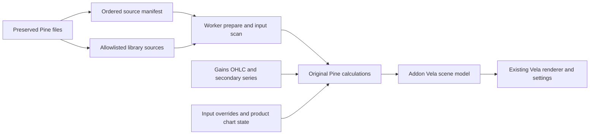

# Pine Script runtime architecture

## Components and versions

The existing **Vela 0.9.3** source remains the chart foundation. The application installs **@luxalgo/vela-pinets 0.3.2** and **pinets 0.13.1**, pinned in the web lockfile. Vela defines the public `ScriptingEngine` port; the official addon implements parsing/execution and conversion to Vela's scene model. Browser computation runs in the addon's hosted worker. No Pine runtime is imported into the Apache-licensed Vela core.

## Dependency resolution

[pine-sources.mjs](../../packages/openfund-charts/src/pine-sources.mjs) preserves source files and transforms only the two exact Open Algo import declarations:

| Original ID | Local resolver ID | Supplied source | Referenced API |
| --- | --- | --- | --- |
| `ayvaliktrading/EyopsTelegram/1` | `openfund/Overlayslibrary/1` | `Overlayslibrary.pine` | `LAF.getSmartTrail(10, 4, 8)` |
| `ayvaliktrading/JoinUsEyopsTelegram/1` | `openfund/sdk/1` | `sdk.pine` | `kernels` is unused |

The allowlist embeds both original library sources. It rejects unregistered/missing IDs. PineTS links declarations through its own library resolver and compiler; no relative-import syntax or textual inlining of function bodies is invented. The kernel library's demonstration plots do not become a selectable study. The selected linker includes referenced declarations rather than executing library examples as independent indicators.

No external library types or constants are accessed. There are no exported types/constants in either local library. `supertrend` and `vector` are private UDTs in Overlayslibrary. No other `LAF.*` or `kernels.*` access exists in the supplied Open Algo source.

## Supplied export inventory

Return types below describe the original Pine expressions; only `getSmartTrail` is required by the three registered indicators. Unused exports have been inventoried, not certified by runtime execution of every branch.

| Library / export | Arguments | Return / state and history |
| --- | --- | --- |
| Overlays / `getVolatilityMetric` | none | float series; ATR(10), stdev/SMA(20), volume RMA(21) |
| Overlays / `getTrendCatcher` | none | `[float, color]`; persistent trend/extremes/up/down, previous bars, ATR(100), SMA |
| Overlays / `getTrendTracer` | none | `[float, color]`; recursive AFR/color state and previous two values, ATR(21) |
| Overlays / `getTPSLBoxes` | `float mult` | three float distances; private `pred_ranges` retains average/ATR state, ATR(200) |
| Overlays / `getTrendStrengthMetric` | `int length, string smoType1, int smooth, string smoType2` | float RSI-minus-signal series; configurable MA smoothing, historical extrema |
| Overlays / `getSmartTrail` | `int ATRPeriod, int ATRFactor, int smoothing` | `[float line1, float Fib2, string state]`; recursive Wilder MA, TrendUp/Down/Trend and extrema; previous OHLC/series, SMA smoothing |
| Overlays / `getSqueezeMetric` | `int conv, int length` | float series; persistent max/min envelopes, log spread and historical correlation |
| Overlays / `getSignalClassification` | `simple int length, int minMult, int maxMult, float step, int perfAlpha, int maxIter, int maxData` | float classification; persistent UDT arrays, ATR/performance history and iterative clustering |
| SDK / `rationalQuadratic` | `series float _src, simple int _lookback, simple float _relativeWeight, simple int startAtBar` | float weighted series; historical indexes `0..array.size(array.from(_src))+startAtBar` inclusive |
| SDK / `gaussian` | `series float _src, simple int _lookback, simple int startAtBar` | float weighted series; same historical loop |
| SDK / `periodic` | `series float _src, simple int _lookback, simple int _period, simple int startAtBar` | float weighted series; same historical loop |
| SDK / `locallyPeriodic` | `series float _src, simple int _lookback, simple int _period, simple int startAtBar` | float weighted series; same historical loop |

Smart Trail receives `(10,4,8)` unchanged. It returns a smoothed trail, a smoothed 78.6% level and `long`/`short` state. Open Algo discards the middle tuple member in its existing assignment. Historical warm-up, `na` handling and source defaults are unchanged. The previous external-library contents are not supplied, so tests compare original import IDs resolved to the supplied libraries against the localized IDs; they do not claim a comparison against remote library implementations.

## PAC compatibility correction

The pinned runtime's request-slicing optimization truncates the secondary program before PAC's nested `getTFData -> reqSeq -> request.security` invocation. With actual secondary candles, the requested expression is absent from the secondary parameter store, causing `Cannot read properties of undefined`.

[pine-compatibility.mjs](../../packages/openfund-charts/src/pine-compatibility.mjs) disables the optimization only for this recognized PAC source. PineTS then uses its existing full-script secondary execution path. No indicator statement, input, return, historical operation or mathematical formula is changed. The build extracts the pinned addon's worker, inserts this compatibility function before message handling and emits a hosted worker. Structural guards fail if the upstream worker layout changes. Upgrade this integration deliberately; do not blindly change versions.

## Data, historical and live execution

The workspace owns bars, cancellation/generation handling and the cache. It passes main-series OHLC, metadata and `fetchSeries` to the engine. Secondary requests remain on the Gains provider. Pine minute IDs (`1`, `5`, `15`, `30`, `60`, `240`, `D`) drive the toolbar. Aliases and numeric resolutions resolve without conflating lowercase minutes with uppercase calendar months.

The provider fetches genuine base candles for additional intraday multiples and UTC Monday weeks/calendar months, then applies standard OHLC aggregation. It neither fabricates missing candles nor reconstructs volume. Current candles retain their historical open/high/low when live marks arrive. The wrapper maps absent volume to `NaN` before the addon's zero-default conversion. Workers stop and terminate with their host controller.

## Verified surface and limits

| Construct | Current evidence / limitation |
| --- | --- |
| Pine v5, functions/methods, tuples, series/history | All three original scripts execute; differential Open Algo and Smart Trail output tests |
| `var`, `varip`, arrays, UDTs | Exercised by original scripts and browser live execution; universal semantic parity is not claimed |
| Inputs, defaults, groups/options, edits | 79/49/52 schemas; existing Vela settings and persistence |
| Plots, fills, candles/colors, lines, labels, boxes, tables | Original script scenes render through official adapters; optional combinations need broader acceptance |
| Overlay/subpane | Official engine/renderer contract retained; supplied studies are overlays |
| `request.security`, `security_lower_tf` | Provider-backed; PAC requires full secondary execution; available history and supported resolutions constrain results |
| Incremental live updates | Official worker sessions, market-change recalculation and browser tests; prolonged/live reconnect soak is not certified |
| Matrices | Runtime contains matrix APIs, but these scripts do not require them; not independently validated |
| Genuine volume and volume-based order-block metrics | Unavailable from current Gains candles; preserved as `na` |
| Financial/earnings/economic/depth requests | No provider integration or support claim |
| Full Pine language / reference-platform equivalence | Not certified; no independent authoritative output dataset supplied |

## Build, licenses and references

`npm run build:web` rebuilds the shared workspace and hosted worker before Vite copies public assets. Render already installs web devDependencies; no service, secret or Blueprint change is required. Generated classic `dist/` and React public chart bundles remain synchronized. Root orchestration has no runtime dependencies.

Vela remains Apache-2.0 with its [NOTICE](../../vendor/vela/NOTICE) intact. Its attribution requirement is satisfied by the visible linked Vela notice in terminal status; the chart footer and native picker badges are removed. PineTS and the addon are AGPL-3.0; their license copies ship under public `assets/notices/`. Keep corresponding source availability and distribution obligations with deployed releases. The supplied Pine sources are client-delivered code and must not be treated as server secrets.

Primary references: [Vela scripting engines](https://docs.luxalgo.com/vela/user/scripting-engines), [addon source](https://github.com/LuxAlgo/Vela-pinets), [PineTS library resolution](https://luxalgo.github.io/PineTS/libraries/). [Validation evidence](../reviews/vela-pine/DELIVERY.md) records the exact local checks and remaining limits.
