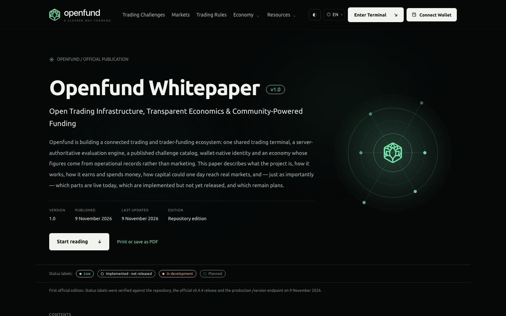
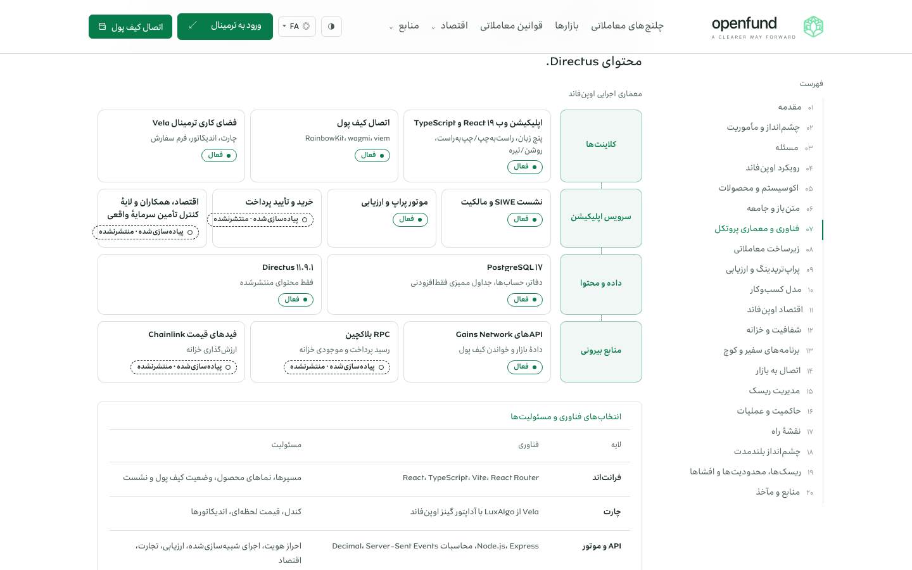

# Openfund Whitepaper v1.0

The official Openfund Whitepaper is a single, anchor-navigated page at `/{locale}/whitepaper`. It is a living publication managed in Directus. It explains the ecosystem, architecture, prop evaluation, business model, economics, treasury transparency, partner programs, Live Market Access, governance, roadmap and disclosures. Every capability carries a status label verified against this repository. [ADR 0016](../decisions/0016-cms-managed-whitepaper.md) records the design decision.

## Route and navigation

| Item | Behavior |
| --- | --- |
| Route | `/:locale/whitepaper` in [main.tsx](../../apps/web-react/src/main.tsx); clean URL, no `/react` prefix; indexable through [seoHead.ts](../../apps/web-react/src/features/loading/seoHead.ts) with canonical and `hreflang` alternates |
| Footer | The existing disabled "Whitepaper · coming soon" document button in [landing-body.html](../../apps/web-react/src/pages/landing-body.html) is now one `data-doc-link="whitepaper"` link. [navigation.ts](../../apps/web-react/src/features/information/navigation.ts) sets its locale-aware href and label on every public footer, including the classic Challenges landing. The brandbook and protocol-proposal entries are unchanged. |
| Chapters | Twenty sections with stable anchors (`#introduction` … `#references`). A sticky table of contents (desktop) or a collapsible chapter navigator (≤ 1050 px) highlights the active chapter. Chapter links push a history entry, so Back and Forward move between chapters. Each chapter has a copy-link control. |
| Locales | Persian and English editorial content. Arabic, Russian and Simplified Chinese show the English edition with the established localized notice, and their canonical URL is the English page. |
| Themes | Only the shared public tokens (`--bg`, `--surface`, `--mint`, `--white`, `--body`, `--muted`, `--line`), so dark and light both apply; reduced motion disables transitions and smooth scrolling. |
| Print | Print CSS removes site chrome and controls and prints chart data tables and reference URLs. |
| Metadata | Title and description from the document SEO fields, Open Graph `article`, and `TechArticle` JSON-LD with version and dates. |

## Content model

Source files: [types](../../apps/web-react/src/cms/whitepaper/types.ts), [schema](../../apps/web-react/src/cms/whitepaper/schema.ts), [client](../../apps/web-react/src/cms/whitepaper/client.ts), [Directus rows](../../apps/web-react/src/cms/whitepaper/directus.ts) and the [repository edition](../../apps/web-react/src/cms/seed/whitepaper/index.ts).

| Collection | Holds | Translated fields |
| --- | --- | --- |
| `whitepaper_documents` | `slug` (`openfund-whitepaper`), `version`, `published_on`, `updated_on`, `status` | `title`, `subtitle`, `abstract`, `revision_note`, `seo_title`, `seo_description` |
| `whitepaper_chapters` | `document`, `slug` (anchor), `sort`, `status` | `kicker`, `title`, `summary`, `blocks` (JSON) |
| `whitepaper_datasets` | `key`, `kind` (`waterfall`, `bars`, `stacked`), `unit` (`usd`, `pct`), `data` (numbers only), `sources`, `status` | `title`, `caption`, `note`, `labels` |
| `whitepaper_references` | `key`, `kind`, `title`, `publisher`, `url` (https), `published_on`, `accessed_on`, `status` | `note` |

### Block types

Each chapter translation stores the same block list in the same order. The client pairs the `fa` and `en` lists by index. Non-localized values must be identical in both locales: block types, statuses, dataset keys, reference keys, image URLs and statistic values.

| Type | Purpose |
| --- | --- |
| `lead`, `p`, `h3`, `list`, `quote` | Editorial prose and highlighted key statements |
| `callout` | `info`, `principle`, `warning` or `risk` notice |
| `features` | Card grid, optionally with a status label |
| `stats`, `definitions` | Statistic display and term definitions |
| `table`, `mapping` | Data tables; three-column problem → approach → outcome map |
| `flow`, `architecture` | Workflow and layered architecture diagrams with status labels |
| `timeline` | Roadmap milestones (`completed`, `in_progress`, `planned`, `research`) |
| `chart` | A dataset by key; `interactive: true` adds hypothetical sliders to a waterfall |
| `pricing` | Renders the challenge catalog itself (Directus `challenge_plans` or the repository catalog). Prices are never typed into the text. |
| `image`, `faq`, `refs` | Lazy image (allow-listed URL), questions and answers, source references |

Capability statuses are `live` (in the official release running in production), `implemented` (code and tests exist; not released or activated), `development` and `planned`.

## Validation and publishing

- The public client requests published rows only. The Directus public policy reads published parents, and translation rows only of published parents ([apply_schema.py](../../apps/backstage/scripts/apply_schema.py)).
- Every block is validated against one schema. Unknown types, missing translations, divergent non-localized values, non-numeric chart values and non-https or unsafe URLs reject the CMS edition. The page then renders the repository edition as a whole, never a mixture.
- An edition must keep the `disclosures` and `references` chapters. Datasets and references must cover every key the chapters use.
- Text is rendered as React text nodes; no CMS HTML is injected.
- New rows default to `draft`. Editors review in the Data Studio and set `published`. Changes appear on the next page load without a frontend build.
- Draft preview on the public page is not supported: the public API never serves drafts. Editors review drafts in the Data Studio or on a local or staging deployment that points at the same CMS.
- The page shows which edition is in use (Openfund CMS or repository edition).

## Seeding

[seed_whitepaper_content.mjs](../../apps/backstage/scripts/seed_whitepaper_content.mjs) uploads the repository edition. It is step 7 of [bootstrap-cms.sh](../../apps/backstage/scripts/bootstrap-cms.sh).

```bash
node apps/backstage/scripts/seed_whitepaper_content.mjs --dry-run
```

`--dry-run` validates the exact rows offline and runs in CI. A real run reads `DIRECTUS_URL`, `DIRECTUS_ADMIN_EMAIL` and `DIRECTUS_ADMIN_PASSWORD` from the environment. It is idempotent by natural key and keeps editorial changes unless `--refresh` is passed. `--draft` creates new rows as drafts. Apply `apply_schema.py` first.

## Editorial rules

- Classify every capability against [Feature Status](../product/FEATURE_STATUS.md) and the production `/version` endpoint. Never label anything `live` that is not in the official release running in production.
- Label scenarios as hypothetical in the dataset note. Real company figures belong only on the Transparency page.
- Profit-share tiers remain proposals until management approves a policy.
- Do not add investors, partnerships, user counts, volumes, registrations, licences, tokens or governance rights that are not established.
- Each reference needs an https URL, a publisher and an access date. Industry figures keep their own definitions.
- When a capability changes state, update the chapter, the `updated_on` date and the revision note.

## Captures

Genuine local captures (feature branch, Vite development server, repository edition) are listed with provenance under `whitepaperV1` in the [screenshot manifest](../assets/screenshots/manifest.json).





## Tests

`npm --prefix apps/web-react run test:whitepaper` ([whitepaper.test.mjs](../../apps/web-react/test/whitepaper.test.mjs)) covers bilingual completeness, schema validation, the seed → CMS → parser round trip, rejection of incomplete or unsafe editions, waterfall arithmetic, profit-share constraints, catalog-derived pricing, approved policy statements, status discipline, the footer link and route registration.

[Documentation index](../README.md) · [Content model](../backstage/CONTENT_MODEL.md)
